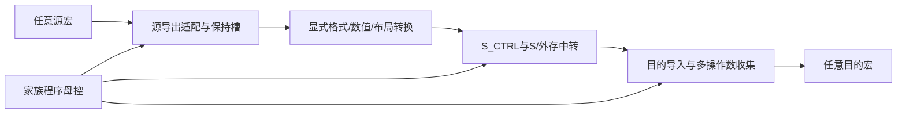

# 有限模型家族内的七宏全合法连接规格 v0.4

> 当前执行前三步的范围已收敛为仓库八样本、保守规模估计与**无外存片上合同**。当前准入见[工作报告](STEPS_1_3_WORK_REPORT.md)、[样本域](SAMPLE_MODEL_FAMILY_SPEC.md)、[角色账本](SAMPLE_LEGAL_CONNECTION_LEDGER.md)及[片上合同](SAMPLE_ONCHIP_SYSTEM_CONTRACT.md)。下文保留总体/历史方案，涉及外存的候选不属于当前阶段，不允许自动spill，也不意味着新增片上容量已经存在。

任务[Issue151](https://github.com/rayggxia-workspace/LLMHardwareDesign/issues/151)，交付[PR152](https://github.com/rayggxia-workspace/LLMHardwareDesign/pull/152)。本文是待评审设计，新增连接层、控制与数值服务尚未实现。设计父版本36f9c9db，七宏RTL继续使用已导入PR144的643c6012固定字节；当前能力见[原生接口审计](RTL_NATIVE_CONNECTION_AUDIT.md)。

## 1. 用户确认的目标与范围

用户明确要求：支持的不能只有Attention、额外Norm、FFN、GDN、SSM、MoE六条固定链，而应打通所有允许的连接组合；成品流程由M11/M12永久绑定，不依赖启动装载控制程序；可以假设只有有限的大模型类型。

据此定义目标为：**在预先声明的有限模型家族、原生算子/数值profile、形状与资源边界内，每条语义合法数据边都有可组合实现方案；每个受支持产品的完整控制图都可由预制控制能力表达，并在M11/M12永久绑定。** 六类算法只是回归集，不能作为合法边的白名单。

“有限类型”不等于任意同名模型都已支持。家族目录还要声明层结构/可选分支、形状范围、数值格式、允许算子、循环和状态规则。超出目录的结构需要补充能力/新底座；尚在目录内但缺实现的合法连接必须保留为gap，不能改成非法来提高完成率。当前八样本仅是目录输入，家族全集、变体边界、完整控制程序与ROM预算尚未冻结。

## 2. 分开记录五种判断

| 判断 | 定义 | 当前不能混淆的事实 |
| --- | --- | --- |
| semantic_legal | 源/目的角色、数学含义、单位、范围和算子合同相容 | 缺适配器不使数学合法边自动非法 |
| recipe_defined | 已有明确的导出、转换、传输、导入及事件顺序 | 一条设计配方不代表RTL存在 |
| resource_mapping | 指定实例/存储/程序容量和物理路线能承载该图 | 容量不足标映射gap；不是所有尺寸都无限支持 |
| rtl_implemented / verified | 对应新逻辑已经编码并通过规定功能测试 | 单宏测试、静态表完整均不能替代组合测试 |
| physical_qualified | 该版本/负载/路径通过组合时序和物理门 | 叶宏资格不能转给新连接层 |

合法性以版本化规则定义，不能用`semantic_legal = rtl_implemented`。编译产品时若有合法gap，输出具体缺项并拒绝发布该产品；连接能力账本保留它，等待补齐。运行时不会接受尚未实现的profile。

## 3. 覆盖单元是角色到角色，不只是宏名

一条连接记录至少为：`源实例/结果角色 → 目的实例/输入角色，element_type，Fin/Fout，layout，shape范围，转换/舍入/饱和，版本，存储区，路径，生命周期，完成事件`。完整原生数据/受控参数角色及P01–P15适配族见[角色与profile目录](LEGAL_CONNECTION_PROFILES.md)，包括S写回显、loader A/B以及G gated/ungated的分别处置。

| 宏 | 必须分类的源角色 | 必须分类的目的角色 |
| --- | --- | --- |
| M | op3两S64、op5四S32容器、op12诊断partial；另有非payload应答 | A的S8/S16行、B的S8/S16 n-major块；scale/EXEC等属于控制参数 |
| N | Norm S16、EXP U16、概率Q14、TopK ID、stats结构、factor | 统计原值、EXP的score回放、Norm原值/gamma、Softmax EXP回放、score/ID记录 |
| E | 普通8S16、op12紧凑8S8、op13低64bit4S16 | A/B/C的S16操作角色；op13 A的4S32特殊解释 |
| G | 根据fn/gated决定格式的2S16输出 | 激活x与线性gate两个不同角色 |
| R | 候选8S32输出、active state、active history、meta | state/x/inject/history、key/query/taps、decay/beta/element_decay、skip |
| S | 带外部类型描述的128bit存储字，loader A/B | 普通整字写、loader描述符；不能靠字节猜类型 |
| T | 保留原生产者类型/有效数的顺序批次 | 已预留租约的顺序128bit写，不是任意随机地址RAM |

配置应答、错误、busy和COMMIT确认进入控制/状态事件通路，不能伪装成数值向量送下游。stats/meta等结构可原样存储，也可经显式FIELD_EXTRACT提取字段后再判断用途。TopK ID需gather或明确的ID_AS_INT数值语义；不能默认转成score。EXP回放必须绑定同一N上下文，不能通过改type_id冒充最终概率。诊断partial不默认进入产品数学图，若使用须有明确算法语义和有效性证明。

## 4. 因子化的连接层

主候选不是为49类宏对各写一颗bridge，而是复用“每源导出适配＋有类型存储传输＋每目的导入适配”。

所有框中MUX、队列、寄存器、地址生成器、数值单元及局部FSM均须预制。S内loader保留为M导入的专用实现。外存服务是实际接口/存储/错误合同，不是概念上的无限缓存。首版允许串行、物化交接，不承诺任意边同时满带宽。高频直连旁路以后单独加速，须保留相同类型/事件合同。

每条路线的最低步骤：保留目的和临时空间→源导出→必要转换/布局→中转写确认→导入全部操作数→目的执行/接收→发布结果→最后引用释放。S自身源/目的也经过唯一S服务，避免自己持有响应槽又等待无法发出的下一访问。

S.LOADER_A/B作为通用导出源时，首版继续沿用loader与普通S访问串行，但必须新增**整描述符spool**：在接受load前保留最大A 8row×4tile×16B=512B及B S16 4tile×128B=512B，合计最多1024B独立payload暂存，另计元数据。先接完A/B并取得loader done，再经普通口写回S；仅使用A或B时，另一支也要按描述符排空/显式丢弃。不能用两个小槽等S写腾空间，否则会出现槽满→loader不done→普通S写被串行锁阻止的死锁。export_mode须预制A/B valid/ready选路，不标记M输入bank已装好；普通M导入模式仍由S loader唯一提供M payload。该spool/选路是新增候选，不是S现有192B loader队列。

普通S读/写回显也先进入已预留响应槽再take，释放S端服务后才等待下游；不能持有一个S响应等待仍需读取其他S操作数的JOIN。若以后以可重入宽/窄调度替代spool，需独立证明无饥饿和容量，不能在当前串行规则下默认为可行。

S中转不是无源全互连：需真实的请求仲裁、数据MUX、响应归属、保持槽与回程线。多个输出即使错时使用也不能短接；M11/M12不增加这些有源电路。数据与控制路径可在预制阶段固定，在定制层接入预留端点；具体实例路线、驱动/负载、长线中继和拥塞仍须验证。

## 5. 7×7有向索引及其含义

下表每格表示“有条件合法的角色配方需覆盖”，**不是已完成、不是任意格式裸连、不是49条物理专线**。B=经存储和端点适配；L=复用S loader导入M；C=存储复制；R=同实例重入有额外生命周期。

| 源＼目的 | M | N | E | G | R | S | T |
| --- | --- | --- | --- | --- | --- | --- | --- |
| M | B/L/R | B | B | B | B | B | B |
| N | B/L | B/R | B | B | B | B | B |
| E | B/L | B | B/R | B | B | B | B |
| G | B/L | B | B | B/R | B | B | B |
| R | B/L | B | B | B | B/R | B | B |
| S | L | B | B | B | B | C | B |
| T | B/L | B | B | B | B | B | B/R |

49格只是完整性入口。每格再按第3节角色、类型/尺度、拓扑和协议下钻；有效组合由规则生成，禁止组合给出理由，未决数值/缺失服务标gap。不能从每格一个冒烟例推断全profile覆盖。

每格required_services仅是宏类别的最低粗索引，不是该格全部角色的服务全集；逐角色/参数recipe尚未完整实例化，不能拿49个数组当覆盖分母。

当前机器目录[all-legal-connection-contract.json](../work/Melodydt/151/all-legal-connection-contract.json)保留49格、数据角色、配方服务与7种同类重入规则，**全部新系统路线仍为planned/unverified**；已有S loader等原语另外记录，不将其提升成整格完成。

## 6. 必须具备的可组合原语

| 原语/服务 | 覆盖职责 | 实现边界 |
| --- | --- | --- |
| EXPORT / IMPORT | 原生握手/命令、结果过滤、标签、busy与上下文区分 | 原生单宏口已有，通用外侧适配待实现 |
| PACK / UNPACK / CAST | S8/S16/S32/S64容器、lane顺序、显式Fin/Fout | E12/E13仅覆盖部分；符号扩展/宽输出/宽转换需补逻辑 |
| COPY / SLICE / CONCAT / LAYOUT | 复制、切分、拼接、转置、M n-major、RoPE配对、padding | 不是E已有的通用opcode，需有界搬运器与地址生成 |
| FORK / JOIN | 只读共享、引用计数、同task/epoch/range/version配对 | E/G同命令多输入锁存不能代替分支管理 |
| REPLAY / REDUCE_CONTEXT | N整组统计/原值、gamma、EXP回放与总长 | N不存整向量、无expected_total、无mask |
| GATHER | TopK ID→原score/专家参数/权重地址 | ID表、越界/重复策略、rank绑定待实现 |
| NUM_CONVERT | 当前E/M不能表达的宽度/尺度转换 | 合法S64下游需求保留gap，不能因没有E64就删除 |
| NUM_COEFF / NUM_WACC | 算法系数及宽归并 | 算术能力，不是纯搬运；需范围/误差和物理预算 |
| STATE_VERSION / TXN_BATCH | R跨tile旧/新版本、T批次、发布和恢复 | R/T内部局部事务已有，跨宏版本/故障协议待实现 |

宽转换profile至少声明`src_bits,dst_bits,signed,Fin,Fout,shift,rounding,overflow_policy`。右移进行明确定义RNE；左移先扩展到足够宽并验证范围，禁止截断后再检查；S64最小负数的绝对值/移位也要在足够宽域处理。E13只接受4S32，不能把op3两S64拆成四S32。若范围证明允许，M op5可以作为S64结果到S32的已有量化出口，但有shift/饱和限制，不能因此宣称所有S64转换已覆盖。

普通数值转换不创造算法语义：EXP→概率仍需要N归一化，ID→score需要gather，R decay/inject需系数计算。无损重打包与有损量化分开登记；数值质量未接受时仍是合法设计gap。

## 7. 串接以外的拓扑也必须覆盖

| 拓扑 | 最低可实现策略 | 需拒绝/报告的错误 |
| --- | --- | --- |
| 一对一串接 | typed handle＋目的预留＋写确认 | 结果未读出或未保存就覆盖源 |
| 一对多fork | 源物化一次，每消费者独立handle/完成，最后引用释放 | 直接共用一个take、任一消费者消费就释放 |
| 多对一join | 收集同任务/版本/位置的全部输入，再向E/G等发命令 | 仅valid相与、分支角色交换或丢掉早到数据 |
| 有界链/重排 | 原语串接、物化屏障、编译后的局部命令 | 相同总线宽度即认为布局/尺度一致 |
| 自回环/迭代 | 有状态延迟、明确迭代次数/初始版本，串行重用资源 | 零延迟ready环、无初始token、无限未定义循环 |
| 多实例同类 | 实例ID、独立租约/存储、具体物理路径 | 宏类型相同就假定实例自动互通 |

同实例须区分RESUME与REENTER_NEW_CONTEXT：RESUME保持同一lease并按原生guard继续阶段，N同组继续STATS/回放、R pending_history下补x/参数并执行状态步骤可以不先关闭context；新BEGIN/OPEN才要求处理旧上下文。M结果覆盖前先保存，跨K同一结果链按guard续算；N新BEGIN前完成旧组；E/G排空在途输出或保留可归属标签；R新OPEN前保存所需输出并完成commit/revoke，不能pending时OPEN。S→S复制需定义重叠时的memmove方向或临时区。T→T不能一边读旧租约一边在同一T BEGIN新租约：先将整批暂存S/外存并确认，读完release，再以新generation BEGIN/回装；这是合法但需要存储/控制的路径。不同T实例可源读到目的写，但不因此具有联合原子性。

允许反馈不要求通用运行时DAG调度。固定程序可以表达有界迭代；每次迭代内依赖须可排定，跨迭代state/handle有明确延迟与版本。资源不足报告映射gap，不能悄悄覆盖活跃数据。

## 8. 有限家族的控制覆盖与M11/M12绑定

主候选继续采用两级：MODEL_CTRL执行有限家族程序/有界循环/等待；每资源_CTRL展开原生握手，端口所有者不变。程序调用第6节通用原语，六算法模板可以复用，但不作为调度器唯一能执行的六种“超级指令”。控制原语、有限分支和循环译码在M1–M10真实预制。

局部控须支持阶段可回访的context lease：N可跨调用保持统计/回放组，R候选输出可交外围处理后按原生合法阶段继续或决定commit/revoke。一个整Norm/整GDN任务不能长期占住S服务并阻塞外围，也不能在用户未决定时自动提交R。母控观察阶段事件后调其他资源再RESUME同一lease，所有原生命令仍由唯一owner发出；该扩展不会绕过R pending或N阶段guard。

家族目录至少含`family_id,结构语法/层序变体,允许算子与profile,shape/循环上限,数值策略,路径与存储资源,程序入口/长度,永久参数表布局,验证矩阵`。离线编译器生成完整程序/参数及资源证明。目录未冻结、程序尚未编译，当前不能声称家族控制覆盖完成。

冻结前可共用家族循环程序并预留参数范围，而不必把每个合法长度完全展开成独立代码；但层序、可选分支或专家模式等差异必须被实际译码/表容量覆盖。M11/M12将预制常量源连接到产品选择和参数端，永久决定入口、特征、层表/形状/尺度/布局；所有常量驱动、读表、MUX、寄存器、缓冲和非法配置检查都预制。成品复位只读取已绑定值，不加载控制程序、不提供运行时改图入口。

若有限家族无法由预置程序＋参数表达某个合法产品，其状态为GAP_PROGRAM_COVERAGE，不能凭同一family_id接收。可在冻结前扩大家族ROM/原语，或另评审金属编码的有限控制存储；后一方案也必须预制全部位单元/读出并证明接点、扇出和M11/M12布线，本文不假定现有普通ROM已经支持逐bit顶层编程。启动装载控制存储不符合本次用户选择，不作为当前实施主/备方案。

有限支持范围与全连接目标并不冲突：家族范围限制所需算子与参数域；连接层覆盖域内所有合法组合，而非只验收六个固定序列。连接边覆盖与完整家族程序覆盖分别出账，二者都通过才允许冻结产品。

## 9. 验收与交付标准

1. **规则覆盖**：七宏类型对49格无遗漏；每个源/目的角色有显式处置；类型/格式/数值profile与禁止原因可追溯，未知项保留gap。静态目录完整不等于硬件全覆盖。
2. **原语功能覆盖**：每个export/import、转换、搬运、fork/join/replay/gather、状态/T服务的实际RTL与独立oracle；每profile测边界/尾部/反压/错误/取消。尚缺宽转换、NUM或外存的项不可标通过。
3. **组合覆盖**：合法角色边逐项组合测试，覆盖同实例与多实例；另测长链、分叉汇合、反馈、随机有界合法图和非法图。永久反压不承诺完成，公平性/容量前提须声明；不能靠单一48/49个冒烟例替代profile与活性证明。
4. **控制覆盖**：完整家族程序可编译、循环/参数/层表有上限且无未解析原语，超ROM/存储/路径容量给出诊断。测试程序可用于覆盖连接层，但不是成品运行时可下载程序。
5. **物理覆盖**：同一冻结底座上，选代表性家族及最差路线组合，检查实际接点、驱动/负载、PG/CTS、RC/DRC与M11/M12路由容量。49格逻辑可达不证明所有实例同时全速互连。

FFN8和Softmax257保留为前两个垂直组合，随后逐项填充角色/profile账本，六算法做家族级回归。另设非六模板覆盖图：Q10输入fork，一支E ABS、一支G SiLU，按位置JOIN后E ADD，并经存储延迟做两次有初值迭代；它验证fork/join/同E重入/反馈，而不是新增生产模型类型。还要独立验证S64→S16、stats字段提取、S写ACK-forward、loader B512拆包及T→计算→T整批spool。不能把两个例子通过当作全连接完成，也不能因先实现这两例就把其他合法路径永久排除。

本轮只形成规格、目录和静态一致性核验，见[覆盖验证](../work/Melodydt/151/all-legal-verification.json)。新系统连接、家族完整程序、RTL组合、整数质量/活性证明与物理验收均未完成。R最终资格限制继续有效。
