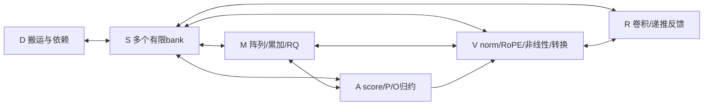

# 算子与Block划分候选 v1：局部归约、分级状态、产品定制连接

2026-10-23（UTC+08:00），Liangruizhi，[Issue41](https://github.com/rayggxia-workspace/LLMHardwareDesign/issues/41)。
这是**分析提出的可证伪候选**，不是已实现IP、最优划分或已验证硬件收益。
承接[共同问题](RESEARCH_QUESTION.md)、[v0方法](OPERATOR_BLOCK_PARTITION.md)、
[架构筛选](MODEL_ARCHITECTURE_REVIEW.md)、[整数合同](INTEGER_PRECISION_CONTRACT.md)及[Issue39实际证据](experiments/issue-39-kv-scale-boundary.md)。
本轮只形成合同、解析记账和实验筛选，不新增模型/RTL/远程实跑，不整合尚未获用户完成通知的兄方结果。

## 1. 明确要切什么

**语义算子**按改变数学函数、状态或格式的位置切：Linear/GEMM、bias、RQ/round/sat、RMS/QK norm、
RoPE、mask/score缩放、softmax、PV、SiLU/GELU、乘门/残差、卷积、递推更新、KV追加/打包。
即使融合执行，这些节点及各自精度仍存在。Qwen的SwiGLU与Gemma的GELU分开，R1 dense蒸馏不替代MoE/MLA。

**调度tile**是这些算子的分块，不直接变成制造Block。**Block**是可反复服务不同层/模型的有源模板，
包括算术、有限本地存储、端口、内部连线、控制和时钟边界。一个Linear可跨多个tile执行，
同一M Block也能分时做QKV、FFN、QK、PV；不为每层、每个语义算子或每个专家制造一块独占硬件。

v1暂选六类模板：**M矩阵、V向量/转换、A注意力归约、R递推状态更新、S存储bank、D搬运/控制**。
其中M/V/S/D作为基础库；A/R是否保持独立物理边界属于后面的D3/D4决策。当前主候选保留A/R局部反馈，
与把相同资源集中到共享V侧的方案对照，尚未决定最终制造库。

制造前固定模板能力/数量、bank/端口、有限FIFO、内部网络、允许的跨块端点及寄存器；
产品确定后只在允许层/预算内选择跨块物理连接；运行时仅改变描述符、tile、路由到已有端点、
mask/window、scale/状态地址和调度，不能每个token改金属或添加乘法器/端口/中继。

## 2. 一份具体但可缩放的库存示例

下面是**一个评估区域**的假设库存，不是芯片总规模或工艺合格宏。参数可扫描，但每组划分配对必须相同。

| 模板/数量 | 计算库存 | 私有RAM | ROM预算 | 外部数据口 |
| --- | --- | ---: | ---: | --- |
| M×1 | 16×16 signed8阵列；一条串行RQ通道 | 32KiB | 0 | 两RX、一TX |
| V×1 | 8条宽算术lane，每lane一个signed8乘法器＋额外i64加/移位；一份除法/开方单元 | 16KiB | 8KiB | 两RX、一TX |
| A×1 | 8条同类宽lane；一份u64 divider、max/sum控制 | 32KiB | 20KiB | 两RX、一TX |
| R×1 | 8条同类宽lane；卷积/状态反馈控制 | 32KiB | 0，非线性借V | 两RX、一TX |
| S×8 | 每bank 32KiB、1RW、128bit；读写同bank串行 | 合计256KiB | 0 | 每bank一RX、一TX，共享同一存储口 |
| D×1 | DMA、描述符/依赖/版本控制；不计作矩阵或向量算力 | 8KiB | 0 | 一RX、一TX，外存服务率另设参数 |

每数据口128bit；每RX/TX各2KiB FIFO，计入30个FIFO共60KiB；私有RAM120KiB、S256KiB、ROM28KiB，
**声明内存共464KiB、signed8乘法器281个**。SRAM编译器粒度/ECC、宽加/比较器、divider/isqrt、
寄存器/mux、布线和时钟面积尚未定，不把这些数称总面积或已有PPA。V/A单端口ROM最多每周期一次查表，
不能因为有8条lane就免费得到8个查表/除法端口。8KiB V ROM仅为预算，GELU实际表/误差合同未冻结。

每数据口还需keep[15:0]、valid/ready/last，合计147根逻辑信号，未含时钟/复位/低速控制；
两RX一TX约441根信号不等于441个已合法落地的宏引脚。单时钟域F待物理确定，吞吐只按cycle参数讨论。
M/V/A/R/S each最多一个命令在途的候选控制由D管理，局部命令寄存器计标准单元；
背压、完成及错误返回使用制造前存在的控制网，不把它作为免费产品后新增资源。

## 3. 每类Block的计算、状态、接口与预连线

### M：保持完整归约语义的矩阵tile

- **计算**：W8A8 GEMM/QK；每个输出完整K归约为checked INT32后才允许RQ。P7×V8直接执行；
  P15×V8候选按3个radix128 digit乘法阶段执行，A侧移位合并；这不是原生单周期INT16 MAC。
  Q/K16若质量需要，将产生更多digit阶段与宽归约，是D1的新合同，尚无阵列实现证据。
- **状态**：两套16×16 INT32 accumulator共2KiB，A双缓冲8KiB、W双缓冲16KiB、
  参数/描述符/余量6KiB，共32KiB。完整模型权重仍在S/外存，不声称常驻。
- **接口**：RX0 A8或明示digit流，RX1 W8/K8/V8；TX选择ACT8/16、SCORE_ACC32或PV_DIGIT_ACC32。
  bias若为INT32，与acc相加后需33位；M31/r0..63、RNE/Sat8或16规则见C1。动态A scale下bias整数也按行变化。
  RQ33尚未由旧RQ32 RTL证明，全部能力保留candidate标签。
- **制造前预连线**：operand buffers→阵列→acc bank→{最终bias/RQ，或typed partial bypass}→TX；
  acc跨K tile反馈在内部固定；同一个TX mux串行发送，不送出后免费取回。接收端必须检查完整K/阶段计数，
  partial不能误标为已经重定标的激活。
- **理由/假设D2**：宽部分和不跨界可省通信，但近端RQ可能拥塞且增加固定面积。主候选RQ近M；
  对照把同一RQ通道移到V，保持通道数/私有存储/数值完全相同，不额外加一套RQ。

### V：保持语义可配置的向量、归一化与格式转换

- **计算**：RMS/QK norm、RoPE/partial RoPE、SiLU、GELU、逐点门/残差、量化scale与格式转换。
  另有保持dtype/bit pattern的copy/pack旁路，仍占用V端口/缓冲与每跳传输服务。
  不将它们视为同一固定函数；effective gamma、epsilon、cast/舍入顺序按模型合同区分。
- **状态**：16KiB行/分块scratch及参数，跨块平方和u48、wide临时值i64；gamma、sin/cos/LUT是有版本的输入。
  C1 gamma16/f14只是已探索格式，Gemma有效gamma不够范围时使用候选gamma32/独立fraction_bits，
  同时增加宽乘次数/带宽；没有实测范围前不固定为免费16位参数。
  同理，旧vector16/f12只能表示约[-8,8)，不能直接覆盖已有Qwen3 K约254的值；
  应在norm/输出转换处选择足够范围的合同，先饱和丢掉的大值不能靠后续scale恢复。
- **接口**：输入ACT8/16、必要时ACC32/33及scale/bias参数；输出Q/K/V8或16、归一化行、门控激活、
  明示的scale/M/r元数据。FP32参考不能直接送入该整数能力口当正常执行；需浮点硬件时另设库存/合同。
- **制造前预连线**：输入缓冲→8lane→{reduce u48/isqrt/divider，ROM，RoPE配对shuffle}→round/sat→输出缓冲；
  residual双输入经同一scale对齐后相加。共享宽乘、查表和divider发生真实仲裁，不假定全部并行。
- **理由/假设D1/D5**：模型间norm/非线性变化大，先以同一基础算术和可装载参数承载；
  全部放进矩阵固定epilogue可能固化错误语义。若共享排队成为关键路径，可再分拆必要功能，须同库存比较。
  大FFN行超16KiB或norm需第二遍时从S分块重读，不隐含无限行buffer。

### A：attention的score、概率与宽输出归约

- **计算**：QK ACC32按Q/K scale重定标为score i16/f8；mask/max/exp/sum；P7或P15；
  接收PV整数部分和、按V block scale和digit位置对齐为i64输出累加器，最后一次RNE/Sat16。
  不能把K scale提到softmax外、V scale提到整段PV和外。
- **状态**：最多4个query行的m/l、O[4,d≤256] i64共8KiB；Q缓存≤2KiB、tile score/P缓冲及metadata，
  全部总计≤32KiB。持久KV不在这32KiB中；每个S/外存页的scale版本与cache位置由D追踪。
- **具体执行合同**：初版采用可检查的**三遍score调度**：①M产生并在S存score、A求全行max；
  ②A读score计算全行exp和；③A再读score、按同一LUT计算P后送M做PV，A归约输出。
  query tile滚动执行，不物化整模型S²矩阵。score缓存、两次读取和P流量全部计入。
  在线softmax是后续算法候选，有限精度的round/sat顺序不天然等价，不能在placement对照中暗换算法。
- **接口**：RX0 SCORE_ACC32/PV_DIGIT_ACC32＋Q/K/V scale引用；RX1来自S的score/KV元数据；
  TX P7/P15流到M，或最终ACT16到V/后续投影。共享一个TX会串行，产品连接需支持两种已存在的目的端点。
  M与A间若只接单向链路，无法运行P→M→A反馈。
- **制造前预连线**：score RQ→mask/max→ROM/sum/div→P FIFO；PV partial→digit合并→V-scale对齐→O反馈→终结转换。
  4-row/64-key tile、d128/256由循环/描述符适配，不在硅上固定某模型的层数或窗口。
- **理由/假设D3**：归约/scale/O局部化可减少宽输出搬运；但score物化、A/M往返和共享TX可能抵消收益。
  对照将同一A算术/32KiB scratch移到共享V物理域，或把M+A装入同一宏；全体资源、算术/舍入和调度自由度相同。

### R：卷积历史与递推矩阵状态的受限更新tile

- **计算**：短卷积；输入已规范化q/k、v、beta、decay后执行候选
  S'=decay·S，delta=beta·(v−kᵀS')，Snew=S'+k·deltaᵀ，y=qᵀSnew。
  算式只作结构说明；各乘法/归约、RNE/Sat位置必须遵循版本化整数合同，不能任意交换。
  q/k规范化、sigmoid/exp和输出gated RMS由V处理；R不能冒充完整全整数GDN。
- **状态**：当前K128×V32的INT32/f20矩阵tile为16KiB，另8KiB DMA staging及q/k、delta、
  卷积历史/参数，在32KiB内；i64局部归约、33位残差。每value head的V128需4个tile。
  私有RAM仅保存当前活跃tile；其他头/层状态有S/外存backing，不复制后声称都在片上。
- **顺序**：同一V32组先完成全部K128投影才能确定delta，之后才能更新该组矩阵；
  partial-k delta不能提前写回。局部16KiB足以保存此组全K，端口读/写仍串行计费。
  q/k卷积和归一化按共享key head只执行所需次数，不能随4个V tile无意重算或改变history推进次数。
- **接口**：RX0带epoch的state tile，RX1 q/k/v/beta/decay/conv参数；TX更新state或y，
  版本提交后才允许下一token读取。heads共享映射、chunk边界、初始状态和有效history须显式提供。
- **制造前预连线**：resident state→decay→projection accumulator→delta→outer-product update→同tile writeback，
  及q→updated state→y；conv history环形反馈固定。对外state spilling经S/D，不绕过版本提交。
- **理由/假设D4**：反馈局部化可能减少端口/通信，但单区域没有能力常驻整模型状态，
  主要成本可能是backing搬运；对照把同样8宽lane和32KiB移到共享V域，不能再保留一套免费R算力。

### S：明确容量和端口的状态/权重存储slice

- **计算**：地址生成、打包/byte enable、bank仲裁；不提供隐含格式转换或归约。
- **状态**：每bank32KiB；由D静态分配地址范围并记录逻辑owner/版本。用途可为权重、activation、
  global KV、local KV ring、score spill或递推backing，不为每种用途额外赠送一份32KiB。
- **接口**：128bit read/write事务，共享1RW；每bank RX/TX各2KiB FIFO，禁止将RX/TX误计作1R1W。
  元数据和padding单独记账；外存cache miss和脏writeback不可省略。
- **预连线**：RX FIFO→bank仲裁/decoder→SRAM→TX FIFO；只有已制造端点能接入。
  global KV append、local window ring、state epoch由描述符控制；定时窗口中bank不能同时读写两次。
- **理由/假设D5**：用bank而非模型名称划分状态，允许产品定制M/V/A/R与不同slice的连接，
  避免把不断增长的KV硬塞进固定attention宏；如果分bank不改善实际争用，就不把其标签变化算收益。

### D：数据搬运、依赖和状态版本控制

- **计算**：DMA、描述符、tile循环、依赖/credit、完成/异常；不免费提供CPU/FP32运算。
- **状态**：8KiB活动描述符/页表窗口；完整页表/权重索引必要时由backing加载，不能称全部元数据常驻。
- **接口**：低速命令/完成网络及128bit数据口；外存带宽/延迟是独立受限服务，当前未物理实现。
- **预连线**：descriptor→依赖/地址→credit→DMA→完成/版本commit；数据路径仍经过实际FIFO和bank端口。
- **理由/假设**：让产品形状/层序由描述符决定，同时把动态调度限制在已制造的固定路径里。

## 4. 跨Block接口合同与状态一致性

数据packet由**一个64B header＋64B对齐payload**组成；128bit链路每64B beat需4cycle，未计仲裁。
这份v1合同与Issue39的8B header账本不同，不引用其320B等数字作为本方案结果。
header布局：

| 字节 | 字段 |
| --- | --- |
| 0–7 | version:u16、kind:u8、dtype:u8、flags:u32 |
| 8–15 | sequence:u32、layer:u16、head:u16 |
| 16–23 | token_begin:u32、valid_tokens:u16、channels:u16 |
| 24–31 | reduction_begin:u32、reduction_count:u32 |
| 32–39 | total_reduction:u32、tile_id:u32 |
| 40–47 | scale_id:u32、scale_version:u32 |
| 48–55 | scale_offset:u32、state_epoch:u32 |
| 56–63 | payload_bytes:u32、format_contract_id:u32 |

tile_id指向D中的shape/axis/stride/布局描述，超出字段范围分包并计header；header的scale引用不是scale本体。
M/r每组5B、dyadic exponent每组1B；实际参数缓存miss要传独立META payload，不能仅给scale_id就当参数免费可得。
例如256通道静态M/r为1280B，4行动态为5120B；动态bias另需4×256×4B，产生/传输成本独立。
所有profile必须声明zero point、fraction_bits/scale粒度、tail、mask/position、round/sat/overflow；错误格式拒绝执行。

FIFO各2KiB且整包接收候选最大payload1984B；大tensor按此分包，不能拿一个2KiB FIFO接收任意大原子事务。
输出先预留credit再开始需要不可中断的归约，D按静态阶段安排M↔A的循环，避免P/partial相互占满。
死锁自由、背压以及多路径公平仍需E2/E3周期验证，不能从有FIFO推定已证明。

状态owner是写权限/生命周期，不等于物理常驻位置：活动R tile可以是唯一新版本，S/外存旧副本标dirty，
writeback完成后才commit epoch。KV已发布块scale不可随新token悄悄改变；可选静态scale、单token块，
或显式重写旧块并更新版本，三者成本不同。local KV ring要防旧epoch/位置别名；scale更新不能引入未来数据。

## 5. 产品后定制的连接及运行时变化

主候选产品连接图如下；箭头是**候选需要的跨块方向**，不是已通过物理验证的线：

| 连接组 | 制造前固定 | 产品后可定制 | 运行时可变 |
| --- | --- | --- | --- |
| M内部累加/RQ bypass | PE、反馈、mux和全部端口 | 无 | 指令选择最终RQ/typed partial |
| A/R内部状态反馈 | 宽算术、RF、反馈wire | 无 | tile/epoch/格式合同 |
| M↔A及M↔V | 端点寄存器、FIFO、允许源/目的及有限目的选择器 | 是否连接、走线/邻接/复用已有通道；受定制层预算 | 仅在已连接目的间按指令切换 |
| 计算Block↔S | SRAM端口、仲裁器、端点 | 哪些bank可达、连接数和几何路径 | 地址范围/owner、合法调度 |
| V↔R、A→V | 端点及有限mux | 模型产品实际需要的路径 | heads/格式、phase |
| D控制/clock/reset | 有源控制网及寄存器 | 仅工艺合同允许的既存接入 | descriptor内容，不能新增控制路径 |

不默认全交叉网络。每个TX的候选目的选择器最多4个已列端点，输入仲裁也在制造前实现并计面积；
S×8按产品绑定有限子集或经已有D路径串行搬运，不能声称一个端点同时无限广播到8bank。
一份具体的hybrid逻辑绑定如下：

| 源TX | 最多四个可达目的 | 当前示例用途 |
| --- | --- | --- |
| M | V、A、S1、S6 | projection/FFN、attention partial、activation/scratch |
| V | M、R、S1、S2 | 算术输入、递推前后处理、gated activation、global KV |
| A | M、V、S3、S4 | P、O、score spill、typed output |
| R | V、S5、S7、S1 | y、state backing、history/staging、activation |
| D | S0、S1、S5、S7 | 权重、输入、递推state、搬运staging |
| S0/S1/S6 | M、V、D | 分别优先权重、activation、scratch |
| S2/S4 | M、A、V、D | S2为hybrid全局KV；S4为辅助输出/Gemma全局KV |
| S3 | A、D | score读回/显式spill |
| S5/S7 | R、V、D | state/history及搬运 |

Gemma产品无R需求时，将V→R端点的产品连接换为V→S4，形成local/global KV分别S2/S4；
这是产品后静态绑定变化，不是运行中改线。D数据RX使用制造前已存在的8源仲裁mux串行汇聚S0–S7，
其有源逻辑/几何/控制要计入D，单RX带宽不随源数增加；不再给D八份额外数据FIFO。
D不能直接写S2/S4，恢复KV经D→S1→V的显式copy/pack→S2/S4；每一跳和bank访问都计费。
不能把“图可达”当零代价直连或死锁自由。此绑定的出度/逻辑可达可由解析工具核查，物理资格仍待E4。
具体ingress绑定：M.RX0接V/A/S1、RX1接S0/S2/S4/S6；V.RX0接M/A/R/S1/S6、
RX1接S0/S2/S4/S5/S7；A.RX0接M/S2/S4、RX1接S3；R.RX0接S5/S7、RX1接V。
这些有限输入mux分别制造并计面积/延迟；S1的M/V/R/D四源先在其单RX仲裁，不能同时写四次。
连接清单、mux、端点方向与布线走廊需在物理阶段一致；允许层/端点/中继/时钟约束未定时标pending。
定制层不能修改Block内部有源资源；需要临时插buffer、改pin或加端口即为候选失败/新一轮制造库，而不是免费修复。

## 6. 代表模型怎样映射

| 工作负载 | 映射及状态归属 | 专门变化 |
| --- | --- | --- |
| Qwen2.5全局GQA | V norm→M QKV/bias/RQ→V RoPE/转换→S KV；M↔A attention→M输出投影；M/V/S做FFN/残差 | bias33与行scale；global KV随长度增长，不能按参数量推容量 |
| 既有Qwen3-0.6B | 同上，Q/K norm在V；已有真实短head仅作局部精度/接口回归 | 单头离线平衡不能当全部GQA共享或因果cache方案 |
| Qwen3.5 hybrid | full-attn层走M/V/A/S；linear层M投影→R卷积→V规范化/门→R state→V输出norm/gate→M投影 | conv与recurrent state分开；混合层仍共享M/V，不能假设两阶段不争用；out gate另计 |
| 条件Gemma3-4B文本 | M/V/A/S，S分local ring/global append；V承担实际norm/GELU | 实际窗口、层表、gamma/cast需授权config/实现核对，未接入前不填伪精确物理容量 |
| Phi保留验证 | 冻结后用M/V/A/S；融合qkv/gate-up描述符拆成M tile调度 | 部分RoPE/LongRoPE和融合存储布局；不能用其trace调Block策略后仍称保留验证 |

FFN主调度为M分块生成gate/up、V逐点激活/乘门、S保存gated片段、M down完整K累加。
同一M需要分时复用，不能同时生成gate/up和所有down输出却不计额外阵列。若改为融合重算调度，
须重记权重重读、活跃acc与临时行，不把少一次中间tensor当必然更快。embedding/LM head使用D gather/M，
末端logits/采样可在显式host边界，端到端模型必须计其时间；本候选不声称采样全部整数硬件化。
MoE dispatch/MLA/视觉不在v1完整验证范围，保留研究轴，不通过dense学生或文本子图代签。

## 7. 不运行模型就能得到的约束与初步筛选

1. **完整K之前RQ会改变函数**；K scale不能移出softmax、不同V scale不能移出PV和；
   不再为这些已知错误方案安排新的GPU对照。先排除，保留负例即可。
2. **近端单RQ不足以假定保持阵列峰值**：16×16×128为32768 MAC，256MAC/cycle理想下界128cycle；
   若RQ initiation interval为28cycle，256输出服务下界为7168cycle，一/八通道分别7168/896cycle。
   II28来自旧RQ32 RTL，只是RQ33敏感性假设，真实实现/阵列利用率待测；不能据两个下界断言实际芯片时延。
   八通道profile增加7个乘法器及控制/寄存器，至少288个乘法器；同profile的组织配对才是同库存比较。
   但它足以否定“搬近后转换成本可忽略”的假设。主候选通道数先不冻结，E2配对资源下比较。
3. **小tile可能完全没有链路节省**：一行N16的INT32/INT8 packet均为128B，受64B header/payload拍影响；
   四行时分别320B/128B。先按打包筛选敏感形状，不统一除四。
4. **A不能把4096长score与O都塞入32KiB**：4query×4096×2B score恰32KiB，加d256的O8KiB就超额；
   三遍合同至少有96KiB逻辑score写读，需S/backing。online算法若要消除此成本，先重新验证其整数语义。
5. **R局部化不等于整模型state常驻**：按已存Qwen3.5 config和每value head一份128×128 INT32的
   canonical假设，24层×32头共48MiB；R32KiB加全部S256KiB仅288KiB，还没留KV/权重。
   若每token冷装载并写回全部状态一次，逻辑读写96MiB/token；此为明确冷驻留假设，不是实测或不可避免下界。
   同配置卷积最小3历史、8192通道，INT16全层合计1.125MiB，FP32为2.25MiB，实际dtype/layout未测。
   因此优先验证backing服务与反馈归属，不能仅给R贴“近状态”标签便宣布收益。

这些推导由`project/experiments/block_candidate/analyze.py`重算；小工具仅查候选库存/公式，不能证明RTL/时序。

## 8. 目前保留的决策与方案

| 决策 | 主候选 | 同资源替代 | 反证时的处理 |
| --- | --- | --- | --- |
| D1 格式/转换边界 | 线性W8A8/INT32；向量16/宽临时、KV8或16、state32独立合同 | attention更宽或不同scale粒度，显式多周期/额外字节 | 质量/因果不通过先改合同，旧成本作废重算 |
| D2 RQ位置/通道 | M近端、通道数待定 | 同通道/参数/缓存移到V侧 | 无稳健周期收益则保留共享/可选，不能强固化 |
| D3 M与A边界 | 分离模板＋产品定制双向配对 | 同算术/存储合并M+A，或A算术集中共享域 | link/score/物理主导时选择更合理边界，改变整数算法另立合同 |
| D4 R反馈边界 | R内部state/更新循环 | 同8lane/32KiB并入V域，仍保留state版本 | backing主导/排队可隐藏局部反馈则不为标签单设R |
| D5 bank归属 | 权重/KV/score/recurrence按生命周期分配 | 同8bank、同1RW下优化共享分配 | 优化后无冲突差异则无placement收益；1R1W是另一库存profile |
| D6 预连线/定制 | 固定内部反馈，有限产品连接 | 相同有源资产的较少/较多合法连接预算 | 无合法pin/时序路径或需新有源修复则本H2候选失败 |

最小实验及每条决策的分叉见[决策实验集](BLOCK_MINIMAL_EXPERIMENTS_V1.md)。
现阶段可以交付**具体候选与可以排除的假设**，尚不能交付已验证最优Block或端到端收益数值。
