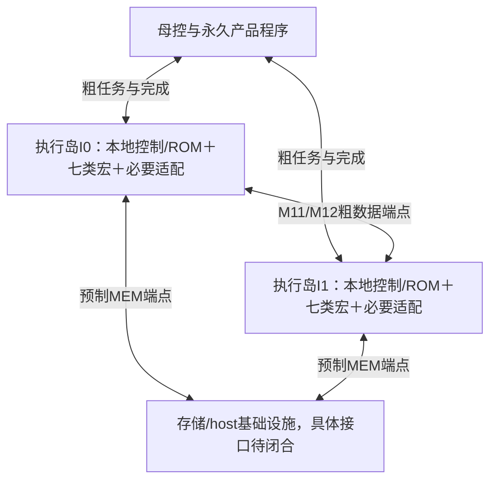

# 七宏执行岛与粗粒度大Block候选方案

Issue151 / PR152，负责人Melodydt。研究输入1cc43a93a0c985587745ceba5e0d8d425d43a843，叶宏源码来源707878621b2add4ed218b8c43df2e95c9a56e2ba。本轮为架构可行性研究；不修改叶宏或P2 RTL，不把候选封装当成新增物理宏、实际仿真或PPA结果。

## 1. 建议与成立条件

建议把这一方案作为现有路线的分层候选：共同底座包含多个七宏执行岛，每岛在M1–M10内预制七类宏、实际本地连接/适配、控制和程序读取能力，M11/M12在岛边界连接张量端点与基础设施端点；母控按完整子层而非逐条叶宏op派发任务。

主比较先采用每岛具备M/N/E/G/R/S/T全部七类型的同构方案。七是类型数，不固定每类只有一个实例；M数量、S/T实例及额外数值/存储资源要由调度、容量和物理预算确定。五种功能profile是A Attention、F FFN、D GDN、H Falcon Attention+SSM混合、X MoE。它们可以由同一种物理岛的有限程序实现，不必做五种不同hard macro，也不意味着每层复制一个物理岛。



图为候选层次，I0/I1仅示例，不是已完成网表或物理岛数。岛内连接在共同底座固定；岛边界命令、完成、数据和基础设施的实际层分配/端口仍须统一冻结。

建议的粒度是一个完整mixer或FFN/MoE子层：输入一个hidden张量，岛内完成该子层的Norm、投影/核计算、门控、输出处理和对应残差，再输出下一hidden张量。LINEAR/MST、Softmax、SSM、router/expert/merge作为岛内核或验证子程序保留，避免把这些内部阶段全部变成M11跨岛任务。

成立仍需要已有缺口真实闭合：七宏本身并未提供所有系数/宽归并/状态版本/搬运/完整控制能力。GDN/SSM系数、Falcon bias/尺度、MoE宽归并和MEM等缺实现不会因重新封装消失。产品程序、数值规则与容量准入都须在共同有源底座冻结前接收。

## 2. 三种组织的比较

| 候选 | 组织 | 主要收益 | 代价与限制 |
| --- | --- | --- | --- |
| A，全七类型同构岛 | 各岛具备相同类型能力，以有限profile执行不同子层 | 接口/控制易复用，同一物理岛能时分承担多个层或profile，符合用户七宏组合设想 | Attention/FFN/MoE时R可能闲置，七宏和所有必要适配按岛复制；数量与PPA未定 |
| B，按功能异构岛 | 预制Attention/FFN/state/MoE等不同资源配比或宏子集 | 可能降低闲置和改善特定数据流 | 需同时满足八产品资源比例、端口/互联和程序覆盖；定制时不能删除不用的岛或补有源逻辑 |
| C，整decoder层封装 | mixer和FFN/MoE都放同一大Block | 层内hidden传输也可本地化 | 岛更大、控制/缓存范围增大，Gemma/GDN/hybrid/MoE差异集中；容易退化成近完整小处理器，难只凭当前叶宏证明更优 |

当前推荐A作为逻辑接口与程序复用的参照，B/C保留对照，不据此冻结物理类型数、岛数或实例配比。新增层次预计能使更多细粒度连接保持局部；是否减少总线长、缓冲和拥塞，要在相同功能/吞吐/存储条件下做实际物理对照。

## 3. 五个功能profile的边界

| profile | 岛内职责 | 算法差异及保留缺口 |
| --- | --- | --- |
| A，Attention子层 | 输入Norm、Q/K/V投影、可选QK Norm、RoPE、KV访问、QK/Softmax/PV、可选输出门、输出投影、规定的postNorm及残差 | Qwen3 Q宽不等于H；Gemma RMS0/局部与全局；Phi融合QKV/部分RoPE；Qwen3.5 sigmoid输出门；KV与长Softmax仍需容量/程序方案 |
| F，FFN子层 | pre-FFN Norm、gate/up、SiLU或GELU_tanh及门乘、down、规定的postNorm/尺度与残差 | Gemma后Norm保留，Phi gate/up融合，Falcon MuP保留；权重及中间激活需要实际存储调度 |
| D，GDN mixer子层 | 输入Norm/投影、conv/history、SiLU、头重复、Q/K L2及Q额外缩放、系数、递推状态、输出Norm/门控/投影及残差 | 精确RepeatHeads/L2顺序按源图；系数/epsilon/数值范围与多tile状态发布仍未闭合 |
| H，Falcon hybrid mixer子层 | 同一输入Norm后Attention与SSM两分支、各自投影/缩放/状态、按源图join和残差 | 可以单M串行执行而保持数学图，但要保存分支输出；SSM Softplus/decay/inject/conv bias32、MuP和状态发布仍需实现 |
| X，MoE子层 | pre-MoE Norm、router、Top8 ID及selected-score概率、8次专家FFN、共同单位宽归并/gain与残差 | 40专家选8的数据相关地址/循环在岛内处理；N仅给ID不等于已经完成概率/专家访问，宽归并与权重平台仍缺 |

每个模型的profile序列、准确Norm/residual归属和来源见模型映射附录及机器表。五种profile覆盖的是当前十种decoder层型的粗边界；源图未包含的embedding、最终Norm、LM head、采样/停止等仍属于完整模型工作流缺口，不能宣称五种岛程序已覆盖完整LLM。

## 4. 一个具体例子：Qwen3复用两个物理岛

仅作调度与接口算例：岛I0/I1都预制全七类型，固定线路I0→I1和I1→I0；模型程序永久选择Qwen3。母控依次发A(layer0)到I0、F(layer0)到I1，再发A(layer1)到I0，直到28层。I0/I1不是28或56个物理实例，profile调用数也不是宏数。

```text
输入hidden -> I0:A(layer0) -> I1:F(layer0)
          -> I0:A(layer1) -> I1:F(layer1) -> ... -> 最后hidden
```

Qwen3的H=1024、I=3072、Q/KV头16/8、D=128。A内部保留逐头Q/K RMS和Q输出2048维；完成输出投影与残差后回到1024维，再交给F。F内部完成3072维中间激活与down，输出仍1024维。不能把Q投影宽度错误写成H。若仅用S16作边界格式算例，一次完整hidden为2048B；这不是已接收的定点质量结论。

外部相邻任务的边界只需hidden张量和少量任务/完成语义，Q/K/V、score/EXP、3072维FFN中间值留岛内S或该岛拥有的MEM区域。这里的本地化表示不跨计算岛接口，不表示全部驻留16KiB S，也不表示权重/KV不经过共享内存网络。

线路构成回路不等于允许两个任务互相占资源等待：母控的依赖仍为A0→F0→A1。必须先有可写结果槽和独立进展的接收端，完成存储确认与规定释放后再复用资源；当前P2未实现这样的完整跨岛闭环。

## 5. 母控、本地控制与程序绑定

母控维护有限产品/层表和粗粒度依赖，派发profile、逻辑层、token/位置、参数或缓冲槽索引；本地控制负责七宏原生op、阶段、tiling、格式/尺度、每笔ACK、回放、错误及状态版本。N的未完成统计/回放阶段、R的候选/commit/history和T租约不向母控拆成逐周期控制线；同一物理宏的未完成上下文不得被另一个profile随意覆盖。

永久绑定的是产品程序及参数/路线，不要求每个岛永远只执行一种profile。同一固定产品程序可按层表依次调用A和D等已预制本地程序。全部必要的指令表、译码、MUX、FIFO、计数、驱动和中继必须已在M1–M10；M11/M12只能选择现成产品入口/参数端点与跨岛线路，不在后定制时生成控制器，也不靠启动加载新程序补齐能力。

禁止启动装载针对控制程序和产品绑定；模型权重、KV/state、激活仍可按固定程序从外存读写。运行时读权重或更新状态不等于给成品加载另一种算法程序，相关MEM硬件和可接受行为仍须预制并验收。

当前P2的21×16bit常量表是MST骨架，不是上述五profile程序库，不能把它的419bit控制字段量当新岛预算。新接口的header/event/数据字段仅是候选编码与准入要求，尚无RTL实现；角色/类型/尺度/layout仍主要由编译期表证明，避免无依据恢复通用role/大handle运行时系统。

## 6. 跨岛完成与活性

应区分输入已接收、计算/局部结果SEALED、传输完成、接收端stored ACK、producer资源可复用、持久状态published和母控job完成。data_last应定义为片段末尾或完整张量末尾之一，不能用T某一小批末字替代整个子层完成。128bit物理载体可以复用，逻辑格式/尺度不因此自动相同。

每岛一前台任务可作首个基线，但输入接收/输出排空或MEM服务必须能在本地计算等待时独立进展。若producer保持T直到consumer启动，母控又等producer完成才启动consumer，就会形成等待环。相同岛重入、A/F回路和大于T容量的输出应由编译器证明缓冲/分片/存储与释放顺序；资源未闭合时标unmapped，保留算法合法性，不通过禁止宏对掩盖缺实现。

R op7局部COMMIT后不能由op8回滚；一个GDN/SSM子层可能已局部提交多个tile。新大Block接口若要保证对外完整结果/状态版本，需外部old/next状态根、候选保存、错误隔离与最终发布协议。把多个R操作放进同一封装并不会自动提供全子层原子性。

## 7. 容量与单M调度不能隐藏

一岛各一M/N/E/G/R/S/T只作资源下界算例。仅S主要payload16KiB、T6KiB、R两bank各8KiB显式数组合计38KiB；未含R参数/history、M/N状态、控制和额外缓冲，更不是物理面积。复制n个这样的岛会至少复制这组数组n份，不能把类型数7当作总实例数或每个profile都独占一份。

单M只有一份merged结果上下文，没有原生结果restore。FFN不能无证据地一边算gate/up chunk，一边在同一个M保留down的partial累加；先物化完整中间激活、使用额外M或新增经验证的累加/重算路径才可闭合。Qwen2.5一个I=11008的S16中间向量为22016B，超过S16KiB；Qwen3最小dense FFN三矩阵即使S8权重也有9MiB。大Block封装不会使这些量自动片上驻留。

完整GDN/SSM每层S32状态为2MiB/4MiB；R active bank仅8KiB。容量比不是native任务数，具体GDN length128与SSM length256的分块还受原生8列/通道布局约束。外存确实存在于系统目标，本轮只保留接口/带宽/调度依赖，不假定无限、零延迟或现成MEM控制器。完整模型profile仍须在相关有源逻辑冻结前完成MEM闭合。

## 8. M11/M12与物理封装边界

大Block内全部本地数据/控制路线固定在M1–M10，顶层只暴露粗数据/命令/完成/基础设施端口。母控、MEM/host适配是基础设施Block，其端口同样纳入顶层接口，避免宣称M11只连计算岛却遗漏必要系统连线。时钟、复位和PG/CTS也必须按共同底座预先实现与核验。

现有叶宏module或物理视图不能仅通过RTL hierarchy就成为合格大宏：需要实际floorplan、M10 pin可达性、本地低层路线/PG/时钟复位、层次LEF/GDS/网表及边界时序。全七岛可能减少顶层细线数，也可能增加内部拥塞、闲置与面积；必须在同资源/同工作负载下验证。M11/M12不能新增MUX、仲裁、FIFO、buffer、时钟修复或有源中继；多push-pull输出即使valid互斥也不能直接短接。

## 9. 从P2进入可验证大Block的步骤

1. 保留P2为岛内LINEAR/MST回归核，先形成有真实输入端、合法描述符/参数、分片输出及数据/完成分离的岛壳；当前P2仍使用硬编码fixture/地址/四字T，不是通用大Block接口。
2. 在共同本地互联上接入N/E/G/R及已明确的必要适配，落实唯一owner、phase锁、NUM/状态/MEM缺口，固定五profile的精确数值与调度表。
3. 先跑两个岛的最小传递/回传、背压、same-island重入和故障，检查stored ACK、T释放、无等待环；再跑A/F小slice，避免先把完整模型缩形状后宣称覆盖实际规模。
4. 对八模型十层型进行完整参数、KV/state/权重、程序长度/ROM和资源准入；小slice结果与完整模型各自出证据，所有未实现项保留。
5. 对A同构/B异构/C整层方案在同资源和性能目标下比较控制位、字节传输、存储、端口、实际综合及P&R；之后才冻结大Block类型/配比/数量和M11布线约束。

这些是对既有P2–P7路线的分层细化候选，不取消P2剩余矩阵，不把研究方案写成已开始P3或已有七岛实现。服务器仿真授权可用于后续实际测试，但当前研究没有新仿真、服务器目录/文件上传或作业。正式回执区分本地资料、远端Git分支、服务器和最终审查状态。


## 10. 可追溯附录与本轮交付

- [八模型/十层型映射](COARSE_BLOCK_MODEL_MAPPING.md)及work/Melodydt/151/coarse-model-map.json：保留242层完整序列、Norm与两次残差唯一归属、96连接义务及484个逻辑子层调用。484不是物理岛数或程序ROM字数。
- [母子控制/端口合同](COARSE_BLOCK_CONTROL_CONTRACT.md)及coarse-control-candidate.json：阶段、反压、分片、存储ACK、复用、状态发布和P2差距；字段/位宽仅为候选编码，不是已冻结ABI。
- [资源与切边分析](COARSE_BLOCK_RESOURCE_STUDY.md)、coarse-block-bounds.json及coarse-block-tables.md：显式数组、单M约束、FFN/KV/state与逻辑切边字节；没有PPA结果或已接收模型容量。
- [本轮来源索引](../work/Melodydt/151/coarse-block-source-index.json)：19份原图/配置/导出资料在当前研究ref逐blob读取，与继承来源索引一致；不上传原始大图。新RTL仍0，静态核验不能转为仿真/物理验收。

用户允许涉及仿真时使用MobaXterm所连服务器。已读取[REMOTE_RULES](REMOTE_RULES.md)，后续任务计划目录为/public/home/yuzelu/Melodydt/LLMHardwareDesign/issue-151/coarse-block/run-<UTC>-<source>/；开源非Python工具仅在/public/home/yuzelu/opt/安装，Slurm按本人缩写与任务缩写命名（拟mdt-cblk，实际提交时核对），资源不超过分配；保留源码、工具/配置、输入、输出位置与SHA。本轮仅研究，尚未创建该服务器目录、上传文件或提交作业，不把计划位置当已部署证据。

任务仍Issue151/PR152，研究候选待独立审查；P2剩余验收和P3–P7实现状态不变。本轮实际命令/产物SHA见coarse-study-checks.json与coarse-study-verification.json，线上提交/登记/看板状态以PR回执为准。
