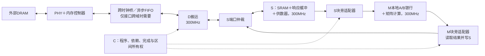

# DRAM → FIFO → D → SRAM S → M：完整数据与控制流程

日期：2026-11-03（Asia/Shanghai）。任务 [Issue #171](https://github.com/rayggxia-workspace/LLMHardwareDesign/issues/171)，交付 [PR #172](https://github.com/rayggxia-workspace/LLMHardwareDesign/pull/172)。

本文合并三个聊天中的结论：本聊天“DRAM 连接 M”、 “评估 S宏 改用 SRAM 方案”、“分析DRAM与片上时钟域跨越方案”。先给出完整工作流程，再列出已有实现与待实现边界。它是集成方案总结，不代表下图已经整机验收通过。

## 1. 一张图看完整流程

**DRAM 是总仓库，D 是搬运员，S 是机器旁的备料仓，供数器负责摆盘上料，M 负责加工。异步 FIFO 是两种工作节奏之间的交接货架；C 负责下达和衔接任务。**

推荐以 D/S/M 共用片上300MHz时钟为讨论基线。若内存控制器的用户接口确实为500MHz，读数据路径为：

```text
外部DRAM
  ↓
PHY＋内存控制器：负责DRAM物理读写、训练、刷新和时序
  ↓ 控制器用户接口500MHz
跨时钟桥（内部有异步FIFO）：500MHz接收，300MHz交付
  ↓
D搬运宏（300MHz）：按地址/长度取数，经自身有限缓冲写入S
  ↓ S普通128bit口＋真实写确认
S宏（300MHz）
  ├─ 四个SRAM bank：存放16KiB工作数据
  └─ 仲裁、响应缓冲、原有供数器：读取并整理操作数
  ↓ 现有块旁S适配器：保持数据和元数据，处理背压及完成
M宏（300MHz）
  ├─ A128 / B512独立装载口 → A/B本地双银行
  └─ 点积 → 归约/累加 → 缩放/结果保存
```

图中的箭头只表示读入的数据方向。**实际由D向控制器发读请求，数据再沿图向下返回。** PHY与控制器可以在平台中集成，无须重复增加一套。



图中S块旁适配器和M块旁适配器是不同角色：前者衔接S供数与M装载；后者配置M计算命令、收应答、把结果写回S。已有逻辑应复用，不是每画一个名称就额外增加一个新宏。

## 2. FIFO到底放哪里

**看控制器“用户接口”的时钟，不是只看DRAM引脚的频率。**

| 实际时钟条件 | 正确连接 |
| --- | --- |
| 控制器接口500MHz，D/S/M同一300MHz域 | 控制器 → 异步跨时钟桥 → D → S → M |
| 控制器接口、D/S/M均为同一个300MHz域 | 控制器 → D → S → M；这处不因跨域而加异步FIFO |
| 将来选择D在500MHz、S/M在300MHz | 在D与S之间处理跨域；这是另一个候选，不能直接沿用现有单时钟D/S连接 |

即使DRAM引脚时钟是500MHz，只要PHY/控制器已经对片上提供同源300MHz接口，就不需要把一个普通FIFO硬塞到DRAM引脚与控制器之间。相同频率但相位关系不确定的独立时钟，仍需要CDC处理。

当前D是AXI主设备。因此图中“FIFO”在完整系统里应理解为**完整的AXI跨时钟桥**：AR读地址、R读返回、AW写地址、W写数据、B写确认都要按协议交接，保留ID、结束、错误、顺序和背压。仅给返回数据接一个异步FIFO，不能完成整个AXI接口跨域。请求与写数据从300MHz向500MHz走，读数据与写响应从500MHz向300MHz走。

异步FIFO与D内部FIFO不是同一件事：前者跨时钟；D当前读写缓冲跟D共用300MHz时钟，负责本域事务与S服务等待，不能直接充当异步桥。S内部响应槽、供数队列和M本地银行也各有自己的容量与职责。

工程原理参考：[AMD独立时钟FIFO说明](https://docs.amd.com/r/en-US/pg327-emb-fifo-gen/Independent-Clocks-Block-RAM-and-Distributed-RAM)、[AMD AXI时钟转换说明](https://docs.amd.com/r/en-US/pg059-axi-interconnect/Clock-Conversion)。两者证明已有工程方法，不授予本项目ASIC实现资格。

## 3. 一次矩阵任务怎样从取数走到写回

| 步骤 | 谁做什么 | 什么时候才算这一步完成 |
| --- | --- | --- |
| ① 准备 | 软件编译分块、数据排列、尺度和程序；C取得S目标区间，向D下发LOAD | 描述符有效，目标区间可写，已预留有限容量 |
| ② 外存取数 | D按地址/步距发AXI读取；控制器/PHY访问DRAM | 读数据实际返回，ID/长度/错误状态正确 |
| ③ 跨域 | 若有跨域，桥安全交接请求、数据、响应；D在300MHz接收 | 对应事务在接收侧真实握手；不等于已写S |
| ④ 写入S | D经S仲裁器使用普通128bit口写入；SRAM wrapper返回确认 | 所需S写确认全部收齐，D才报告LOAD完成 |
| ⑤ 给M上料 | C启动S供数；供数器读取A与B，附银行/行/tile/格式信息，经适配器送M | 对应A/B包均被M实际接收；不能只看已从SRAM读出 |
| ⑥ 执行 | C经M适配器设置尺度、发计算描述符；M使用已准备的本地银行运算 | M返回该计算命令的完成/错误应答 |
| ⑦ 结果落S | M适配器读原始或格式化结果，经仲裁器写回独占S结果区 | 对应结果S写确认全部完成 |
| ⑧ 外存写回 | C令D执行STORE；D读S，经跨时钟桥和控制器写DRAM | W数据发送完且相应AXI B响应成功，才释放区间或发布结果 |

“数据进入FIFO”“D收到返回”“S写完”“M收齐操作数”“M算完”“外存写回成功”是不同事件，不能合成一个done信号。

C负责按事件推进，不需要把DRAM第几拍与M第几拍对齐。出错时不能把已收到部分数据的目标区间当成完整有效结果；停止新增请求并按协议处理在途。复位应协调桥、D、S响应、适配器和完成/区间状态，防止旧响应被误认成新任务；不承诺撤销已完成的SRAM或外存写入。

### S和M之间还要整理什么

- M接收的是特定tile布局的A128/B512操作数，不是裸AXI读返回；银行编号、行号、tile、S8/S16格式必须一起保持。
- B的布局由软件打包与已有供数器约定，不能把任意行主序B直接当成可用输入。S16是规定的整数格式，不是FP16/BF16编码。
- 例如一个S8的8×8 B tile为64B，可由四个128bit字组成一次512bit装载；S16同样64个元素需128B，分两次512bit装载。拼接不增加外存持续带宽。
- 双银行允许按合同向空闲银行装下一批，不能覆盖正在执行的银行；B复用也必须保持有效性和格式。
- M结果口是128bit；原始S64结果和格式化结果的有效字节/容器不同，回写描述符必须匹配。等待结果接收的停顿也算完整任务时间。

## 4. S改用SRAM以后，保留什么、改变什么

**替换的是S里大容量的存储体，S的收货、排队、仲裁和上料能力仍然保留。**

```text
新的完整S宏
┌──────────────────────────────────────────────┐
│ 普通口/宽口仲裁 ＋ 有限响应槽 ＋ 写确认         │
│                                              │
│ SRAM bank0  SRAM bank1  SRAM bank2  SRAM bank3 │
│   每个256×128bit、1RW，总容量16KiB             │
│                                              │
│ 原有供数器 ＋ A/B有限队列与装载元数据          │
└──────────────────────────────────────────────┘
```

[PR #158的固定交付](https://github.com/rayggxia-workspace/LLMHardwareDesign/blob/ac29d11ed5728861689046d04a0f03060de2439c/docs/S_SRAM_FINAL.md)已经提供这类结构：

| 项目 | 集成时要遵守 |
| --- | --- |
| 普通口/宽口 | 普通128bit；宽读512bit，顺序为bank3..bank0拼接 |
| 端口能力 | 每拍接受普通或宽操作之一；宽读占四bank，不能同时假定D满速写入、供数器满速宽读 |
| 返回延迟 | K上升沿接受，随后下降沿SRAM操作，K+1寄存返回，最早K+2消费；比旧标准单元S多一级返回寄存 |
| 背压 | 按valid/ready等待；普通/宽响应各两槽，包含在途返回，不能只数已经排队的数据 |
| 复位 | 不清SRAM，不回滚已完成写入；先初始化有效数据再读 |

两个S区域交替使用可以隔离数据所有权，但不会凭空增加物理端口。要与计算重叠补料，必须按真实仲裁和银行限制测量；增加第二个S实例则还需要真实路由与控制支持。

在父层图上，可以把完整已冻结S画成一个方块。实现S内部时，仍有四个SRAM硬宏和周围标准单元控制逻辑；父层必须使用匹配的尺寸/接点/遮挡LEF、时序模型、功能模型和GDS，按真实引脚负载、供电、时钟与上层线RC验收。画成方块不等于接口线无需处理。

SRAM版S的叶块工程验收已记录通过、独立审查未完成；TT/1.1V/25℃、银行内部wire PEX未实现等边界保留。PR #163给标准单元S补驱动的结果，不能自动转给SRAM S，反过来也一样。

## 5. 带宽、缓冲与多个S共享DRAM

FIFO是交接货架，不是扩大运输能力的设备。等宽128bit、每拍一字时：

- 500MHz侧理论8GB/s，300MHz侧理论4.8GB/s。
- 快侧连续满速1µs，理想积压为200字＝3200B；这是算例，不是推荐FIFO深度。
- 深度还取决于最大突发、已发未回数据、同步/背压延迟和S暂停时间。发新请求前为承诺的返回留足容量，不能等满了才停止。
- 下游长期更慢时，必须限制发起速率、提高复用或升级整条瓶颈路径；单独加深FIFO或加宽M入口都无效。S端口仲裁会让实际吞吐低于总线理论上限。

桥、D缓冲、S响应槽是独立容量池：各自的承诺返回都要有位置，不能把同一空位重复算给多笔在途。具体容量准入式和CDC约束见[异步FIFO专题](DRAM_S_ASYNC_FIFO.md)。

多个大block、多个S共享DRAM时，可候选采用“共享控制器/跨域桥 → 仲裁互联 → 各block本地D → 本地多个S → M”。需要来源与目的地标识、事务ID映射、公平仲裁、按目的地的有限缓冲/信用，以及避免一个堵塞S挡住所有其他S。所有block共享的是总外存带宽；同一300MHz域可集中跨域，不必每个S重复加异步FIFO，独立时钟域除外。

**这不是已实现的多S能力。**核对的#162/#156接口虽然预留4bit S实例字段，现有实现只接受实例0。未来要增加实例，必须补真实路由和验收，不能只放开编号检查。

## 6. 当前已经有的，和还需要实现的

| 环节 | 固定来源及实际边界 |
| --- | --- |
| M与标准单元S基线 | main `4b1df2c7`；M/N/E/G/S/T六叶已交付；不等于系统通过 |
| SRAM版S | PR #158 `ac29d11e`；整块叶级工程验收通过，待独立审查/合并，模型限制保留 |
| D/C、S仲裁及块旁适配 | PR #163本次核对头 `9e539b22`；有单块及真实程序证据，实际上层布线仍失败，组合未验收 |
| D与两种S的接口兼容 | PR #159 `aa51cf3c`；有RTL兼容回归，不是SRAM实体与完整CDC系统验收 |
| 500/300MHz跨域桥 | PR #172本次扩写前 `f5f9edb2`；仍为文档方案，无新增FIFO RTL或物理资格 |
| D→M绕过S | 本聊天中的备选研究；尚无该旁路实现验收，不替代本文主路径 |
| 多block/多S共享 | 候选架构；当前多实例路由未实现 |

因此下一步实现应按顺序：确认控制器用户接口时钟/协议 → 选择并实现完整CDC桥（若需要）→ 冻结容量及在途合同 → 选定SRAM S并绑定模型/延迟 → 跑C驱动的完整LOAD/供数/计算/结果/STORE → 完成实际物理互联、CDC/复位、两侧时序和错误/背压测试。

FIFO、同步器、控制、驱动与流水是有源电路，要在相应M1–M10预制阶段明确物理归属、面积和电源/时钟。后续M11/M12金属不能临时生成它们。已有叶宏通过不能代替整条路径的验收。

## 7. 来源与复查入口

以下固定链接是实现事实依据，聊天用于整理问题和解释，不替代源代码/验收证据：

1. [M及六宏合同](https://github.com/rayggxia-workspace/LLMHardwareDesign/blob/4b1df2c7cbdaa0fa6f9f468f2b5b854cec875609/docs/BLOCK_V2.md)。
2. [SRAM S最终结果与限制](https://github.com/rayggxia-workspace/LLMHardwareDesign/blob/ac29d11ed5728861689046d04a0f03060de2439c/docs/S_SRAM_FINAL.md)、[SRAM S接口合同](https://github.com/rayggxia-workspace/LLMHardwareDesign/blob/ac29d11ed5728861689046d04a0f03060de2439c/project/experiments/s_sram/README.md)。
3. [C/D及适配器合同](https://github.com/rayggxia-workspace/LLMHardwareDesign/blob/9e539b22eb0096323992a9d23d4a975f8abcbf26/docs/CONTROL_V1.md)、[D实际接口](https://github.com/rayggxia-workspace/LLMHardwareDesign/blob/9e539b22eb0096323992a9d23d4a975f8abcbf26/project/rtl/control_v1/control_d.sv)。
4. [外存集成/所有权/完成合同](https://github.com/rayggxia-workspace/LLMHardwareDesign/blob/aa51cf3cb9d2e308d70bdd08373696b5cc4442da/docs/EXTERNAL_MEMORY_CONTROL_INTEGRATION.md)。该旧快照里的SRAM“仍待”及R额外禁令属历史，本文只引用数据接口/完成语义；SRAM当前验收看第2项，R不受旧禁令限制。
5. [正式异步FIFO方案PR #172](https://github.com/rayggxia-workspace/LLMHardwareDesign/pull/172)。旧PR #170已撤销，不作为有效提交。
6. [本次任务与验证记录](../work/huangpingyang04-lgtm/171/README.md)。

聊天中的llaccel补充结论：参考的llaccel_core物理范围不含SRAM存储体；其16-bank接口与crossbar不证明“SRAM硬宏被拆散”。这不改变本文采用完整SRAM S的路径，也不能用该core图推算包含存储体的系统面积。
