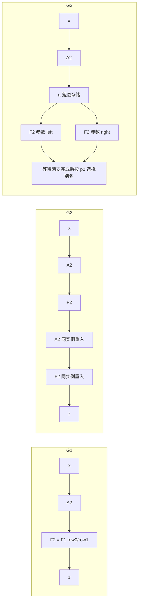

# H1 有界执行图与控制表规格 v0.1

2026-11-03，Asia/Shanghai。Issue151 / PR152，负责人 Melodydt。研究输入 `08451c3a563cdb331a3516d83cbf9647cd0554b1`。本稿是 [混合控制方案](HYBRID_METAL_CONTROL_PLAN.md) 的 H1 / L5 前置交付；L4-QUALITY-AF 继续独立推进。本轮新增离线 Python 编译/抽象检查，没有新增 RTL、服务器作业或物理实验。

## 1. 这一步解决什么

从“固定一个 A→F 父 FSM”推进到“同一候选执行硬件解释不同产品的有限粗表”。本轮把图合同、两行 F 的展开、槽生存期、存储确认、释放及程序容量变成可重算对象。金属编码只是候选载体，尚没有已实现的 M11/M12 ROM、共同母顺序器或通用端点。

语义合法、原生内核已实现、候选资源可调度、实际布线映射、数值质量分别判定。三个图均为声明的 A/F 整数域内语义合法；静态服务模型中可调度；实际共同实现为 `GAP_COMMON_SEQUENCER_ENDPOINT_EDGE_STORE`，实际映射为 `GAP_REAL_TOPOLOGY_AND_PARAMETER_SERVICE`，物理未核实，产品质量未接收。不能把静态 PASS 写成三个产品已经实现。

## 2. 版本化 IR 和支持域

正式输入在 `project/experiments/hybrid_control/h1/v0_1/`，检查器为 `scripts/check_h1_graphs.py`。所有文件以 schema_version 区分；本版本只接收以下完整合同。

| 对象 | 必填字段及约束 |
|---|---|
| 图 | `schema_version=h1.graph.0.1`、name、type、按依赖拓扑排列的 calls、output；feedback=null |
| hidden 类型 | signed_integer，16 bit，Fin10，shape=[2,1024]，token_major_natural_axis，tail=0，AF_BASELINE_W7_EPS1 |
| 调用 | 唯一 id，kernel=A2 或 F2，单一已有 input，唯一新版本 output，非空 parameter_ref；同一参数名不可跨 A/F ABI 使用 |
| A2 | 已测固定 Sq2 全 Attention，本地入口 AFULL；一个逻辑调用对应一个原生任务 |
| F2 | 编译虚拟入口，两次原生 F1 顺序展开；没有已实现的原生双行 F 内核 |
| 输出 | direct 指定一个对象；或 select 指定 p0/AT_ACCEPT、true/false 两个不同对象，predicate 接单时捕获并保持 |
| 对象版本 | 图内单赋值，x 为真实导入初值；不允许前向未定义读、覆盖仍活版本；版本/epoch 跨任务隔离仍需 H2 实现 |
| 参数引用 | 只是产品符号引用，必须由未来真实参数服务解析到内容/形状/版本；摘要只识别引用名字，绝非实际权重 SHA |

本版本可编译该域内的有限拓扑序 A/F DAG 和末端二选一。它没有实现 CALL/RETURN、运行时循环、被跳过计算分支、D/H/X 或状态发布。G2 是两层显式展开，不是运行时反馈证明。运行时有限反馈必须另有初值、old/next、迭代上限、退出及回收合同，当前报 `GAP_RUNTIME_FEEDBACK`；后续扩展必须提升版本并加正反例。相同位宽的 Fin12、FP16/BF16 或 RoPE 成对轴不能冒充本 hidden。

## 3. 三种不同图和同一候选资源



G3 两支都执行，F 物理实例只有一个，因此串行调度；JOIN 执行掩码是 11。p0 只选数据，不允许只等待所选支就覆写另一支资源。SELECT 不做 ADD、不新建算术宏、不复制 hidden；未选版本安全释放后导出所选对象。

同一目标 `AF_EDGE16K_SERIAL_CANDIDATE` 包含 M2/N2/E2/G1/S3/T2/R0，共 12 叶：已有独立 A/F 的 11 叶，新增一块 S16KiB 边存储。边存储划为四个 4096B 槽，单普通端口 owner；每个 hidden 两行，每行 2048B。它不是现有 AF1024 的资源清单，也没有实测 RTL。母控/表存储、TX/RX holding、metadata、S helper、参数服务及 PG/CTS/驱动全部另计，不能塞入四个已占满 16KiB 的槽。

粗计算任务最多一个 active，数据服务一字在途，独立一个 ACK 槽和一个事件槽。ARM 先预约全目标槽和返回信用；单端口 helper 串行办理边 S 读和目的原生 S 写，不握住读 owner 等另一笔写。母控 WAIT 期间 helper、参数返回和 ACK/事件必须独立推进。这是 H2 待实现的服务前提，不是当前 Python 已证明的硬件公平性。

候选索引上限：256 条 128bit 记录、16 逻辑调用、17 对象记录、16 参数引用、6 服务路线；这些约束同时生效，16 调用不保证任何展开都放得下 256 条。每个图分别占用同一容量，不把三产品的表相加。无面积、读周期或可制造容量结论。

原生接口与存储逐项审计见 [资源审计](H1_NATIVE_RESOURCE_AUDIT.md)，金属实现输入见 [后端输入](H1_METAL_STORAGE_PHYSICAL_INPUT.md)。

## 4. 正常执行与真实完成事实

每个图先 ALLOC x，IMPORT 256 个128bit字，等目的实际存储事实后 x 才有效。对每个逻辑调用先 ALLOC 输出，再逐原生调用执行：

1. ARM 是共同 wrapper 承担任务义务并绑定岛、参数、row、context、输出版本、预约返回空间；当前原生 F 没有这种通用 admission 接口，属于 H2 新能力。
2. LOAD 传 hidden，WAIT_INPUT 是 wrapper 从真实 S 写 ACK 建立的 HIDDEN_STORED 部分事实，不是现有内核的整帧 input_stored，也不许可提前 start。
3. PARAM/WAIT_PARAM 完成 gamma 等剩余原生帧并观察整帧实际 input_stored；最后一个消费者的最后一帧确认后才 FREE 输入 edge 槽，再发原生 START。A 每帧 hidden256+参数192=448字，F1 每帧 hidden128+gamma128=256字；计算中的权重服务仍须进展。
4. WAIT_SEALED 等输出可读；STORE helper 必须逐字捕获→目的 S 请求→实际写 ACK→源 T 退休。WAIT_STORED 是该循环全字数确认，不是 last/ready 或软件宣称。
5. CLOSE 之后观察实际 T RELEASE、再 WAIT_DONE。不能先等生产者整个 DONE 再排输出；不能在未 release/DONE 时 ARM 下一原生调用。
6. F2 row0 完整输出/释放/DONE 后才 row1。完整 F2 INPUT_STORED 只是两行历史事实的合取，发生时 row0 已执行；不得把这整体事件当首行计算许可门，否则死锁，也不得偷加 4KiB 隐藏输入数组。
7. SETOUT 选择有效版本，EXPORT 256字，WAIT_HOST_STORED 等真实出口确认，CLOSE_OUTPUT 释放最后槽，HALT 才成为可发布成功的母程序终态。硬件终态保持和消费后复用另由 H2 实现。

源 T 的生命周期到“边 S ACK 后源退休并 RELEASE”为止；edge 版本的生命周期到所有实际消费者对应 INPUT_STORED 为止，两者不能合并。A 的单读指针 T 不承担 fork 回放。G2/G3 每父任务有四次 F1 start，必须预算四个真实原生编号；既有 AF1024 只预留两次的 guard 不能原样复用。Python context 是图内关联检查，不证明硬件的 job mirror、晚返回隔离或回绕安全。

## 5. 候选控制编码和表内容

粗记录布局固定为本次逻辑候选：opcode8 / flags8 / a16 / b16 / c16 / imm32 / next16 / aux16，共 128bit；little-endian 打包。a/b/c 随 opcode 绑定对象/岛/row，ARM 的 imm 为图内 context、aux 为参数 id；IF 的 b/c 为 p0 真/假目标，其余按 next。未使用 flags/字段必须为0；实际读出端口、ACK位宽和物理 bit 映射待 H2/H5 接收。21 个正常路径动作的数值编码在脚本 OPS，不能视为未来完整 ISA 冻结。

每产品镜像依次为：64B header（版本、各表项数、偏移、图摘要），128bit 指令序列，64B 对象描述，32B 参数引用，16B 路线记录。对象描述含 id/version、4096B长度、shape、数值/布局 profile、消费者计数、producer 和语义摘要；槽由固定 first-free 分配器按表运行。参数引用摘要是名字摘要，实际权重/参数 manifest 仍 GAP。六路线为 host→edge、edge→A/F、A/F→edge、edge→host；镜像中 ACK width=0 是待定哨兵，不是无 ACK 硬件。

代码输出完整 `.program.json/.program.hex`、`.lowered.json`、`.tables.json/.image.hex` 和 `.schedule.json`。program 是粗 helper 调用，不逐 MAC/逐字存控制指令；schedule 内每个 ACK 事件带 words 数和前置义务，是聚合抽象，不冒充逐拍波形。

公共固定 fault handler 不作为每产品表中的另一份下载程序。本次只规定 H2 必须实施的错误协议：停止新接单，保持已有返回通道；记录 exact accepted/stored/visible prefix、source/row/context；可安全排空的事务按事实关闭，不能安全排空则 poison 并协调复位；已输出前缀不回滚；确认资源/晚返回隔离后发布 held error DONE。异常 PC/非法字段、外部失败、取消、超时、复位、重复/迟到 ACK 均需定向 RTL 测试。本轮正常路径 Python 不执行该 fault handler，其逻辑面积、ROM/FF、最大延迟未知，不算进产品镜像数值。

## 6. 可重算结果与预算

| 图 | 原生调用 A/F1 | 程序条数/字节 | 对象/参数/路线字节 | header | 产品表总字节 | edge峰值 | 权重服务字节 |
|---|---:|---:|---:|---:|---:|---:|---:|
| G1 串行 AF | 1 / 2 | 48 / 768 | 192 / 64 / 96 | 64 | 1184 | 2槽=8192B | 24MiB |
| G2 重入 AFAF | 2 / 4 | 88 / 1408 | 320 / 128 / 96 | 64 | 2016 | 2槽=8192B | 48MiB |
| G3 fork/SELECT | 1 / 4 | 81 / 1296 | 256 / 96 / 96 | 64 | 1808 | 3槽=12288B | 42MiB |

G3 镜像保留两个末端分支，实际每场景只走其一；两 F 计算分支都执行。G1/G2 峰两槽来自同时保留输入并预留输出；G3 生成 right 时 a/left/right 三版本同时占槽，a 在 right row1 INPUT_STORED 后才能释放。每对象 allocate/free PC、每步 live/slot map 和所有原生 context 已生成，不能用平均容量代替峰值。

候选共同表槽上界 = 64 + 256×16 + 17×64 + 16×32 + 6×16 = **5856B / 46848逻辑bit**，只是本次可重算预留输入，不是实际 ROM 宏面积/容量资格。其上界比三图最大镜像2016B大，预留用于后续新图；真正物理容量/宽深重排要依据编码、读出和 landing 试验决定。参数实际数据、6/9MiB权重、原生岛内程序、母控/端点状态、公共错误逻辑不包含在其中。

## 7. 验证范围与下一步

在仓库根目录执行：

```text
python -B -X utf8 scripts/check_h1_graphs.py --root . --out work/Melodydt/151/h1/evidence
```

三图四场景、定向拒绝例及输入/输出 SHA 记录在 [机器报告](../work/Melodydt/151/h1/evidence/report.json)。生成物不是测试期望的手抄镜像；checker 从 IR 重新编译、关联事件并计资源，负例改变格式、容量、控制目标/顺序以验证实际拒绝。独立审查记录和最终检查随交付保存。新测试是离线协议/预算检查，没有运行 RTL 或数值算法，不替代既有服务器结果。

H1 v0.1 只完成 A/F 有界切片规格。H2 首切片应固定此资源图，实现 edge S owner 和 TX/RX 一字在途/真实ACK、母顺序器与参数适配，先跑 G1，再同 RTL 只换表跑 G2/G3；加入背压、错误/partial、取消/reset/晚返回/编号边界及终态复用。运行时循环/被跳分支和一般拓扑在 H3 扩版本验收。L4 trained 整数 AF/新代表数据/阈值、R/NUM、D/H/X、真实 MEM 和共同底座物理均未退出，八样本旧24GAP保持。
