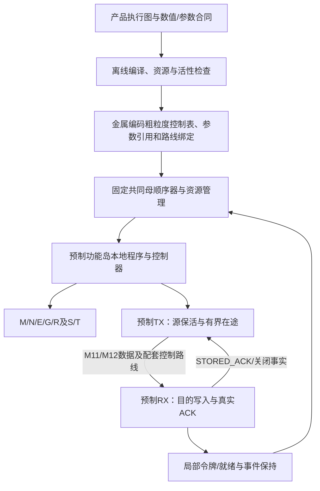

# 七宏功能岛混合控制总方案 v0.6

日期：2026-11-03（Asia/Shanghai）。Issue151 / PR152，负责人 Melodydt。用户在架构讨论对话中确认：采用本混合主候选更新总方案，并同步实施对话接续。输入研究提交为 `6ecc33a2b956cdce0f92d6b083d5905a541a1e81`。
本次是目标、架构候选和研究路线更新，不是控制ROM、通用端点、新RTL或物理资格的交付。已有实验的源码版本、失败/成功记录和数值边界保持原样。

## 1. 产品目标与支持域

目标是在共同M1–M10有源底座冻结后，仍能为此前未逐项列出的新产品编译合法执行图，通过M11/M12及所需定制通孔永久绑定。成品不通过host在启动时下载或运行时替换控制程序。新图必须使用冻结前已实现、已接收的算子、数值/布局转换、控制语法、状态与存储服务，并能容纳于程序、参数、缓冲、上下文、端口和物理路线预算。

“新图”不要求新产品的完整层序已被预存为某个family入口；也不意味着未知新算子、新精度、无限shape/序列、无限并发或任意同名模型自动支持。八样本/十层型仍是事实来源及回归对象，不能缩形假准入；合法组合的分母由版本化语法、接口角色和资源域确定，不能退化成只允许六条固定链。

状态逐项区分：SEMANTIC_LEGAL、IMPLEMENTED、MAPPED、PHYSICAL_ACCEPTED、QUALITY_ACCEPTED。合法但缺控制、适配、资源或物理路径的产品报告具体GAP并拒绝发布，不把缺实现改称语义非法。图可执行与保持原训练模型精度分别验收。

## 2. 主候选：集中表达粗任务，分布式推进真实数据

- 控制表表达层序、粗任务调用、循环、条件和必要同步，不逐MAC、逐S字重复存储指令。
- 母顺序器管理任务依赖、实例映射、资源预约、上下文/版本和终态；不转发每个payload字。
- 本地程序展开已预制的宏op、tiling、Norm统计/回放、布局、数值转换及实际存储ACK。
- 局部令牌是许可和依赖事实的载体，不代替数据、缓冲、任务归属或真实S写确认。数据接收与ACK/事件必须在母控WAIT期间继续推进。
- 局部握手适应变长延迟；不因此默认增加通用乱序、动态抢占、通用类型包头或全连接交叉网络。

这是主候选，不排除经对照证明更合适的纯令牌方案。不能宣称本混合方案已经比其它路线更小、更快或更省电。

## 3. 冻结边界与永久控制存储

| 冻结前共同预制 | 产品金属定制 | 成品合法运行变量 |
|---|---|---|
| 叶宏/岛内适配、固定母顺序器及译码、控制存储位单元/读出、全部MUX/仲裁/holding/FIFO、计数和地址生成、状态服务、MEM边界、驱动/中继、PG/CTS/reset与测试能力 | 在既有物理资源内编码粗程序/图表和常量选择；绑定合法参数引用及端点/数据/ACK路线 | token、受支持长度/位置、权重/激活/KV/state内容、MoE ID、计数、ready/valid等待和错误 |
| 指令语义、可用本地入口、格式/布局profile、存储与资源上限 | 不增加晶体管、门、寄存器、算子或时钟修复；不得逐产品重新综合父FSM | 不改变冻结能力边界，不下载新控制程序，不将权重数据伪装成程序 |

旧“ROM在底座冻结前枚举全部产品完整程序，金属只选择已有入口”不足以保证冻结后接收新的合法层序。本主候选改为：共同执行硬件固定，产品粗程序可在预留的金属可编码控制存储中永久表达；固定岛内子程序仍可共享和预存。只有金属编码和既定路线差异，不允许各产品常量化RTL、删宏、改FSM或插buffer后仍宣称同一底座。

普通RTL ROM数组、标准低层mask ROM或若干tie端口，都不自动具备M11/M12逐bit编码能力。须单独设计并接收位单元/阵列、地址译码与读取保持、常量驱动、非法地址/码处理、接点/扇出、编码/读回与几何/STA。两层金属加通孔不等于“两张掩模”或既有可制造流程；容量、周期、面积和成本均待实测。无法容纳的新图为GAP_PROGRAM_CAPACITY或GAP_PHYSICAL，不以启动装载作无授权替代。

## 4. 图与接口的编译期合同

每个节点绑定：功能profile及版本、本地入口、逻辑调用/物理岛、shape、数值规则、参数/权重身份、上下文、读写区域和状态副作用。
每条边绑定：源结果/目的输入角色、元素位宽与Fin、布局/轴、有效长度/tail、舍入/饱和或拒绝策略、存储位置/版本、传输路径、消费者集合、保活/释放和完成条件。

A_plain/A_gate/F/D/H/X是完整子层候选；专家gate/up/down核、shared-Norm分支与完整F并非同义。相同128bit口不证明相同语义，S16/FP16/BF16不可按同位宽互换。格式变化可能需要现成M/E或新增NUM能力，必须在冻结前真实实现。

当前A/F整数基线采用S16 Fin10与S8 Fin7，概率S16 Fin14；这只是已测profile，不冻结为八样本统一精度。W8中的“8”是小数位，仍为S8；数值来源、epsilon、clip和训练质量独立保留。数据载荷128bit、CMD/EVT/ACK64bit等旧候选只能在新图预算后接收，不能顺带冻结。

## 5. 固定控制语法与金属表

先定义语义动作，再依据完整程序和后端决定实际编码宽度。最小候选包含：RESERVE/ARM、TRANSFER、RUN、WAIT事实、RELEASE/CLOSE、CALL/RETURN、有界LOOP、条件BRANCH、JOIN、终态及受控错误/取消。状态发布调用专门已实现服务；指令名字不提供R/T/MEM联合原子性。

每个产品的控制内容应包括调用/层表、分支/循环范围、参数/地址/尺度引用、缓冲与上下文绑定、路线选择、预期事件和错误路径。公共子程序/循环压缩规律层序，不能为所有组合枚举完整程序；不规则层序仍需真实编码位，不能以“参数化”隐藏控制存储。

必须冻结：指令/表记录宽、深度、PC/索引/循环计数/调用栈范围、参数表及跳转合法性、端口与读取延迟、配置稳定性和错误行为。当前全部待完整图编译与物理试验，不沿用旧2MiB ROM或32KiB控制估计冒充预算。超限、缺入口、非法字段或未解析原语必须被拒绝。

## 6. 可组合端点与完成语义

固定产品图不消除以下区别：任务已接收、输入捕获、INPUT_STORED、结果可读/SEALED、片段传完、REMOTE_STORED、源可释放、状态已发布、整任务终态、资源可复用。

通用端点须预制TX源保活、RX捕获与唯一S owner、真实目的写ACK、ACK/事件独立保持和关联、长度/tail/元数据检查、错误/partial/poison及协调复位。先预约接收/存储及返回空间，再启动生产者；不能等待生产者整个DONE才允许接收。ACK不得被数据或母控WAIT反压永久堵住。

现有AF1024逐字等待F真实S ACK后退休A_T，证明特定锁定子接口下的固定组合，不等于通用端点；不能无证明把ready当ACK。接收数据完成也不等于参数/gamma全部齐备、kernel完成或state发布。初版可单fragment/有限在途，若增FIFO或块确认须重新计价并证明prefix/错误语义。

## 7. 资源、生存期与合法图

离线检查同时建立：
1. 计算依赖图：算子/数值与任务顺序；
2. 资源等待图：S/T、结果上下文、端点槽、ACK/事件及MEM所有权；
3. 物理可达图：数据、控制、回程及基础设施实际连接。

初版采用串行粗任务、显式中间值物化；接收、存储辅助服务、ACK和事件仍独立推进。保留N/R上下文时允许按原生guard RESUME，但不能长期占死S/返回服务。单M不能在同一结果累加上下文中插入覆盖它的另一投影。

同岛重入须先保存仍需结果并关闭旧资源；同T必须保存旧批、实际RELEASE后才新BEGIN，不能假定双端口或第二lease。fork的源保留到全部实际消费者确认；join只等被选择的分支并匹配版本。反馈须有初值、显式状态延迟和有界迭代/退出规则，不能形成组合ready环。图无环不保证资源无死锁；外部永久背压不承诺完成，活性声明须包含公平性、容量和MEM进展前提。

状态需区分old/privateNext/published、R局部commit、MEM写ACK及输出可见；错误不回滚已消费前缀。跨任务/复位迟到响应、编号回绕、重复事件和混代必须由实际端点/存储合同隔离，不能靠换一个软件标签假定排空。

## 8. 物理与性能预算

同一资源上界内支持新图，不等于每条边各铺一条直连专线，也不保证任意并发、任意满带宽。预制有限端口/选择/仲裁与共享路径，编译确定可用路线；多push-pull输出即使错时也不得短接。若某方向无真实路径或pin/驱动预算不够，报告mapping gap。

在冻结前预算岛实例/类型、端口和landing、线长/扇出、中继、寄存切片、组合ready路径、时钟复位、PG及host/MEM。M11/M12不能事后插入修时序单元。完整模型的权重、KV和GDN/SSM状态不能假定驻S/T；MEM存在于系统目标，但真实服务和带宽尚未闭合。

固定路径的潜在速度收益来自减少选路、多跳和争用，不能省掉payload拍数和写确认。比较首字延迟、持续间隔、背压、传输/ACK完成和整任务时间；区分控制成本、岛间hidden、权重/MEM与岛内S流量。参数量不直接决定元素位宽，位宽相同也不保证精度或容量。

## 9. 六路线同条件对照

| 路线 | 新图表达边界 | 本轮定位/主要代价 |
|---|---|---|
| 预置家族程序+金属参数 | 原有语法内 | 现状基线；不得当无限新图支持 |
| 金属编码控制ROM+共同顺序器 | 已预制ISA/控制表、容量与路线内 | 主混合候选；重点验证编码/读出及顶层布线 |
| 控制令牌网络 | 预制节点/通道/缓冲及图映射内 | 主要对照；长层序/共享资源可能仍需表或顺序控制 |
| 金属可编程控制阵列 | 预制门/FF与布线内 | 次级候选；改变控制网表，仅共同有源几何不等于现有固定控制器 |
| OTP/eFuse/反熔丝 | 所配置执行架构与器件容量内 | 工艺条件候选；须预制实际器件/编程/读回/锁定，不假定标准单元模型可制造 |
| 独立控制器/chiplet | 系统接口及控制能力内 | 系统级替代；改变产品边界，不算纯M11/M12实现 |

控制执行方式与永久编码载体是两个维度，可以混合，OTP本身不增加控制语法。所有比较固定算法/精度、MAC与存储资源、MEM假设、数据搬运次数和性能目标；分别报控制/互联开销、物理差异、每产品编译验证与制造工作。无实测前不排序绝对PPA、速度或报价。

外部参考仅解释机制：[数据流局部握手](https://ecocloud.epfl.ch/research/sustainable-data-centers/dynamatic/)、[OTP读出/锁定](https://opentitan.org/book/hw/ip/otp_ctrl/doc/theory_of_operation.html)。它们不提供本项目工艺IP或资格。

## 10. 接续研究与退出门

| 阶段 | 工作与验收 | 既有主线对应 |
|---|---|---|
| H0 本次方案交付 | 固定新图目标/混合候选、旧方案优先级、差距和交接；只完成文档静态核查 | L1/L4接口前置 |
| H1 图与编码规格 | 定义有界图IR、节点/边合同、目标资源和语义/映射分离；至少三种不同合法图的完整执行表/生存期/预算；明确不支持图诊断 | L4-W5前置，L5设计输入 |
| H2 共同顺序器与端点小切片 | 同一固定RTL实例图，产品表/路线内容变化；真实TX/RX/SACK/释放、错误/背压/取消/复位；先串行后有限并发 | L5-W2 |
| H3 组合覆盖 | 同岛重入、长链、fork/join、被跳分支、有初值反馈、共享资源等待；有界合法图和非法图/超限拒绝；不以有限例子宣称所有图证明 | L5-W6 |
| H4 能力闭合 | D/H所需NUM/R/state版本、X router/专家/宽归并、真实MEM/参数供给；完整模型数值/质量另门 | L6/L7/L8及L4质量 |
| H5 编译与物理共同证明 | 程序编码/读回，至少两个不同产品绑定；同一M1–M10/PG/CTS及有源几何，定制层/通孔差异合法，实际STA/几何/电气与PPA | L8-W11 |

H2可以先用已接收的有限数据profile/copy服务验证组合机制；不能把它写成八模型准入。图规格、预算及后端可行性现在前置，当前L4-QUALITY-AF（训练参数完整整数A→F误差、新代表性数据和产品阈值）保留，不因总方案更新跳过。QUALITY已有95979官方参考/W8有限证据保持原范围。H1/H2以及全体系物理均未完成。

## 11. 当前事实与下一执行顺序

已接收研究证据仍按原commit：六叶M/N/E/G/S/T合格、R未完成；有限N/A/F与固定AF1024实跑；QUALITY参考与Fin10 W8有限回归。原54份runtime/旧锁、八样本×三旧target24GAP不变；本轮不启动服务器、不重跑RTL、不自合并。

下一负责人Melodydt先读本稿、[当前八主线](COARSE_BLOCK_RESEARCH_PROGRESS.md)和[本次交接](handoffs/2026-11-03-issue-151-hybrid-control.md)，整理H1图语法/资源与金属控制存储物理可行性输入，同时按原门推进L4-QUALITY-AF。任何新RTL仿真只在本人服务器Slurm/Verilator运行，并立即给出源码、job、运行/日志/结果和追踪命令。

每完成一步继续覆盖同一本地交流PDF，不新建版本、不上传PDF或发送他人。本稿是总方案主入口；相关旧文保留历史证据，与本稿目标冲突的“只选冻结前完整程序”表述不再作为当前主候选。
