# 局部可定制 Block：设计宗旨与三模型映射提案

2026-11-03，Asia/Shanghai。文档任务 [#175](https://github.com/rayggxia-workspace/LLMHardwareDesign/issues/175)。核对基线 `main@4b1df2c7cbdaa0fa6f9f468f2b5b854cec875609`。

**研究对象是同一预制底座，在模型确定后用程序和少量后制金属完成有实际价值的定制。** 底座不预存候选模型的完整程序库，也不预先把整个 Attention、FFN 或模型层连成固定大黑盒。先用 3～4 个基础宏形成有局部性的 Block 候选，允许宏类型重复；Block 内部主要数据连接和 Block 之间的连接都可以在后期确定。少量高复用预连可以保留，但必须记账并说明它限制了什么。

这里确认的是用户的设计方向；P/U/C/F/J 的组合、数量、容量、指令与路线是**供审查的候选映射**。本 PR 只整理说明和图，没有实现控制器、修改 S/R 或执行新的布局布线。[六个合格叶宏与未完成 R](BLOCK_V2_RESULTS.md)的资格保持原范围，不转移给这些组合。

## 阅读顺序

1. 本文：设计边界、五种候选、控制、存储和比较方法。
2. [七宏模型流程图](local-blocks/SEVEN_MACRO_MODEL_FLOWS.md)：先看每项计算落到哪个宏、数据存在哪里。
3. [组合 Block 模型流程图](local-blocks/COMPOSITE_MODEL_FLOWS.md)：再看同一示例资源如何配置为三个模型。
4. [来源与数值接收边界](local-blocks/SOURCES_AND_GAPS.md)：逐项区分模型语义、当前宏合同与新增能力。
5. [决策 0006](decisions/0006-local-configurable-blocks.md)：记录本次方向，保留旧决策的历史范围。

所有流程图同时交付可编辑 `.mmd` 和渲染 `.svg`；[图与来源索引](local-blocks/manifest.json)绑定输入版本和图文件 SHA-256。图是分块执行顺序及数据依赖说明，不是最终网表、物理实例清单或已经实现的端点协议。

## 1. 哪些预制，哪些后定制，哪些运行时改变

| 层次 | 固定或变化的内容 | 不能混淆的边界 |
| --- | --- | --- |
| M1–M10、via1–via9 预制 | 宏内部电路，全部局部/母控制器、程序存储硬件、译码、适配器、有限选择器、队列、驱动/中继、时钟复位和测试资源 | 最终有源库存须一次冻结；不能等布线失败后在产品间随意补 buffer |
| M11/M12、via10/via11 后制 | 预留端点间的数据和必要确认路线，Block 内部主要数据绑定、Block 间路线；若采用真实金属编程存储，也包含合法的程序编码图形 | 这是新增研究层，不能当作 Nangate45 原生已提供；被动导线不能新增仲裁、缓存、乘法器或动态路由逻辑 |
| 模型确定后编译 | 从模型图生成母控与局部程序、尺寸/地址/尺度/表数据、端点绑定及静态调度 | 固定的是通用指令语义与资源上限，不是有限模型 ID 对应的完整预存程序 |
| 运行时 | PC、循环次数、队列、bank 所有权、token/epoch、专家 ID、KV/递推状态、加载的程序和参数数据 | 专家 ID 选择已有任务/权重地址；不能在运行时改变金属线 |

程序的可用载体有两条候选：**带写入端口的程序 RAM**，或预制好译码/读出电路、允许后制层编码的**真正金属可编程 ROM**。RAM 需要装载、容量、写读互锁和启动完整性；金属 ROM 需要真实位单元、接点、面积/读延迟及版图证据。仿真的 `hex`/外部 ROM 读口都不是物理 ROM。两者均不能用“预存 Qwen/Falcon/Granite 三份表，选一个”替代开放图编译。

当前 [PR #152](https://github.com/rayggxia-workspace/LLMHardwareDesign/pull/152) 的有限 A/F 图、真实 ACK 和局部执行经验可以复用；其固定岛内边界、永久入口、受限 A/F 图域与本文的开放局部结构存在差异。本文不改写该 PR，不把它当前的 G1 切片当作这三个 LLM 的实现。对照固定来源见[来源表](local-blocks/SOURCES_AND_GAPS.md)。

## 2. 五种局部 Block 候选

这里的 C 是 **C Block（卷积/状态组合区）**，不是已有其他任务中的 C 母控 RTL。实际顶层应使用 `blk_c`、`global_ctrl` 等无歧义实例名。

| 类型 | 基础宏组合 | 可以组织的局部工作 | 需要保留的变化 |
| --- | --- | --- | --- |
| **P：矩阵与函数** | **M＋G＋S，3 个** | 矩阵投影、局部保存 gate/up、SiLU 与门乘、down 或多路加权矩阵归并；也可以旁路 G | M/G 的数据绑定和回放顺序随用途变化；同一 M 只有一个完整结果上下文 |
| **U：统计与变换** | **N＋E＋S，3 个** | RMS/L2、Softmax、TopK、缩放、有限配对 RoPE；统计后从私有 S 回放 | Norm/Softmax/选择任务、N/E 顺序、回传端点；没有任意宽度通用 ALU |
| **C：卷积与状态** | **R＋G＋E＋S，4 个** | 四抽头卷积、激活、分块递推、S32→S16、可选读出门乘 | 卷积/状态顺序、Q/K 和读出外送/回入，外围 Norm 不固化；R 仍待验收 |
| **F：函数与向量** | **G＋E＋S，3 个** | 独立激活、门乘、逐元素算术、短向量保留 | 双输入就绪顺序、门函数、格式与旁路；不会替 N 执行 Softmax |
| **J：汇合与交接** | **E＋S＋T，3 个** | 分支等待、残差相加、必要缩放、完成片段交接 | 两/三路对象与版本、逐片就绪、最终释放；不承担任意 S64 专家归并 |

相同字母宏出现在不同 Block 中，表示不同物理实例；不能把 P.G 与 F.G 算成一份面积。每个 Block 另带局部控制器、宏端口适配、S 访问控制、TX/RX 保持与必要小队列，**这些不是表中免费的第 0 个宏**。共享某个实例时必须另列并发限制和仲裁成本。

上图虚线表示后定制的候选数据连接，实线表示本地控制/存储访问职责；不是冻结 pin 或逐根 wire。有限本地 S 接口/控制设施可以预连，主要计算数据链不必全部预连。每个输出到多个潜在目的地时，必须预制独立驱动或选择/复制端点，禁止把多个输出短接或凭“程序互斥”消除电气冲突。

## 3. 两级控制如何分工

母控负责 Block 任务依赖、层/头/token 循环、资源预约、对象版本、fork/join、状态根发布与错误结束；局部控制器负责本 Block 的宏命令、数据分片、S 地址、回放、局部循环及输入/输出实际确认。母控无需逐拍调度每条 M/N/E/G/R 指令。

候选粗指令族可以是 `RESERVE / TRANSFER / CALL / WAIT / LOOP / RELEASE / PUBLISH`；局部程序展开成原生宏命令。这是 ISA 需求草案，尚无编码/RTL 资格。新模型只要能降到这些受限原语及固定资源，就能重新编译；超出能力要明确拒绝，不能靠后制金属补硬件。

以 P0 的 FFN 任务为例：

1. 母控预约 P0 的输入、up 窗口和输出片段，发任务描述及参数引用。
2. P0 从自身 S 读归一化输入，用 M 累加完整 gate 输出片段并保存；同一 M 没有空闲结果上下文时不启动另一条累加链。
3. 等 P1 的对应 up 片段**实际写入 P0.S**，G 执行 SiLU(gate)×up；保存结果，通知下游。
4. P2 接收 Mid 片段并完成自身 S 写 ACK，P0 才释放该片段；P2 本地 M 执行 down。生产/消费可按片重叠，但必须有独立缓冲和进展通路。
5. 结果可读、目的已存、源已释放、局部完成分别上报，不能用一次 `last` 替代全部事实。

固定控制网络可以承载模型变化后的程序。数据不必穿过母控；控制/确认不能被等待的数据路径堵死。暂停装载程序时必须先排空在途工作；首版可以只允许空闲时改程序，不要求热更新。

## 4. S 管局部，T 管交接

**用户已决定后续 S 修改方向：每个 S 服务所属局部 Block，由局部控制器管理，不由所有 Block 直接竞争一份全局工作 RAM。** 本文不声称当前合格 S 已完成这种重设计。远端写入通过目的 RX/本地 S helper 完成，远端不直接获得目的 S 的原始端口所有权。

局部 S 保存输入、统计回放、gate/up、短中间向量、残差、分支等待和有限返回片段；F/J 也需要 S。T 保证一个结果片段完整保持到消费，并有背压/完成释放语义；它不是随机工作 RAM，也没有多消费者独立游标。fork 必须从仍保活的 S 对每个目的复制并收齐实际存储确认，不能读一次 T 后假设所有分支都收到。

S 私有化减少跨 Block 仲裁，但同一 bank 仍只有原合同声明的端口。现有 S 为 16 KiB、四 bank 的标准单元存储；512bit 读占全 bank，与普通访问存在冲突，还带 M feeder 等本地保持资源。新容量/接口/并发、驱动、地址生成和控制资源要重新实现及物理验收，不能称 SRAM 宏，不能沿用旧资格。

图中统一记号：

| 记号 | 数据动作 |
| --- | --- |
| `S_X / P0.S / U1.S` | 真实工作存储对象或所属 Block 的私有 S；同一对象可分片，不保证整张量同时驻留 |
| `→ 目的.S` | 经过 TX/RX 与必要宽度/格式适配，目的实际写 ACK 后才有效；图省略相同端点画法，不省略存储义务 |
| `→ 宏` 且注明 `local` | 同 Block 内有限直接流水/旁路；仍须保留握手和输出 holding，不推定可零成本裸接 |
| `MEM` | 独立的权重/KV/状态/系数表服务，需要真实控制器与容量/带宽，不是隐形无限 S |
| `T → 下层.S` | 完整片段交接，目的存储确认及源释放闭环；最后一层则交给显式输出接收器 |

除明确的本地流水，图中的 Q/K、scores、probabilities、context、gate、分支结果都有指定的 S 或 MEM 落点；没有把模型中间变量直接当成一条永不堵塞的线。

## 5. 用同一示例资源配置三个模型

为让两个层次的图能逐项对应，使用同一**示例池**：`P0/P1/P2、U0/U1、C0、F0、J0/J1`，共 9 Block。它不是已经冻结或最优的芯片规模，未做面积/吞吐/布线结论。

| 类型及实例数 | 每实例候选工作 S | 额外交接 T | 此容量的用途 |
| --- | --- | --- | --- |
| P ×3 | 32 KiB | 无 | Qwen 单 token FFN Mid 为 9216×2＝18 KiB，加 5 KiB 输入和有界片段窗口；Granite P2 保留八份 S16 专家输出 24 KiB |
| U ×2 | 16 KiB | 无 | 归一化/Softmax 统计和回放，示例 attention 按头/行分片 |
| C ×1 | 16 KiB | 无 | 当前递推分片/卷积输入与系数；R 自带 active/shadow 不计入这 16 KiB |
| F ×1 | 16 KiB | 无 | Qwen attention 的 4096 通道 S16 context＋gate＝16 KiB；原地消费与覆盖，额外 holding 单独计 |
| J ×2 | 16 KiB | 各 6 KiB | Falcon X、A、B 各 2560×2＝5 KiB，共 15 KiB；T 逐完整 token/片段交接 |

工作 S 合计 **192 KiB**，T 合计 **12 KiB**；另有 M/N/E/G/R 内部存储、局控/队列/端点和全部保持寄存器。合计 28 个基础宏实例：M3、N2、R1、G5、E6、S9、T2。32 KiB S 是重新设计候选，不能把当前 16 KiB S 的证据当作它的证据。

上述只是局部驻留预算，不意味着所有权重、整段 KV 或递推状态都能放入。Qwen GDN 每层 S32 状态约 **2 MiB**，Falcon SSM 每层约 **4 MiB**；按头/列切入 R，旧/新完整状态在 MEM 维护。历史卷积也需分片读取。示例单 attention 行取有效长度 L≤4096；更长行必须重新检查 U 存储/回放调度及 N 的 65535 元素上限，不能默认支持模型最大上下文。

详细驻留和路线见[组合图册](local-blocks/COMPOSITE_MODEL_FLOWS.md)。局部 S 不够时应改变本地分片、顺序或声明新的本地容量，**不借其他 Block 的裸 S 来掩盖不足**。

## 6. 为什么这三种模型值得比较

| 模型 | 关键局部组合/执行方式 | 会影响 Block 间数据路线的关系 |
| --- | --- | --- |
| Qwen3.5-4B | GDN/全局注意力按 3:1 交替；GDN 每头 Norm 后门乘；注意力 PV 后 Sigmoid 门；普通密集 FFN | `C0→U0→C0` 的 Q/K 归一化回路、`C0→U1→C0` 的读出 Norm 回路；注意力 `P1→F0→P2`；FFN `P1→P0→P2` |
| Falcon-H1-3B | 每层 Attention 与 SSM 两支，SSM 门乘后跨 4096 通道 Norm，最后双支汇合 | `C0→U0→P2`；Attention 输出 `P0→J0` 与 SSM 输出 `P2→J0`，J0 同时保留两支与 X；双支可重叠程度受实际实例调度限制 |
| Granite 40/top8 图谱 | Attention＋动态稀疏 MoE；两条 P 执行 lane 复用完成八专家，P2 转做宽累加归并 | `U1→任务队列/参数服务` 的窄 ID；`P0/P1→P2` 的多份专家结果及加权归并；不需要 C0 递推回路或 F0 输出门 |

同一 P 在 Qwen/Falcon 中做 gate/up/down 分工，在 Granite 中可局部串行完成专家 gate/up/down，再由 P2 做加权归并；这改变局部 M/G/S 的组织和跨块返回关系。不同模型的程序必须与其实际连通图匹配；控制指令不能调用未接通端点。

**这些逻辑差异是物理比较的假设，不是已经证明的优势。** 复用实例、片段调度或一套固定交换网络可能消除一部分差异；若一套固定互联已同样便宜且快，应如实报告本方案的增益有限，不能通过多画边、复制不必要实例来制造结果。

后续比较应固定这组资源及数值函数：①模型特定后制路线；②覆盖三模型需求的共同固定路线/有限交换基线；③必要时保留同边界的预连比例对照。计入空闲 C/F、局控、程序存储、S、端点、驱动、ACK、PG/CTS 和 MEM；报告实际带宽/拥塞/线长/通孔、缓冲面积、关键路径、能耗和任务延迟。不能用任务图边数或控制表长度代替物理收益。

## 7. 本轮交付与后续实现门

本轮交付设计宗旨、五候选及两层流程图、控制/存储职责、同资源实例与源绑定；检查只包括文档、图解析/渲染和来源一致性。以下必须另行实现、验证并审查：

1. 选定模型整数合同，逐项落实[数值/能力差异表](local-blocks/SOURCES_AND_GAPS.md)，先保证真实可执行，再做性能比较。
2. 定义私有 S/端点/局控及全局 ISA；列清每项有状态逻辑的物理归属和容量，复用已通过组件但不继承其外部组合资格。
3. 用真实转移、背压、存储确认、源释放、重入/错误和非零旧状态轨迹验证各声明组合；R 未通过时保持不合格状态。
4. 新增/改动物理块与最终组合都完成最终 P&R、300MHz、实际 M11/M12 接入和同一 M1–M10 库存/几何证明。单块通过不能宣布系统通过。

这些是接下来可审查的研究输入，不在这个文档 PR 中启动服务器作业或接管 #151/#162/#166 的任务。
