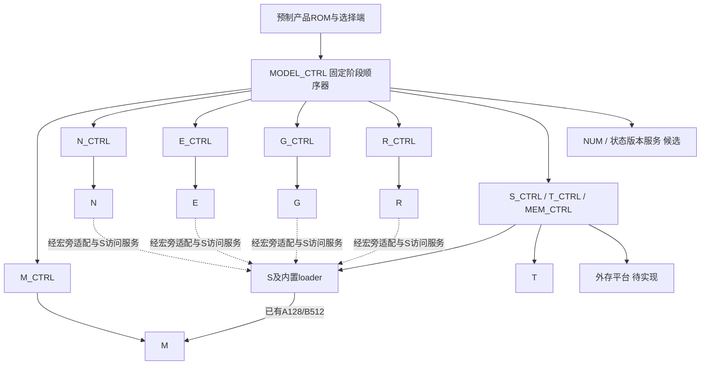

# 七宏六类连接与固定产品控制总方案 v0.2

任务 [Issue151](https://github.com/rayggxia-workspace/LLMHardwareDesign/issues/151)，交付 [PR152](https://github.com/rayggxia-workspace/LLMHardwareDesign/pull/152)，负责人 Melodydt。状态：**待评审设计，系统 RTL 尚未实现**。本稿取代 v0.1 作为当前总方案；历史研究保留来源和资格边界。

## 1. 本稿建立在什么实现之上

本轮逐项读取研究分支 `task/151-six-connection-study` 的 `faabeda68b3b098ba562d68517319e02725f5bc3`：它已经合入 PR144 的固定版本 `643c6012a11cbf461146ac40fbf61485223fe946`。14 份核心 RTL/include 的 Git blob 与 SHA-256 见 [RTL 基线](../work/Melodydt/151/rtl-baseline.json)。PR144 后续提交不自动算入本方案；PR133 的专项互联和 PR146 的 SystemC 也没有随之纳入。

当前真实实现是 **M/N/E/G/S/R/T 七种叶宏，加上 S 内置供数器**，没有已经连接六类算法的统一系统顶层，也没有本稿的母控、局部服务、完整产品程序或通用 bridge。端口与操作码的逐项审计见 [原生接口审计](RTL_NATIVE_CONNECTION_AUDIT.md)，控制协议见 [控制规格](SIX_CONNECTION_CONTROL_SPEC.md)，六类原生命令流程见 [六模板规格](SIX_CONNECTION_TEMPLATE_SPEC.md)。

| 叶宏 | 当前实际能力 | 对系统设计的约束 |
| --- | --- | --- |
| [M](../project/rtl/block_v2/block_v2_m.sv) | 双输入银行，S8/S16 tile 计算，S64 结果，op3/op5 读出 | v2 只有 op3/4/5/6/10/11/12；op4 是全局缩放配置，不能当旧版 merge；只有一个结果上下文 |
| [N](../project/rtl/block_v2/block_v2_n.sv) | 分组统计、RMS/L2 因子、Softmax 分轮回放、至多40项 TopK | 不保存整向量，不接收目标总长度，不提供 mask 或 score gather；一次只能占用一个归约上下文 |
| [E](../project/rtl/block_v2/block_v2_e.sv) | 8×S16 向量运算，op13 将4×S32量化成4×S16 | 无有效数端口；op13 仅低64bit有结果，必须两次拼成一个128bit字 |
| [G](../project/rtl/block_v2/block_v2_g.sv) | 2 lane 的 SiLU/Sigmoid/GELU/Softplus，可乘 gate | x 与 gate 有角色；2 lane 与8 lane必须拆拼，整个流水受输出反压停顿 |
| [S](../project/rtl/block_feed_v1/block_feed_s_macro.sv) | 16KiB，普通128bit访问；内部 loader 已驱动 M 的 A128/B512 | 普通读写都要取回应答；loader 与普通访问需统一管理，不能旁边再接第二个驱动者 |
| [R](../project/rtl/block_library_v1/block_v1_r.sv) | GDN/SSM状态与4-tap卷积，局部 active/shadow、候选与提交 | 8值lane、状态长度至多256；S32单位由产品声明；一次局部提交不等于全层/全token提交 |
| [T](../project/rtl/block_v1/transaction6k.sv) | 单租约384×128bit事务缓存，写满、提交、读出、释放 | 非普通流FIFO；超长结果需分批；错误为 sticky protocol_error，不是 commit_error 应答 |

M/N/E/G/S/T 的上游叶宏资格不能转成整链资格；**R 仍未取得最终资格**。跟踪中的 R 是缩窄候选，不能把另存原 R4032 源码的物理数据库挂到它名下。来源和集成边界见 [当前实现基线](SEVEN_BLOCK_RESEARCH_BASELINE.md)。本轮没有改动叶宏或重新运行物理流程。

## 2. 总体选择与bridge归属

采用 **固定产品母顺序器＋按物理资源划分的局部控制器＋宏旁格式/协议适配＋S/外存物化交接**。统一的是局部控制器外侧的任务、缓冲描述符和完成事件；宏内原生接口仍各不相同。

控制器、虚线交接、NUM与外存服务均为新增候选。S→M只表示现有loader的原生供数接口，不表示已经有完整v2系统组合证明。所有普通S请求汇聚到S_CTRL，数据通路不穿过母控。

| 内容 | 位置与改动 | 是否已有 |
| --- | --- | --- |
| M A/B供数与bank/row/tile拆分 | 保留S内部loader；系统补描述符和完成管理 | loader已有，新v2组合待验证 |
| E三操作数收集，M四S32结果打包，G两lane拆拼 | 叶宏旁预制寄存器、MUX和局部FSM | 新增 |
| N统计/原值/EXP/gamma回放 | N_CTRL＋S/外存缓冲；默认不在N内加整向量RAM | 新增 |
| R参数/状态装载、候选读出与局部提交 | R_CTRL；跨tile版本管理在外部状态服务 | 宏内局部FSM已有，外部服务新增 |
| S仲裁、T租约、跨消费者引用计数 | S/T附近的服务控制器和元数据 | 新增 |
| GDN/SSM系数、MoE宽累加 | 显式NUM算术服务，单独算面积/数值误差 | 新增算术，不能称普通搬运bridge |

首版优先用宏旁标准单元实现外部逻辑。是否硬化为独立辅助宏，要在面积、pin和布线评估后决定；本稿没有现成“统一bridge宏”。塞进原硬宏会改变其pin、面积、时序边界，需要重新做对应资格；外置也需要组合时序与物理验证。

## 3. 哪些连接允许，哪些需要禁止

编译器检查真实生产者/消费者角色、类型、尺度、长度、布局、生命周期和物理路径，再决定能否经已有路径或显式适配连接。相同128bit不代表相同数据。

| 源→目的 | 当前可利用的能力 | 必须加入的条件/适配 |
| --- | --- | --- |
| S→M A/B | S内loader与M接口字段可对应 | A/B宽度、bank、rows/tiles与保留地址组一致；M就绪，load完成无错；S16 B两half均到齐 |
| M→E/G/N | M op3 S64 或 op5 四个S32容器 | 先读结果；仅op5四S32可经E13两次拼包；op3两S64须已定义宽转换或改用op5量化读出；EXEC应答不是结果 |
| N→M | Softmax回放得到非负S16 Q1.14，可作M S16输入 | 不能把EXP UQ1.15当概率；PV按Q14×V的实际小数位配置M读出 |
| N→R | Q/K归一化结果可作为Q1.14候选 | N gamma/epsilon与目标L2定义必须显式匹配；无自动Q10→Q14 |
| E→G | E普通S16与G输入可以采用Q5.10合同 | x放激活输入，gate放线性分支；8 lane拆4次，每次2 lane |
| G→E/N/M | 按实际输出格式物化 | ungated Sigmoid是Q1.14，其他ungated及全部gated输出按Q5.10；不能只按fn推格式 |
| G/E→R | q/k、x/inject、skip、decay/beta等不同角色 | q/k/taps Q1.14；x/inject S32单位F；skip Q16.16；decay/beta UQ1.31，分别转换 |
| R→E/G/N/M | R op12读8lane候选输出 | 四S32一包，E13 shift取决于F；到Q10时仅F−10∈0..31可直接用E13，其他转换另设计 |
| N TopK→专家 | N只给ID | 独立score表gather原分数，校验ID并关联专家/概率/rank；ID不能送Softmax当score |
| 任意生产者→T | T保护一批至多384字 | 先保留整批空间，顺序填满，再commit；tail有效数由外部描述符保存 |

必须拒绝：多个源并驱同一输入、多个消费者共享一个take而无fork管理、未量化S32直接解释成S16、N EXP当M概率、未完成整组就FINALIZE、覆盖仍在使用的S槽、R pending时OPEN或重装状态、跨资源提交后仍声称可整步撤销、单批T超过384字、产品需要的算术/ROM/外存不存在。

N有cmd_count（1..8），E/G没有count，尾部独占一个S字、无效lane填零后整128bit写并保存有效数；共享尾字须另做RMW/仲裁。mask不是padding：N没有注意力mask端口，有限负哨兵不等于负无穷，全mask行会给出错误语义。首版要求至少一个有效key，且能证明masked score与有效max之差不大于−16384（Q5.10的−16），否则增加专用mask处理或拒绝该数值策略。

## 4. 六类算法的闭合路径

六类是系统模板，尚非六个完成的RTL系统。“可承担”只指叶宏可做相应子算子；缺失项须先预制，才允许纳入产品。

| 模板 | 固定数据/控制顺序 | 本版仍需补的主要能力 |
| --- | --- | --- |
| 普通Attention | Norm→QKV投影→可选RoPE→QK→完整一行Softmax→PV→输出投影→残差 | K/V外存和转置布局、RoPE sin/cos来源及E合同、QK缩放/因果mask、N多轮回放 |
| 额外Norm | 整组STATS→FINALIZE→原值/gamma回放→下游 | 外部总长度计数和保留；RMS/L2 epsilon及输出单位；不能把所有Norm都映成同一模式 |
| 门控FFN | gate投影保存＋up投影保存→G激活(gate)×up→完整mid物化→down所有K块→残差 | G拆拼、E13、M单结果上下文管理；大mid外存 |
| Qwen GDN | 投影→R卷积/history pass→保存→E转换/G SiLU/QKV切分→Q/K L2/头复用与仅Q缩放→系数→R各state tile→保存全head输出→全head Norm→z门控→输出投影 | 非线性系数NUM、R输出/状态F合同、跨tile状态版本及head回放 |
| Falcon SSM | 投影→各conv tile保存/历史提交→状态tile载入decay和输入→R状态更新→z门控→全channel Norm→输出投影 | 逐元素衰减NUM、conv与状态两遍计划、外部history/state版本；SSM与GDN的Norm次序不同 |
| Granite MoE | 路由logits→TopK ID→gather所选logit→小Softmax→专家FFN→S64宽归并→共享分支/残差 | score gather、专家地址动态选择、NUM_WACC及共用尺度、0.22缩放合同 |

M结果行不能同时保存两个独立投影，也没有通用结果恢复命令。K分块可在一个投影中累加，但投影切换前要读出/物化；不能交错gate/up覆盖down的未完成结果。N长归约必须整组占用一个context；跨头可串行复用，不能交错BEGIN。

R active和shadow各8KiB，至多256×8个S32，只是单tile容量。多个value tile/head/layer、conv history、KV和输出都需要S/外存计划。局部COMMIT后才能由op11/op14读出新active state/history；pending期间读它们仍是旧版本。全层成功后切换外部根版本，不能假定R的一个COMMIT会完成外部事务。

## 5. 如何适配不同产品的固定控制链

### 5.1 制造与运行边界

用户已确认：模型在M11/M12定制时才确定，成品运行时流程固定。不能在知道模型后重新综合有源FSM，再称为同一预制底座。

主候选：冻结前编译**有限受支持产品的完整程序/参数ROM**，预制相同母顺序器、局部FSM、循环计数器、等待/错误逻辑、缓冲和常量驱动；M11/M12只连接预留产品选择端和合法数据/控制线；冷复位锁定入口。非法或缺能力的产品拒绝启动。金属不能添加MUX、寄存器、FIFO、译码或重做CTS。

若要求冻结后支持未编译模型，备选是预制可写控制存储，冷启动一次装载并锁定，其RAM、装载口和校验成本计入。**六模板不等于样本八个模型的完整程序**，当前 `complete_model_programs_compiled=false`；ROM容量、完整形状/量化和外存布局待实际编译，不能现在冻结。

固定控制链仍需运行时token/长度循环、KV地址、TopK专家ID分支、ready等待和错误处理。这些是固定程序的动态参数，不需要通用DAG扫描器。

### 5.2 两级组织与布局布线

母控MODEL_CTRL只发有界阶段任务及依赖，子控靠近资源逐拍驱动。M_CTRL独占M cmd/rsp；S_CTRL独占S普通口和loader描述符；M A/B仍由S内loader独占。N/E/G/R/T同理。Attention/FFN是阶段程序，不各自建立能直接争用M/S的控制器。

母控↔子控采用保持型任务/完成握手、task_id和epoch；完成分compute_done、data_ready、publish_done、release_done。S写回应答被取走后才标本次数据可见；T commit只代表本批对T读口发布，不代表最终外存写成功。

两级能够缩短高扇出逐拍控制线，但母控仍有少量长线，S访问也可能成为热点。首版单时钟域，局部ready路径以预制寄存/缓冲隔离，不能形成跨宏组合ready环。是否再加区域层取决于宏位置、扇出、最差线长、拥塞与延迟，不先按算法复制控制器。冻结前以相同计算叶宏、约束及布局预算比较单中央/两级/必要区域层三种有源底座候选，选定后再冻结共同底座做产品A/B，不能凭分层框图宣称已解决布线。

## 6. 两个首轮实现例子

### 6.1 1 token、H=I=8的门控FFN

输入/残差S16 Q5.10，三个权重S8整数；本例不含输入Norm。S按字地址分配：0..3 A_X组（word0有效），4..7 Wgate，8..11 Wup，12..15 Wdown，16 Gate，17 Up，18 Mid，19间隙，20..23 Down_A组，24 Y。**保留跨度400B**，另有wrapper寄存器和T一字16B；不是所有产品的存储成本。

1. S普通写逐字取回应答。M_CTRL发op4：index0、data1，显式设置factor=1、left=0；CLEAR_ALL不会恢复缩放配置。
2. S_CTRL发load：bank0、rows1、tiles1、A16/B8、reuse_b=0，A_base0，B_base4；等loader done被取走且无错。
3. M op10 index0、data=`0x9885`：A16/B8、clear、K8/N8/tile1/row1。等EXEC应答无错，再用op5 data=`0x100`、index0/1读两组四S32容器。
4. 各经E op13 shift0取低64bit，拼一个128bit Gate字写S16；同样B_base8得到Up写S17。两个投影都完成物化。
5. G fn0(SiLU)、gated1，in_x取Gate、in_gate取Up，每次2lane共4次，拼Mid写S18，再复制到S20。
6. A_base20、B_base12、reuse_b=0做down投影，同样读出/拼包。E ADD将down与保留在S0的输入相加，保存Y到S24。
7. T begin(words1)→write(index0,Y)→SEALED→commit→消费者read_take→release，完成本批输出。

这是拟实现的命令级组合例，不是现有测试已通过的FFN。权重改S16、加Norm、K分块或换尺度会改变字数、循环和量化，不能复用400B结论。

### 6.2 257项Softmax

S0..32保存257个score（33字528B），S64..96保存EXP（33字528B）；T一批33字528B。N BEGIN(mode0)→33次STATS（32次count8、末次1）→FINALIZE→33次EXP并保存→FINISH_EXP→33次SOFT_REPLAY并填T→commit→逐字读出→release。score与EXP活动数据1056B，S保留跨度因空洞更大。

N_CTRL自己累计期望257、记录每轮读写进度、验证tail1并排空应答；N没有目标长度寄存器，提前FINALIZE可能被原生RTL接受。T read_last表示最后一个字，不携带该字只有1个有效元素的信息；tail留在wrapper描述符。这个例子优先验证整组/回放/尾部/T生命周期。

## 7. 错误、取消和可见性

局部控先保留输入、目的槽和应答保持空间，再接受任务；无资源就反压。多输入join按同task/epoch/范围/格式绑定，fork按消费者引用释放。S_CTRL对loader和普通请求首版串行服务，取得合法握手后才撤销valid。

错误分原生命令错误、饱和策略、格式/长度非法、存储失败和协议错误。M/E/G/N有saturated，R没有饱和标志而会报计算/协议错误，T为粘性protocol_error。不能伪造统一原生错误口；由外部局部控归一为保持型完成状态。

取消在安全点进行：停止新命令、排空已接受应答、丢弃未发布输出、按资源语义清理。R pending可revoke，但COMMIT已握手后必须等应答；成功后不能撤销原active。R/T无跨宏两阶段提交，R已提交而输出落地失败属部分完成，需要外部旧版本/恢复策略，T revoke不能回滚R。详见控制规格。

## 8. 实施顺序与验收门

1. 冻结原生接口合同及数值命名，实现M/S/T、N回放、E/G拆拼最小wrapper；优先不改叶宏。
2. 组合验证FFN8和Softmax257，覆盖任意反压、tail、S写应答、非法命令和取消边界，独立整数oracle核算每个量化步骤。
3. Attention/额外Norm验证跨tile统计、KV、转置/RoPE与mask；大形状证明S/外存容量和带宽。
4. 独立实现/验证NUM_COEFF、NUM_WACC、gather和版本服务，再做GDN/SSM/MoE；R自身资格未完成单列阻塞。
5. 完整样本图编译、量化校准、输出质量和存储计划通过后，计算ROM与局部资源上限，冻结支持产品集合。
6. 控制器、适配器和实际M11/M12线路共同做STA/CTS/布线及同底座对照；结果绑定源码、约束、工具和数据库，不能沿用叶宏数字。

本轮执行管理检查、来源字节核对、设计合同/示例编码与文档链接静态检查，见[本轮验证](../work/Melodydt/151/rtl-redesign-verification.json)。RTL/SystemC、整模型质量、综合和P&R均未执行；新系统硬件、完整产品程序和系统资格未完成。独立审查人待指定，PR未合并，Issue待审查而非done。
