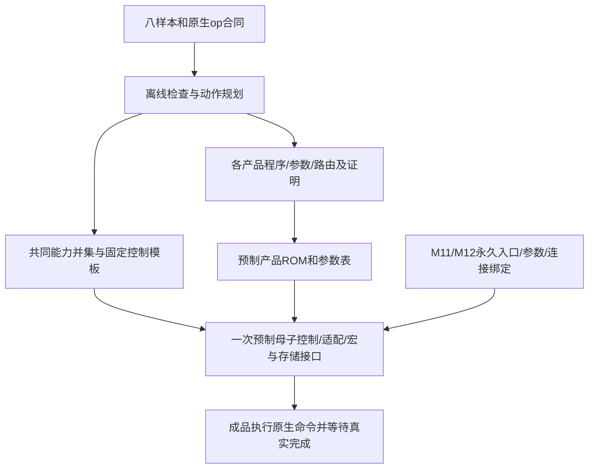

# 前三步重新研究：编译期契约、共同预制能力与固定产品执行

状态：**可评审研究与静态工具交付；系统RTL、完整模型程序及共同底座尚未验收**。任务[Issue151](https://github.com/rayggxia-workspace/LLMHardwareDesign/issues/151)，交付[PR152](https://github.com/rayggxia-workspace/LLMHardwareDesign/pull/152)，负责人Melodydt。输入研究提交e44c4f5f492b2ef0fef12846dd25c1b1ea637664；七宏仍固定PR144来源643c6012a11cbf461146ac40fbf61485223fe946，不导入该PR后续更新。

## 1. 本轮为什么重新划分前三步

之前已经建立八样本、621数据槽/460受控参数槽、153配方及96连接义务，但通用task/handle/事件合同容易被误读为每条链都必须运行时识别类型、维护完整动态描述符。本轮将语义规格与物理执行分开：**软件证明角色/数值/布局/生命周期的可静态部分，硬件只保留执行这些证明后计划所必需的接线、已有算术、MUX、保持、计数及同步。**

这不删除角色目录。只有明确源op/mode/参数和目的op的合同，编译器才知道应当保证什么。role可由这些字段推导，不需要为每个payload增加一个通用role标签；153份配方也不等于153颗bridge。没有静态证明的未知项继续保留，不能把“缺硬件”改成“数学非法”提高覆盖率。

范围继续仅为仓库八样本/十层型，保留真实H/I、头数、层序、位置上限和状态形状；六算法仅作回归。系统有外存，接口、带宽、驻留和搬运调度暂不展开；P0纯片上评估的缺口不是产品永久无外存结论。M11/M12只作合法无源连线与永久选择，不依赖启动装载控制程序。

## 2. 步骤1：从模型参数表转为共同底座的绑定合同

正式入口为[样本与绑定规格](SAMPLE_MODEL_FAMILY_SPEC.md)，机器输入为[family-binding-contract.json](../work/Melodydt/151/family-binding-contract.json)。旧family-spec和19份来源索引继续保存精确配置/图事实，本轮不重写模型维度或量化已验收状态。

新增的核心区分：

| 层次 | 典型内容 | 谁决定及何时生效 |
| --- | --- | --- |
| 共同预制 | 宏数量/位置、所有支持op、路由MUX、缓冲、母子FSM、译码、程序/参数ROM和必要算术 | 全部目标模型需求取并集后，一次设计并在M1–M10共同冻结 |
| 产品绑定 | 产品入口、层序/层表、H/I/Q/KV/D、布局与定点参数集 | 预制记录已经存在，M11/M12永久选择；执行时可按层/头索引读表 |
| 运行时必要变量 | token/位置、循环进度、TopK专家ID、原生valid/pending、响应完成、错误与发布状态 | 由实际输入和执行进度变化，保留相应计数/状态/选择电路 |
| 编译证据 | role、类型、尺度关系、范围、布局、资源生命周期与别名证明 | 离线检查；已证明静态项不必重复进入通用runtime表 |

“永久参数集固定”不等于所有层共用一个scale常量；一个模型内部仍可按层或通道读不同的预制参数。模型已知但输入值未知，也不等于所有运行时分支都能消除：Granite专家选择、可变序列长和外存响应等待仍需真实执行机制。

有限集合必须在共同底座冻结前具体化并编译接收完整产品程序。只有“模型类型数量有限”、却不知道其算子与边界，不能保证未来模型都能映射。当前绑定表属于可检查研究输入，完整八产品编译/接收数仍为0。

## 3. 步骤2：角色到共享动作的静态降解

正式入口为[角色与动作规划](SAMPLE_LEGAL_CONNECTION_LEDGER.md)，机器合同为[compile-lowering-contract.json](../work/Melodydt/151/compile-lowering-contract.json)。原始621/460槽、153配方、96义务保留为覆盖分母；本轮提供动作归并与有限实例规划工具，不把目录遍历称为完整模型编译。

降解顺序为：先检查原生op产生/需要的数学角色，再绑定类型/尺度/布局/有效数，消除identity动作，优先利用已有op，最后只为剩余的真实动作要求预制电路。编译器输出指令/参数、接线/路由选择、必要临时区和未决项；不能通过“更改类型标签”改变数据。

| 实际需求 | 可由编译期决定 | 仍须执行的物理动作 |
| --- | --- | --- |
| M.op5已按S16夹取后送G | 证明数值范围、尺度和顺序相容 | 抽取四个32bit容器的低16bit，分两次G32传输；利用源保持或明确暂存，不强制先拼八元素 |
| 未夹S16的M四S32结果送S16目的 | 选择正确shift/舍入/饱和，不能裸截取 | 优先用M已有量化读出或E13；现有op不能表达时保留数值服务缺口 |
| E12与E13都只用低64bit | 由op推导前者8S8、后者4S16 | 按消费者需要抽取/拆拼/补零；不从位宽猜元素数 |
| G Sigmoid Q14送Q10输入 | 插入明确的重标度，禁止只改F标签 | 复用已有合适移位/算术；若无能力再要求新增硬件 |
| N EXP送最终概率用途 | 确认完整统计/EXP/factor/回放关系 | 使用N已有SOFT_REPLAY，不能把EXP位模式当概率 |
| TopK ID选择专家 | 静态专家表和有界ID域；证明或保留值域检查 | 必要的索引/地址生成和gather；真实专家权重供数仍待存储方案 |

合包不是所有目的的共同要求。N可接受每命令count=4时，无需为了统一128bit先凑八个；G每包只需两个S16。相反，M.B等有固定大载体/布局的目的仍需真实收集与格式组织。静态地址调度可承担部分布局变换，但无byte mask、尾字所有权和跨字重排的成本仍要出账。

多个普通推挽输出不能因软件证明valid互斥，就用金属直接并到同一输入。需要时分复用的数据路线仍须预制MUX/仲裁；M11/M12选择接入图形，运行时phase通过已预制控制选择合法通路。无损复制可以沿用schema/lineage，有损转换必须形成新的数值节点。

工具中的数值/字段探针用于检查这些规则和参考整数行为，尚未生成完整模型指令、运行现有RTL或证明全部参数实例。未实例化的尺度、上下文、数值质量、实现与路线仍作为独立缺口。

## 4. 步骤3：固定程序驱动的局部执行合同

正式入口为[静态执行与资源合同](SAMPLE_ONCHIP_SYSTEM_CONTRACT.md)，机器合同为[static-execution-contract.json](../work/Melodydt/151/static-execution-contract.json)。旧onchip-contract的handle256/task512/event256、32KiB控制和2MiB ROM预算保留为通用方案比较，**不再当作当前方案的最低运行时硬件要求**。

本轮选择保守、可逐步落实RTL的功能候选：母控执行静态程序和有界循环，局部控唯一驱动原生端口；减少通用动态任务与handle管理。角色/尺度/布局的静态事实驻留离线证据或预制ROM，运行时保留真实指令选择、循环、数据准备与写确认、N/R阶段锁、T租约、错误和排空。具体字宽、模板记录、槽深和逻辑存储逐项列在步骤3合同，不以缩短指令字掩盖模板/参数和局部保持成本。

局部执行不意味着忽略协议：S辅助访问必须能够独立完成，不能因母控等待另一个宏而停转；接受命令前要预留结果保持/完成空间；完成被母控接走不自动释放N/R上下文；旧响应未排空不得重用身份。R输出读取、局部COMMIT、完整state/history根发布和T批次发布仍分别处理，不能假定联合原子回滚。

S原生16KiB、T6KiB、R各银行8KiB不因软件抽象而变大。P0的loader快照1KiB＋T批次spool6KiB＋计算区9KiB、另增1KiB loader capture继续是有明确串行策略的保守容量基线。新静态直连可以减少某条路线的物化；只有实际生命周期证明后才能复用或扣除预留，不能凭“由软件保证”删除真实保持空间。

选中产品的完整状态根也不能消失：即使按静态层索引代替通用handle，old/next状态、位置、完成和发布元数据仍需表示。大型payload可在后续外存方案中驻留；本轮仅保留MEM服务和可变延迟完成语义扩展，不给未研究接口编造带宽或已存在的RAM。

### 当前候选的具体规模与代价边界

| 项目 | 本轮候选 | 证据边界 |
| --- | ---: | --- |
| 微指令 / 普通命令模板 / 完成记录 | 64bit / 256bit / 128bit | 固定格式候选，27项packing/预算检查，不是已综合端口 |
| 子控模板接收存储 | 10×64B=640B | 物理上每服务各一份；单前台job不能把十份成本算成一份 |
| 运行态、局部控制与端点staging | 3448B，预算点4KiB | 裕量648B；不含NUM算术/LUT、完整MEM/PHY、模型payload、ROM或布线逻辑 |
| 程序及各类永久表 | 648960B，预算点1MiB | 含指令、32B模板、242层表、Granite专家地址和56项R静态根；完整程序未编译，容量仍未证明 |
| R运行根 | 32层×32B=1024B | 只选一个产品且按层串行；保留old/next、位置与发布，不代表state payload已驻留 |
| loader额外capture | 1024B | 另于上述控制预算和S，未实现 |

ROM按64bit beat直接流入选中子控的模板bank，母控不另藏一份完整模板；4/8字收齐后才执行。旧32KiB/2MiB通用候选与本方案的功能/并发假设不同，不能把预算差额当作面积或节省率。新增MUX、握手、计数、地址生成及NUM/MEM实现成本仍需综合与物理评估。

## 5. 同一预制底座的约束没有放松

1. 所有目标产品使用同一宏版本/实例数/位置、控制器、ROM位单元、MUX/缓冲、有源中继及固定PG/CTS。不能分别综合产品A/B或为其中一个产品临时插buffer后仍称共同底座。
2. 编译器可产生不同产品计划，但计划必须落到已经预制的能力与程序记录。M11/M12只能选择/接线，不能在冻结后新增FSM、PHY、DMA或算术门。
3. 对每个产品分别完成数值、容量、程序、调度/活性和物理验证。边级合法不保证整图可布通或达到目标吞吐，串行候选也不代表性能已可接受。
4. 仅作静态检查的role/handle不是硅上必需字段；必须执行的数据变换和握手也不会因离线编译而自动发生。源操作已能产生目标格式时，消除冗余转换，不重复量化。

## 6. 本轮修改范围、追溯和未完成项

本轮实质重写三个步骤规格和本报告，新增模型绑定、角色降解、静态执行三个机器合同与可复现工具/案例；同步总方案、控制、全合法规格、profile目录、候选决策、架构命令、本人进度与交接。原始模型/角色输入与历史运行回执保留，七宏RTL和ref-project不改。

实际命令、输入commit/源码SHA、工具版本、输出SHA及未执行项见[本轮检查回执](../work/Melodydt/151/static-rework-checks.json)和[本轮交叉验证](../work/Melodydt/151/static-rework-verification.json)。来源仍由原19份配置/图快照及10份原导出回执验证；不把原FP32小图、SystemC或管理CI转为新RTL证据。新增脚本在运行时尚未提交，以源码内容SHA追溯，交付commit在PR回执中绑定。

本轮12项实际命令全部exit0；八模型绑定与动作合同均可逐字节重生成。37个明确预期的正/负/状态/容量/缺数据probe通过，22561个整数RNE结果与独立精确有理数参考一致；18个N回放配方/46槽另核对目标op，原分数回放是N3、EXP概率回放是N6。27项执行格式/物理模板bank/预算检查通过；原70项P0规则、19份来源/10份配置回执、7接口与14核心RTL字节回归通过。全部都是所声明范围的静态/软件检查。

未完成：完整八产品程序编译及预制ROM容量证明、全部角色参数实例与量化质量、实际共用适配/NUM/母子控制RTL、外存平台、全图活性、共同底座布局布线和多产品同底座验收。当前新系统RTL与完整产品准入均未因此增加，R最终资格仍由独立实施任务跟踪。

成果待独立审查，PR未合并，不将Issue标done。登记沿用management-hub PR5 pending；缺Projects条目能力和board.json时，卡片状态unverified、同步pending，恢复动作与处理人见本任务交接。
