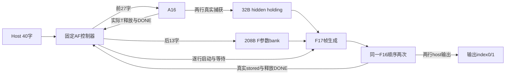

# 主线四AF16纵向衔接与真实样本准入

Issue151 / PR152；Melodydt；2026-11-02 Asia/Shanghai。输入cd8dfc9a，真实测试源a37df8be480d6472627a11419777511042af6a60。本轮新增固定A16→F16的纵向集成验证顶层，并交付保留八模型真实形状的静态准入检查器。旧A16/F16/native保持字节不变。

## 接口为什么仍需协调器

A16输出两字S16Fin10 hidden；F16每行输入17字，包含hidden、padding、三份权重及gamma。格式相同只使hidden能逐bit复制，不能自动生成剩余帧、保留参数或管理DONE。新block_w4_af16_top把这些职责落实在真实parent控制器、13字参数bank和2字A结果holding中。它是主线四固定纵向验证顶层，不增加第七种功能岛、不冻结AF产品岛，不表示L5通用母控/可定制跨岛网络已经实现。

输入0..26为原A16帧；27..38为F三权重，39为F gamma。A gamma仍在24，不能把两种Norm参数混用。外部帧640B=544B有效+96B padding；F参数外部只送一次，但在两次F17帧内实际重放，不是假定F核保留上一任务权重。只有40字已捕获且子A的真实S最后写ACK建立stored后，父input_stored/start才成立。

父RUN接受后拥有独立终态。A_START尚未真正启动子A、或F_FEED仍在填子F帧时，取消由父形成error完成，不等待子prestart本来不会生成的DONE。父以seen+busy/stored检测子帧异常；preRUN丢帧无DONE，RUN内丢帧给父error并协调reset。父metadata门控在错误index/last时禁止捕获/发布；saturation只从当前已启动及相应阶段的子任务采样，避免旧帧flag污染。

A两字经实际FF捕获后，父holding取得保活责任；随后消费A正常DONE，即A的T已实际释放。F帧逐行为hidden、3个实际zero、12权重字及F gamma；必须等各F真实stored再start，并等该F输出take和T释放DONE后才换下一行。F输出由原F的T在背压期间保留，父不新增T。第一行已被host消费后，第二行错误只报告error，不承诺回滚前缀。childDONE不是F目的S存储确认；父显式holding填补了旧T释放后的数据生存期。

## 资源及正常路径

新增数据holding1920bit/240B（参数208B、A两行32B），另28bit父控制声明账；这不是综合后最小面积。实例合计M2/N2/E2/G1/R0/S2/T2，无额外T。两个S仍各16KiB、两个T仍各6KiB；A任务预约S1312B/T32B，F任务预约S448B/T16B顺序复用，不能把任务预约当成宏面积或免费并行池。

正常固定AF事务核对：181普通S（131W/50R）、72M、28N、10E、2G服务/8pair、12loader/26宽读、18Abeat/14Bbeat、子T取4字/释放3次、外部输出2字。父输入40字，子A输入27字、子F共34字。旧两个子RTL完全不改；本轮不改变其数值单位或引入RNE3/S8窄化。

## 真实验证与可追溯证据

job95242在node1/c64/8CPU、Verilator5.042运行，首次r01 Slurm COMPLETED0:0，build/sim0，33个预声明CASE各一次exactPASS。10组独立数学组合期望以既有独立A16/F16数学参考生成，不使用DUT输出做golden。检查逐bit A→F、两gamma/参数复用、真实stored/释放、背压、RUN已收但子未start取消、部分F帧S helper错误、两输出间取消、N/M/E/G错误、坏A/Fmetadata、未启动F/已关闭A旧sat过滤及复位/保留DONE。

33个完整正常父任务与18个异常/取消/reset事务可精确解释全套统计：input1924、S7549/7549、M2935/2935、N1183/1183、childT154/release111、host68；host68是33正常×2加两个已消费前缀，不是68次推理。正常任务181/72等逐阶段守恒单独检查。

保留30条警告（16TIMESCALEMOD、11WIDTHTRUNC、3WIDTHEXPAND），仅-Wno-fatal，不屏蔽类别，不称lintclean。工具g++11.4.0/Make4.3/Python3.10.12；容器SHA c742bf99ea498fb4da5135bc83fd1677abcebe0e64470e6a115f2baecb3905df。30份运行输入在计算节点和导出时SHA校验，12文本证据与archive SHA校验；build/二进制只留本人服务器目录。

原始[运行回执](../work/Melodydt/151/af16-rtl-evidence/runs/r01/results/run-receipt.json)、[模拟日志](../work/Melodydt/151/af16-rtl-evidence/runs/r01/logs/simulate-af16.log)、[SHA索引](../work/Melodydt/151/af16-rtl-evidence/evidence-manifest.json)、[独立复核](../work/Melodydt/151/af16-final-evidence-review.md)与[数值合同](W4_AF16_NUMERIC_CONTRACT.md)可交叉核验。

## 八真实样本为什么仍未准入

新增[样本准入账本与下一实际尺寸路线](AF16_MODEL_ADMISSION.md)、机器ledger和scripts/check_af_model_admission.py：核22输入源SHA、24个独立literal正反例及八模型×A16/F16/AF16=24个真实结论。唯一静态ALLOW是synthetic_af16_h8_sq2_i8_v1，真实24项全部GAP，数值/质量/参数供给各项UNKNOWN保留。真实模型身份以来源H/I/head等计算，即使请求伪写H8也不能缩形准入。

正式CLI默认检查exit0；Qwen3/AF16正确以exit2拒绝并报告H1024/I3072。CLI原始输出在本地包留SHA，简明运行记录见[准入检查回执](../work/Melodydt/151/af16-admission-cli-checks.json)。静态ALLOW与33CASE RTL通过、真实模型质量及物理资格分别记录。

下一项优先Qwen3实际F行H1024/I3072：候选S0..931=14912B、T128字；先接收权重量化/epsilon/误差合同，再扩N-long计数/地址及K32/N8完整归约程序、真实有序chunk供参。S8三矩阵9MiB，13字bank不能供给；单M先全gate/up/G得到完整mid，再连续完成down，不能在down partial中切回gate/up，不能逐K chunk窄化。未优化候选36864EXEC/行是设计数，不是实测性能或ROM长度。上述均未实施/验收，详见准入报告。

当前仍L4；真实GQA/QKnorm、模型RoPE/位置、实际H/I/量化质量与供参未接收，L5通用端点/母控/peer storedACK、L8真实MEM与共同底座/M11-M12物理另验。外存仍保留灵活性，本轮没有假定它不存在或已经可用。

## RTL作者结构审阅记录

下述为作者源审阅阶段记录，未运行仿真的措辞说明分工；实际通过范围以本报告与服务器回执为准。

# AF16 固定 A16→F16 纵向组合实现草稿

Issue151 / PR152；输入 `cd8dfc9a3770f0be04b3e75fe08fe60fd69e47a6`，原生叶源沿用7078786。本稿实现冻结 `AF16_PLAN.md`：新增 `block_w4_af16_top.sv`，实际实例原 `u_a=block_w4_a16_top`、`u_f=block_w4_f16_top`，不修改任何旧RTL。

当前是L4固定H8/Sq2/head1、F I8的验证顶层草稿；本作者未编译、未运行本地RTL仿真或远程动作。源码机械检查及本审阅不是编译通过、等价证明、外部PR批准或物理资格。

## 1. 真实数据边界

外部19信号/282逻辑bit沿A16/F16，帧改为40×128bit：0..26通过valid/ready原样交给A16，27..38为F的gate/up/down共12字权重，39为F gamma；后13字真实写入 `parameter_bank[0..12]`。A gamma仍在A帧beat24，不能复用F gamma代替。

A的最后S输入写ACK未完成时，父仍可捕获F参数，但必须40拍全接受且A的 `input_stored` 真实建立后才形成父marker/start_ready。A部分帧的每拍仍由原S helper实际写ACK；参数bank是本轮真实FF存储，参数accept即该FF写入，并没有伪造额外S ACK。

父start成功后独立拥有整个AF任务。A产生两行输出时逐拍核对index0/1、last0/1，才把数据写 `a_rows[0/1]`；非法metadata不take、不产生任何F输入，进入父错误。捕获齐两行后仍等待A成功DONE并真正消费它；原A已在DONE前释放其T，不能只等第二字last就开始覆盖/复用。

一个F16按row0、row1串行复用。每行17拍由硬件选择器生成：beat0为对应128bit A行原位数据，1..3为真zero，4..15为parameter_bank0..11，16为parameter_bank12。每个F输入握手才推进feed_index；第17个实际S写ACK建立子stored后才允许F start。没有新增RNE3/S8窄化，因此A输出S16Fin10逐bit进入F的原始输入、Norm与残差。

F输出直接受控转发host，先验证子metadata必须index0/last1；父index改为row0/1，last仅row1。无效metadata立即屏蔽hostvalid与子take并形成错误。每次host输出take之后，仍等待该F真实T释放并消费正常DONE；row0之后才发row1的第一拍。最终AF正常DONE要求A一次、F两次全部正常闭合。

本轮不是独立权重服务的完整产品接口，也不是一般岛间数据/ACK网络；F参数只通过本40帧载入，在这一次AF任务内两行复用。对host的take不能解释成目的stored ACK。

## 2. 控制与所有权

父state：INPUT0、A_START1、A_CAPTURE2、A_DONE3、F_FEED4、F_STORED5、F_START6、F_OUTPUT7、F_DONE8、DONE9。input_index6bit记录下一输入0..40，f_feed_index5bit记录0..16，row_index1bit，a_capture_count2bit。

parameter_bank仅INPUT阶段的27..39实际host握手可写，进入RUN及未消费DONE时外部in_ready保持0；两个a_rows只在合法A输出take时写，整个AF任务保持，直到下次任务建立。中途host不能更新F权重/gamma；子S普通口、N/E/G服务及loader owner继续由原A/F内部控制，不另起一个owner驱动原生宏端口。

`permit_a_start`、`permit_capture`、`permit_f_feed`、`permit_f_start`、`permit_a_done`、`permit_f_done`固定为1，只是有限TB停顿观察点，不是运行时host配置。实际常量路径的请求/数据在valid未被ready接受时保持；host输出背压直接作用真实F T holding。force这些点的测试不扩展产品协议。

父RUN在自身start握手即成立，覆盖A_START尚未子start、A_CAPTURE、F部分装帧、F_STORED/F_START等窗口。父不能依赖旧子核prestart abort产生不存在的DONE，也不能把子启动当成父接单的唯一时刻。

## 3. 帧失败、metadata与复位

A/F原顶层的输入S服务失败会清frame且不产生子DONE。父分别记a_frame_seen/f_frame_seen：只有至少一个真实子输入被接受，随后busy=0且stored=0，才判断该frame丢失；初次空闲child不会误报。A在父prestart失帧时丢整个40帧、协调reset两子、无父DONE；新的完整40帧须重建。F在父RUN装帧中失帧时停止F valid，协调reset并保持父error DONE，不会永远等子stored或子DONE。

异常子DONE、提前DONE、额外输出、A/F坏metadata、正常子DONE带error都阻止后续正常发令。错误路径用 `child_reset=reset||abort||internal_reset` 同时复位两子；两子abort绑0，父独立保留accepted任务与终态。内部失败形成单周期internal_reset，父状态不被这次叶/子reset清掉。

父reset优先清事务和终态；prestart abort仅丢帧无DONE；RUN abort无论子核是否已启动，均形成一个保持的error完成；既有父DONE遇abort保留flags，ready同拍只消费一次。参数/行FF在hard reset显式清零；正常empty_frame只清有效性与计数，不能将残留值当作新帧。

父sat累计为A与两次F实际观察值OR：仅a_started且A_CAPTURE/A_DONE，或f_started且F_OUTPUT/F_DONE时采样。各started在真实子start握手后建立，下一行F_FEED前清除，避免旧子flags污染新帧或未启动的新F行；abort/error同拍仍保留已观察饱和。DONE不再轮询子flags，终态保持稳定。

row0可能已经被host接收，然后row1错误/abort；该前缀不回滚，父只有done_error布尔值，没有partial/错误原因/输出进度字段。整个AF也没有全token原子发布、跨岛stored ACK或外部晚返回恢复承诺。

## 4. 正常路径计数与资源

| 项目 | A一次 | F两次 | AF正常合计 |
| --- | ---: | ---: | ---: |
| 普通S请求/真实ACK/响应 | 103 | 78 | 181 |
| 普通S写 /读 | 73 /30 | 58 /20 | 131 /50 |
| M cmd/rsp | 42 | 30 | 72 |
| N native cmd/rsp | 20 | 8 | 28 |
| E service/native | 6 | 4 | 10 |
| G service /pair | 0 /0 | 2 /8 | 2 /8 |
| loader service /宽读 | 6 /14 | 6 /12 | 12 /26 |
| A128 /B512退休beat | 12 /8 | 6 /6 | 18 /14 |
| 子T输出take /release | 2 /1 | 2 /2 | 4 /3 |

外部输入40、A输入27、F输入34、A启动1、F启动2、父启动1、外部输出2；A捕获2写FF、父参数13写FF，不被加成额外S事务。正常守恒不用于reset/abort/error场景，也不是本作者已运行获得的统计。

实例总M2/N2/E2/G1/R0/S2/T2，父不添加T。物理S2×16KiB、T2×6KiB共44KiB，依然两套独立存储；任务包络A S1312B/T32B、F S448B/T16B顺序两次复用，不能把预约region当作宏被缩小。

新增显式数据FF为13×128参数bank+2×128 A行bank=1920bit/240B；另有28bit源码声明控制状态/计数/flags，总1948bit仅是本父模块的声明账目。新增参数MUX/行MUX/metadata比较、复位和控制逻辑还须综合计费；未计任何子内部存储/控制，不称实际FF数、最小面积或PPA。40帧640B=544B有效+96B实际padding。

## 5. 审阅和验证边界

静态审阅核了40/27/17边界、gamma隔离、子失帧检测、capture metadata、逐F stored/DONE门、父独立终态、饱和生命周期和旧源不改；有限TB的正常181事务及F部分输入/A prestart故障时序与实现匹配。独立TB现冻结33CASE，新增bad A first-last、bad F index、unused/closed child saturation三项负例。已只读核对它们分别命中a_meta_ok/f_meta_ok、a_started/f_started加当前阶段门，源码意图为先屏蔽坏payload再形成父error，以及不采集未拥有child的旧flags。本作者未执行TB，不能把这些源定义写成已测通过；更不推导全部metadata/stale情形、完整模型质量或通用网络已覆盖。最终结论须绑定真实服务器编译/CASE/Slurm/源码SHA。

本轮只扩展L4纵向有界验证，不改变六类功能岛划分，不冻结AF新产品宏、共同M1–M10底座、通用L5母控/peer ACK、外存、完整8样本准入或物理实现。
