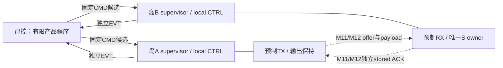

# W5-IF v0.1：功能岛三层接口合同

Issue151 / PR152；负责人Melodydt；研究输入f9a90c845504b198cc3265106e03c67902382ebb；2026-11-02（Asia/Shanghai）。本合同落实主线四的接口前置子任务，向主线五提供可实施的有界接口定义。**状态为逻辑合同v0.1已形成、待审查；新端点/母控网络尚未实现，物理层和完整产品ABI未冻结。**

## 1. 本次确定的边界

| 层级 | 合同责任 | 当前实现和证据 |
| --- | --- | --- |
| 母控—local CTRL | 固定控制网候选承载粗任务、准入、运行、关闭及事件；母控WAIT期间仍收取返回，不搬运payload | 当前P2/W1的mother ROM只是本地MST顺序器；芯片母控及本合同新CMD/EVT未实现 |
| 功能岛—功能岛 | 已预制端点负责offer/数据、目的实际存储ACK、源保留和释放；M11/M12只被动连接已存在的端点与永久路线 | 当前MST/A8/F8有host流口及本地T生命周期，没有跨岛stored ACK或本合同的接收/源lease |
| 岛内local CTRL—宏 | 唯一owner处理各宏原生cmd/rsp、流式退休、S普通口/loader、N回放与R/T上下文，输出语义由静态程序决定 | 已有有限MST/E/G/N/F8/A8组合，保留各自源/范围；它们未获得完整大岛物理资格 |

主候选仍为岛内及母控控制网络固定预制、模型相关数据及配套确认路线由M11/M12定制。集中、分段还是区域控制网需要端口、扇出、线长、拥塞和时序反馈，不由本逻辑合同提前签发。所有运行时MUX、解析、holding、仲裁、缓冲、中继、ROM/译码及必要CDC均须在共同底座冻结前存在。

图表示候选功能分工，非当前已有芯片顶层或物理走线结果。

合同的主接口是任务、数据与生命周期关系，角色/格式/Fin/layout及绝大多数shape由有限产品程序和离线表决定，不要求每拍带通用类型标签、动态大型handle或新控制程序。运行时内容、已准入长度/位置、任务关联、真实计数与资源所有权仍须执行。历史通用task/handle方案保留比较用途，不自动作为本轮最低硬件要求。

## 2. 数据语义由静态profile准入

载体宽度128bit不等于张量格式相同。每条路线在编译期必须绑定来源/目的程序入口、逻辑轴/布局、有效字节/tail、数值单位/舍入/范围、参数供给、缓冲和释放条件；缺任一必要能力记GAP，不把它改成永久宏对非法。

完整A_plain/A_gate/F/D/H/X子层的逻辑主边界为源图规定的hidden输入/输出及残差，但全产品hidden整数位宽、Fin、质量和运行范围尚未统一接收。源图B1/S2/FP32/no-cache不能被写成硬件S16/decode/prefill准入证据。B8协议例使用H8/S16Fin10，只验证所选接口语义，不把样本模型缩为H8。

关键现有差异：A8的12拍是Q/K/V操作数及padding，F8的16拍是X与三份权重及padding；MST还输出四拍raw S64。A8/F8的一拍S16Fin10输出不能直接作为另一核的输入帧。尤其S16Fin10→S8Fin7的RNE3/clip会改变F8原始残差和Norm输入，必须被声明为新量化profile或增加保真S16入口/残差路径，不能标成无损接口适配。实际端口与缺口见[端口及资源审计](rtl-contracts/W5_IF_PORTS_AND_RESOURCES.md)，样本要求见[模型准入边界](W5_IF_MODEL_ADMISSION.md)。

## 3. 新有界候选及通道

本轮为L5/W2给出一个可实施的最小候选：一母控、两岛、单时钟、每岛一个active任务、一个完整已预约输入槽、全系统一个未CLOSE的fragment；首例每任务一fragment、一字16B。两个新smoke入口SOURCE_COPY_H8/SINK_READ_H8使用同一预制能力并集，I0→I1或I1→I0分别永久绑定，暂不同时执行双向环。**这两个入口及其wrapper仍待主线五实现。**

| 逻辑通道 | 方向 | 接收/完成的必要条件 |
| --- | --- | --- |
| TASK_ARM | 母控→local | 捕获任务关联，预约全部input/output/参数/状态生存期资源及返回空间；接单不启动宏 |
| TASK_RUN | 母控→local | 同一已ARM任务的输入、参数和版本已真实存储并符合profile；local再执行原生命令 |
| TASK_CLOSE_SOURCE | 母控→producer | 有效peer存储确认已建立，所选fragment义务满足，随后实际释放并回报 |
| TASK_CANCEL_PRESTART | 母控→local | 仅严格未RUN、无accepted offer/data、无原生在途/不可撤销效果的任务；wrapper生成自身取消终态 |
| EVENT | local→母控 | 里程碑、终态或first-error保持到接收；不同事实可合并编码但不可混同依赖 |
| FRAGMENT_OFFER / DATA | producer→consumer | consumer已ARM且预留完整目标槽、接收和ACK能力；先明确范围，再按有效字节逐拍接收 |
| STORED_ACK | consumer→producer | 本fragment所有目的payload写的真实ACK均已消费，计数/tail/身份正确；独立反向保持 |

发布、R版本、MoE选择和MEM持久可见性按后续profile扩展，预留编码不构成功能实现。规范的逻辑字段、支持范围、64/128bit候选编码与相对时序详见[协议与时序](W5_IF_PROTOCOL_EXAMPLES.md)及机器通道表。任务/fragment关联字段允许在有等价及晚事件排空证明后做物理省略，不允许仅以“单在途”直接取消其语义。

候选编码中的CMD valid/ready仅表示控制记录进入有真实空间的inbox。TASK_ADMITTED事件才建立成功准入；无效opcode/key/状态或资源不足的控制请求可形成同请求key的CMD_REJECT，不分配新任务、不发原生命令、不破坏已有live任务。拒绝记录有独立稳定来源，母控按outstanding命令关联，不能借当前active任务key重构。正常程序仍先确认准入和输入就绪再RUN，不能依赖不断发送非法请求探测资源。

## 4. 完成与可复用规则

接单、COMPUTE_DONE、FRAGMENT_SEALED、DATA握手、INPUT_STORED、REMOTE_STORED、SOURCE_RELEASED、OUTPUT_PUBLISHED（B8保留、不支持）、TASK_DONE和REUSABLE是不同事实。目的ready只表示该拍能被接受；stored ACK要求真实存储写已完成；源关闭要求明确CLOSE许可及实际lease释放。任务成功需其profile全部义务满足，可复用还要求原生、输出、ACK及旧事件全部关闭。

现有核在输出take后会自动释放T并产生本地DONE。新wrapper必须实际保存输出或持有真实可读、不可覆盖的region，不能将旧DONE或out_last当成peer stored ACK。当前顶层未暴露任意S读口，不能免费假定重新读取结果。A8/F8完整输出16B可用新holding保留；MST四字64B要么完整保存，要么另证明逐fragment握手与未消费T字的生存期。

现有核prestart abort不产生DONE。未来wrapper一旦接过母控任务，就须拥有独立accepted任务状态和终态mailbox，不能在取消后无期限等待旧核的done。输出前缀或目的RAM写已可见时，error可伴partial；saturated与协议error分开，不承诺回滚。

## 5. 调度、复位和错误边界

先ARM consumer，预约目标完整存储、接收/ACK及事件空间，再RUN producer；consumer计算尚未开始时仍可接收并确认。禁止母控等producer完整DONE才允许consumer接收，或占着S响应再等下一S读取。母控按已知资源状态发ARM/RUN，不能将不可能接收的未来任务堵在同一命令通道前端、挡住当前任务必需的CLOSE/恢复。

发送方valid未被ready接受时保持记录及tag；已接收事务与错误终态都有明确owner。错误key/phase/计数不得修改当前槽或重复发原生操作；重复或晚事件须隔离，不能重新写S/RUN/释放。任务序列耗尽先排空，epoch回绕前必须证明全cohort安静或进入受控冷启动。小字段不是外部无限晚响应安全性的证明。

无reset取消仅限严格prestart窗口。其他失败保守停止新增发令，保持/排空已接收返回，记录error/possible partial，再协调参与的native/helper/端点复位；supervisor任务终态保持直到母控接收。全系统hard reset会清除事务及终态，应重新建立slot-valid和输入完整性，不能把S RAM旧内容当新输入。外部MEM晚返回、独立warm-reset和CDC尚未在首个候选中接收。

## 6. 资源和物理预算的使用方法

新逻辑需要真实任务/事件保持、TX/RX payload、offer解析、ACKtx/rx、pending/sticky事实、关联/计数/first-error/poison及复位状态；母控还需要每岛发送/返回保持、全局租约、表和预制程序。候选中的82B/岛及母控16B/岛只是列明的payload/记录holding小计，不含flags、计数、原叶资源、whole tensor、weights/KV/state、clock/CDC、中继或实际门面积，也不未经生存期证明扣除旧holding。

采用CMD/EVT/ACK各64bit和双向128bit data候选时，每岛功能端点位数为536，两岛端点位数之和1072；它们不是唯一wire数、实际M10 pin或I/O pad数量。具体公式、源声明寄存和未决项见资源审计；片上容量与前置pin/扇出/中继可行性仍需后续综合/P&R。

容量准入以同时存活的数据和服务能力为准：单token H3072/S16为6144B，只说明一份payload可占T384字；N的src/gamma/dst三份共18432B，已大于S16KiB。现Nctrl范围1..257、6bit字计数也不支持直接把guard改大到H3072/4096。prefill、原FP32、FFN内部维度、R old/next和MoE专家数据须各算，完整模型仍是数值/容量/参数供给GAP。

## 7. 本合同退出范围与下一步

本轮交付逻辑通道、事件/lease与源/目的资源归属，现有接口适配表，B8编码/资源算例、完整成功/背压/故障因果时序和样本扩展矩阵；三层字段/端点不再留无归属事项。具体产品整数格式、规模、R/MoE/MEM扩展、最终控制网拓扑、物理pin/时序等未知项显式列GAP，不能被解释为已接收。

合同可以交给L5做所选有界接口实现及真实测试，外部审查仍待完成；本次没有新增RTL、运行仿真、服务器/EDA或接受完整A/F/L4。历史N/F8/A8证据保持原源与范围。

继续L4的下一项是按模型细化完整A/F输入/输出的数值、残差与布局，并闭合所选shape的Norm/中间数据保留及参数供给，再实施相应完整有界计算流程；不把本合同准备当作L5已开始。实现新端点和双岛网络按既定主线五安排，最终M1–M10共同底座及M11/M12差分仍归主线八。
