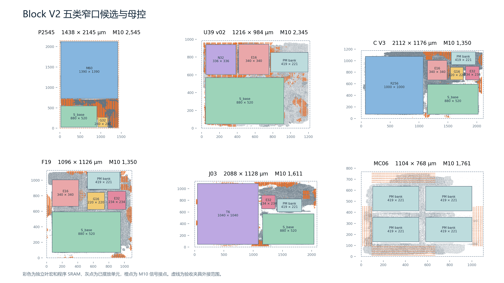
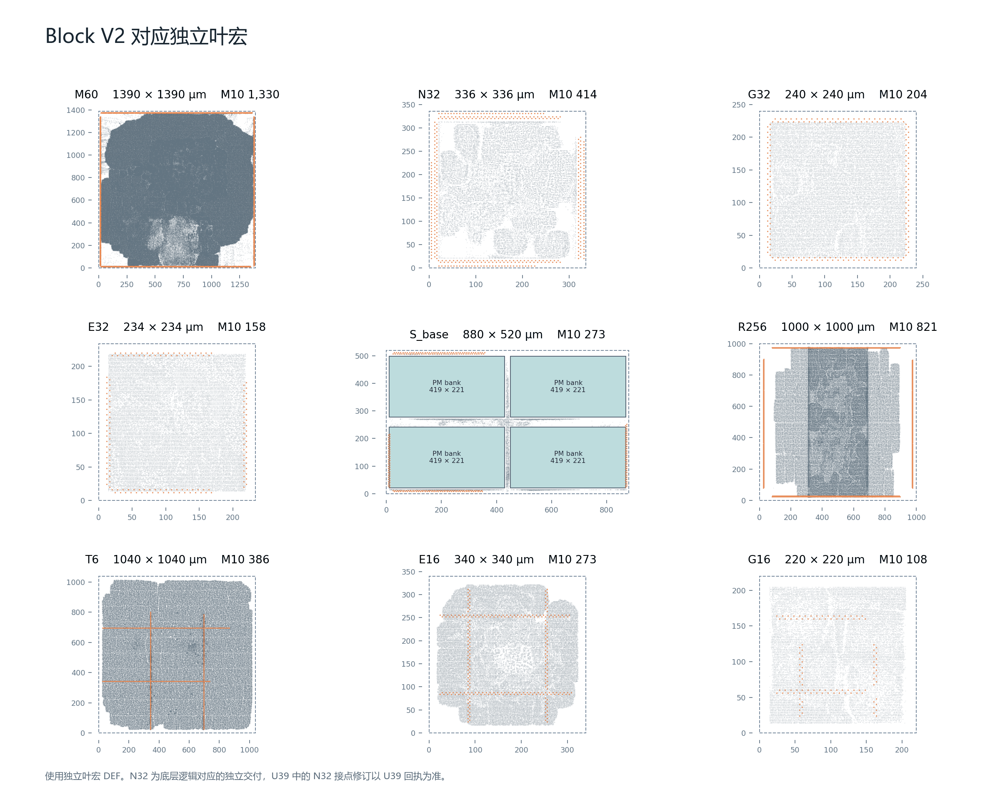
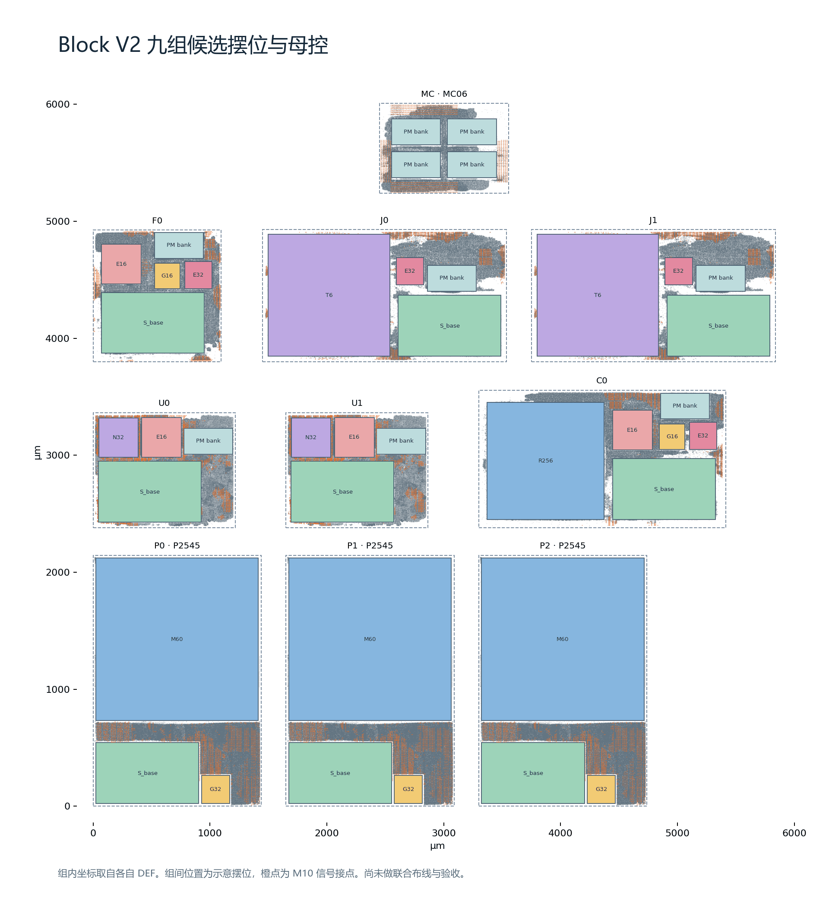

# 五类 Block V2 版图图册

[Block V2 RTL](../../../../project/rtl/block_v2/README.md)按 P、U、C、F、J 进入各自的组装源码。该批版图把叶宏作为独立物理实例，虚线是独立验收夹具的外接范围。彩色矩形为叶宏和程序 SRAM，灰点为摆放单元（略去 filler 和 tap），橙点为 DEF 中 M10 信号引脚的中心。各面板采用独立比例。

## 五类窄口候选与母控



| 版图 | 独立叶宏 | M10 信号接点 | 回执及范围 |
| --- | --- | ---: | --- |
| P2545 | M60、G32、S_base | 2,545 | [窄口子集](evidence/p2545.json)，原版 DRC 0，TT 300 MHz setup / hold +36.863 / +0.233 ps |
| U39 v02 | N32、E16、S_base、程序 SRAM | 2,345 | [独立回执](evidence/u39.json)，原版 DRC 0，TT 300 MHz setup / hold +17.840 / +0.566 ps |
| C V3 | R256、E16、E32、G16、S_base、程序 SRAM | 1,350 | [独立回执](evidence/c-v3.json)，原版 DRC 0，TT 300 MHz setup / hold +272.389 / +6.445 ps |
| F19 | E16、E32、G16、S_base、程序 SRAM | 1,350 | [独立回执](evidence/f19.json)，原版 DRC 0，TT 300 MHz setup / hold +462.551 / +26.886 ps |
| J03 | E32、T6、S_base、程序 SRAM | 1,611 | [独立回执](evidence/j03.json)，原版 DRC 0，TT 300 MHz setup / hold +128.308 / +18.263 ps |
| MC06 | 四个程序 SRAM bank | 1,761 | [独立回执](evidence/mc06.json)，原版 DRC 0，已回收核验 210 个包内文件 |

P2545 新增 207 个 FFN Mid 接点。回执列出实时主机启动、实时 K-window、相邻 P 完整范围和最后 86 个 M FENCE 接点仍待补齐。正式 S_P 版 P 另行验收。J03 两路各 128 位的外部读回 `io_rsp_data` 留在 M6，当前回执覆盖写入、写确认和 T 输出。C、F 在 M5/M6 保留观察信号。

## 对应独立叶宏



本批更新的叶宏有 [M60](evidence/m60.json)、[N32](evidence/n32.json)、[G32](evidence/g32.json) 和 [E32](evidence/e32.json)。N32 面板使用独立交付的 DEF，U39 内的接点修订以 U39 回执为准。S_base、R256、T6、E16 和 G16 是这批候选复用的独立实现。[紧凑 S 原图](../compact-local-s/index.html)含 S_base 与正式 P 所用 S_P，[紧凑 G/E 原图](../compact-ge/index.html)含复用的 G16/E16。

## 九组候选摆位



3P、2U、1C、1F、2J 加 MC06。各组内部保留各自 DEF 坐标，组间间距和位置为示意。图中用三份 P2545 表示窄口候选。实际九组还要验收母控扇出负载、共用时钟、复位和 512 位 DMA。[母控直连初筛](evidence/nine-control-load-screen.json)出现负电容裕量，九组联合物理验收尚未完成。

## 图源与复现

[图源清单](placement-source.json)锁定六份组级 DEF、九份叶宏 DEF、程序 SRAM LEF 的路径和 SHA-256。准备 `<角色>.def` 与 `pm.lef`，从图册目录运行以下命令。完整六文件保存在回执指向的项目存储。

```text
python -B plot_placement.py placement-source.json INPUT_DIRECTORY . --font FONT_FILE
```

使用 Matplotlib 3.9.2、Pillow 和支持中文的字体。图只读 DEF 和 LEF，点和边界用于查看布局。
