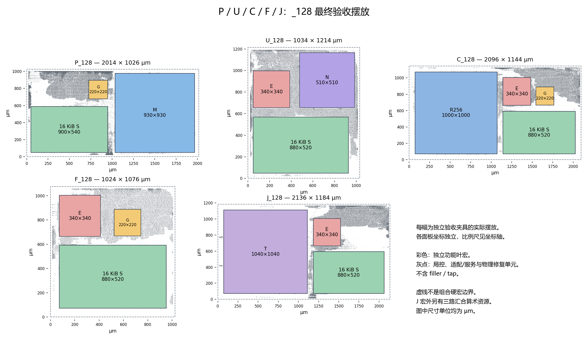
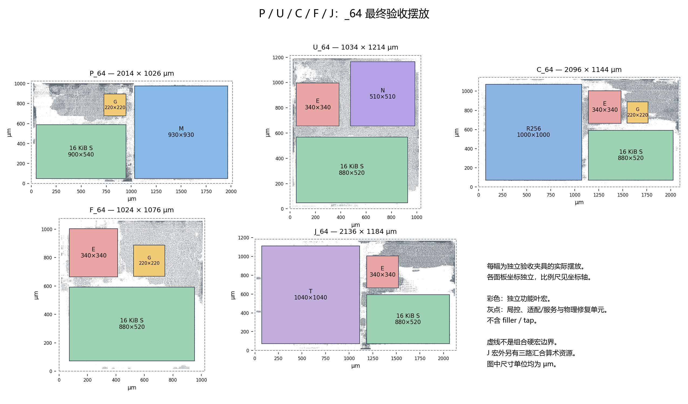

# 五类独立叶宏组与母控：交付入口及 _128 / _64 摆放图

本页统一索引 P/U/C/F/J 与母控。源码仍按实际项目目录保存，大体积交付包仍在验收报告指定的授权存储，不搬移或复制原始证据。

| 交付 | 源码 | 实验、回执与包位置 |
| --- | --- | --- |
| P / U（_64、_128） | [独立叶宏组](../../../../project/rtl/pu_leaf_base/) | [P/U 验收入口](../../../../work/YUZE-LU/212/README.md)；[U 当前修复与验收](../../../../work/YUZE-LU/212/u-native-fix.md) |
| C / F / J（_64、_128） | [独立叶宏组](../../../../project/rtl/block_cfj_v1/) | [C/F/J 验收入口](../../../../work/YUZE-LU/211/README.md) |
| 母控（64 v2、128 v1） | [母控与真实程序 SRAM](../../../../project/rtl/mother_control_v1/) | [双格式验收报告](../../mother-control-dual-format.md)、[交付包索引及 SHA](../../../../work/YUZE-LU/223/acceptance-index.json)、[复跑说明](../../../../project/experiments/mother_control_v1/README.md) |

母控由 [PR #224](https://github.com/rayggxia-workspace/LLMHardwareDesign/pull/224) 交付，用户已授权合入 main。两种程序格式分别验收，共用同一组六文件，物理 cell 名为 `mother_control_64`；并非两份不同的物理版图。当前母控为两个驻留目标，母控最终网表与五类 Block/局控 RTL 的有限组合已通过，不代表九实例系统联合布局布线。下方五类图册保留 #213/#214 的 P/C/F/J 来源，并将 U 两版更新为 #221 新验收包，图源绑定与当前图片同步。

本图册随 [PR #213](https://github.com/rayggxia-workspace/LLMHardwareDesign/pull/213) 和 [PR #214](https://github.com/rayggxia-workspace/LLMHardwareDesign/pull/214) 的主线整合交付。两版分别保留，不把旧包重命名为新物理实现。U 两版已更新为 [PR #221](https://github.com/rayggxia-workspace/LLMHardwareDesign/pull/221) 修复普通三源入口和同时 SEND 后重新物理验收的最终包；P/C/F/J 的归档来源保持不变。

## 128 位指令版本

## 64 位紧凑取指版本

彩色矩形是独立叶宏，灰点取自各自最终 DEF 的标准单元位置（不含 filler/tap）；虚线仅为独立验收夹具范围，不是可复用的组合硬宏边界。各面板比例独立。J 的宏外逻辑包含三路汇合算术，不能省略其资源成本。

## 来源及验收边界

[图源绑定](placement-source.json)记录十个不可变包的 SHA-256、最终 DEF 和几何元数据的 SHA-256、宏位置与实际标准单元点数。生成时核对包 SHA，存在 SHA256SUMS 的包还核对被读取成员；宏位置取最终 DEF，尺寸取归档的 inventory 或 inputs，未重新估算布局。U_128/U_64 均采用本次原生服务入口和独立 TX 槽修复后的包，不采用 #214 历史 U 包；新包的 `FILES.sha256` 和旧包的 `SHA256SUMS` 均逐项核对所读取成员。

完整物理验收及回收回执分别见 [C/F/J](../../../../work/YUZE-LU/211/README.md)、[C/F/J _64](../../../../work/YUZE-LU/211/control64-acceptance.json)、[P/U](../../../../work/YUZE-LU/212/README.md)、[P/U _64](../../../../work/YUZE-LU/212/compact64-acceptance.json)。本图不扩大独立 TT 300 MHz 的证据范围，不代表九实例共同底座、模型执行或多 PVT 签核。

## 当前 U 两版验收

| 版本 | 完整原版 GDS DRC | 原生 TT 300 MHz setup / hold（ps） | 最终网表回归 | 已回收核验文件 |
| --- | --- | --- | --- | --- |
| U_128 | 0 | +255.014 / +14.595 | 48/48 | 1,389 |
| U_64 | 0 | +73.082 / +0.212 | 78/78 | 2,101 |

[当前 U 工程回执](../../../../work/YUZE-LU/212/u-native-fix.md)和[机器索引](../../../../work/YUZE-LU/212/u-native-fix.json)给出源码锁、最终网表、全部程序和不可变交付包 SHA-256。两版图片均重新读取这些包的最终 DEF；其他八个版本的图源记录与此前一致。U_64 的 +0.212 ps hold 仅代表 TT 1.1 V、25 °C 当前约束通过，不代表顶层或多 PVT 裕量。

P/U 的 _64 是记录的 #195 派生原生服务子集加紧凑取指；C/F/J 的 _64 固定 #180 `2a66b918`，也仅声明已注册服务。合入同一主线不等于 ISA/profile 已统一；联合顶层仍需绑定局控 ID、程序镜像版本、描述符及控制 profile。

生成脚本：`project/experiments/cfj_leaf_base/plot_five.py`。安装 matplotlib 后，运行 `python -B project/experiments/cfj_leaf_base/plot_five.py inputs.json OUTPUT_DIRECTORY`。inputs.json 为十条对象组成的数组，每条提供 `kind`（P/U/C/F/J）、`version`（字符串 128/64）、`archive`（本地归档路径）、`archive_sha256`；文件名和预期 SHA 见图源绑定。大体积归档不进入 Git。
