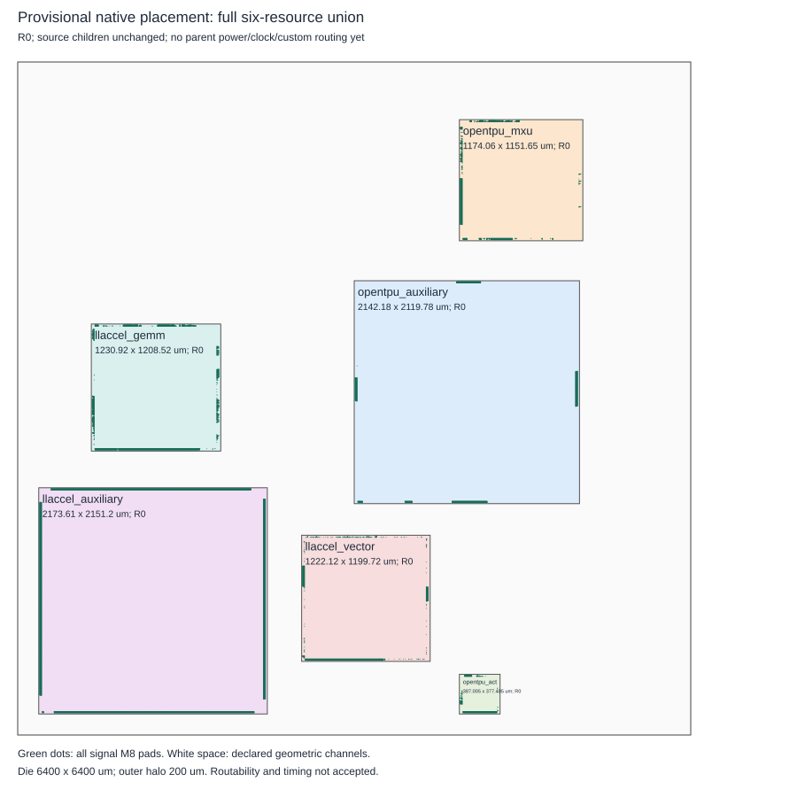
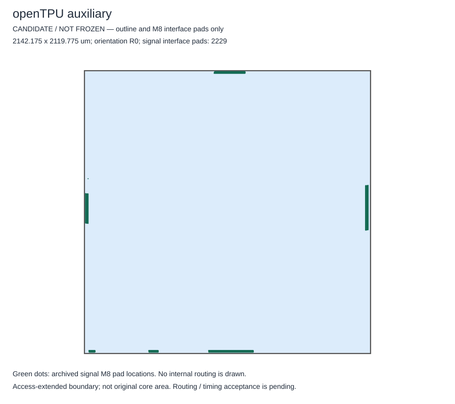
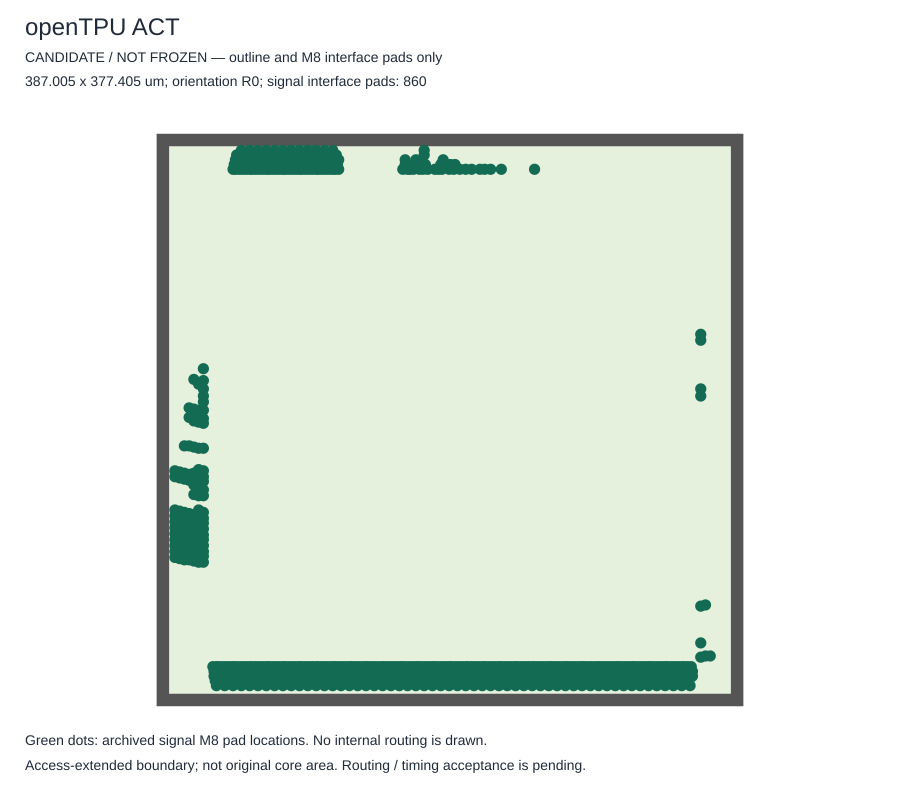
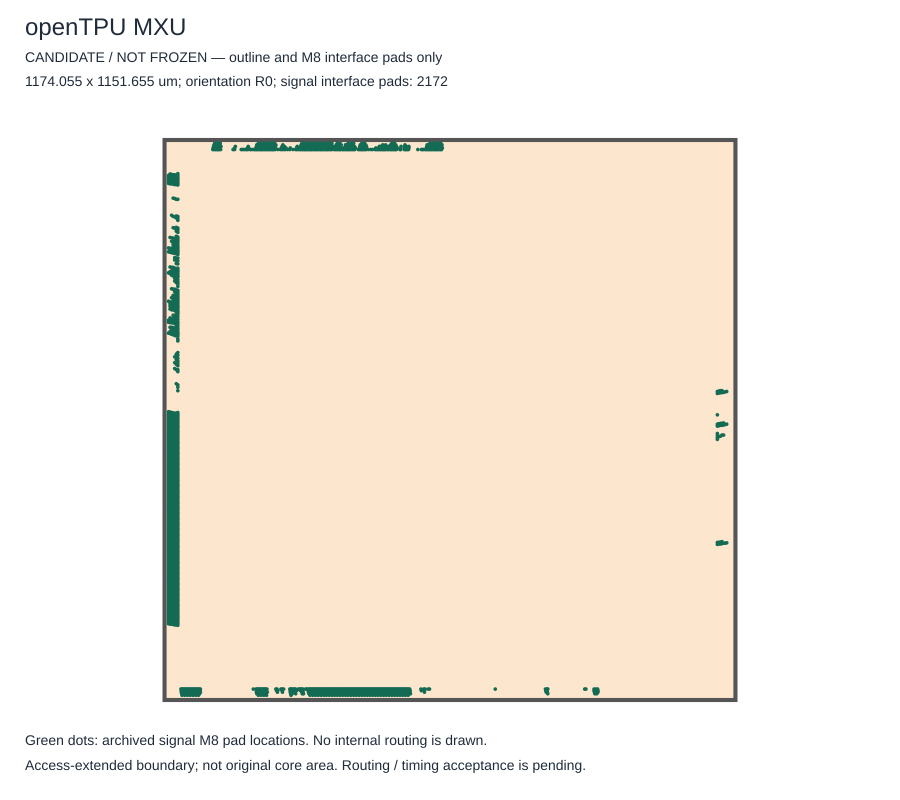
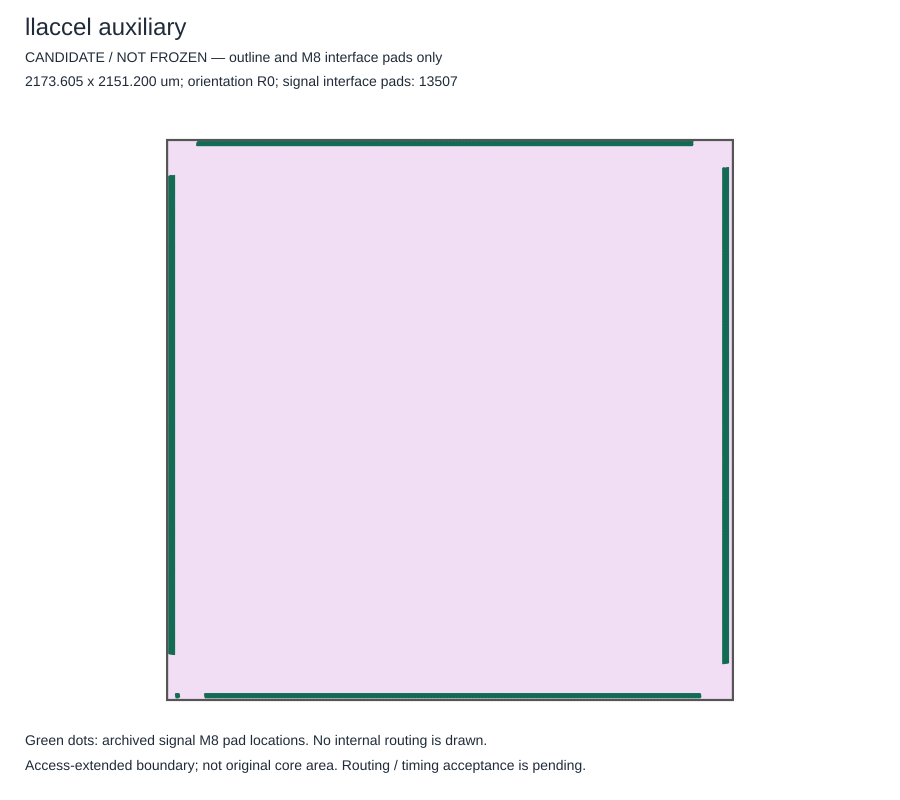
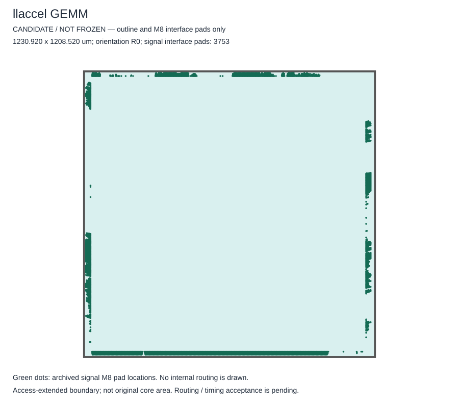
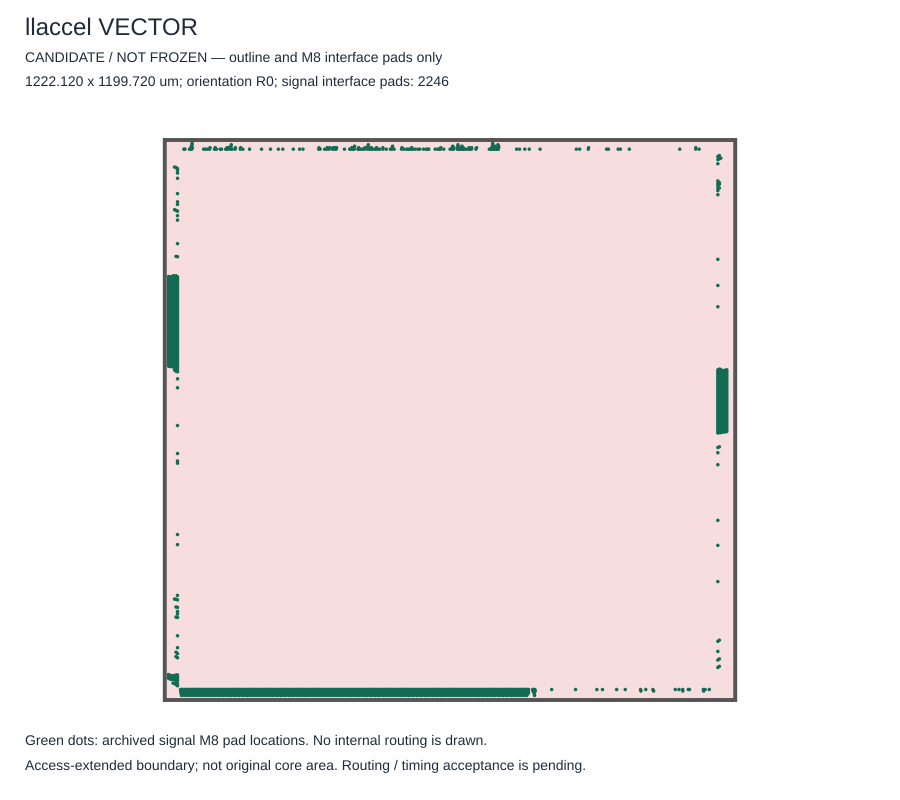

# Issue #55：全部六个 Block 示意图

关联 [Issue #55](https://github.com/rayggxia-workspace/LLMHardwareDesign/issues/55) / [PR #58](https://github.com/rayggxia-workspace/LLMHardwareDesign/pull/58)。

本图集将服务器已经生成的共同候选布局图入库，并从同一份图中精确抽取六个 Block 的边界及 M8 信号接入点。**候选未冻结；图中没有画 Block 内部晶体管和布线，也不表示块间布线、功能或时序已经全部通过。** 这是可视化补交，不是一次新的物理实验。

## 六个 Block 的共同候选布局

原总图逐字节保留；图中文字“no parent power/clock/custom routing yet”描述生成该布局快照时的状态，不代表后续实验没有开展这些工作。后续进展以 PR 最新记录为准，不用旧图冒充最新物理状态。

## 逐个 Block 查看

| Block | 本图表示的范围 | 含接入扩展的宽 × 高（μm） | M8信号接入点 |
| --- | --- | ---: | ---: |
| [openTPU auxiliary](opentpu_auxiliary.svg) | 原设计除ACT/MXU之外的辅助资源区 | 2142.175 × 2119.775 | 2229 |
| [openTPU ACT](opentpu_act.svg) | 激活数据与相关存储资源块 | 387.005 × 377.405 | 860 |
| [openTPU MXU](opentpu_mxu.svg) | 矩阵计算资源块 | 1174.055 × 1151.655 | 2172 |
| [llaccel auxiliary](llaccel_auxiliary.svg) | 原设计除GEMM/VECTOR之外的辅助资源区 | 2173.605 × 2151.200 | 13507 |
| [llaccel GEMM](llaccel_gemm.svg) | 矩阵计算资源块 | 1230.920 × 1208.520 | 3753 |
| [llaccel VECTOR](llaccel_vector.svg) | 向量计算资源块 | 1222.120 × 1199.720 | 2246 |

绿色点是原快照中真实导出的 M8 信号接入点；不是计算单元，也不是已完成的块间连线。尺寸包含迁线／引脚接入扩展边界，不应当作原始核心面积。

### openTPU auxiliary

### openTPU ACT

### openTPU MXU

### llaccel auxiliary

### llaccel GEMM

### llaccel VECTOR

## 原参考设计的块内布局图

已有的[《Block布局与接口分布报告》](../../../../ref-project/llm-routing/docs/Block布局与接口分布报告.html)提供 ACT、MXU、GEMM、VECTOR 和 ACT+MXU 合并对照块的内部布局／引脚图（图片及数据内嵌）。合并对照块不是本图集第七个共同底座实例；两个辅助区是本任务新增分区。本次不修改、重算原报告。

## 来源、核验与局限

- 原快照：runs/union-native-placement-r01-timing-repair-4c-01/，相对服务器根目录见 manifest.json。
- 原总图 SHA-256：c74d68add5239fcc4ff73b1d2f0914124d12c9ad34a56add0fbebd5a3653b1e1；六个单图的 SHA-256、来源回执、尺寸和数量见 [manifest.json](manifest.json)。
- 来源检查器实际确认六个宏、24779个全部端口的变换与源几何保持，以及宏不重叠；本次精确分配24767个信号接入点，各出现一次，逐点属性保持并通过XML解析。不重跑EDA，不把本次图形核对称为新物理验收。
- 辅助区和核心后续修复仍在推进；本图只代表上述封存快照，不能替代后续数据库、全局DRC、RC/STA、功能或最终冻结证明。
- 主方案冻结后 M1–M8 固定，M9/M10及实际via8_0/via9_0定制；M11/M12为独立后备。当前底座未冻结。

规则：rayggxia-project-collab 1.0.0。负责人 huangpingyang04-lgtm；部分交付 Refs #55；PR保持草稿，未合并。项目登记沿用管理中心PR5 pending（本次未重新核验）；缺 config/board.json，看板状态 unverified、同步 pending，待有权限维护者处理；不因图集上传改变任务验收状态。
