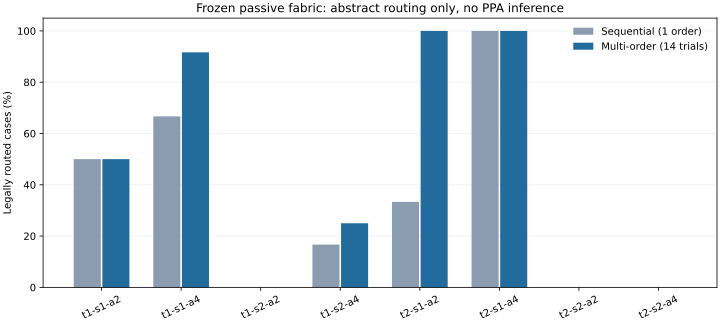

# Issue #11：冻结互联资源模型的首轮实验

- 日期：2026-10-22（UTC+08:00）；负责人Liangruizhi。
- [Issue #11](https://github.com/rayggxia-workspace/LLMHardwareDesign/issues/11)／[PR #12](https://github.com/rayggxia-workspace/LLMHardwareDesign/pull/12)，分支 `task/11-frozen-routing-pilot`，待审查，未合并。
- 实际运行源码commit：`6ab796b3f6e754aa30c79ab91bb2795f6a6f056c`，运行时工作区干净。归档／诊断是后续处理，不倒填为运行输入。
- 开始：2026-10-22 11:30:54.747（北京时间）；结束11:31:03.104；本轮约8.356秒。正式记录 `source_dirty=false`。

## 实际执行与数据

本轮只检验未校准的抽象电气模型，不是物理H2、RTL/周期仿真、16-bit算术、真实LLM运行或PPA验证。设计集为FFN／门控FFN，保留集为残差FFN／双投影汇合。预声明8种底座、种子17/43/101、2种方法，共192例；每一底座的资源指纹在所有任务间相同。源码与配置在开发观察之后未针对保留结果改变库存；开发尝试本身单独保留为dirty结果，不当成正式清洁源码。

本机Intel Core Ultra X7 358H／16逻辑核／约31.5GiB可见内存；本轮为小型单进程CPU实验，不需要GPU或耗尽全部资源。Python3.13.14、NumPy2.5.0；绘图Matplotlib3.11.0。使用项目`.venv`与现有system-site-packages，没有安装或升级EDA工具、WSL、Docker或Python。全部数据、缓存与输出在D盘。

| 工作负载 | 顺序法（1顺序） | 多顺序搜索（14次尝试） |
|---|---:|---:|
| FFN，设计集 | 13/24 | 15/24 |
| 门控FFN，设计集 | 7/24 | 9/24 |
| 残差FFN，保留集 | 5/24 | 10/24 |
| 双投影汇合，保留集 | 7/24 | 10/24 |
| 总计 | 32/96 | 44/96 |

配对实例32个两者成功、12个仅多顺序成功、52个两者均未找到解。多顺序含更多搜索预算，不能称等预算优势或新算法贡献。

| 底座：轨道数t／跨度s／引脚接入选择数a | 顺序法 | 多顺序 |
|---|---:|---:|
| t1-s1-a2 | 6/12 | 6/12 |
| t1-s1-a4 | 8/12 | 11/12 |
| t1-s2-a2 | 0/12 | 0/12 |
| t1-s2-a4 | 2/12 | 3/12 |
| t2-s1-a2 | 4/12 | 12/12 |
| t2-s1-a4 | 12/12 | 12/12 |
| t2-s2-a2 | 0/12 | 0/12 |
| t2-s2-a4 | 0/12 | 0/12 |



## 可以观察到什么

所有76条成功解经全局电气重建检查，连通、单驱动、端点容量、连接白名单与操作映射能力均通过。含固定网络成功项共81次数值对照，最大绝对误差 `2.7755575615628914e-17`；这是软件float64值流一致性，未验证传输编码、量化或时钟周期。

24个微型实例逐一枚举全部白名单子集：15可行、9不可行；两方法在15个可行小例均找到最优抽象成本。最大11个connector，不将小例最优性外推到大例。

固定网络由设计集候选选择，在同一variant的4任务中保持完全相同接线；允许所有同类单射映射。5个variant的所选候选仅覆盖FFN，其余3个未覆盖任务。该结果只描述有限候选族和当前编译语义，不是所有固定网络的最优覆盖率；未考虑代数重写、恒等操作或时间复用。不能据此断言制造时改线必然优于固定互联。

相同track数时，span1/2的预埋总线长相同，但暴露端点和端口接入库存不同。长段组的失败不能概括为长线天然较差。后处理的必要条件BFS（忽略容量和其他net）进一步确认：

| variant，12个固定映射实例（每算法相同） | 单网已有sink无白名单路径 | 单网都可达但全路由未知 |
|---|---:|---:|
| t1-s2-a2 | 9 | 3 |
| t2-s2-a2 | 12 | 0 |
| t2-s2-a4 | 9 | 3 |

其余失败均满足该必要可达性条件。无路径只能证明当前固定映射在模型下失败，不能证明换映射后也失败；单网可达仍不能证明多个net可同时满足电气和容量约束。详见 `diagnostics.json` 的逐例记录和后处理源码hash。

下一轮应优先以通过资格的宏提取真实引脚、方向、接入层、负载和驱动／流水资源，再做端点感知映射与轨道对照。仅增加轨道数、只看逻辑模块名或只修宏内电容，都不足以支撑DAC的最终架构主张。

## 实际验证

- `python scripts/check_project.py`：通过，只检查管理结构。
- `.venv/Scripts/python.exe -m unittest discover -s project/experiments/frozen_routing -p "test_*.py" -v`：17项通过，含固定长线短接、闲置输出多驱动、非法接点、端点容量、错误Block操作、非法／NaN位宽、库存变化和断连等负例。
- `verify.py <原始运行目录> --replay`：PASS；21个索引输出＋manifest共22文件，192例、81次数值、48条oracle方法记录均读回，候选固定基线按设计集重建，全部确定性连接重放相同。
- 独立只读审查另用独立DSU、NumPy表达式、全部小例子集重算，结果与记录一致；没有修改或重新解释失败记录。
- `package.py --verify <归档目录>`：PASS，ZIP内所有原始字节、哈希及来源commit对应；图已视觉检查，无遮挡。
- 源码与文档执行 `git -c core.whitespace=cr-at-eol diff --cached --check -- . ":(exclude)project/experiments/frozen_routing/results/**"`：通过。默认全量空白检查会报告原样保存的CRLF，以及Matplotlib生成SVG路径中的尾随空格；结果目录保留原始字节，使用上述归档／SHA-256检查，没有改写成果或全局Git设置。物理构建、STA、LEC、应用能量、真实制造验证：未执行。

开发中曾发现“解释器替矩阵块执行SiLU”和“NaN宽度比较绕过”的验收漏洞，正式源码前已修复并加入负例。开发输出仍在 `local_runs/development-01`，其dirty事实保留；不作为本轮正式结果。

## 证据、SHA-256与复查

[归档目录](../../project/experiments/frozen_routing/results/issue-11-run01/)包含原始ZIP、原始manifest、汇总、CSV、SVG／PNG与绘图来源、后处理诊断。约811KB原始文本压缩为46,845B，属于轻量实验记录；未搬运原始物理大数据。

- 原始manifest：`f1b67f4fde2daea3d1d15d62e08348a73ef21d6bbe0c9467fd2b95b51fa030cd`。
- `raw-evidence.zip`：`a87b746333ab72eb59c3d971bb98f7d58d658152606207d2831831417d748e9b`。
- 配置原字节：`e1bca2f37ac5713f11e6a3047093b7c415228587daeaaaf6e775bbf1f512602f`。
- 诊断：`517b2ac00d974dc8f91b6751fd530f3a8e29a43b200bcee4b693afe29d0580ad`。
- 其余成果和每个源码文件的校验值见 `archive-manifest.json`、`run-manifest.json` 与诊断头；后处理packager有独立源码hash，不冒充实验运行源码。

从仓库复查（使用新目录，避免覆盖任何旧结果）：

```powershell
.\.venv\Scripts\python.exe project/experiments/frozen_routing/package.py --verify project/experiments/frozen_routing/results/issue-11-run01
.\.venv\Scripts\python.exe -m zipfile -e project/experiments/frozen_routing/results/issue-11-run01/raw-evidence.zip project/experiments/frozen_routing/local_runs/review-01
.\.venv\Scripts\python.exe project/experiments/frozen_routing/verify.py project/experiments/frozen_routing/local_runs/review-01 --replay
```

重新实验应使用新的out目录；后续HEAD记录的是实际新运行版本，不倒填6ab796b。完全相同环境的确定性重放已验证，跨版本浮点末位与墙钟时间不保证逐字节相同。

## 远端与接入

规则rayggxia-project-collab 1.0.0；登记pending（management-hub PR5仍OPEN，默认registry未含本项目）；当前插件没有Projects工具，本项目无board.json，看板unverified／同步pending，处理人待指定。成果经PR12供审查，不自行合并或提前关闭Issue11。不会把这些抽象结果写成Issue7物理门槛已解决。
