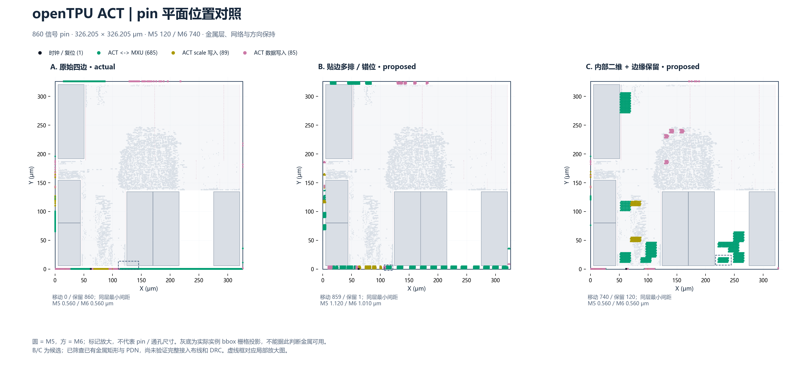
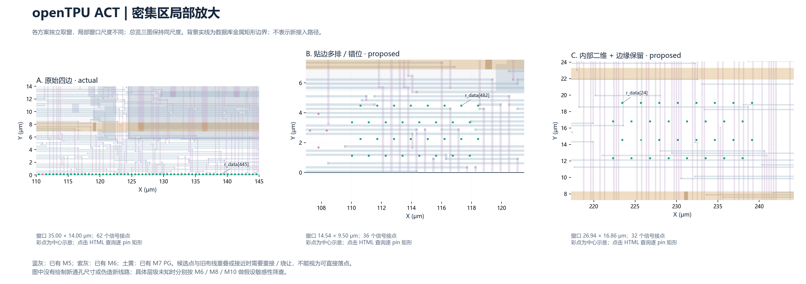
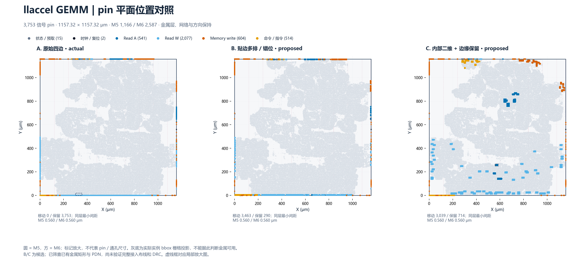
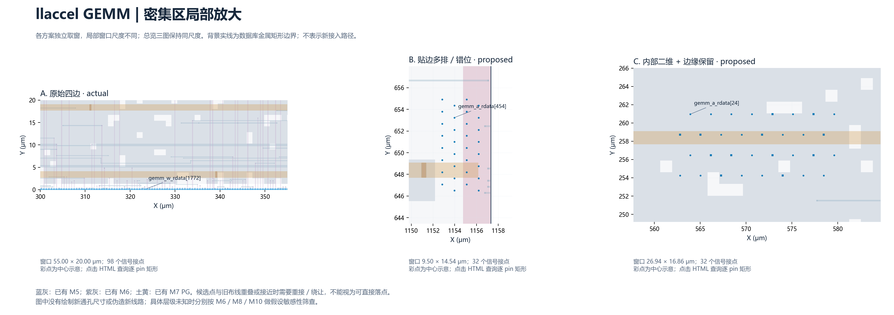

# ACT / GEMM 接口 pin：四边、多排与二维候选对照

关联 [Issue #119](https://github.com/rayggxia-workspace/LLMHardwareDesign/issues/119)，2026-10-26（中国标准时间）。本次仅总结 pin 平面位置研究，未重硬化或启动新的 P&R。

**建议先局部验证混合二维方案 C：ACT 将宽数据接口放入宏外通道；GEMM 优先让有实际端点依据的活跃读接口靠近接收逻辑。时钟、窄控制与不适合移动的位保留边缘。** B 是用于比较改动纵深和接入压力的贴边多排方案，不能因点间距变大就认定拥塞降低。

[完整中文 HTML 摘要](issue-119-pin-xy/report.html) · [图表与数据说明](issue-119-pin-xy/README.md) · [逐 pin 坐标 CSV.gz](issue-119-pin-xy/data/all_pin_coordinates.csv.gz) · [解析、布局、绘图与验证脚本](../../project/experiments/pin_xy_candidates/README.md)

## 保持不变的约束

- ACT 860 个、GEMM 3,753 个信号 pin，每个方案清单完整；功能、方向、网络、M5/M6 所属层、pin 矩形尺寸不变。
- M1–M10 作为设想的固定底座，M11/M12 作为补充适配层；本次不将 pin 统一提升到高层。原 M5→M8 连接仍须 M5→M8，变化仅为 XY 与相应接入线/通孔位置。
- 没有父层逐 pin 连接对象及目标层映射，因此 CSV 将其列为未知、未重新指派；到 M6/M8/M10 的通孔栈只作为敏感性假设。
- 原报告和既有实验不修改。浅灰实例背景不代表空白或可通孔区域，单元占地不能证明上方金属未占用。

## ACT：宏外数据簇与边缘控制的混合布局

[可编辑 SVG](issue-119-pin-xy/assets/act_comparison.svg)。三个总览使用同一边界、坐标尺度和配色；标记放大，不代表真实 pin/通孔尺寸。

ACT 为 326.205 × 326.205 μm，M5 120 位、M6 740 位，包含 6 个合成 SRAM 研究宏。C 优先选择宏外 x≈45–125 μm、x≈216–275 μm 的纵向通道及宏上方区域；写数据接点可靠近中上部逻辑，但仍需避让已有金属和 PDN。C 移动 740 位，保留 120 位，包含时钟、小控制/地址及没有端点依据的位。

ACT 的 `w_data[8k+:8]` 与 `we[k]` 对应由同版 RTL 循环确认。其余宽总线：B 按同总线、同原边的坐标近邻分束；C 按连续位号分段，明确是绘图假设，不称为真实 lane/bank。`r_data` 与 `r_scale` 不编造逐位硬件对应关系；MXU 的实际父层位置仍需输入后续评分。

局部窗口各自取景，刻度为 μm；与总览不同，三个局部窗口尺度并不相同。[放大 SVG](issue-119-pin-xy/assets/act_zoom.svg) · [实际端点与几何关系 PNG](issue-119-pin-xy/assets/act_endpoints.png) / [SVG](issue-119-pin-xy/assets/act_endpoints.svg)。端点叉号来自实际 ITerm；虚线是几何距离示意，未伪造新布线路径。

## GEMM：活跃数据向内，常量字节保留原位

[可编辑 SVG](issue-119-pin-xy/assets/gemm_comparison.svg)。GEMM 为 1,157.32 × 1,157.32 μm，M5 1,166 位、M6 2,587 位。内部 tile buffer 映射为标准单元，没有块内 SRAM 宏；外部 SRAM 不在该 block 内。

权重读数据共 2,048 位，其中 1,363 位在原下边界。C 按缓冲/反相器之后的真实端点选簇，可研究减少边缘折返；其外部供数对象和目标层未知，不能保证对外距离缩短。C 移动 3,039 位，保留 714 位，包含窄控制/时钟、321 个无块内 ITerm 的指令位及下述常量位。

GEMM 的写接口按 64 个“8 位数据 + 1 位 strobe”字节束保留关联。RTL 确认 `gemm_wr_wdata[511:256]` 和 `gemm_wr_wstrb[63:32]` 恒为零；它们的原驱动端点很分散，强行聚成物理字节簇会增加引出。因此 B/C 均保留这 **288 个真实 pin** 的原坐标和逻辑字节关系，未删除常量位，活跃字节仍成束。依据见 [RTL 窄范围证据](issue-119-pin-xy/data/rtl_evidence.txt)。

[放大 SVG](issue-119-pin-xy/assets/gemm_zoom.svg) · [实际端点与几何关系 PNG](issue-119-pin-xy/assets/gemm_endpoints.png) / [SVG](issue-119-pin-xy/assets/gemm_endpoints.svg)。先选择少量接收簇做接入 ECO 更合理，不能把无宏或浅灰背景视为可直接落点。

## 几何收益与物理风险分开读

| block / 方案 | 移动 / 保留 pin | 最近追踪端点 L1 合计（μm） | 相对 A | pin 层异网直接相交 | 基础 spacing 风险 pin |
| --- | ---: | ---: | ---: | ---: | ---: |
| ACT A | 0 / 860 | 38,285.049 | — | 0 | 0 |
| ACT B | 859 / 1 | 37,502.224 | −2.0% | 95 | 430 |
| ACT C | 740 / 120 | 22,056.134 | −42.4% | 145 | 188 |
| GEMM A | 0 / 3,753 | 350,615.139 | — | 0 | 0 |
| GEMM B | 3,463 / 290 | 377,532.636 | +7.7% | 69 | 1,129 |
| GEMM C | 3,039 / 714 | 167,040.214 | −52.4% | 260 | 363 |

L1 只覆盖 ACT 774 位、GEMM 3,431 位已追踪端点（不含时钟）；同 pin 多端点时取最近者，属于局部几何代理，不是完整扇出树线长、提取 RC 或时序收益。C 的直接相交数仍多于 B，故不能据 L1 的减少称为物理更优。

多排/二维簇的 20×20 μm 采样窗口峰值密度可高于原单排，B 的名义 pitch 1.12 μm、C 为 2.24 μm，并不自动减少接入拥塞。移动束 pin 矩形包络合计：ACT C 2,662.66 μm²、GEMM C 10,810.32 μm²；未含完整逃逸线、通孔栈与避让，不是面积节省。逐层间距、密度和 M6/M8/M10 接入区域敏感性见 [HTML](issue-119-pin-xy/report.html) 与 [metrics.json](issue-119-pin-xy/data/metrics.json)。

按同源技术库的单 cut master、同心堆叠和基本 spacing，孤立栈中心间距的轴向筛查门槛约为：M5→M6 0.30 μm、到 M8 0.84 μm、到 M10 1.68 μm。B 不足以让所有接点在原 pitch 逐点堆到 M10；C 的移动簇更宽松，保留边缘位仍要单列。不能统一使用最高层规则评判全部 pin，也不能把假设栈风险当成原设计的 DRC 违例。

## 验证与下一步

已读取同源 ODB，逐 pin 对照原 HTML 的 BTerm 矩形；输入 ODB 的 SHA 与报告元数据一致。自动检查全部 **13,839 行信号坐标**，清单/网络/层/方向/尺寸保持，无遗漏、重复名、重复 XY、完整矩形越界或宏 bbox 交叠；PG 访问矩形另行原位保留。六张最终 PNG 均已打开目视核验，原离线交互 HTML 的搜索/筛选/点击也已在浏览器验证。

已有 wire/path、逐层 via landing/cut、PG special-wire 几何用于异网相交和基础 spacing 筛查；宏 bbox 保守排除。未完整导出全部单元/宏 pin/OBS 开窗，也未验证新线连通、track、全部 EOL/PRL/宽线/cut/enclosure 规则、天线、RC、完整 STA 或 DRC。**候选已发现需要重接/绕让的金属冲突，不是可直接替换 LEF 的合法实现。**

下一步应先取得父层连接对象与目标层映射，再挑少量候选窗口重接，比较实际逃逸容量、固定层改线量、RC/STA/DRC。若底座已制造冻结，不能直接移动 M1–M10 原线/过孔；本次主要是冻结前接口重构研究。

原始物理表留在获授权服务器独立任务目录，仓库仅收录轻量坐标、指标、图和 [SHA/路径索引](issue-119-pin-xy/data/source-index.json)，没有上传 ODB/GDS 或更改现有物理任务。项目登记仍 pending；Projects 无已核验配置/工具，unverified、同步 pending，详见 [交接](../handoffs/2026-10-26-issue-119-pin-xy.md)。
