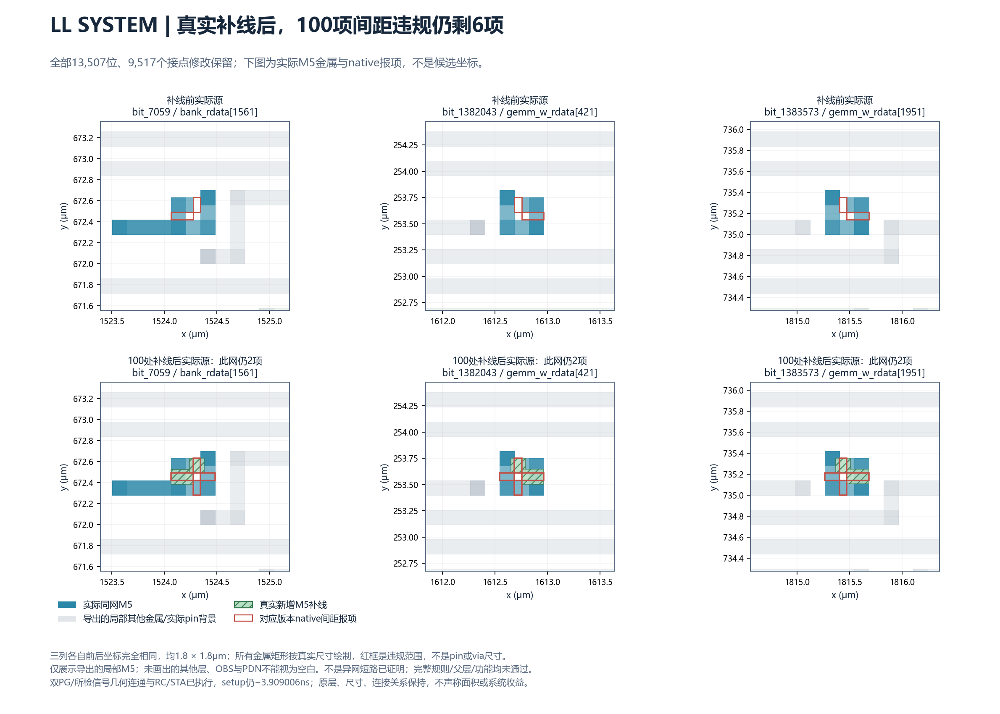

# 这轮工程遇到的阻塞与修复分析

[中文学习网页（HTML，下载后用浏览器打开）](issue-126-blocker-review.html)：包含通俗解释、目录、术语速查、问题搜索、可展开的逐次修复记录及提问文本整理。图已内嵌，可离线阅读；原始证据链接需联网及仓库权限。网页整理不增加任何物理实现结论。

本次单独新建PR，只交付问题分析和关键图。不修改旧Issue/PR，不启动新试验。原完整工程目标未完成；12小时硬交付及后半程每小时报告未完成，也如实记录。

按问题归并重复背景；每节说明用户要求的7项，随后保留该问题每次尝试的具体过程。每行沿用本节功能和总体影响；对象变化及该次失败范围另列。原始材料用固定commit链接按需查看，不把整套实验代码和大批回执复制进本PR。

[完整逐次原始台账（固定版本）](https://github.com/rayggxia-workspace/LLMHardwareDesign/blob/246bb1bd43b275bb1f71ffe33f5da92760381f42/docs/experiments/issue-126-blocker-review/data/incidents.json) · [原文/SHA索引（固定版本）](https://github.com/rayggxia-workspace/LLMHardwareDesign/blob/246bb1bd43b275bb1f71ffe33f5da92760381f42/docs/experiments/issue-126-blocker-review/data/evidence_manifest.json)

## 先看当前影响

- LL SYSTEM最新真实补线仍有6处M5间距违规；不是合法接口实现。
- VECTOR和SYSTEM已实际执行RC/STA，但原节拍或电气仍失败；不等于所有频率下都不能工作。
- 共同底座未冻结，两套完整上层适配与公平完整系统对照未完成。
- ACT/MXU匹配SRAM GDS缺失；缺验证资料与已证明的物理失败分开。

## 关键真实对照图

[SVG](issue-126-blocker-review/assets/llsys_actual_gap_residual6.svg) · [图的真实ODB/SHA来源](https://github.com/rayggxia-workspace/LLMHardwareDesign/blob/246bb1bd43b275bb1f71ffe33f5da92760381f42/docs/experiments/issue-126-blocker-review/data/llsys_actual_gap_residual6_figure.json)

下面按实际数据库矩形尺寸显示；红框是违规范围，不是pin/via尺寸。未绘出的金属、PG和OBS不能视为空白。

## 1. LL内部接点仍有6处实际间距违规

**1. 哪个案例、哪个阶段：** 块内真实接入后的独立native规则检查

**2. 哪个具体对象：** llaccel SYSTEM / M5：bit_7059→bank_rdata[1561]，端点wire48966/A；bit_1382043→gemm_w_rdata[421]，output5623/Z；bit_1383573→gemm_w_rdata[1951]，output7154/Z。各2处。

**3. 它本来负责什么功能：** 前者把外部存储返回数据送进SYSTEM；后两者把权重读取数据送往GEMM计算块。

**4. 实际出了什么问题：** 期望间距报项0；9517个接点真实修改后报100项，100处真实补线后仍6项。13507位、原M5/M6层和0.14μm尺寸、单元/连接/PG/外框保持。

**5. 问题影响多大：** 这是已证明的间距规则失败，无法作为合法接口交给父层；尚未证明这些同网报项是异网短路或RTL功能错误。

**6. 证据是什么：** [execution.json.gz（原版本）](https://github.com/rayggxia-workspace/LLMHardwareDesign/blob/246bb1bd43b275bb1f71ffe33f5da92760381f42/docs/experiments/issue-126-blocker-review/evidence/additional/data/deadline_receipts/llsys100-gap-heal-r02/execution.json.gz)；[independent.drc.gz（原版本）](https://github.com/rayggxia-workspace/LLMHardwareDesign/blob/246bb1bd43b275bb1f71ffe33f5da92760381f42/docs/experiments/issue-126-blocker-review/evidence/additional/data/deadline_receipts/llsys100-gap-heal-r02/independent.drc.gz)；[final_failure_mapping.json（原版本）](https://github.com/rayggxia-workspace/LLMHardwareDesign/blob/246bb1bd43b275bb1f71ffe33f5da92760381f42/docs/experiments/issue-126-blocker-review/evidence/additional/data/final_failure_mapping.json)

**7. 已经尝试什么、下一步做什么：** 先修正LEF线宽解析错误（未改数据库），再检查同网金属/异网/PG/未来首级via占地，实际补100处金属；双PG/所检连通/RCSTA执行，native100→6。 下一步：重新检查三网剩余窄缝的真实形状与完整间距条件，最小修改后再做独立native、PG、几何、父层接入和RCSTA。禁止直接导出LEF制造通过。 剩余工作估计：本轮一次完整检查实际约33分钟；剩余根因尚未完全定位，无法给出总修复时间。

**是否需要用户输入/授权：** 常规定位和修复无需重新确认；若最终必须改变原资源、架构或目标合同，才需要用户决定。缺资料时保持未知，不擅自指派连接层或虚构几何。

**帮助理解的比喻：** 像门口的管线已经重铺，但三处转角仍不满足施工间隔；对应上面三条M5网络，不是只在图纸上移动门。

### 本问题逐次尝试（去除重复背景）

| 时间（北京时间）/记录 | 本次对象或阶段 | 实际问题/结果 | 已做的最小修改、后续动作 | 证据 |
| --- | --- | --- | --- | --- |
| 2026-10-29T22:25:06.293393+08:00 / A001 | 旧pin移走会把真实金属一并移除；只读定位，未实施 | 扫描28,517,812行实际几何，2832点合同核对；盲移会移除105,138,600 DBU²原pin金属。仅只读，没有重接。 | 假设移走pin不影响导体不成立；先核对原WIRE/VIA与旧pin金属并集。 若上述并非原生证明的根因，只作为当时假设；以回执/报错及后续对照为准。 后续：重新检查三网剩余窄缝的真实形状与完整间距条件，最小修改后再做独立native、PG、几何、父层接入和RCSTA。禁止直接导出LEF制造通过。 | [原文/版本](https://github.com/rayggxia-workspace/LLMHardwareDesign/blob/246bb1bd43b275bb1f71ffe33f5da92760381f42/docs/experiments/issue-126-blocker-review/evidence/wire-candidate-metal-r01/receipt-summary.json) |
| 2026-10-29T22:30:23.463925+08:00 / A002 | 原生保留小方块的下游读取试验失败；工具消费失败 | 原生创建返回0；KLayout消费返回1，具体报错Original FreePDK45 M5 mapping missing。另有DEF DBU0.0005/reader0.0001不一致警告，警告本身不作为已证明根因。 | 已定位消费者对M5图层映射的断言；r02按实际读入metal5(19/0)核对，未改真实金属或规则。 后续：重新检查三网剩余窄缝的真实形状与完整间距条件，最小修改后再做独立native、PG、几何、父层接入和RCSTA。禁止直接导出LEF制造通过。 | [原文/版本](https://github.com/rayggxia-workspace/LLMHardwareDesign/blob/246bb1bd43b275bb1f71ffe33f5da92760381f42/docs/experiments/issue-126-blocker-review/evidence/pin-retention-consumers-r01/receipt-summary.json) |
| 2026-10-29T22:34:08.213999+08:00 / A003 | 小方块编码的真实消费往返通过；局部工具验证通过 | 原生与KLayout消费均返回0；两种编码预期M5矩形存在、无局部额外金属，GDS往返XOR空。只是小夹具。 | 修复消费者适配后重跑真实DEF读取，不伪造GDS或改工艺。 若上述并非原生证明的根因，只作为当时假设；以回执/报错及后续对照为准。 后续：重新检查三网剩余窄缝的真实形状与完整间距条件，最小修改后再做独立native、PG、几何、父层接入和RCSTA。禁止直接导出LEF制造通过。 | [原文/版本](https://github.com/rayggxia-workspace/LLMHardwareDesign/blob/246bb1bd43b275bb1f71ffe33f5da92760381f42/docs/experiments/issue-126-blocker-review/evidence/pin-retention-consumers-r02/receipt-summary.json) |
| 2026-10-29T23:19:18.887288+08:00 / A016 | 实际2832个WIRE接点重定位并保留旧pin金属；接点/有限检查通过，时序失败 | 2832点实际编辑，2827处旧pin金属保留成真实WIRE；原725253网所检连通/native0；setup−3.909000/min−0.587515ns仍失败。 | 用通过消费测试的原生WIRE编码保留导体；不重复GRT/DRT搜索，不将金属并集不变说成线长收益。 若上述并非原生证明的根因，只作为当时假设；以回执/报错及后续对照为准。 后续：重新检查三网剩余窄缝的真实形状与完整间距条件，最小修改后再做独立native、PG、几何、父层接入和RCSTA。禁止直接导出LEF制造通过。 | [原文/版本](https://github.com/rayggxia-workspace/LLMHardwareDesign/blob/246bb1bd43b275bb1f71ffe33f5da92760381f42/docs/experiments/issue-126-blocker-review/evidence/llsys-wire-pin-retention-r01/receipt-summary.json) |
| 2026-10-30T00:03:15.267287+08:00 / A022 | 核实当前源没有漏导出的RECT补丁；有限审计通过 | 当前c494源原生RECT审计为0；这只排除此类漏导，不等于完整规则通过。 | 直接原生解码真实wire opcode，不能从绘图数据猜测补丁。 若上述并非原生证明的根因，只作为当时假设；以回执/报错及后续对照为准。 后续：重新检查三网剩余窄缝的真实形状与完整间距条件，最小修改后再做独立native、PG、几何、父层接入和RCSTA。禁止直接导出LEF制造通过。 | [原文/版本](https://github.com/rayggxia-workspace/LLMHardwareDesign/blob/246bb1bd43b275bb1f71ffe33f5da92760381f42/docs/experiments/issue-126-blocker-review/evidence/native-patch-audit-r03-llaccel13093/receipt-summary.json) |
| 2026-10-30T00:11:46.301566+08:00 / A024 | 13507位新物理视图与实际SPEF匹配；视图验证闭合，父层未验 | 全13507位物理/研究模型匹配，原负时序SPEF逐字重放；不证明父层可达性。 | 从实际c494 ODB导出，并独立进程读模型核对全位；不是只改最终LEF。 若上述并非原生证明的根因，只作为当时假设；以回执/报错及后续对照为准。 后续：重新检查三网剩余窄缝的真实形状与完整间距条件，最小修改后再做独立native、PG、几何、父层接入和RCSTA。禁止直接导出LEF制造通过。 | [原文/版本](https://github.com/rayggxia-workspace/LLMHardwareDesign/blob/246bb1bd43b275bb1f71ffe33f5da92760381f42/docs/experiments/issue-126-blocker-review/evidence/llsys13093-views-r01/receipt-summary.json) |
| 2026-10-30T01:36:34.325099+08:00 / A041 | 全口接入实际编辑遇到没有原导线的声明口；原生对象条件失败 | 原生编辑报Original routed conductor missing，停止；不能为无块内端点的口虚构导线。 | 全口规划短接入线/同网金属接点，真正写DB时核实每个口是否有原WIRE。 若上述并非原生证明的根因，只作为当时假设；以回执/报错及后续对照为准。 后续：重新检查三网剩余窄缝的真实形状与完整间距条件，最小修改后再做独立native、PG、几何、父层接入和RCSTA。禁止直接导出LEF制造通过。 | [原文/版本](https://github.com/rayggxia-workspace/LLMHardwareDesign/blob/246bb1bd43b275bb1f71ffe33f5da92760381f42/docs/experiments/issue-126-blocker-review/evidence/all-access-stubs-r01/receipt-summary.json) |
| 2026-10-30T01:40:31.531763+08:00 / A042 | 加入父PG和同网金属选择后仍遇无WIRE声明口；同根因重试仍失败 | 复用完整13507口计划、扩大同网既有金属选择并纳入父PG；真实编辑仍在无原导线的单端声明口失败。 | 同根因第二次出现后转为原生角色审计，未继续扩大搜索或延长P&R。 若上述并非原生证明的根因，只作为当时假设；以回执/报错及后续对照为准。 后续：重新检查三网剩余窄缝的真实形状与完整间距条件，最小修改后再做独立native、PG、几何、父层接入和RCSTA。禁止直接导出LEF制造通过。 | [原文/版本](https://github.com/rayggxia-workspace/LLMHardwareDesign/blob/246bb1bd43b275bb1f71ffe33f5da92760381f42/docs/experiments/issue-126-blocker-review/evidence/all-access-stubs-r02/receipt-summary.json) |
| 2026-10-30T02:29:29.704594+08:00 / A048 | 证明24个声明口角色后，9517处真实引出完成但留100违规；真实施工后规则失败 | 原生证明24口仅1 BTerm/0 ITerm/无原WIRE，保持原位；9517处实际XY/接入线编辑，双PG/所检连通/RCSTA执行；独立native100项间距。 | 复用封存计划，保留完整位清单、24声明口原XY和旧金属，未把无端点解释成虚构RTL常量。 若上述并非原生证明的根因，只作为当时假设；以回执/报错及后续对照为准。 后续：重新检查三网剩余窄缝的真实形状与完整间距条件，最小修改后再做独立native、PG、几何、父层接入和RCSTA。禁止直接导出LEF制造通过。 | [原文/版本](https://github.com/rayggxia-workspace/LLMHardwareDesign/blob/246bb1bd43b275bb1f71ffe33f5da92760381f42/docs/experiments/issue-126-blocker-review/evidence/all-access-stubs-r03/receipt-summary.json) |
| 2026-10-30T02:59:32.121069+08:00 / A051 | 补线脚本把间距表宽度误认成线宽；工艺解析脚本失败 | 读取LEF WIDTH断言失败，在修改数据库之前停止；不能称为补线失败的物理证据。 | 先定位到底层SPACINGTABLE WIDTH与带分号的标量WIDTH歧义；原规则未改。 若上述并非原生证明的根因，只作为当时假设；以回执/报错及后续对照为准。 后续：重新检查三网剩余窄缝的真实形状与完整间距条件，最小修改后再做独立native、PG、几何、父层接入和RCSTA。禁止直接导出LEF制造通过。 | [原文/版本](https://github.com/rayggxia-workspace/LLMHardwareDesign/blob/246bb1bd43b275bb1f71ffe33f5da92760381f42/docs/experiments/issue-126-blocker-review/evidence/llsys100-gap-heal-r01/receipt-summary.json) |
| 2026-10-30T03:52:07.081119+08:00 / A058 | 修正解析并真实补100处金属后仍剩6项；局部改善，6项实际失败 | 100处真实补线，原13507位/9517接点/单元/网络/PG保持，双PG/所检连通/RCSTA执行；M5三网各2项间距，100→6。 | 用标量WIDTH语法，逐处检查实际同网形状、异网、PG和预留首级via占地，再写真实原生WIRE。 若上述并非原生证明的根因，只作为当时假设；以回执/报错及后续对照为准。 后续：重新检查三网剩余窄缝的真实形状与完整间距条件，最小修改后再做独立native、PG、几何、父层接入和RCSTA。禁止直接导出LEF制造通过。 | [原文/版本](https://github.com/rayggxia-workspace/LLMHardwareDesign/blob/246bb1bd43b275bb1f71ffe33f5da92760381f42/docs/experiments/issue-126-blocker-review/evidence/llsys100-gap-heal-r02/receipt-summary.json) |

## 2. VECTOR实际布线可连通，但原3ns节拍仍不达标

**1. 哪个案例、哪个阶段：** 寄生提取后的setup/电气检查

**2. 哪个具体对象：** llaccel VECTOR；当前主源vector_resume/r01；独立75换型/9朝向修复变体vector_pose_route_fix/r01

**3. 它本来负责什么功能：** 完成向量运算，把本拍的数据经过组合逻辑送到下一级寄存器。

**4. 实际出了什么问题：** 原3ns不变；主源setup−4.140220ns，9朝向/时钟线修复变体−4.137150ns，公平同资源周边−4.133816ns。正min余量不抵消setup失败。

**5. 问题影响多大：** 数据赶不上研究目标节拍；不代表任何低频条件下都不能工作，也未完成全功能证明。

**6. 证据是什么：** [execution.json.gz（原版本）](https://github.com/rayggxia-workspace/LLMHardwareDesign/blob/246bb1bd43b275bb1f71ffe33f5da92760381f42/docs/experiments/issue-126-blocker-review/evidence/additional/data/deadline_receipts/vector-pose-route-fix-r01/execution.json.gz)；[checks.txt.gz（原版本）](https://github.com/rayggxia-workspace/LLMHardwareDesign/blob/246bb1bd43b275bb1f71ffe33f5da92760381f42/docs/experiments/issue-126-blocker-review/evidence/additional/data/deadline_receipts/vector-pose-route-fix-r01/checks.txt.gz)；[execution.json.gz（原版本）](https://github.com/rayggxia-workspace/LLMHardwareDesign/blob/246bb1bd43b275bb1f71ffe33f5da92760381f42/docs/experiments/issue-126-blocker-review/evidence/additional/data/deadline_receipts/same-source-perimeter-vector-r01/execution.json.gz)

**7. 已经尝试什么、下一步做什么：** 真实75驱动换型、合法化、详细布线；修正9个朝向及坐标重放遗漏，再重接旧时钟线。新变体双PG/native0，负时序仍保留；该单元成本独立。 下一步：在不改协议、流水和3ns合同下继续定位组合逻辑/驱动/实际路径；还需完整电气与系统STA。 剩余工作估计：未证明原合同下存在可行解，无法估计完成时间。

**是否需要用户输入/授权：** 常规定位和修复无需重新确认；若最终必须改变原资源、架构或目标合同，才需要用户决定。缺资料时保持未知，不擅自指派连接层或虚构几何。

**帮助理解的比喻：** 线路已经通，但数据赶不上班车；这里班车就是VECTOR原3ns时钟，供电修好不能替代赶车检查。

### 本问题逐次尝试（去除重复背景）

| 时间（北京时间）/记录 | 本次对象或阶段 | 实际问题/结果 | 已做的最小修改、后续动作 | 证据 |
| --- | --- | --- | --- | --- |
| 2026-10-30T01:18:13.833494+08:00 / A035 | VECTOR脚本误缩允许层范围而拒绝原M9 guide；试验脚本范围错误 | 75个真实换型已合法化，但脚本误用M2–M8；DRT-0155拒绝原M9 net_086937_ guide。是试验脚本错误，不是原工艺不可行。 | 核对SHA绑定的原脚本，恢复原信号M2–M10/时钟M4–M10；不改变合同制造通过。 若上述并非原生证明的根因，只作为当时假设；以回执/报错及后续对照为准。 后续：在不改协议、流水和3ns合同下继续定位组合逻辑/驱动/实际路径；还需完整电气与系统STA。 | [原文/版本](https://github.com/rayggxia-workspace/LLMHardwareDesign/blob/246bb1bd43b275bb1f71ffe33f5da92760381f42/docs/experiments/issue-126-blocker-review/evidence/drive-sizing-vector-r04/receipt-summary.json) |
| 2026-10-30T01:50:36.476091+08:00 / A043 | 恢复正确层范围后发现供电朝向问题；布线完成但供电失败 | 真实DRT/RCSTA执行且独立native0，但VDD/VSS检查失败；后来定位9个被遗漏重放朝向的单元。 | 复用封存的75换型合法化位置，在原M2–M10路由，不重复换型搜索。 若上述并非原生证明的根因，只作为当时假设；以回执/报错及后续对照为准。 后续：在不改协议、流水和3ns合同下继续定位组合逻辑/驱动/实际路径；还需完整电气与系统STA。 | [原文/版本](https://github.com/rayggxia-workspace/LLMHardwareDesign/blob/246bb1bd43b275bb1f71ffe33f5da92760381f42/docs/experiments/issue-126-blocker-review/evidence/drive-sizing-vector-r05/receipt-summary.json) |
| 2026-10-30T01:54:35.966804+08:00 / A044 | 只补朝向导致包围框偏移一排；局部朝向修复失败 | _457487_等单元翻转后包围框下移1.4μm，布局及PG仍失败；不能只翻方向不恢复真实坐标。 | 逐一比较9个单元的合法化master/XY/orient与实际DB，查明OpenDB翻转后包围框变化。 若上述并非原生证明的根因，只作为当时假设；以回执/报错及后续对照为准。 后续：在不改协议、流水和3ns合同下继续定位组合逻辑/驱动/实际路径；还需完整电气与系统STA。 | [原文/版本](https://github.com/rayggxia-workspace/LLMHardwareDesign/blob/246bb1bd43b275bb1f71ffe33f5da92760381f42/docs/experiments/issue-126-blocker-review/evidence/vector-pose-power-r01/receipt-summary.json) |
| 2026-10-30T02:03:24.883999+08:00 / A046 | 朝向和坐标一起恢复后暴露旧时钟线冲突；位置修复通过，旧线仍冲突 | placement与VSS通过，0个未接PG警告；VDD仍与clknet_leaf_167_clk/172_clk旧时钟线冲突。 | 先设orient再恢复验证过的lower-left XY；不能沿用朝向改变前的旧信号线。 若上述并非原生证明的根因，只作为当时假设；以回执/报错及后续对照为准。 后续：在不改协议、流水和3ns合同下继续定位组合逻辑/驱动/实际路径；还需完整电气与系统STA。 | [原文/版本](https://github.com/rayggxia-workspace/LLMHardwareDesign/blob/246bb1bd43b275bb1f71ffe33f5da92760381f42/docs/experiments/issue-126-blocker-review/evidence/vector-pose-power-r02/receipt-summary.json) |
| 2026-10-30T02:27:09.306469+08:00 / A047 | 按真实受影响网重接，双PG/native通过但时序仍失败；接线/PG修复，时序仍失败 | 9个朝向/坐标及关联时钟数据重接完成，双PG/独立native0，setup−4.137150/min+0.040984ns。仍不满足3ns。 | 只重接真实受影响网络，原75换型资源保留；未额外改流水或时钟。 若上述并非原生证明的根因，只作为当时假设；以回执/报错及后续对照为准。 后续：在不改协议、流水和3ns合同下继续定位组合逻辑/驱动/实际路径；还需完整电气与系统STA。 | [原文/版本](https://github.com/rayggxia-workspace/LLMHardwareDesign/blob/246bb1bd43b275bb1f71ffe33f5da92760381f42/docs/experiments/issue-126-blocker-review/evidence/vector-pose-route-fix-r01/receipt-summary.json) |
| 2026-10-30T03:25:02.502671+08:00 / A056 | VECTOR姿态修复版本导出匹配视图但不晋升全通过；有限视图闭合，系统未验 | 2246位模型匹配，独立读回/SPEF重放一致；setup−4.137150ns、电气与完整规则未通过。 | 把另75换型/9朝向修复版本独立导出，成本与纯XY/公平原资源组分开。 若上述并非原生证明的根因，只作为当时假设；以回执/报错及后续对照为准。 后续：在不改协议、流水和3ns合同下继续定位组合逻辑/驱动/实际路径；还需完整电气与系统STA。 | [原文/版本](https://github.com/rayggxia-workspace/LLMHardwareDesign/blob/246bb1bd43b275bb1f71ffe33f5da92760381f42/docs/experiments/issue-126-blocker-review/evidence/verified-vector-pose-view-r01/receipt-summary.json) |

## 3. 两套SYSTEM仍有时序或输出负载失败

**1. 哪个案例、哪个阶段：** 块内RC/完整原约束下STA与电气检查

**2. 哪个具体对象：** openTPU SYSTEM：DMA t_rq[25]寄存器输出、TMEM pw_d[124]寄存器输出；llaccel SYSTEM：output10580/Z→bank_we[67]

**3. 它本来负责什么功能：** 分别传递搬运请求/存储写数据，以及把写入许可送往外部存储bank。外部SRAM未虚构为六块内部已实现资源。

**4. 实际出了什么问题：** openTPU当前setup−0.056396/min−0.119919ns；同资源周边−0.383581/−0.105735ns，原2.5ns不变。LL当前setup−3.909000/min−0.587515ns（min含removal）；输出bank_we[67]电容420.387054fF，限制60.653706fF。LL原slew1091/cap7784行失败。

**5. 问题影响多大：** 目标速度、最小延迟或电气约束实际失败；不能统称接线未通，也不能把含removal的最小余量全部叫hold。

**6. 证据是什么：** [execution.json.gz（原版本）](https://github.com/rayggxia-workspace/LLMHardwareDesign/blob/246bb1bd43b275bb1f71ffe33f5da92760381f42/docs/experiments/issue-126-blocker-review/evidence/current-electrical-r02/execution.json.gz)；[execution.json.gz（原版本）](https://github.com/rayggxia-workspace/LLMHardwareDesign/blob/246bb1bd43b275bb1f71ffe33f5da92760381f42/docs/experiments/issue-126-blocker-review/evidence/drive-sizing-llsys-r04/execution.json.gz)；[execution.json.gz（原版本）](https://github.com/rayggxia-workspace/LLMHardwareDesign/blob/246bb1bd43b275bb1f71ffe33f5da92760381f42/docs/experiments/issue-126-blocker-review/evidence/additional/data/deadline_receipts/same-source-perimeter-opentpu_aux-r01/execution.json.gz)

**7. 已经尝试什么、下一步做什么：** LL7438驱动换型、openTPU1149驱动换型真实执行/合法化，但详细布线分别在bit_3598和bit_22553无接入点停止，未产生合格新RCSTA源；旧失败保留。 下一步：先修复对应接口的真实首级接入，再在原负载/节拍下验证驱动、缓冲、布线和setup/hold/电气；新增单元成本单列。 剩余工作估计：新实现尚不能完成布线，无法可靠估计闭合时间。

**是否需要用户输入/授权：** 常规定位和修复无需重新确认；若最终必须改变原资源、架构或目标合同，才需要用户决定。缺资料时保持未知，不擅自指派连接层或虚构几何。

**帮助理解的比喻：** 像小推车承担了超出额定的货物；对应bank_we[67]输出缓冲器的实际420.387054fF负载，不能把负载限制改大就宣布通过。

### 本问题逐次尝试（去除重复背景）

| 时间（北京时间）/记录 | 本次对象或阶段 | 实际问题/结果 | 已做的最小修改、后续动作 | 证据 |
| --- | --- | --- | --- | --- |
| 2026-10-29T22:53:52.976918+08:00 / A009 | 将原检查中的电气失败与时序混合报项分开；真实失败分类 | 读取已封存真实报表分类，不重跑STA；发现原native0并未消除slew/cap/时序问题。 | 以匹配ODB的原报表为准，不把总VIOLATED计数都当成电容或hold。 若上述并非原生证明的根因，只作为当时假设；以回执/报错及后续对照为准。 后续：先修复对应接口的真实首级接入，再在原负载/节拍下验证驱动、缓冲、布线和setup/hold/电气；新增单元成本单列。 | [原文/版本](https://github.com/rayggxia-workspace/LLMHardwareDesign/blob/246bb1bd43b275bb1f71ffe33f5da92760381f42/docs/experiments/issue-126-blocker-review/evidence/current-electrical-r01/receipt-summary.json) |
| 2026-10-30T00:09:08.524233+08:00 / A023 | 对更新后的LL源重新绑定电气失败身份；真实电气失败 | LL当前源slew1091/cap7784行失败；bank_we[67]输出电容420.387054fF，限制60.653706fF。原负时序保留。 | 源变更后重新绑定报表SHA与实例/网络，避免继承另一版本的通过结论。 若上述并非原生证明的根因，只作为当时假设；以回执/报错及后续对照为准。 后续：先修复对应接口的真实首级接入，再在原负载/节拍下验证驱动、缓冲、布线和setup/hold/电气；新增单元成本单列。 | [原文/版本](https://github.com/rayggxia-workspace/LLMHardwareDesign/blob/246bb1bd43b275bb1f71ffe33f5da92760381f42/docs/experiments/issue-126-blocker-review/evidence/current-electrical-r02/receipt-summary.json) |
| 2026-10-30T01:06:22.822620+08:00 / A031 | 电气换型库存解析被非功能库单元阻断；库存脚本失败 | Liberty contract断言pins的direction失败；没有真实换型或新P&R通过。 | 实际库还含非功能对象；先区分能比较函数/状态的单元，再选择同功能驱动。 若上述并非原生证明的根因，只作为当时假设；以回执/报错及后续对照为准。 后续：先修复对应接口的真实首级接入，再在原负载/节拍下验证驱动、缓冲、布线和setup/hold/电气；新增单元成本单列。 | [原文/版本](https://github.com/rayggxia-workspace/LLMHardwareDesign/blob/246bb1bd43b275bb1f71ffe33f5da92760381f42/docs/experiments/issue-126-blocker-review/evidence/drive-sizing-llsys-r01/receipt-summary.json) |
| 2026-10-30T01:08:17.565679+08:00 / A032 | 报表驱动名与原生实例名不能对应；身份映射失败 | inst/term匹配断言失败；没有把无法核对身份的驱动擅自换型。 | 先核对OpenSTA显示名与ODB原生名，不能以字符串相似度替换单元。 若上述并非原生证明的根因，只作为当时假设；以回执/报错及后续对照为准。 后续：先修复对应接口的真实首级接入，再在原负载/节拍下验证驱动、缓冲、布线和setup/hold/电气；新增单元成本单列。 | [原文/版本](https://github.com/rayggxia-workspace/LLMHardwareDesign/blob/246bb1bd43b275bb1f71ffe33f5da92760381f42/docs/experiments/issue-126-blocker-review/evidence/drive-sizing-llsys-r02/receipt-summary.json) |
| 2026-10-30T01:11:43.272585+08:00 / A033 | 进一步定位总线转义导致的驱动匹配失败；具体转义匹配失败 | u_xbar.rstart[39]$_DFF_PN0_/QN在实际名字表匹配False/False；本轮仍无实际换型结果。 | 定位显示名与含转义ODB名差异；后续建立一一对应映射，保留真实原生名。 若上述并非原生证明的根因，只作为当时假设；以回执/报错及后续对照为准。 后续：先修复对应接口的真实首级接入，再在原负载/节拍下验证驱动、缓冲、布线和setup/hold/电气；新增单元成本单列。 | [原文/版本](https://github.com/rayggxia-workspace/LLMHardwareDesign/blob/246bb1bd43b275bb1f71ffe33f5da92760381f42/docs/experiments/issue-126-blocker-review/evidence/drive-sizing-llsys-r03/receipt-summary.json) |
| 2026-10-30T01:26:15.972326+08:00 / A038 | LL7438个实际驱动换型后路由卡在bit_3598；真实换型后接入失败 | 7784个报告驱动中7438个真实换型/合法化，346个没有更强兼容族；DRT在bit_3598无AP，未得到新RCSTA。 | 仅同功能/同状态合同的更强单元；不改位宽、协议或原时钟/负载，换型成本另列。 若上述并非原生证明的根因，只作为当时假设；以回执/报错及后续对照为准。 后续：先修复对应接口的真实首级接入，再在原负载/节拍下验证驱动、缓冲、布线和setup/hold/电气；新增单元成本单列。 | [原文/版本](https://github.com/rayggxia-workspace/LLMHardwareDesign/blob/246bb1bd43b275bb1f71ffe33f5da92760381f42/docs/experiments/issue-126-blocker-review/evidence/drive-sizing-llsys-r04/receipt-summary.json) |
| 2026-10-30T01:32:36.777802+08:00 / A040 | openTPU SYSTEM1149换型后卡在bit_22553；真实换型后接入失败 | 1221个报告驱动中1149个真实换型，72个无更强兼容族；全局路由执行，详细布线在bit_22553无AP。 | 保留原2.5ns和外部负载，只增强兼容驱动并合法化；当前仅定位接入失败，未证明全部负载已修复。 若上述并非原生证明的根因，只作为当时假设；以回执/报错及后续对照为准。 后续：先修复对应接口的真实首级接入，再在原负载/节拍下验证驱动、缓冲、布线和setup/hold/电气；新增单元成本单列。 | [原文/版本](https://github.com/rayggxia-workspace/LLMHardwareDesign/blob/246bb1bd43b275bb1f71ffe33f5da92760381f42/docs/experiments/issue-126-blocker-review/evidence/drive-sizing-system-r04/receipt-summary.json) |

## 4. 共同底座尚未完成真实父层引出，不能冻结

**1. 哪个案例、哪个阶段：** 共同M1–M10父层详细布线

**2. 哪个具体对象：** u_llaccel_aux/bit_1011，M5，dram_rsp_rdata[329]；其上方M6异网net257248

**3. 它本来负责什么功能：** 把外部DRAM返回的一位数据送入llaccel控制搬运块。

**4. 实际出了什么问题：** 六块布局/供电、256条原生FIXED M10导体和全局布线已生成，但93460在此pin报DRT-0073 No access point。当前c494源该pin未移动；9517新变体移动了它，但新变体仍6项规则失败，未晋升。

**5. 问题影响多大：** 共同底座未完成详细布线/系统寄生和时序，不能冻结，也不能证明两种功能的M1–M10冻结哈希相同。

**6. 证据是什么：** [execution.json.gz（原版本）](https://github.com/rayggxia-workspace/LLMHardwareDesign/blob/246bb1bd43b275bb1f71ffe33f5da92760381f42/docs/experiments/issue-126-blocker-review/evidence/current-common-deadline-r01/execution.json.gz)；[execution.json.gz（原版本）](https://github.com/rayggxia-workspace/LLMHardwareDesign/blob/246bb1bd43b275bb1f71ffe33f5da92760381f42/docs/experiments/issue-126-blocker-review/evidence/parent1011-firsthop-r02/execution.json.gz)；[execution.json.gz（原版本）](https://github.com/rayggxia-workspace/LLMHardwareDesign/blob/246bb1bd43b275bb1f71ffe33f5da92760381f42/docs/experiments/issue-126-blocker-review/evidence/common-def-import-r01/execution.json.gz)

**7. 已经尝试什么、下一步做什么：** 查到实际M6遮挡；75点重接及7438换型遇其他未选pin bit_3598无AP；全口9517实接和100补线随后执行。宏swap调用崩溃后改用DEF导入，父图/PG/位置及256 FIXED读回保持。 下一步：三网规则修复和新匹配视图导出合格后，用已写可复现DEF接续脚本实际跑父层；再做全规则/连通/RCSTA与冻结manifest。新接续脚本写成但未执行。 剩余工作估计：全口父层可达性尚未证明，不能给完整路由完成时间；旧长作业也不能替代新源。

**是否需要用户输入/授权：** 常规定位和修复无需重新确认；若最终必须改变原资源、架构或目标合同，才需要用户决定。缺资料时保持未知，不擅自指派连接层或虚构几何。

**帮助理解的比喻：** 房间已建、门也画好了，但门上方有别人的管线；这里就是M5 bit_1011上方的M6 net257248。

### 本问题逐次尝试（去除重复背景）

| 时间（北京时间）/记录 | 本次对象或阶段 | 实际问题/结果 | 已做的最小修改、后续动作 | 证据 |
| --- | --- | --- | --- | --- |
| 2026-10-29T23:10:22.431094+08:00 / A013 | 细粒度OBS过多：准备更保守的父层抽象；抽象准备，未布线 | 准备扩大禁止区域的低层OBS视图，原真实pin/金属保留；不是打通灰色区域。 | 将选定低层已占用区域的包围范围整体视为禁止区，后续另检父层PG，避免少导出障碍。 若上述并非原生证明的根因，只作为当时假设；以回执/报错及后续对照为准。 后续：三网规则修复和新匹配视图导出合格后，用已写可复现DEF接续脚本实际跑父层；再做全规则/连通/RCSTA与冻结manifest。新接续脚本写成但未执行。 | [原文/版本](https://github.com/rayggxia-workspace/LLMHardwareDesign/blob/246bb1bd43b275bb1f71ffe33f5da92760381f42/docs/experiments/issue-126-blocker-review/evidence/conservative-low-views-r01/receipt-summary.json) |
| 2026-10-29T23:31:09.227324+08:00 / A020 | 六块保守抽象原生读回核对；有限读回通过 | 24767信号口与PG全部保持的读回通过；源版本仍需与新LL单独匹配，不能据此冻结底座。 | 使用原生LEF读取再比完整pin清单，而非从图颜色判宏可接入。 若上述并非原生证明的根因，只作为当时假设；以回执/报错及后续对照为准。 后续：三网规则修复和新匹配视图导出合格后，用已写可复现DEF接续脚本实际跑父层；再做全规则/连通/RCSTA与冻结manifest。新接续脚本写成但未执行。 | [原文/版本](https://github.com/rayggxia-workspace/LLMHardwareDesign/blob/246bb1bd43b275bb1f71ffe33f5da92760381f42/docs/experiments/issue-126-blocker-review/evidence/conservative-native-check-r01/receipt-summary.json) |
| 2026-10-30T00:14:14.788224+08:00 / A025 | 首级via筛查错误地假设三层落点一样大；规则尺寸假设失败 | 只读导出成功，脚本断言失败；真实via6的M7落点0.4×0.4μm，原pin仍0.14×0.14μm。 | 查实际via5/via6矩形而不是统一套最高层规则；此失败未改数据库。 若上述并非原生证明的根因，只作为当时假设；以回执/报错及后续对照为准。 后续：三网规则修复和新匹配视图导出合格后，用已写可复现DEF接续脚本实际跑父层；再做全规则/连通/RCSTA与冻结manifest。新接续脚本写成但未执行。 | [原文/版本](https://github.com/rayggxia-workspace/LLMHardwareDesign/blob/246bb1bd43b275bb1f71ffe33f5da92760381f42/docs/experiments/issue-126-blocker-review/evidence/llsys-residual87-preflight-r01/receipt-summary.json) |
| 2026-10-30T00:16:01.573429+08:00 / A026 | 共同父层详细布线卡在DRAM返回数据pin；父层接入实际失败 | 六块布局/双PG与256条FIXED M10真实导体完成，全局布线执行；详细布线在u_llaccel_aux/bit_1011报DRT-0073无接入点。 | 保持实际共同资源与预连预算，用CuGR绕过旧FastRoute拥塞，再检查真实详细接入。 若上述并非原生证明的根因，只作为当时假设；以回执/报错及后续对照为准。 后续：三网规则修复和新匹配视图导出合格后，用已写可复现DEF接续脚本实际跑父层；再做全规则/连通/RCSTA与冻结manifest。新接续脚本写成但未执行。 | [原文/版本](https://github.com/rayggxia-workspace/LLMHardwareDesign/blob/246bb1bd43b275bb1f71ffe33f5da92760381f42/docs/experiments/issue-126-blocker-review/evidence/current-common-deadline-r01/receipt-summary.json) |
| 2026-10-30T00:43:46.088867+08:00 / A028 | 按真实首级via尺寸筛查87点；只读筛查，未施工 | 实际74点找到局部几何候选、13点在限定搜索内未找到；仍没有真实重接/父层AP通过证据。 | 复用只读导出，修正via6 M7 cap为0.4μm，保留M5/M6原pin尺寸与层。 若上述并非原生证明的根因，只作为当时假设；以回执/报错及后续对照为准。 后续：三网规则修复和新匹配视图导出合格后，用已写可复现DEF接续脚本实际跑父层；再做全规则/连通/RCSTA与冻结manifest。新接续脚本写成但未执行。 | [原文/版本](https://github.com/rayggxia-workspace/LLMHardwareDesign/blob/246bb1bd43b275bb1f71ffe33f5da92760381f42/docs/experiments/issue-126-blocker-review/evidence/llsys-residual87-preflight-r02/receipt-summary.json) |
| 2026-10-30T01:02:55.231693+08:00 / A029 | 定位bit_1011上方的异网M6导线；具体遮挡已定位 | M5中心(340.015,1062.390)μm上方M6 net257248真实遮挡；找到相距0.28μm局部点，仍未验证完整接入栈。 | 对DRAM返回dram_rsp_rdata[329]单点读真实线/PG/via几何，不指定未知历史目标层。 若上述并非原生证明的根因，只作为当时假设；以回执/报错及后续对照为准。 后续：三网规则修复和新匹配视图导出合格后，用已写可复现DEF接续脚本实际跑父层；再做全规则/连通/RCSTA与冻结manifest。新接续脚本写成但未执行。 | [原文/版本](https://github.com/rayggxia-workspace/LLMHardwareDesign/blob/246bb1bd43b275bb1f71ffe33f5da92760381f42/docs/experiments/issue-126-blocker-review/evidence/parent1011-firsthop-r02/receipt-summary.json) |
| 2026-10-30T01:06:00.460298+08:00 / A030 | 更换宏master时原生进程崩溃；工具崩溃，根因未证 | 3415950次父PG与新增保守OBS交叠检查无冲突；在current_master_swaps原生返回−11，未完成布线。 | 保留图/PG/位置/预连尝试换当前匹配视图；仅定位到swap API阶段，根因未证明。 若上述并非原生证明的根因，只作为当时假设；以回执/报错及后续对照为准。 后续：三网规则修复和新匹配视图导出合格后，用已写可复现DEF接续脚本实际跑父层；再做全规则/连通/RCSTA与冻结manifest。新接续脚本写成但未执行。 | [原文/版本](https://github.com/rayggxia-workspace/LLMHardwareDesign/blob/246bb1bd43b275bb1f71ffe33f5da92760381f42/docs/experiments/issue-126-blocker-review/evidence/current-common-resume-r01/receipt-summary.json) |
| 2026-10-30T01:14:12.894038+08:00 / A034 | 通过新进程DEF导入绕开宏swap崩溃；导入阻塞已绕开，路由未完成 | 原图/端口/PG/实例位置/256 FIXED导体与状态保持，双PG检查执行；只完成导入，未完成路由冻结。 | 不用继续重复swapMaster；导出原检查点DEF，在新进程用匹配master读入后逐项比较。 若上述并非原生证明的根因，只作为当时假设；以回执/报错及后续对照为准。 后续：三网规则修复和新匹配视图导出合格后，用已写可复现DEF接续脚本实际跑父层；再做全规则/连通/RCSTA与冻结manifest。新接续脚本写成但未执行。 | [原文/版本](https://github.com/rayggxia-workspace/LLMHardwareDesign/blob/246bb1bd43b275bb1f71ffe33f5da92760381f42/docs/experiments/issue-126-blocker-review/evidence/common-def-import-r01/receipt-summary.json) |
| 2026-10-30T01:18:39.450652+08:00 / A036 | 全13507口首级几何审计显示问题不限87点；全口只读风险定位 | 4937点局部几何清，8570有风险，6796不在所测第一跳交叉轨道；不是8570个native DRC失败。 | 全口读取实际M5/M6/M7和via占用，避免少量样例代表全块。 若上述并非原生证明的根因，只作为当时假设；以回执/报错及后续对照为准。 后续：三网规则修复和新匹配视图导出合格后，用已写可复现DEF接续脚本实际跑父层；再做全规则/连通/RCSTA与冻结manifest。新接续脚本写成但未执行。 | [原文/版本](https://github.com/rayggxia-workspace/LLMHardwareDesign/blob/246bb1bd43b275bb1f71ffe33f5da92760381f42/docs/experiments/issue-126-blocker-review/evidence/all13507-first-hop-r01/receipt-summary.json) |
| 2026-10-30T01:18:45.434885+08:00 / A037 | 75个接口真实重接后仍遇另一个未选pin无AP；真实重接试验失败 | 75点实际编辑；DRT在bit_3598报DRT-1231，此pin不在所选75点中。没有新合格RCSTA。 | 从单个失败门口修复扩大到经证据选择的75点；失败显示需要全口首级核查。 若上述并非原生证明的根因，只作为当时假设；以回执/报错及后续对照为准。 后续：三网规则修复和新匹配视图导出合格后，用已写可复现DEF接续脚本实际跑父层；再做全规则/连通/RCSTA与冻结manifest。新接续脚本写成但未执行。 | [原文/版本](https://github.com/rayggxia-workspace/LLMHardwareDesign/blob/246bb1bd43b275bb1f71ffe33f5da92760381f42/docs/experiments/issue-126-blocker-review/evidence/firsthop75-r01/receipt-summary.json) |
| 2026-10-30T01:29:53.553814+08:00 / A039 | 将真实共同父层PG带入叶块接入筛查；只读PG依据补齐 | 导出13797条相关父层PG几何和原生R0变换；不再仅看叶内供电。 | 把父PG落到LL实际局部坐标，维持原父层供电与目标层，不虚构空白。 若上述并非原生证明的根因，只作为当时假设；以回执/报错及后续对照为准。 后续：三网规则修复和新匹配视图导出合格后，用已写可复现DEF接续脚本实际跑父层；再做全规则/连通/RCSTA与冻结manifest。新接续脚本写成但未执行。 | [原文/版本](https://github.com/rayggxia-workspace/LLMHardwareDesign/blob/246bb1bd43b275bb1f71ffe33f5da92760381f42/docs/experiments/issue-126-blocker-review/evidence/common-parent-PG-local-r01/receipt-summary.json) |
| 2026-10-30T13:44:15+08:00 / A060 | 历史父层逐pin目标映射仍缺资料；流程/资料阻塞；不是新增硬件试验 | 示例逐pin历史handoff层仍UNKNOWN；新受控M10接入是独立构造策略，不是找回的原始目标层。 | 只陈述有记录的现象，未定位的原因不推测。 后续：取得匹配历史handoff，或继续明确区分新受控实验与历史层级不变量。 | [原文/版本](https://github.com/rayggxia-workspace/LLMHardwareDesign/blob/246bb1bd43b275bb1f71ffe33f5da92760381f42/docs/experiments/issue-126-blocker-review/data/final_failure_mapping.json) |

## 5. 两套M11/M12适配尚未形成完整功能实现

**1. 哪个案例、哪个阶段：** 上层支路组合、真实连通与规则检查

**2. 哪个具体对象：** 旧514组合helper的M11网络编号243/248与199/206两处Short；编号未进一步映射为完整系统功能端点

**3. 它本来负责什么功能：** 通过可改变的上层连接，选择同一固定底座上不同计算块和共享预连的用途。

**4. 实际出了什么问题：** 旧组合曾127→2处Short，未归零。新增64μm小夹具在显式guide下native0/DRC0，但4端点仍分成3组，未生成有效补充连接。

**5. 问题影响多大：** 实际旧上层短路仍失败；小夹具连通失败。两套完整功能验证、同一冻结底座哈希、系统RCSTA均未执行，不能声称仅M11/M12已实现。

**6. 证据是什么：** [deadline_engineering_receipts.json（原版本）](https://github.com/rayggxia-workspace/LLMHardwareDesign/blob/246bb1bd43b275bb1f71ffe33f5da92760381f42/docs/experiments/issue-126-blocker-review/evidence/pr129-baseline/data/deadline_engineering_receipts.json)；[execution.json.gz（原版本）](https://github.com/rayggxia-workspace/LLMHardwareDesign/blob/246bb1bd43b275bb1f71ffe33f5da92760381f42/docs/experiments/issue-126-blocker-review/evidence/additional/data/deadline_receipts/partial-fixed-upper-r02/execution.json.gz)

**7. 已经尝试什么、下一步做什么：** 已有联合几何搜索、原生via间距控制夹具及guard作业；两次partial-prewire metadata工具试验未改善连通，停止同根因重复试验。 下一步：重新定位部分已连网络在路由器中的表示，真实解决两处上层冲突；随后在合法冻结底座上做两模式逻辑/物理/时序验证。 剩余工作估计：底座与工具表示均未闭合，无法估计。研究M11/M12几何/RC模型并非制造签核模型。

**是否需要用户输入/授权：** 常规定位和修复无需重新确认；若最终必须改变原资源、架构或目标合同，才需要用户决定。缺资料时保持未知，不擅自指派连接层或虚构几何。

**帮助理解的比喻：** 像检票记录显示0错误，但旅客还分在3个不相通的候车区；对应夹具4端点/3组，说明DRC0不等于接通。

### 本问题逐次尝试（去除重复背景）

| 时间（北京时间）/记录 | 本次对象或阶段 | 实际问题/结果 | 已做的最小修改、后续动作 | 证据 |
| --- | --- | --- | --- | --- |
| 2026-10-29T22:34:22.818695+08:00 / A004 | 固定接入点约束下的整网联合几何搜索未找到方案；限定搜索失败，未施工 | 关联src[248]/[206]/[243]/[199]等7网的限定搜索失败；没有原生修改/DRC/RCSTA。 | 允许via11调整、保留原M10/via10和hook，搜索整网；只定位到局部阻挡，未证明全局不可行。 若上述并非原生证明的根因，只作为当时假设；以回执/报错及后续对照为准。 后续：重新定位部分已连网络在路由器中的表示，真实解决两处上层冲突；随后在合法冻结底座上做两模式逻辑/物理/时序验证。 | [原文/版本](https://github.com/rayggxia-workspace/LLMHardwareDesign/blob/246bb1bd43b275bb1f71ffe33f5da92760381f42/docs/experiments/issue-126-blocker-review/evidence/upper-whole-net-search-r01/receipt-summary.json) |
| 2026-10-29T22:39:42.292734+08:00 / A005 | 按实际PRL/宽度间距修正整网搜索仍失败；限定搜索仍失败 | 改用实际间距表，限定7网搜索仍未找到可验方案；没有原生重接。 | 怀疑统一宽度间距过保守，改为实际PRL/width并用加权A*；没有放宽真实工艺。 若上述并非原生证明的根因，只作为当时假设；以回执/报错及后续对照为准。 后续：重新定位部分已连网络在路由器中的表示，真实解决两处上层冲突；随后在合法冻结底座上做两模式逻辑/物理/时序验证。 | [原文/版本](https://github.com/rayggxia-workspace/LLMHardwareDesign/blob/246bb1bd43b275bb1f71ffe33f5da92760381f42/docs/experiments/issue-126-blocker-review/evidence/upper-whole-net-search-r02/receipt-summary.json) |
| 2026-10-29T22:47:47.156730+08:00 / A007 | 通孔间距控制夹具第一次未能执行有效原生判定；工具夹具失败 | 两组控制返回1，具体PPL-0022：metal11没有routing tracks，停在place_pin；尚未有效检查via间距。 | 已证实夹具缺少M11轨道定义，不能把此失败当成工艺间距判断。 后续：重新定位部分已连网络在路由器中的表示，真实解决两处上层冲突；随后在合法冻结底座上做两模式逻辑/物理/时序验证。 | [原文/版本](https://github.com/rayggxia-workspace/LLMHardwareDesign/blob/246bb1bd43b275bb1f71ffe33f5da92760381f42/docs/experiments/issue-126-blocker-review/evidence/upper-cut-corner-r01/receipt-summary.json) |
| 2026-10-29T22:50:51.350851+08:00 / A008 | 通孔控制夹具第二次仍失败；工具夹具仍失败 | 补轨道后仍返回1，具体DRT-0001：GCELLGRID is undefined，停在drt::check_drc；0报项不是通过。 | 已证实夹具缺少全局布线网格；r03补齐夹具轨道/网格，不改变via尺寸和间距。 后续：重新定位部分已连网络在路由器中的表示，真实解决两处上层冲突；随后在合法冻结底座上做两模式逻辑/物理/时序验证。 | [原文/版本](https://github.com/rayggxia-workspace/LLMHardwareDesign/blob/246bb1bd43b275bb1f71ffe33f5da92760381f42/docs/experiments/issue-126-blocker-review/evidence/upper-cut-corner-r02/receipt-summary.json) |
| 2026-10-29T22:54:56.371136+08:00 / A010 | 原生控制证实对角间距筛查过保守；局部规则控制通过 | 轴向gap0.8μm报CutSpacing1；对角0.8/0.8μm原生0。只证明这一规则夹具。 | 纠正夹具导入/构造后让原生检查实际via几何，保持原工艺间距。 若上述并非原生证明的根因，只作为当时假设；以回执/报错及后续对照为准。 后续：重新定位部分已连网络在路由器中的表示，真实解决两处上层冲突；随后在合法冻结底座上做两模式逻辑/物理/时序验证。 | [原文/版本](https://github.com/rayggxia-workspace/LLMHardwareDesign/blob/246bb1bd43b275bb1f71ffe33f5da92760381f42/docs/experiments/issue-126-blocker-review/evidence/upper-cut-corner-r03/receipt-summary.json) |
| 2026-10-29T23:00:43.313344+08:00 / A011 | 修正局部通孔角落筛查后仍未形成合法上层实现；未施工，原失败保留 | 整网几何搜索仍未取得原生可验证修复；旧两处M11 Short没有被证明消除。 | 先用原生角落控制验证几何筛查，再修正搜索，保留全部固定接入对象。 若上述并非原生证明的根因，只作为当时假设；以回执/报错及后续对照为准。 后续：重新定位部分已连网络在路由器中的表示，真实解决两处上层冲突；随后在合法冻结底座上做两模式逻辑/物理/时序验证。 | [原文/版本](https://github.com/rayggxia-workspace/LLMHardwareDesign/blob/246bb1bd43b275bb1f71ffe33f5da92760381f42/docs/experiments/issue-126-blocker-review/evidence/upper-whole-net-search-r03/receipt-summary.json) |
| 2026-10-29T23:09:43.070922+08:00 / A012 | 改为局部连通分量搜索仍未完成上层修复；只读搜索，未施工 | 实际源码明确未执行native修改/DRC/RCSTA；不能把搜索路径当真实导线。 | 保留窗外实际锚点与固定导体，在局部分量上尝试最小替代；根因尚未完全定位。 若上述并非原生证明的根因，只作为当时假设；以回执/报错及后续对照为准。 后续：重新定位部分已连网络在路由器中的表示，真实解决两处上层冲突；随后在合法冻结底座上做两模式逻辑/物理/时序验证。 | [原文/版本](https://github.com/rayggxia-workspace/LLMHardwareDesign/blob/246bb1bd43b275bb1f71ffe33f5da92760381f42/docs/experiments/issue-126-blocker-review/evidence/upper-local-component-search-r01/receipt-summary.json) |
| 2026-10-29T23:12:15.605159+08:00 / A014 | upper_local_failure_r02：在同一SHA绑定源上做局部连通分量搜索；限定几何试验未闭合；未原生施工 | 在同一SHA绑定源上做局部连通分量搜索；限定搜索失败，没有原生改线。 | 局部锚点、已有金属/via及同时选路会限制可达性；尚未证明完整物理根因或全局无解。 后续：重新定位部分已连网络在路由器中的表示，真实解决两处上层冲突；随后在合法冻结底座上做两模式逻辑/物理/时序验证。 | [原文/版本](https://github.com/rayggxia-workspace/LLMHardwareDesign/blob/246bb1bd43b275bb1f71ffe33f5da92760381f42/docs/experiments/issue-126-blocker-review/evidence/local-search/upper_local_failure_r02.json) |
| 2026-10-29T23:16:10.011327+08:00 / A015 | upper_local_components_r03：调整局部分量重接处理后仍失败；限定几何试验未闭合；未原生施工 | 调整局部分量重接处理后仍失败；没有以几何路径宣称实际导线。 | 局部锚点、已有金属/via及同时选路会限制可达性；尚未证明完整物理根因或全局无解。 后续：重新定位部分已连网络在路由器中的表示，真实解决两处上层冲突；随后在合法冻结底座上做两模式逻辑/物理/时序验证。 | [原文/版本](https://github.com/rayggxia-workspace/LLMHardwareDesign/blob/246bb1bd43b275bb1f71ffe33f5da92760381f42/docs/experiments/issue-126-blocker-review/evidence/local-search/upper_local_components_r03.json) |
| 2026-10-29T23:19:59.547052+08:00 / A017 | upper_minimal_bypass_r01：尝试两条实际M11线的最小旁路，限定真实规则模型未找到方案。；限定几何试验未闭合；未原生施工 | 尝试两条实际M11线的最小旁路，限定真实规则模型未找到方案。 | 局部锚点、已有金属/via及同时选路会限制可达性；尚未证明完整物理根因或全局无解。 后续：重新定位部分已连网络在路由器中的表示，真实解决两处上层冲突；随后在合法冻结底座上做两模式逻辑/物理/时序验证。 | [原文/版本](https://github.com/rayggxia-workspace/LLMHardwareDesign/blob/246bb1bd43b275bb1f71ffe33f5da92760381f42/docs/experiments/issue-126-blocker-review/evidence/local-search/upper_minimal_bypass_r01.json) |
| 2026-10-29T23:22:11.046942+08:00 / A018 | upper_reserved_escape_r04：保留首段逃逸/固定窗外锚点再搜索，仍未得到可原生验证的修复。；限定几何试验未闭合；未原生施工 | 保留首段逃逸/固定窗外锚点再搜索，仍未得到可原生验证的修复。 | 局部锚点、已有金属/via及同时选路会限制可达性；尚未证明完整物理根因或全局无解。 后续：重新定位部分已连网络在路由器中的表示，真实解决两处上层冲突；随后在合法冻结底座上做两模式逻辑/物理/时序验证。 | [原文/版本](https://github.com/rayggxia-workspace/LLMHardwareDesign/blob/246bb1bd43b275bb1f71ffe33f5da92760381f42/docs/experiments/issue-126-blocker-review/evidence/local-search/upper_reserved_escape_r04.json) |
| 2026-10-29T23:29:33.166579+08:00 / A019 | upper_simultaneous_flow_r01：改为同时求7网的限定几何流模型；限定几何试验未闭合；未原生施工 | 改为同时求7网的限定几何流模型；求解器报告该限定模型不可行，不是整个物理问题全局无解。 | 局部锚点、已有金属/via及同时选路会限制可达性；尚未证明完整物理根因或全局无解。 后续：重新定位部分已连网络在路由器中的表示，真实解决两处上层冲突；随后在合法冻结底座上做两模式逻辑/物理/时序验证。 | [原文/版本](https://github.com/rayggxia-workspace/LLMHardwareDesign/blob/246bb1bd43b275bb1f71ffe33f5da92760381f42/docs/experiments/issue-126-blocker-review/evidence/local-search/upper_simultaneous_flow_r01.json) |
| 2026-10-29T23:43:41.886681+08:00 / A021 | upper_simultaneous_flow_r02：纳入实际额外阻挡网后求12网，180秒时限未取得可行解；限定几何试验未闭合；未原生施工 | 纳入实际额外阻挡网后求12网，180秒时限未取得可行解；没有继续延长或宣称已修。 | 局部锚点、已有金属/via及同时选路会限制可达性；尚未证明完整物理根因或全局无解。 后续：重新定位部分已连网络在路由器中的表示，真实解决两处上层冲突；随后在合法冻结底座上做两模式逻辑/物理/时序验证。 | [原文/版本](https://github.com/rayggxia-workspace/LLMHardwareDesign/blob/246bb1bd43b275bb1f71ffe33f5da92760381f42/docs/experiments/issue-126-blocker-review/evidence/local-search/upper_simultaneous_flow_r02.json) |
| 2026-10-30T03:03:53.426331+08:00 / A052 | 已有部分固定线的夹具没有生成global guides；工具夹具接入失败 | FIXED/ROUTED两种状态的全局路由输出guide为空，详细布线报DRT-0047；4端点原本分成3组。 | 只在64μm独立夹具中比较同0.8μm×32μm M10导体的metadata；未改真实底座。 若上述并非原生证明的根因，只作为当时假设；以回执/报错及后续对照为准。 后续：重新定位部分已连网络在路由器中的表示，真实解决两处上层冲突；随后在合法冻结底座上做两模式逻辑/物理/时序验证。 | [原文/版本](https://github.com/rayggxia-workspace/LLMHardwareDesign/blob/246bb1bd43b275bb1f71ffe33f5da92760381f42/docs/experiments/issue-126-blocker-review/evidence/partial-fixed-upper-r01/receipt-summary.json) |
| 2026-10-30T03:19:34.845057+08:00 / A053 | 显式guide后native0但4端点仍分3组；实际连通失败，不能报成功 | 同M11/M12规则下两种状态native0/DRC0，却没有新增有效上层线，4端点仍3组，桥必要性门槛失败。 | 增加同一明确夹具guide以隔离GRT影响，保持几何/规则；两次metadata路径无改善后停止。 若上述并非原生证明的根因，只作为当时假设；以回执/报错及后续对照为准。 后续：重新定位部分已连网络在路由器中的表示，真实解决两处上层冲突；随后在合法冻结底座上做两模式逻辑/物理/时序验证。 | [原文/版本](https://github.com/rayggxia-workspace/LLMHardwareDesign/blob/246bb1bd43b275bb1f71ffe33f5da92760381f42/docs/experiments/issue-126-blocker-review/evidence/partial-fixed-upper-r02/receipt-summary.json) |

## 6. ACT/MXU匹配SRAM的真实GDS仍缺失

**1. 哪个案例、哪个阶段：** 完整宏几何与GDS规则/LVS验证

**2. 哪个具体对象：** ACT两种fakeram master、MXU四种master；64×64示例fakeram45_1r1w_64x64

**3. 它本来负责什么功能：** 保存激活值、权重或计算相关数据；宏的内部物理版图必须真实存在。

**4. 实际出了什么问题：** 原包提供RTL/LEF/Lib，没有匹配GDS。实际原64×64 RTL标准单元映射17043单元、37608.676μm²，原宏外框5156.676μm²，约7.29倍。

**5. 问题影响多大：** 缺材料是尚未验证；这个特定标准单元映射装不下是已证明失败。不能推断所有SRAM实现都不可能，也不能虚构空GDS。

**6. 证据是什么：** [execution.json.gz（原版本）](https://github.com/rayggxia-workspace/LLMHardwareDesign/blob/246bb1bd43b275bb1f71ffe33f5da92760381f42/docs/experiments/issue-126-blocker-review/evidence/original-ram-mapping-r01/execution.json.gz)；[final_job_state.json（原版本）](https://github.com/rayggxia-workspace/LLMHardwareDesign/blob/246bb1bd43b275bb1f71ffe33f5da92760381f42/docs/experiments/issue-126-blocker-review/evidence/additional/data/final_job_state.json)

**7. 已经尝试什么、下一步做什么：** 复用原RTL、核对同步读/位掩码合同并实际映射；另一RAM物理长作业尚运行且合同不同，不替换原宏。 下一步：取得同规格真实SRAM物理包或完成符合原合同/外框的真实实现。若最终只能扩大资源或改架构才可行，须另由用户决定。 剩余工作估计：缺少可用同规格存储实现来源，无法估计交付时间。

**是否需要用户输入/授权：** 常规定位和修复无需重新确认；若最终必须改变原资源、架构或目标合同，才需要用户决定。缺资料时保持未知，不擅自指派连接层或虚构几何。

**帮助理解的比喻：** 像有仓库面积说明却没有建筑施工图；把本次普通单元实现塞进去，面积至少已超过原外框约7.29倍。

### 本问题逐次尝试（去除重复背景）

| 时间（北京时间）/记录 | 本次对象或阶段 | 实际问题/结果 | 已做的最小修改、后续动作 | 证据 |
| --- | --- | --- | --- | --- |
| 2026-10-29T22:42:50.671313+08:00 / A006 | 原64×64存储RTL的实际映射装不进旧外框；这个具体替换失败 | 实际Yosys映射17043单元、37608.676μm²，旧外框5156.676μm²，约7.293倍；不是所有SRAM实现不可能的证明。 | 复用原同步读/位掩码RTL实际综合，比较真实单元面积下界，不生成虚构SRAM GDS。 若上述并非原生证明的根因，只作为当时假设；以回执/报错及后续对照为准。 后续：取得同规格真实SRAM物理包或完成符合原合同/外框的真实实现。若最终只能扩大资源或改架构才可行，须另由用户决定。 | [原文/版本](https://github.com/rayggxia-workspace/LLMHardwareDesign/blob/246bb1bd43b275bb1f71ffe33f5da92760381f42/docs/experiments/issue-126-blocker-review/evidence/original-ram-mapping-r01/receipt-summary.json) |

## 7. 公平完整系统对照未完成

**1. 哪个案例、哪个阶段：** 共同底座/两模式端到端比较

**2. 哪个具体对象：** 六块优化周边Aopt与内部C；不是只比较旧边界坏布局

**3. 它本来负责什么功能：** 判断内部接点的块内成本是否能换来块间和适配层的总收益。

**4. 实际出了什么问题：** ACT/MXU/LL同资源原生指纹精确一致，复用旧Aopt；其余三块从当前C同资源完成真实Aopt。叶块覆盖完成，但两策略完整系统均未闭合。

**5. 问题影响多大：** 尚未验证系统线长/via/占用/RC/STA收益，不能报告系统面积、速度或M11/M12压力改善。

**6. 证据是什么：** [execution.json.gz（原版本）](https://github.com/rayggxia-workspace/LLMHardwareDesign/blob/246bb1bd43b275bb1f71ffe33f5da92760381f42/docs/experiments/issue-126-blocker-review/evidence/fair-boundary-source-inventory-r01/execution.json.gz)；[deadline_engineering_receipts.json（原版本）](https://github.com/rayggxia-workspace/LLMHardwareDesign/blob/246bb1bd43b275bb1f71ffe33f5da92760381f42/docs/experiments/issue-126-blocker-review/evidence/pr129-baseline/data/deadline_engineering_receipts.json)

**7. 已经尝试什么、下一步做什么：** 保持单元/位置/PG/外框/SDC/原层范围，执行GEMM/VECTOR/openTPU SYSTEM真实周边重布线；新周边的电气/负时序保留。 下一步：各策略分别形成两模式冻结底座、布线/功能/RCSTA后，按同预连逻辑拓扑及预算比较块内/块间/预连/适配成本。 剩余工作估计：上游尚未可验收，不能估计完整对照完成时间。

**是否需要用户输入/授权：** 常规定位和修复无需重新确认；若最终必须改变原资源、架构或目标合同，才需要用户决定。缺资料时保持未知，不擅自指派连接层或虚构几何。

**帮助理解的比喻：** 只量了各房间内部线路，还没量全楼走廊；不能用房间内的改动冒充整栋楼节省。

### 本问题逐次尝试（去除重复背景）

| 时间（北京时间）/记录 | 本次对象或阶段 | 实际问题/结果 | 已做的最小修改、后续动作 | 证据 |
| --- | --- | --- | --- | --- |
| 2026-10-30T02:00:28.207201+08:00 / A045 | 旧周边结果与当前C资源版本不一致，先核对；三块可复用，三块须重跑 | ACT/MXU/LL的全cells/连接/位置、PG、die、SDC指纹精确相同；其余3块不能混用旧ECO资源。 | 按原生封存指纹核对，不拿旧边界坏布局或少资源旧版当公平对照。 若上述并非原生证明的根因，只作为当时假设；以回执/报错及后续对照为准。 后续：各策略分别形成两模式冻结底座、布线/功能/RCSTA后，按同预连逻辑拓扑及预算比较块内/块间/预连/适配成本。 | [原文/版本](https://github.com/rayggxia-workspace/LLMHardwareDesign/blob/246bb1bd43b275bb1f71ffe33f5da92760381f42/docs/experiments/issue-126-blocker-review/evidence/fair-boundary-source-inventory-r01/receipt-summary.json) |
| 2026-10-30T02:34:15.260109+08:00 / A049 | GEMM同资源周边重布线后仍有电气失败；公平叶结果完成，电气失败 | 3753口完整保留；双PG/native0/RCSTA，setup+0.772594/min+0.054509ns；仍2 slew/4 cap失败。 | 使用当前658 diode等相同单元/位置/PG/外框/原3ns，只改到既有优化周边XY并实际重布线。 若上述并非原生证明的根因，只作为当时假设；以回执/报错及后续对照为准。 后续：各策略分别形成两模式冻结底座、布线/功能/RCSTA后，按同预连逻辑拓扑及预算比较块内/块间/预连/适配成本。 | [原文/版本](https://github.com/rayggxia-workspace/LLMHardwareDesign/blob/246bb1bd43b275bb1f71ffe33f5da92760381f42/docs/experiments/issue-126-blocker-review/evidence/same-source-perimeter-gemm-r01/receipt-summary.json) |
| 2026-10-30T02:41:56.108498+08:00 / A050 | VECTOR同资源周边仍赶不上原节拍；公平叶结果完成，时序失败 | 2246口保留，同资源双PG/native0/RCSTA，setup−4.133816/min+0.020196ns；不能用周边方案抹掉原组合时序问题。 | 保持原3ns、负载、单元/位置/PG/外框，完整重新布线；未混入另75换型版本。 若上述并非原生证明的根因，只作为当时假设；以回执/报错及后续对照为准。 后续：各策略分别形成两模式冻结底座、布线/功能/RCSTA后，按同预连逻辑拓扑及预算比较块内/块间/预连/适配成本。 | [原文/版本](https://github.com/rayggxia-workspace/LLMHardwareDesign/blob/246bb1bd43b275bb1f71ffe33f5da92760381f42/docs/experiments/issue-126-blocker-review/evidence/same-source-perimeter-vector-r01/receipt-summary.json) |
| 2026-10-30T03:24:37.531867+08:00 / A054 | GEMM新周边模型全位核对，但电气失败未消失；有限视图闭合，未全验收 | 3753位物理/模型全部匹配，独立模型读回与源SPEF结果一致；原2 slew/4 cap仍在。 | 从实际native0/双PG源导出，并独立进程读模型，避免模型源版本错配。 若上述并非原生证明的根因，只作为当时假设；以回执/报错及后续对照为准。 后续：各策略分别形成两模式冻结底座、布线/功能/RCSTA后，按同预连逻辑拓扑及预算比较块内/块间/预连/适配成本。 | [原文/版本](https://github.com/rayggxia-workspace/LLMHardwareDesign/blob/246bb1bd43b275bb1f71ffe33f5da92760381f42/docs/experiments/issue-126-blocker-review/evidence/verified-perimeter-gemm-view-r01/receipt-summary.json) |
| 2026-10-30T03:25:00.118443+08:00 / A055 | VECTOR新周边视图匹配但保留原负时序；有限视图闭合，时序失败 | 2246位匹配，模型独立读回、SPEF重放一致；setup−4.133816ns没有变成通过。 | 不更换约束或删负路径，以实际源绑定研究模型。 若上述并非原生证明的根因，只作为当时假设；以回执/报错及后续对照为准。 后续：各策略分别形成两模式冻结底座、布线/功能/RCSTA后，按同预连逻辑拓扑及预算比较块内/块间/预连/适配成本。 | [原文/版本](https://github.com/rayggxia-workspace/LLMHardwareDesign/blob/246bb1bd43b275bb1f71ffe33f5da92760381f42/docs/experiments/issue-126-blocker-review/evidence/verified-perimeter-vector-view-r01/receipt-summary.json) |
| 2026-10-30T03:30:44.043535+08:00 / A057 | openTPU SYSTEM同资源周边仍有负时序；公平叶结果完成，时序失败 | 2229口保留，双PG/native0/RCSTA执行，setup−0.383581/min−0.105735ns，原2.5ns不变。 | 从当前C同资源开始，不复用缺旧buffer/sizing成本的周边结果；全网真实重布线。 若上述并非原生证明的根因，只作为当时假设；以回执/报错及后续对照为准。 后续：各策略分别形成两模式冻结底座、布线/功能/RCSTA后，按同预连逻辑拓扑及预算比较块内/块间/预连/适配成本。 | [原文/版本](https://github.com/rayggxia-workspace/LLMHardwareDesign/blob/246bb1bd43b275bb1f71ffe33f5da92760381f42/docs/experiments/issue-126-blocker-review/evidence/same-source-perimeter-opentpu_aux-r01/receipt-summary.json) |

## 8. 误看静态日志尾部曾漏收LL已完成回执

**1. 哪个案例、哪个阶段：** 作业状态收集

**2. 哪个具体对象：** LL wire-pin-retention/r01，原生闭合时间2026-10-29T15:19:18UTC；第3小时工作流纠错。

**3. 它本来负责什么功能：** 把已经完成的结果及时纳入后续工程，避免重复提交或误报仍运行。

**4. 实际出了什么问题：** 日志尾部不能判断终态；实际execution.json已经闭合。后续改为先读带completed_utc与输出SHA的回执。

**5. 问题影响多大：** 造成状态报告与真实进展不一致；不是新增芯片功能错误。

**6. 证据是什么：** [当时状态记录（含第3小时纠错说明）](https://github.com/rayggxia-workspace/LLMHardwareDesign/blob/246bb1bd43b275bb1f71ffe33f5da92760381f42/docs/experiments/issue-126-blocker-review/evidence/pr129-baseline/data/execution_state.json)

**7. 已经尝试什么、下一步做什么：** 核对typed执行回执、源SHA和实际PG/RC/STA，纠正报告，不重交同一试验。 下一步：今后每次状态先查execution.json，再看内层日志；保持失败原文。 剩余工作估计：流程修正已采用，不能据此消除物理失败。

**是否需要用户输入/授权：** 常规定位和修复无需重新确认；若最终必须改变原资源、架构或目标合同，才需要用户决定。缺资料时保持未知，不擅自指派连接层或虚构几何。

**帮助理解的比喻：** 像只看已经不更新的施工牌，却没看验收单；这里验收单是execution.json，但它也仅证明所列范围。

## 9. 12小时硬交付与后半程小时报告未完成

**1. 哪个案例、哪个阶段：** 调度/交付与证据发布

**2. 哪个具体对象：** Issue126本轮12小时预算和09:19北京时间硬截止；后半程小时报告。

**3. 它本来负责什么功能：** 在截止前交付实际成果，并每小时通俗解释已完成、阻塞、影响、下一步和预期。

**4. 实际出了什么问题：** 截止应为2026-10-30 09:19；13:42重新核时后才开始逾期收集。第7小时至截止未持续给出小时报告。

**5. 问题影响多大：** 交付与沟通合同实际失败；不得倒填时间或把运行中作业算已完成；这不证明全部硬件在所有条件下失效。

**6. 证据是什么：** [最终作业快照/硬截止/实际时间](https://github.com/rayggxia-workspace/LLMHardwareDesign/blob/246bb1bd43b275bb1f71ffe33f5da92760381f42/docs/experiments/issue-126-blocker-review/data/final_job_state.json)

**7. 已经尝试什么、下一步做什么：** 前6小时有报告，后来缺报；重新核时后明确承认逾期、停止新增工程试验并收集真实结果。缺乏足够记录解释空档，不编造外部原因。 下一步：补齐追溯和真实失败证据；今后把硬截止检查放到每次工具返回后的调度门槛。 剩余工作估计：过去的硬截止已不可补救；本PR为事后追溯，不能算准时交付。

**是否需要用户输入/授权：** 常规定位和修复无需重新确认；若最终必须改变原资源、架构或目标合同，才需要用户决定。缺资料时保持未知，不擅自指派连接层或虚构几何。

**帮助理解的比喻：** 像错过了约定的交货班车；这里是09:19交付期限，事后补齐报告不能把逾期改写成准时。

## 具体坐标补充

LL的6项都是native **Metal Spacing / metal5**，每网2项。完整清单见[实际independent.drc](https://github.com/rayggxia-workspace/LLMHardwareDesign/blob/246bb1bd43b275bb1f71ffe33f5da92760381f42/docs/experiments/issue-126-blocker-review/evidence/llsys100-gap-heal-r02/readable/independent.drc)。单位μm：

| 网络/实际功能别名 | 两项报错范围 |
| --- | --- |
| bit_7059 / bank_rdata[1561] | (1524.065,672.420)–(1524.485,672.490)；(1524.275,672.280)–(1524.345,672.630) |
| bit_1382043 / gemm_w_rdata[421] | (1612.545,253.540)–(1612.965,253.610)；(1612.685,253.400)–(1612.755,253.750) |
| bit_1383573 / gemm_w_rdata[1951] | (1815.265,735.140)–(1815.685,735.210)；(1815.405,735.000)–(1815.475,735.350) |

旧上层两处M11 Short仅定位到helper网络243/248与199/206；范围分别(2438.095,2642.870)–(2438.895,2643.670)、(2465.295,2638.070)–(2466.095,2638.870)。尚未进一步建立完整系统功能端点映射，不编造具体计算单元根因。

## 来源与交付边界

60条记录包括51份闭合执行/检查回执、6次本地限定求解、3条资料/流程观察；含只读检查、导出和工具夹具，不等于51次完整P&R。driver/source/输出SHA见固定版本证据；本文提交不是CAD执行版本。已有大批原文留在已上传的证据版本中，本PR文件变更只保留分析、关键PNG/SVG及个人进度。

这是新的独立文档PR，基于main。Refs #126只是来源关联，不更新或合并旧任务/PR。原工程没有完整验收。登记沿用此前management-hub PR5 pending记录、本次未重核；缺Projects配置/已验证能力，看板unverified、同步pending；审查人待指定。没有为“通过”降低时钟、负载或物理规则。
