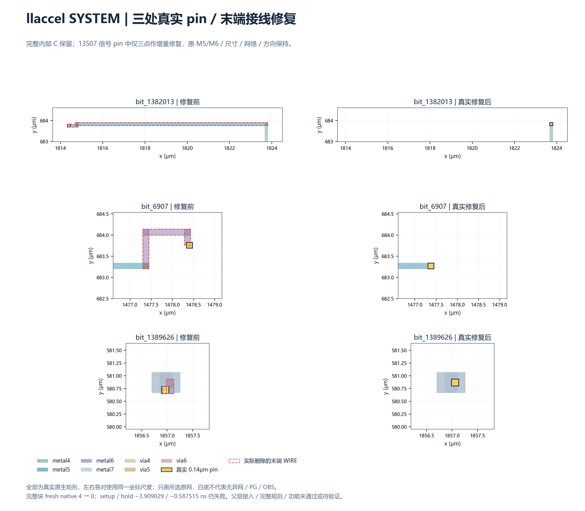
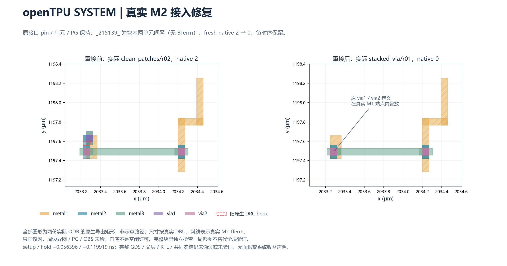
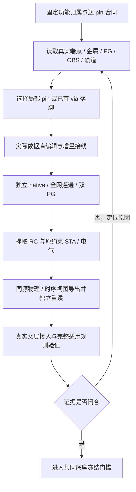

# 内部二维 pin 引出：块内物理实现的问题、修复与经验

日期：2026-10-29（Asia/Shanghai）。关联 [Issue #126](https://github.com/rayggxia-workspace/LLMHardwareDesign/issues/126)、[实验主 PR #129](https://github.com/rayggxia-workspace/LLMHardwareDesign/pull/129)。

本文解释“block 划分后，为什么块内实现仍需调整”，并整理已经遇到的问题和可复用做法。**功能归属稳定，不等于内部单元、接入线和通孔位置已经冻结。** 单元移动是修复手段之一；实际接入、规则覆盖、模型一致性和时序验证也占用大量工作量。

## 1. 证据范围与当前结论

本次独立文档以已发布 commit [3c28051e990c1a05dd1b4366001e3fc137bed392](https://github.com/rayggxia-workspace/LLMHardwareDesign/commit/3c28051e990c1a05dd1b4366001e3fc137bed392) 为固定证据截面，不采纳主工作区尚未发布的改动，也不把该截面中的“运行中”推定为当前仍运行或已经成功。后续结果以主 PR 的源绑定终态回执为准。本次没有提交或干扰物理作业。

- 六块功能与接口清单、24,767 个原始信号 pin 已覆盖；74,301 是 A/B/C 三方案坐标行数。
- 六块各有一个完成真实块内接入、独立 native DRC 为 0 的内部方案版本。
- **六块完整物理资格均未闭合**：父层可达性、完整规则、时序/电气和功能证明仍有失败或缺项。
- 现有负余量不能全部归因于二维 pin；必须结合原基线、同成本控制和真实关键路径区分原因。

下表是截面所选择的实际物理版本。setup/hold 单位 ns，来自各自源 SDC 与提取寄生，不能跨 block 当作性能排名；0 表示该版本的 native 检查计数，不代表完整 DRC 或系统通过。

| Block | 原信号 pin / 当前内部迁移数 | 选择的物理版本 | native DRC | setup / hold | 主要未闭合项 |
| --- | ---: | --- | ---: | --- | --- |
| ACT | 860 / 740 | act-access-r03 | 0 | 1.255988 / 0.031533 | 父层研究夹具 hold 失败；真实 SRAM GDS、完整规则/功能证据不足 |
| MXU | 2,172 / 1,931 | M6_escape_route/r02 | 0 | 0.246690 / 0.038538 | 匹配父层 fresh 仍 1 项；时钟 USE 合同回归；真实 SRAM GDS 缺失 |
| openTPU SYSTEM | 2,229 / 1,768 | native_stacked_via/r01 | 0 | -0.056396 / -0.119919 | setup/hold 失败；当前源父层和完整规则未闭合 |
| GEMM | 3,753 / 3,021 | 658_real_diodes/r01 | 0 | 0.770702 / 0.039533 | 含真实 diode 等附加成本；当前父层、完整规则/功能未闭合 |
| VECTOR | 2,246 / 1,022 | costed_VECTOR_resume/r01 | 0 | -4.140220 / 0.037989 | setup 失败；含 buffer/换型/移动成本；父层与完整资格不足 |
| llaccel SYSTEM | 13,507 / 13,184 | actual_via_tips/r02 | 0 | -3.909029 / -0.587515 | setup/hold 失败；新源父层未验证，旧父层 NoAP 失败保留 |

[原矩阵](issue-126-full-pin/data/qualification_matrix.json)保存逐版本证据；[本次证据摘要](issue-126-pin-physical-lessons-evidence.json)保存固定截面的字段、来源路径及 SHA-256。不同版本的通过项不能拼接成一个已经合格的 block。

## 2. 哪些可以调整，哪些必须保持

当前范围保持 block 功能归属、协议、流水、计算/存储资源、接口方向/位宽/逐 bit 语义和常量位；保持原 pin 金属层、尺寸、连接对象、目标层及原允许布线层集合。VDD/VSS 按 PDN 规则处理。历史父层目标层仍未知的连接继续标未知，不能靠新施工接点补写历史事实。

冻结前，允许在独立版本中调整 pin XY、相应接入线/通孔以及必要的块内单元位置，随后重新合法化、接线和验证。必要时增加 buffer、diode 或换型，必须作为**附加成本 ECO**单列，并验证数字连接和逻辑状态保持。不能把新增资源的效果计成纯 XY 收益。

共同 M1–M10 底座冻结后，单元、pin、布线和固定预连的实际下层几何/连接均属于冻结内容。若必须再改块内实现，应创建新底座版本并让两种模式重新验证，不能只修改其中一种模式的下层。

## 3. 已遇到的问题与处理结果

### 3.1 几何候选落在实际金属或固定 PG 上

早期 llaccel SYSTEM 完整 C 中，有 26 个 pin 与固定 PG 直接接触。候选完整、在 block 内、图上浅灰，都不能证明可用；上层金属、via 帽和宏 OBS 也会限制接入。

**做法：**按原 pin 所在层及真实连接经过层，导出真实金属、PG、OBS、via、端点和轨道；先排除硬冲突，再做小范围实际编辑。保存 pin/PG/外框和未改网络的不变证明，重做全块检查。

**已验证案例：**LL 三个内部 M5/M6 pin 落到原网已有 via 帽，删除恰好 8 个旧末端 WIRE 矩形；所有 via、单元、PG及其余 725,250 个多端网的 WIRE/VIA 表示保持。独立 native DRC **4→0**，但提取 setup/hold 仍 **-3.909029/-0.587515 ns**。这是局部实际修复，不是全部规则或时序通过。

[SVG](issue-126-full-pin/assets/llsys_actual_via_tip_repair.svg)。图中 pin、wire 与 via 落脚使用原生实际矩形；每组前后同尺度。未绘制的异网/PG/OBS不能当作空闲区。小范围三 pin 修复是在完整内部布局上的 ECO，不代表只用三 pin 样例完成全块研究。

### 3.2 叶块已经连通，父层仍没有合法接入点

MXU 的实际 M6 引出源 native 0，但对应父层 fresh 仍 1 项；共同下层在 LL bit_1025 出现 NoAP。全 24,767 pin 轨道审计发现旧 LL 视图有 13,184 个 preferred 中心未对齐，其余五块为 0。**未对齐是风险线索，不能直接等同于 NoAP 的根因或判决。**

**做法：**从真实父层 LEF/OBS、实例变换、轨道、原层 pin、附近 PG 和 via 尺寸检查可访问性；结合实际块内连接端点选择落脚，再生成匹配新源的物理/时序视图并重新验证父层。仅移动最终 LEF 或改示意图不能修复真实数据库。

MXU act_data[12] 的已有 via-tip 方案和 LL bit_1025 的接续修复在本截面尚无终态通过证据；本文不提前宣布修复。新增父层 M10 施工接点也不意味着把原叶 M5/M6 pin 全部抬层。

### 3.3 pin 坐标正确，via 堆叠或接入短线仍冲突

openTPU SYSTEM 的真实 M2 局部金属报项需要检查同网 wire、堆叠 via 落脚及附近异网，不能只检测 pin 中心距离。

**已做：**在原数据库上修复真实堆叠 via 接入，保留网络、pin/PG/外框和允许层集合，重新进行全块连通、native、RCX 与原约束 STA；该源 native **2→0**，setup/hold 仍 **-0.056396/-0.119919 ns**。

**经验：**pin 层间距、via cut spacing、金属 landing spacing/enclosure 是不同条件。必须按实际层级与规则检查；最高层间距不能统一套给所有低层 pin。

[SVG](issue-126-full-pin/assets/system_stacked_via_actual.svg)。图示实际几何的局部修复不替代完整规则或时序证据。

### 3.4 移动单元、加缓冲或换型后，时序不一定改善

VECTOR 和 SYSTEM 在 native 0 后仍有明显负余量。真实关键路径需要区分 cell arc、net arc、扇出、输入/输出约束和时钟路径，不能因为失败就继续盲目增加驱动。

**已做：**提取真实关键路径；对 SYSTEM 的实际私有 identity-buffer 链尝试重排既有单元，执行独立合法化和重布线。工具 Signal11、估算器不支持等失败保留，采用兼容的分阶段进程复用检查点，不把“单元已移动”当作合法化或布线完成。

VECTOR 后续变体在继承旧 ECO 外又增加 49 个非 filler buffer、365 处原非 filler 换型、325 个非 filler 移动，标准单元 master bbox 面积额外 **+354.046 μm²**；提取 setup 从 **-4.140220** 变为 **-4.148930 ns**，没有改善。因此保留旧可实现内部版本作为主源，记录新失败；不撤回边界来结束二维研究，也不声称所有修改都有收益。

**成本经验：**排除 filler 移除/重建和重名干扰，分别统计功能单元新增、换型、移动与 master 面积。外框不变时，不能称节省 block 面积。

### 3.5 工具显示“天线 0”，可能只是没有加载规则

原 native 检查显示天线 0，但真实 GDS 规则得到 GEMM 1,460 项。进一步查明原 M1–M10 tech LEF 没有相应天线规则，macro LEF 也缺相关天线模型；0 不能作为覆盖证明。

**已做：**将真实 GDS 违规多边形与网络关联，使用真实 ANTENNA_X1 几何与 Liberty 电容，实际插入、合法化、重接线、提取，再严格合并并重跑未修改的可用 deck。GEMM 当前 658-diode 源在该可用 deck 下 **1,460→0 项**，提取 setup/hold 为 **0.770702/0.039533 ns**。

**仍未完成：**可用 deck 自身的完整规则覆盖、系统功能/时序及当前父层资格。真实 diode 数量、负载和面积成本单列，不能混为纯 XY 收益。ACT/MXU 缺失 SRAM GDS，不以空宏或虚构几何补出“完整 GDS 通过”。

### 3.6 LEF、Liberty 与 ODB 的时钟属性不一致

MXU 父层导入/替换后，clk 的 USE 从 CLOCK 变成 SIGNAL；几何、方向、层和网络虽然相同，接口合同仍失败。小探针证实读入同源 Liberty 后属性变化；整父层先加载库再 swapMaster 则发生 Signal11。

**处理方向：**在真实流程中先完成物理替换、绑定同源时序库，再保存 ODB，并在独立进程 read_db 后重新核对持久属性。内存中看到 CLOCK，不能证明之前保存的 ODB 也正确。本截面复验未闭合，不手改标签或删除时钟检查来宣布通过。

### 3.7 ECO 后网络看似相同，数字语义仍可能回归

缓冲链改动不能只看端点是否在同一无向连通分量。VECTOR 严格有向关系检查曾发现 5 个输入接法问题；恢复实际五输入后，同一未降低要求的检查通过。

**经验：**核对全部原功能实例/端点、常量、方向、逻辑状态以及缓冲有向可达性和无环性；区分非 filler 和重建 filler。这样的相对映射数字合同仍不是完整 RTL 形式等价，也不覆盖 SRAM 黑盒内部或模拟/时序行为。

### 3.8 旧模型与新几何混用，会产生假的“通过组合”

每次真实接入或成本 ECO 后，旧 LEF/Liberty/SPEF 和旧父层结果不能直接继承。LL 当前源已导出全部 13,507 pin 的匹配视图，clean ODB SHA 与实际源一致，原 SPEF 余量精确重放；**负余量仍原样保留**。

**做法：**每份视图绑定实际源 ODB/SPEF/SDC、源码 commit、工具 SHA 和配置，逐 pin 检查层/尺寸/方向/网络/XY；默认与详细 OBS 都要保存。完整 minimum_period 等覆盖缺项继续标明。进程返回 0 或研究模型重放成功均不是签核库资格。

## 4. 建议沿用的修复顺序

这是由上述实际问题归纳的复用流程，不表示以下所有门槛目前均已完成。

优先尝试最小几何修复与重新接线；证据表明端点位置不合理时，再移动相关既有单元并合法化；需要 buffer、换型或 diode 时开启单独成本版本。最小修复也必须复查全块，不能只验目标 pin。

每次实验先定义允许变化与不变量，保存失败检查点与日志；已完成的阶段按源 SHA 复用，不重新提交相同试验。新版本进入独立目录，不覆盖活动驱动。检查脚本失败要区分“工具/配置未执行检查”和“实际规则报错”，两者都不能记成通过。

## 5. 公平比较与冻结前检查表

1. 对比边界 Aopt、贴边 B、内部 C 时，使用相同功能/资源/约束/原允许层与固定预连预算；必要的相同成本 ECO 在对照组补齐。
2. 同成本 GEMM/MXU 已有真实叶块 DRT 指标：C 对 Aopt 总线长约 **-0.547% / +2.133%**。只属于对应叶版本和工具统计精度，不是几何 L1、完整 RC、系统收益或面积变化。
3. 分别报告块内、块间、固定预连与适配层成本；内部线长增加不能单独否定系统价值，必须等待共同底座与适配层对照。
4. 逐版本独立记录：候选完整、实际接线、native DRC、信号/时钟/PG 连通、完整适用规则、RC、setup/hold、电容/转换时间、功能证明。
5. 冻结 manifest 必须覆盖真实实例/单元位置、完整 pin、逐层几何/连接、固定导体及来源 SHA；只比较输入文件名或把两个独立系统并排不算共同底座。
6. 一旦更换叶块物理源，重新生成对应父层与系统证据。没有共同 M1–M10 资格和冻结证据，就不能声称已“仅通过 M11/M12 实现两功能”。

## 6. 复用入口与证据回执

| 用途 | 已有入口 |
| --- | --- |
| 全块阶段矩阵与原始回执索引 | [qualification_matrix.json](issue-126-full-pin/data/qualification_matrix.json)、[主 HTML](issue-126-full-pin/report.html) |
| 真实 via-tip 编辑与全网不变合同 | [llsys_move_to_actual_via_tips.tcl](../../project/experiments/full_pin_xy/llsys_move_to_actual_via_tips.tcl) |
| 真实堆叠 via 修复 | [repair_system_stacked_vias.py](../../project/experiments/full_pin_xy/repair_system_stacked_vias.py) |
| 天线覆盖与实际 diode ECO | [audit_antenna_rules.py](../../project/experiments/full_pin_xy/audit_antenna_rules.py)、[run_antenna_diode_eco.py](../../project/experiments/full_pin_xy/run_antenna_diode_eco.py) |
| 全量数字缓冲关系与验证 | [buffer_graph_contract.py](../../project/experiments/full_pin_xy/buffer_graph_contract.py)、[verify_buffered_eco.py](../../project/experiments/full_pin_xy/verify_buffered_eco.py) |
| 同源视图与接口合同 | [export_real_diode_view.py](../../project/experiments/full_pin_xy/export_real_diode_view.py)、[lef_view_contract.py](../../project/experiments/full_pin_xy/lef_view_contract.py) |
| 叶块真实关键路径和覆盖 | [audit_extended_sta.py](../../project/experiments/full_pin_xy/audit_extended_sta.py) |
| 接续记录 | [原交接](../handoffs/2026-10-29-issue-126-incremental-diode-and-upper.md) |

以上入口用于定位已执行流程，需先读取各脚本和原配置，不能不带版本/输入检查就对活动目录运行。本文不启动 EDA 重跑。

本次交付：独立经验文档、固定证据摘要和个人进度增量；复用两组已经上传的 PNG/SVG，不生成或替换实验图，不修改实验实现、主报告或矩阵。管理结构检查和摘要/链接/引用图片检查的实际结果在 PR 说明中记录；物理、RC、STA、DRC重跑**本次未执行**。

规则 rayggxia-project-collab 1.0.0；project_id 为 llm-hardware-design；操作者 huangpingyang04-lgtm。继续使用 Issue126，整体保持 in_progress，主 PR129 保持 Draft；本文档 PR 待审查，不提前关闭任务或合并。管理中心登记 PR5 尚待合并（pending）；本截面缺 board.json，当前工具没有 Projects 能力，看板 unverified、同步 pending，管理员和审查人待指定。此文档提交不改变主线实验状态。

