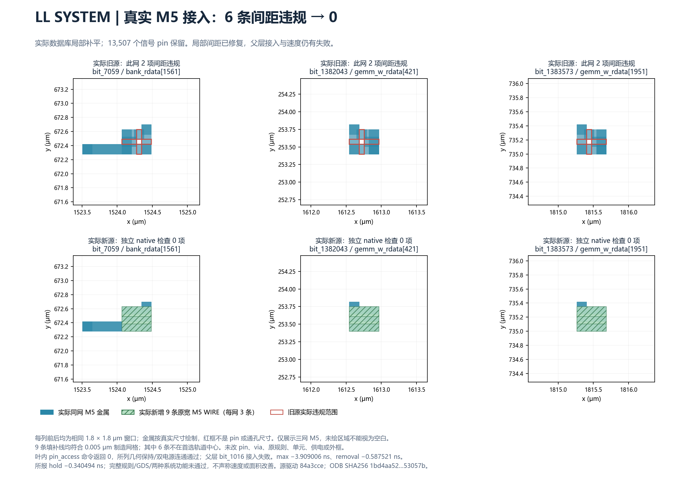

# Issue126：2026-10-30继续实际工程

原总目标还没有完成。本轮已实际修掉llaccel SYSTEM最后6条局部间距违规，并把新的完整接口视图送入共同底座布线。数据能否赶上规定节拍仍有实际失败；共同底座和两套完整功能还不能宣布建成。

沿用原工程Draft PR129；问题分析PR138保持独立，不修改或合并。此前12小时交付未完成的事实保留，本次恢复没有倒填期限或重写历史结果。正式当前选用源与新试验阶段分开，不把提交/运行中当验收。

## LL的6处M5间距阻塞：实际修复与叶块后验已闭合，负时序保留

1. **案例/阶段：** llaccel SYSTEM，真实M5接入补线后的独立native DRC。
2. **对象：** `bit_7059`（`bank_rdata[1561]`，`wire48966/A`）、`bit_1382043`（`gemm_w_rdata[421]`，`output5623/Z`）、`bit_1383573`（`gemm_w_rdata[1951]`，`output7154/Z`）。原先每网2项Metal Spacing，共6项。
3. **功能：** 第一条把外部存储数据送入SYSTEM，后两条把权重读取数据送往GEMM。
4. **实际问题/最小修改：** 前次100条细补线仍留下3处转角窄缝。核对真实同网几何与异网/叶PG/父PG/预留首级via范围后，用9条原宽0.14μm的重叠原生WIRE覆盖3个0.42×0.35μm局部区域；未修改pin或via。job93645独立native检查已从6降到0。
5. **影响与边界：** 这6项局部间距失败已在新试验中消除。13507位和既有9517接点修改保持，原单元、接口层/尺寸/XY/网络、PG和外框逐项核对保持。双PG、3条改变网的实际几何连通通过，叶内`pin_access`命令返回0；这不是13507个宏接口的父层可达性证明，父层实际仍在bit_1016失败。725253网精确金属多重集核对保持725250条其他网，复用原闭合源全网连通证书，不冒充重新执行725253网BFS。RC/STA执行后max仍−3.909006ns、min仍−0.587521ns；后者已识别为removal，所报最差hold为−0.340494ns。6条填补条带不在首选路由轨道中心，制造网格已筛查；首选轨道与适用完整规则单列，不用native0代替制造签核。
6. **证据：** job93645于2026-10-30 17:21:43北京时间闭合。[实际回执及物理文件SHA](issue-126-resume-20261030/ll-corner-fill/execution.json)、[局部金属证明](issue-126-resume-20261030/ll-corner-fill/local_geometry_and_patch_proof.json)、[原生接入日志](issue-126-resume-20261030/ll-corner-fill/all_geometry_and_AP.log.gz)、[时序/电气检查](issue-126-resume-20261030/ll-corner-fill/checks.txt.gz)。真实ODB留在服务器独立目录`/public/home/yuzelu/PingyangHuang/issue-126/full-pin-20261027/llsys_corner_fill/r01/routed.odb`，816769183字节，SHA256 `1bd4aa52b3345a6398d521d8056f8ba8524d8153a64ed78d28ec1d347b53057b`。驱动commit `84a3cce1e77a9cfe69a6b09774539da47adf8b8b`，[源码](../../project/experiments/full_pin_xy/run_llsys_corner_fill.py)。
7. **下一步/授权：** 匹配视图93648已于17:34:51闭合，13507信号pin及原SPEF时序重放吻合。父层93649完成DEF导入、VDD/VSS连通、逐bit图/实例/256导体保持和全局布线，于17:47:51因详细布线准备阶段bit_1016无AP失败；不是父层布通或底座冻结。93665已复用既有SPEF完成具体失败路径分类，没有重复提取。常规修复无需额外授权；不改变架构、原层或规则。

比喻：三处转角的窄缝已实际补平，施工间隔检查归零；对应以上三条M5数据网。门外走廊是否能接通、数据能否赶上原节拍，还须父层和时序分别检查。



[SVG](issue-126-resume-20261030/assets/ll-corner-fill-6-to-0.svg) / [图数据来源与SHA](issue-126-resume-20261030/figure_provenance.json)。已实际打开PNG目视检查，坐标/字体/图例清晰；实际金属按真实尺寸绘制。

## VECTOR重映射脚本遇到的TAPCELL输入问题

1. **案例/阶段：** VECTOR实测失败数据通路的组合逻辑重新映射，尚未安装新物理单元。
2. **对象：** `TAPCELL_X1`共5326个，例如`PHY_EDGE_ROW_0_Left_818`、`PHY_EDGE_ROW_0_Right_0`；原生信号端点数0，实际Liberty信号pin数0。不是负责计算数据的逻辑门。
3. **功能：** 将衬底/阱连接到电源参考，维持单元正常的电气环境。
4. **实际问题：** job93660/r01在`cell_semantics.contract`的“逻辑单元必须有信号pin”断言停止。只发生程序处理异常，未编辑原ODB、未执行映射或等价检查。
5. **影响：** 阻止这一轮映射实验启动，不表示5326个单元电气失效，也不证明VECTOR计算错误。原setup−4.140220ns仍未修复；最差通路为`p0_r[18]$_DFFE_PN0P_/Q`到`wr_data_r[18]$_DFFE_PN0P_/D`，141段单元内部弧合计6.7401ns、142段网延迟合计0.1984ns。
6. **证据：** 服务器`vector_critical_cone_remap/r01/execution.json`，原驱动`ca49733e9b9a8478b27fa8a52e3bd7569e682452`。随后只读核实实际库和全原生端点，库SHA `8d540a4d4cf6d09d27c87ad067857a9c0c2eeb023ab7a56e058cd3113db4e9b1`。
7. **尝试/下一步：** 仅允许“Liberty无信号pin且实际数据库无信号端点”的物理单元排除在布尔逻辑解析之外；5326单元保留原位。修复驱动`a75f1f9cd3c22be5e44955fa5326b36f65275918`、job93663/r02通过该输入步骤，随后整段22353单元映射在1800秒预算内未完成。没有重复延时；转到实测141弧及一级扇入的351单元范围。独立CEC已通过396任意输入对应的209个对外输出，仍未安装到真实版图，不宣称时序改善。无需用户改变架构或额外授权。

比喻：清点施工材料时，把接地固定件误送进了“逻辑门”加工工序；这里特指5326个无信号端点的TAPCELL。现在修正分类，实际固定件没有拆除或移动。

## 父层bit_1016为什么仍然进不去

1. **案例/阶段：** 内部二维C方案共同父层；独立原生AP及详细布线准备阶段实际失败。完整终态证明全局布线已执行，不能把整体返回1误说成全局布线失败。
2. **对象：** `u_llaccel_aux/bit_1016`，原网`bit_1016`，对应`dram_rsp_rdata[334]`。M5原尺寸0.14×0.14μm，叶内中心(353.175,1062.390)μm，父层中心(442.775,4780.790)μm。上方同网M6 WIRE的矩形为(353.105,1062.320)至(353.245,1063.580)μm，导出OBS与该矩形完全一致。
3. **功能：** 接收外部存储器返回的第334位数据，送入SYSTEM的数据搬运网络。
4. **实际问题：** 叶内看是同一网络的M6线和via帽；导出为硬宏后，上层把这段M6当作障碍，覆盖首级接入位置。原生`DRT-0073 No access point`已复现。此处是同网OBS阻碍接入，不是已证明异网短路。
5. **影响：** 当前共同底座无法完成详细布线、不能冻结，进而没有当前底座上的两套完整功能证据；不表示已经接通的整个叶块都不能计算。具体唯一根因仍须修改后原生父层检查作因果验证。
6. **证据：** [父层失败回执](issue-126-resume-20261030/stages/parent-route/execution.json)、[阶段与错误日志](issue-126-resume-20261030/stages/parent-route/lower_route.log.gz)、[独立父层AP](issue-126-resume-20261030/stages/parent-AP/execution.json)、[实际同网金属/OBS诊断](issue-126-resume-20261030/stages/parent-diag-r02/execution.json)。诊断驱动`24cd64985d4776ebd59d557d78babbf44c4c7bb5`，源LL ODB为`1bd4aa52…53057b`；完整SHA与坐标绑定在原回执。
7. **尝试/下一步：** 没有删除OBS或抬升pin层。job93688、驱动`45f2c987f0732740fbbdcefd9967f1cec5146411`，已按真实同网M5导线支持、全局部异网/PG/其他接口首级预留进行筛查，并执行真实BPin移动。新原生DRC、重新导出几何和父层AP尚待闭合；旧负时序不因此消失。无需用户额外授权；若新首条失败仍属于同类，将转为整类接点的严格OBS筛查，避免盲目逐bit重跑全流程。

比喻：房间自己的管线在外部施工图中也被标为禁入区，正好挡住门；这里就是bit_1016上方同网M6及其OBS。移动真实门口后还要重新检查整条外部通路，不能在图上擦掉禁入区就算修好。

## LL速度、电气与RC覆盖分别是什么结果

1. **案例/阶段：** 新LL叶源`1bd4aa52…53057b`的实际寄生提取、原3ns时钟/负载下STA与电气检查。
2. **对象：** 最大延迟失败从`u_attn.D_r[6]$_DFFE_PN0P_`寄存器到`bit_2941/bank_we[3]`写许可输出；hold失败从`bit_6/pc_start[1]`到`u_cp.pc[1]$_DFFE_PN0P_`；removal失败从`bit_3/rst_n`到`bit_2909$_DFF_PN0_`复位端。后者原RTL状态含义尚未逐项追溯，不凭实例名字猜测具体计数功能。
3. **功能：** 分别把写许可送到外部存储bank、装入程序起始地址的一位、在复位结束时让寄存器安全恢复工作。
4. **实际问题：** 输出最大延迟余量−3.909006ns；所报hold−0.340494ns；最差removal−0.587521ns。新源实测1094条slew和7786条cap违规，不能继续套用旧c494源的1091/7784。代表输出缓冲器`output10509/Z`转换时间0.780810ns，限0.198535ns；`output10580/Z`负载420.384247fF，限60.653706fF。完整清单在原检查文件。
5. **影响：** 原时钟与IO合同下不能通过速度/电气验收；复位释放和数据保持间隔也有实际失败。尚未完整功能仿真，不能断言任何频率下都不能工作，也不能把已接通误写成速度通过。
6. **证据：** [新源实际路径分类](issue-126-resume-20261030/LL_actual_path_types.json)、[完整原检查表](issue-126-resume-20261030/ll-corner-fill/checks.txt.gz)、[电气统计及代表对象](issue-126-resume-20261030/LL_actual_electrical.json)、[实际路径原文](issue-126-resume-20261030/stages/LL-paths/hold_paths.txt.gz)。所有数据绑定原ODB与报告SHA。
7. **尝试/下一步：** 独立检查73255个RC未标注驱动：65080个为实际单端网络，8175个为未连接端点；没有本清单中的多端连接网RC缺失，不能把整个73255都当作漏提取。[全部逐驱动分类](issue-126-resume-20261030/stages/RC-coverage/all_reported_drivers.tsv.gz)及[原生回执](issue-126-resume-20261030/stages/RC-coverage/execution.json)。这不是RC模型校准或全部签核。新源同功能驱动换型93682已完成合法化及全局布线，正在详细布线；附加单元/位置成本单列，不混成纯XY收益，hold/removal还须独立修复。原时钟、负载不放宽，无需额外授权。

比喻：写许可迟到像赶不上班车；对应bank_we[3]的−3.909006ns。复位释放间隔不够像起跑信号贴着采样时刻改变；对应rst_n到指定寄存器的removal失败。两者有不同修复对象，不能用“时序不满足”概括后就算定位完成。

## VECTOR整段映射超时与元数据解析阻塞

1. **案例/阶段：** VECTOR实测最差路径的等价组合逻辑映射；尚未物理安装新门。
2. **对象：** r02整段22353单元、383输入/2809输出；r03缩到141弧及一级扇入的351实际单元、396输入/209输出。r03另带351个`$scopeinfo`元数据对象，实测没有任何连接端口。
3. **功能：** 这段逻辑把p0_r寄存器保存的数据加工为wr_data_r写回数据；元数据只记录来源层次，不是电路元器件。
4. **实际问题：** r02于18:00:16触发1800秒预算，没有完成网表及CEC；目前只定位到映射子流程超时，不能武断说是ABC算法或硬件错误。r03实际映射返回0，校验器随后把`$scopeinfo`当成硬件类型而停止。
5. **影响：** 两个试验均未改原ODB；超时及脚本异常不构成计算功能出错证据。此前VECTOR最大延迟−4.140220ns仍未被证明改善。
6. **证据：** [r02超时原回执](issue-126-resume-20261030/stages/vector-map-r02/execution.json)、[r03实际新类型与原断言](issue-126-resume-20261030/stages/vector-map-r03/execution.json)、[独立CEC原输出](issue-126-resume-20261030/stages/vector-slice-CEC/independent_combinational_CEC.log.gz)。驱动与源SHA均在回执中。
7. **尝试/下一步：** 没有加长整段超时；缩小实测范围后已实际得到新网表。只在确认元数据零信号端口后区分于硬件，未删除逻辑门或有效检查；复用现有新网表、无重复映射，job93681于18:19:52独立CEC通过全部209输出对396任意输入的等价关系。[回执](issue-126-resume-20261030/stages/vector-slice-CEC/execution.json)。下一步必须实际装入、合法化、接线、RC/STA后才能谈速度；整设计RTL等价与制造签核未完成。无需改变流水或用户架构决策。

## 六块及系统阶段状态（18:35北京时间）

| 对象 | 实际内部引出/所列native DRC | 叶块max/min余量ns（非单独setup/hold） | 仍不能宣布完成的部分 |
| --- | --- | --- | --- |
| ACT，860pin | 已有实际源，0项 | +1.255988 / +0.031533 | 匹配SRAM GDS、完整规则/父层与完整系统证据 |
| MXU，2172pin | 实际M6入口修复源，0项 | +0.246690 / +0.038538 | 匹配SRAM GDS、父层完整接出/hold与完整规则 |
| openTPU SYSTEM，2229pin | 实际堆叠via修复源，0项 | −0.056396 / −0.119919 | 原速度/电气失败，父层完整证明 |
| GEMM，3753pin | 实际658二极管源，0项 | +0.770702 / +0.039533 | 当前父层拥堵失败、完整规则/系统；288恒零位保留 |
| VECTOR，2246pin | 当前主源0项；75换型变体另列 | −4.140220 / +0.037989 | 原速度/负载失败；组合重映射只是试验 |
| llaccel SYSTEM，13507pin | 新实际源1bd4aa…，0项，叶内AP命令返回0 | −3.909006 / −0.587521 | 父层bit_1016无AP；hold/removal与1094/7786电气失败，两个修复分支运行 |
| 共同M1–M10 | 256条实际固定导体保留；93649全局完成、详细布线准备失败 | 未执行完整系统STA | 未冻结，bit_1016真实修改后的父层复核待闭合 |
| 两套M11/M12适配 | 旧helper试验不作为完整功能 | 未执行完整功能STA | 尚未在当前冻结共同底座实现两功能/相同冻结哈希 |
| 同资源优化周边 | 六块叶基线齐；SYS匹配视图93653闭合，93655供电/全局完成 | 保留各自实际失败 | 详细布线仍运行，中间违规数不是最终结果；完整系统比较未完成 |

本表是本次恢复的最新阶段读回，旧报告状态页仍保留原发布时点，不能用旧时间戳替代当前结果。六块各有native0的实际叶源，不等于六块均通过速度、电气、完整规则或父层验收。固定外框保持，不声称面积节省。

## 收回的旧失败：LL38条输出缓冲链试验

1. **案例/阶段：** llaccel SYSTEM旧试验`llsys_output_chain/r01`，全局布线。
2. **对象：** 原试验选择的38条既有输出缓冲链；具体实例/移动清单在该目录原回执与选择文件中。尚未定位拥堵到单条责任网，不能编造根因。
3. **功能：** 增强输出信号，驱动远处接口及其负载。
4. **实际问题：** 既有buffer重定位和合法化执行，最大合法化移动4.1μm；之后`GRT-0116 Global routing finished with congestion`，route_RC_STA返回1。原日志还包含自动禁用部分时钟NDR的警告，没有作为合格修复接受。
5. **影响：** 没有新详细布线/RC/STA结果，不能说明原负载或时序已修复；不代表所有工作频率下整个SYSTEM不能运行。
6. **证据：** job93269于2026-10-30 14:35:12北京时间实际FAILED；原目录`/public/home/yuzelu/PingyangHuang/issue-126/full-pin-20261027/llsys_output_chain/r01/`的`execution.json`、`route_RC_STA.stages.tsv`、`route_RC_STA.log`及`legalization.log`保持不变。
7. **下一步/授权：** 不重复同一旧源全流程；优先修好当前pin接入，在当前源上独立评估同功能驱动/缓冲成本与拥堵。无需新增用户授权，不放宽原时钟/负载/NDR检查制造通过。

比喻：增强信号的中继位置改了，但走廊仍堵住；对应这个旧38链试验的全局布线拥堵，不是已完成接线或已改善时序。

## 其余阶段

- VECTOR与两套SYSTEM的原负时序/电气失败保留，正在复用已有真实关键路径材料定位，不重复已完成候选统计。
- 共同底座尚未完成当前源全口接入，未冻结；两个完整功能、同M1–M10冻结哈希及公平完整系统比较没有完成。
- ACT/MXU匹配SRAM GDS仍缺失，不以空几何或合同不同的RAM替代。
- 旧93217/93243/93317作业的最新状态只作原版本观察，未取消、覆盖或晋升成当前版本通过。

复跑这次增量图与HTML（仓库根目录，本地Python3.10+，复用现有matplotlib及markdown-it-py环境）：

```text
python project/experiments/full_pin_xy/plot_corner_fill_result.py
python project/experiments/full_pin_xy/build_resume_report.py
```

仅读取已发布的无损压缩回执，不重复候选分析或启动P&R。远程真实工程脚本保留Python3.6兼容；大体积ODB/DEF/SPEF继续留在原获授权独立目录，仓库JSON提供逐文件SHA。不能用本地报告生成成功代替物理验收。

Refs #126 / Draft PR129；登记沿用此前PR5 pending记录，看板缺配置/已验证能力，unverified与同步pending保留；审查人待指定。
