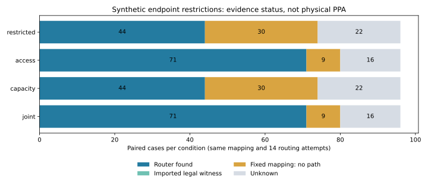

# Issue13：端点白名单与容量的严格配对消融

2026-10-22，UTC+08:00；负责人Liangruizhi。[Issue13](https://github.com/rayggxia-workspace/LLMHardwareDesign/issues/13)／[PR14](https://github.com/rayggxia-workspace/LLMHardwareDesign/pull/14)。分支task/13-endpoint-ablation，独立目录D:/Projects/LLMHardwareDesign-endpoints。PR基分支为task/11-frozen-routing-pilot，依赖PR12，待审查／未合并。

## 来源与实际执行

- 实际运行源码commit：`dc294114a6758b6baa1e4f6085630971a8f11fcc`，source_dirty=false，20个源码／配置文件逐字节记录SHA-256。
- 预声明配置：`project/experiments/endpoint_ablation/campaign.json`；输入版本endpoint-overlay-ablation-v1，SHA-256 `40a97c1f9c40bf9f2d1abc0495f48a3278854b501ac6558cd489b20b6639556b`。
- 北京时间2026-10-22 15:32:39.066开始，15:33:10.310结束；本轮约31.125秒。原始21文件共1,342,248字节，20文件加manifest；轻量ZIP为78,354字节，不搬运物理大数据。
- 使用现有D盘Python、项目venv及NumPy；实际解释器／包／平台／命令见run-manifest.json。所有本轮可指定临时／缓存按进程放D:/Projects/Codex/issue-13-endpoint-ablation，不改系统环境变量。
- 开发尝试local_runs/development-01显式dirty保留；开发后只补合同断言与来源/验收，没有根据结果调优库存或参数。四个拓扑已经被观察，prior_split_label只保留来源，不称本轮新盲测。

## 什么保持相同，什么发生变化

每组先冻结最大合成master库存；四个overlay分别限制允许连接与wire-tap容量。同组导线／Block／tap位置／driver／宽度／连接成本／全局预算完全相同，不切线、不新增内点或buffer；pin容量始终1。分别记录master、overlay、effective三种哈希，不冒称有效配置哈希不变。

8组（track1/2、span1/2、原始access2/4）×4图×seed17/43/101×4条件，共384例。每组四条件固定同一合法mapping、net顺序、multi_order算法、seed和14次尝试；容量放宽两条件使用同一degree上界。restricted的资源与原模型完全一致。

| 条件 | 引脚可选连接数 | wire-tap容量 | 路由器找到 | 仅跨条件witness | 证明当前映射无路径 | 未知 |
|---|---|---|---:|---:|---:|---:|
| restricted | 原始2/4 | 3 | 44/96 | 0 | 30 | 22 |
| access | 扩展4/8 | 3 | 71/96 | 0 | 9 | 16 |
| capacity | 原始2/4 | max(3, 扩展库存tap的degree) | 44/96 | 0 | 30 | 22 |
| joint | 扩展4/8 | 与capacity完全相同 | 71/96 | 0 | 9 | 16 |



## 可以得出与不能得出的结论

扩展允许接点后多找到27例。本轮9个固定映射在restricted有闭合cut证书，在access有全局合法解，因此可以确认当前白名单限制使这些映射在模型中无路径；其余成功变化不等于原配置全局不可行。joint对应联合放宽，不能把它单独归为access因素收益。

capacity-only结果未增加，不能推断端点容量永远不重要；精确微例反而确认容量独立限制可行性。当前合成规模、映射和搜索预算下，优先校准真实接入位置／允许层比无依据增加tap容量更有研究价值，这是下一步判断，不是物理结论。

总计230个成功配置全部独立电气／映射／软件数值验证通过，最大绝对误差2.7755575615628914e-17。软件float64与16-bit束的连通宽度是不同语义，未验证量化、编码、周期、握手、时钟／供电或权重供给。全部248份单网cut证书读回验证；78个失败条件有至少一份cut，其余76个失败条件仍未知。

跨条件witness工具保留原始搜索记录并重新绑定目标hash、重验同一连接集合，本轮实际没有触发“已有witness但router miss”。该分支用负例测试验证，不能写成实测出现。

六类微例×四条件共24个精确状态，9可行／15不可行；最大5连接，全部368个候选子集交叉核验。它们分别隔离接点、容量、联合限制、多驱动、正例和总预算，微例结论不外推到大例最优性。

## 实际验证与归档

- `python scripts/check_project.py`：通过，管理结构检查不代替业务行为。
- `python scripts/check_research.py`：原模型17项＋新消融16项，共33项通过。
- `verify_ablation.py <run> --replay`：PASS；20个索引文件、384例／96配对、230次数值、248份cut、24精确状态，全部连接确定性重放一致；声明源码逐个与Git commit原字节核对。
- `package.py --verify <archive>`：PASS，ZIP21文件、原manifest和全部原字节哈希对应。SVG／PNG人工视觉检查通过。
- 独立只读审查不导入项目生成器／验证器／oracle，另以DSU、BFS、NumPy与全子集穷举复算以上230解、248cut和24精确状态，全部通过；restricted96例与旧Issue11对应方法的mapping、状态和成功连接集合／顺序完全一致。[审查原始回执](../../work/Liangruizhi/13/audit.json)与[后处理脚本](../../work/Liangruizhi/13/recompute.py)已归档，不倒填为运行输入。脚本SHA256 `9bc54af130683c064b5f411b08fb06b78583ed6542cae6d0e2260dda97d23ae5`，回执SHA256 `cb85b338df542af9162e685eb9390215188d86655632eaa4de70dcd74074c833`。
- 源码与文档执行 `git -c core.whitespace=cr-at-eol diff --cached --check -- . ":(exclude)project/experiments/endpoint_ablation/results/**"`：通过。生成SVG的路径尾随空格及原始行尾保持不变，成果通过SHA-256核验；未更改全局Git设置。
- 本地EDA／STA／LEC／RTL／周期／物理H2／PPA：未执行。三组普通LEF可读但未冻结到本轮输入，其宏资格仍不完整；详见[端点接入合同](../MACRO_ENDPOINT_CONTRACT.md)。

[正式归档](../../project/experiments/endpoint_ablation/results/issue-13-run01/)保存ZIP、原manifest、汇总、CSV、SVG／PNG与绘图来源：

- raw-evidence.zip：`da9f18282acbeaaa1e09de53fc5e9bcc0b989ff871f148a39b2de22695d8bb2a`。
- 原manifest：`6ad74db7b00fbfe2d5421f9f9bca526b0a164994fe11b20b77a4f98230174a91`。
- summary.json：`0f272326e1e7d6bbe0df470e1bb5ffa14af11e9373b733dd6db74f348ff43ce5`。
- 其余来源和成果见archive-manifest.json、run-manifest.json、report-manifest.json；归档与绘图作为后处理保留独立来源，不倒填为运行输入。

从新目录复查，避免覆盖旧证据：

```powershell
python project/experiments/frozen_routing/package.py --verify project/experiments/endpoint_ablation/results/issue-13-run01
python -m zipfile -e project/experiments/endpoint_ablation/results/issue-13-run01/raw-evidence.zip D:/Projects/Codex/issue-13-endpoint-ablation/review-run-01
python project/experiments/endpoint_ablation/verify_ablation.py D:/Projects/Codex/issue-13-endpoint-ablation/review-run-01 --replay
```

重跑必须使用新目录，并记录届时真实commit。跨Python/NumPy版本的末位浮点与墙钟时间不保证相同，不能伪造逐字节重复结果。

## 下一步与协作状态

下一任务先按端点合同冻结普通LEF原字节和SHA，导出pin/rect/layer/orientation及未匹配端口、时序/负载缺项，再决定端点感知mapping实验。固定每例K个mapping及总路由预算，另列预处理成本；不要以模型优势替代宏资格或工艺合法性。Issue7的作业、分支和人员进度没有修改。

规则rayggxia-project-collab1.0.0。登记pending（management-hub PR5仍OPEN）；无本项目board.json／Projects工具，看板事实unverified、同步pending，管理员待指定。未推断本人账号在线Projects权限。PR14依赖PR12，均未审查／未合并，不自行关闭Issue13。
