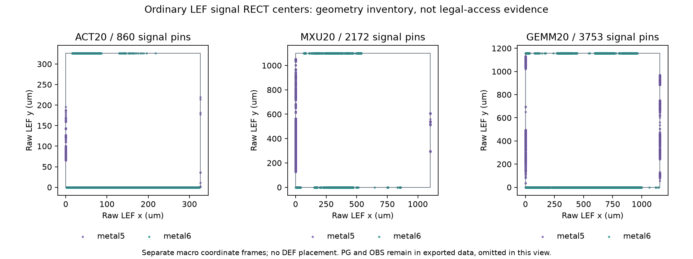

# Issue16：真实普通 LEF 冻结与端点几何库存

2026-10-22（UTC+08:00），负责人 Liangruizhi；[Issue16](https://github.com/rayggxia-workspace/LLMHardwareDesign/issues/16)／[PR18](https://github.com/rayggxia-workspace/LLMHardwareDesign/pull/18)。本任务接续 Issue13 端点合同，只读捕获，不在服务器提交作业或更改他人物理工程。

## 本次回答的问题

Issue13 的端点消融来自合成库存，真实宏端点还没有可重放的原字节输入。本轮建立三份实际普通 LEF 的输入冻结和完整几何表，把“观察到矩形”与“验证了合法工艺访问”分开。后续可以据此明确位匹配、安装方向与技术访问规则的缺项，不能直接把这些矩形塞入抽象路由器并称物理验证。

## 来源、运行与完整性

- 捕获／导出／后处理源码 commit：`23040b0459cd32297b6562e22f48af5ae812ed25`，正式运行时工作区 clean。配置与运行源码逐文件 SHA 保存在 capture/run/report/archive manifest。
- 输入版本：`wave2-06-ordinary-lef-snapshot-v1`；解析 profile：`lef58-single-macro-rect-v1`。输入精确路径和 scope 见[配置](../../project/experiments/macro_endpoints/inputs.json)。仅读取三份普通 LEF，总计1,094,468 bytes；未读取 Liberty、detailed LEF 或物理数据库。
- 来源 Issue7/PR10，记录 commit `2b76f692830a2bdfc157cefb21c3bc1bc91fc409`；attempt `parallel-blocks-wave2-06`，runner commit `05074e2f357fb3f89e3a6796e76ab1863697b244`。submission/completion Git blob 分别 `af8caf248fc74eacb6e96b222ec06054c2ebe64c`、`c55804314f99c1c93be9b918915ce5962b51f6f8`。
- 上游记录只有 checksum 审计摘要，没有逐文件预期 SHA/bytes。以下 SHA 为本次 SSH 捕获实测，不能声称已与上游逐文件预期值一致。底层 RTL commit、OpenROAD/ORFS 精确版本及镜像内容 SHA 均待核实；runner commit 不能冒充 RTL 版本。
- 2026-10-22 08:40:00 UTC，通过本用户现有专用公钥认证，只读 `mgt01` 上的项目目录；远端用户 yuzelu、Python3.6.8。固定远端 Python 命令通过 stdin 读取三份文件，严格已知主机检查；读前后 device/inode/size/mtime_ns 一致，传输后重算 bytes/SHA。未读取私钥内容或记录其内容。
- 本机 Python3.13.14 / Windows11；项目 venv 复用现有环境。TEMP/TMP/TMPDIR/字节码缓存/Matplotlib缓存均为本任务 D 盘目录；没有系统环境变量修改。实际命令与恢复步骤见[工具说明](../../project/experiments/macro_endpoints/README.md)。

| 输入 | bytes | 本次捕获 SHA-256 |
|---|---:|---|
| ACT20.lef | 132447 | `f74ca8e0ff35b5900979aa0d5d6b4356da943fdf1f3d8af92c7ab4647d5c955a` |
| MXU20.lef | 338311 | `774ff58156636631d2764bbb7ed72c525180110b8f1fd56bdbe12869e9e42bd3` |
| GEMM20.lef | 623710 | `6bf8b0359c406e2ebc83ffa0e3c0b39c91ade98837e088ce1efd7c7de611dd7b` |

## 实测几何

| 候选 | SIZE µm | 全部 PIN | SIGNAL | PG PIN | PIN RECT | OBS RECT | SIGNAL metal5/metal6 |
|---|---|---:|---:|---:|---:|---:|---|
| ACT20 | 326.205 × 326.205 | 862 | 860 | 2 | 881 | 10 | 120 / 740 |
| MXU20 | 1100.455 × 1100.455 | 2174 | 2172 | 2 | 2245 | 10 | 1111 / 1061 |
| GEMM20 | 1157.32 × 1157.32 | 3755 | 3753 | 2 | 3830 | 10 | 1166 / 2587 |
| 总计 | 独立坐标系 | 6791 | 6785 | 6 | 6956 | 30 | 2397 / 4388 |

三份 LEF 均为 VERSION5.8、DATABASE MICRONS2000、CLASS BLOCK，未显式声明 ORIGIN/SYMMETRY；每个 PIN 一份 PORT。每个 SIGNAL 一份 RECT，PG 的 metal7 PORT 合计171份 RECT：ACT21、MXU73、GEMM77。三份宏各有一个 OBS 组，分别覆盖 metal1—metal10 的整块矩形，完整保留。`clk` 的 USE 实际为 SIGNAL，未通过名字猜测为 CLOCK。

LEF 数值坐标已经是微米，DBU 用 Decimal 精确乘2000得到整数，不除2000或作浮点舍入。原始名字、数值字符串、PIN/PORT/LAYER/RECT 与 OBS 层次、源行号同时进入 inventory.json 和逐 RECT CSV。原始字段未声明时保持 null；不是伪造 ORIGIN=0 或许可旋转的证据。框外/重复几何的诊断逻辑也不会删除原始形状；本次三宏诊断为空。

图中点为原始信号 RECT 中心，图例区分金属层；三框采用各自坐标系和尺寸。PG/OBS只从图中省略，在数据中保留。人工查看 PNG，标题、图例、轴和边界完整，无裁切。中心点不是 routing track、via 或合法 access point。

## 实际验证与产物

- `python scripts/check_project.py`：PASS，仅管理结构。
- `python scripts/check_research.py`：67项通过（frozen_routing17、endpoint_ablation16、macro_endpoints34）。新检查覆盖多PORT/层/RECT/PG、总线/转义原名、单位/精度、ORIGIN/缺项、截断/未知语法/非法数值、框外几何、传输与文件篡改、旧图误归档及边界有限区间。
- `verify.py --replay`：输入5文件及输出5文件索引/bytes/SHA、Git源码版本核验通过，四个业务输出逐字节确定性重导出一致。
- `archive.py --verify`：10个 ZIP 成员及外层文件完整性通过；外层摘要、来源commit和图表与 ZIP 内实际输入/输出交叉核对。另将归档实际解压至新的D盘offline-replay-01，对其中inputs/outputs执行`verify.py --replay`，四业务输出逐字节一致，无服务器访问。
- 独立全量审计：独立逐行读取全部54,598行、消费54,595非空行，394,774个字段与条件检查，0差异。没有导入或运行项目解析器；inventory全树及两CSV逐字段一致，6份唯一源码SHA匹配本地字节及固定Git blob。原始[审计JSON](../../work/Liangruizhi/16/audit/audit.json)、[独立脚本](../../work/Liangruizhi/16/audit/recompute.py)及SHA256SUMS原字节保存；JSON SHA为`3ef48c326bc4244d98c322aeb24ca4d78ac63f3334497fba49bb2da855f252da`，脚本SHA为`76fa194f3f55e66707fb5d9d55b0b7552766c5739bc96bc257a13d8e838260e4`。审计只能复核本地冻结字节和导出，不能独立重建历史服务器stat或全工作区clean事实；限制保留在报告。未执行的工艺访问、EDA、RTL仿真和PPA检查不计入以上通过项。

正式轻量产物在 [results/issue-16-run01](../../project/experiments/macro_endpoints/results/issue-16-run01/)。`evidence.zip`（502,980 bytes）无损包含原始三LEF、inputs.json、capture.json及四个业务输出和运行manifest，未丢弃任何输入字节。它适合存仓库；大数据库和详细物理视图仍按项目共享存储规则处理。

| 证据 | SHA-256 |
|---|---|
| evidence.zip | `42555df9e5ba32b405b2bc124722d4aea5fec94ef8a874adc37aeaf4020f5bcf` |
| capture-manifest.json | `b2185e5bb527bdefc15961b33ef36ce1ddb7b4fa0c9e238b1f2b76cd8519b3bc` |
| run-manifest.json | `22f07330e2806c29932ae44635d2aff0b57ae1788f9b457aeadf83378a89b791` |

其余文件及 ZIP 内逐成员 SHA 见 archive-manifest.json。离线核验时将 evidence.zip 解压到全新 D 盘临时目录，对其中 inputs/outputs 执行 `verify.py --replay`，不需要再次访问服务器。哈希用于完整性，没有第三方签名认证含义。

## 对后续实验的约束

真实端点数量与层/边分布明显不均，不能用宏面积或均匀边界插针替代这个输入。当前最多用于研究明确标注的几何必要条件；矩形尺寸/位置本身不足以定义接入容量。普通 LEF 中的整块 OBS 必须交给真实技术规则和路由器解释，不能直接忽略，也不能据矩形重叠断言所有引脚无法访问。

下一任务应先完成 ACT—MXU 实际端口逐 bit 合同与 RTL/Lib 对应，再固定安装位置、方向和技术访问层/via/spacing/enclosure规则，给出 access candidate 的来源及拒绝证据；条件足够后才开展每例 K 个 mapping、同总搜索预算的端点感知对照。时序minimum_period/arc、边界driver/load、PG连通、等价与合格宏仍需补齐，全部 `qualified_hard_macro=false`。本轮没有得到物理H2、PPA收益、制造可行性或新盲测结论。

Issue15 的同资源 ACT/MXU 分离／融合物理对照由 YUZE-LU 推进，独立于本次几何冻结。PR12/14/18均须团队审查；本任务不自合并、不提前done。登记pending，看板unverified/同步pending及恢复入口见[交接](../handoffs/2026-10-22-issue-16-macro-endpoints.md)。
