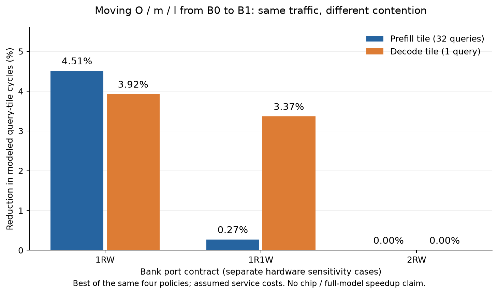

# 固定端口约束下，状态放在哪里才有价值？

任务：[Issue27](https://github.com/rayggxia-workspace/LLMHardwareDesign/issues/27)，负责人Liangruizhi。源码冻结为 `6ffb9417f0f01f614b733ce6c3ca9837906b3203`；结果通过[PR28](https://github.com/rayggxia-workspace/LLMHardwareDesign/pull/28)交付，待审查。以下是**假设服务参数下的 attention 单头 query-tile 研究**，没有芯片端到端加速、PPA或最终Block划分结论。

## 直接结果

相同算法、相同流量下，状态归属的价值取决于端口争用；调度选择可能比状态放置本身影响更大。单靠减少跨Block字节数不足以选边界。模型中的仅改Block标签对照全部零效应。

基准点：两bank各64KiB、最大query tile32、key tile16、head dimension128；每bank端口与每链路64B/cycle、外存32B/cycle、每burst建立2cycle、M1024MAC/cycle、V16个等效scalar/cycle。全部服务参数尚未物理校准。Q/K/V在B0，S/P/T在B1，O/m/l/alpha由静态方案决定。两方案使用相同四策略搜索；表中是各自找到的最佳可行调度，不是全局最优。

| bank端口合同 | 子图 | O/m/l均在B0 | O/m/l均在B1 | 模型周期减少 |
| --- | --- | ---: | ---: | ---: |
| 1RW | prefill32 | 7094 | 6774 | 4.51% |
| 1RW | decode48 | 2625 | 2522 | 3.92% |
| 1R1W | prefill32 | 6698 | 6680 | 0.27% |
| 1R1W | decode48 | 1872 | 1809 | 3.37% |
| 2RW | prefill32 | 6680 | 6680 | 0.00% |
| 2RW | decode48 | 1809 | 1809 | 0.00% |

不同端口类型是不同硬件敏感性，不能假定同面积。2RW“放置无差异”仅指本轮同四策略搜索的最佳周期；个别单策略仍受优先级影响。模型没有证明真实硬件多加一个端口的面积/能量代价值得付出。

两种状态放置的流量逐项相同：prefill的DMA/M/V分别65536/106496/157568B，decode分别50176/52608/6612B。变化来自共享服务资源与依赖的重叠，而不是凭空消除搬运。

## 调度公平性是必要判据

同1R1W decode案例，若只采用critical策略，B0→B1看似2265→1939cycle，减少约14.39%；双方都使用相同四策略搜索后，变为1872→1809，只剩3.37%的最佳已找到调度差异。不能把欠优化基线放大出的差距认作物理边界收益。

四种启发式都不保证最优。独立小例：A持续5cycle占x；B持续1cycle占y；C依赖B持续1cycle占x；D依赖C持续5cycle占y。四个非延迟策略都是11cycle，允许合理等待的精确解为7，且匹配依赖下界。两套独立event-DP/整数时间枚举核对；该结论只属于声明的非抢占原子任务模型。

## 存储裕量改变可定制连接的选择

key tile16时，O/m/l均在B1需要B0=32KiB、B1=36.375KiB；O在B0、m/l在B1需要B0=48KiB、B1=20.375KiB。M/V实际最大事务scratch分别26KiB、48.125KiB，硬件配置各64KiB；三个端点各假设64B staging，合计192B，独立计入。所有phase共用最大slot/scratch配置。

静态方案同服务prefill/decode，以下周期只是两个query tile的等权和：

| 固定bank容量/端口 | full六链路最佳已找到方案 | 去V0，五链路 | 去D1，五链路 |
| --- | --- | --- | --- |
| 64/64KiB，1RW | O/m/l=B1，9296 | 同方案，9296 | O=B0、m/l=B1，9599 |
| 64/32KiB，1RW | O=B0、m/l=B1，9599 | 无可行共同放置 | 同方案，9599 |
| 64/64KiB，1R1W | O/m/l=B1，8489 | 同方案，8489 | O=B0、m/l=B1，8519 |
| 64/32KiB，1R1W | O=B0、m/l=B1，8519 | 无可行共同放置 | 同方案，8519 |

去V0和去D1具有相同启用链路数，但与容量约束耦合后适用性不同。没有删有源仲裁/端点，没有免费替代路径；link计数还不是实际金属长度或定制成本。本直接连接模型下，禁用必要边拒绝、禁用未用边保持同图，所以不能产生更快最优解。

本轮108个静态组中，所有有可行方案的组都找到一个placement同时达到两phase各自的最佳已找到周期；**未观察到prefill/decode放置偏好反转**。更复杂流水、FFN/MoE状态和真正全模型干扰尚未加入，不能据此推断它们也没有冲突。

## 与真实模型计算的绑定

源配置/权重固定Qwen/Qwen3-0.6B `c1899de289a04d12100db370d81485cdf75e47ca`，沿用Issue23的8个文件SHA及安装源码SHA。完整模型CPU FP32/eager，teacher-forced前32token再16步decode，4线程。采集仅layer0/query head0（对应KV head0）的两处真实Q/K/V、additive mask和原eager head输出，捕获后恢复原callable。

NumPy FP32独立在线m/l/O核分别按key tile8/16/32比较实际eager参考，共6正例全部符合 `abs(error) <= 1e-4 + 1e-4*abs(reference)`；最大绝对误差 `4.4330954551696777e-7`，最大relative-L2 `4.895898158002069e-7`。错误O rescale和每tile重置O共10个适用负例全部检出；prefill32/tile32只有一tile，两个carry错误明确记N/A。Q/K/V/mask/reference是实际观测，NPZ中的tile m/l/O/alpha是独立核计算状态，不能说它们是eager内部状态。

两次正式采集与两次资源运行均用同一干净源码，模型和源码前后核验一致。8个科学payload文件逐字节一致；含运行时间/命令的manifest不要求相同。此前开发运行与测试集成时临时目录缺失错误保留为开发记录，不冒充正式运行或删除失败历史。

## 覆盖、验证与证据

- 3456配置：1224可行、2232不可行；按首个拒绝原因分为B0容量432、B1容量864、缺连接936。首个原因不是全部不可行原因的枚举。
- 4896策略调度逐项核验，1224次Block重命名零效应对照；108静态组、24完整witness保留。256长度两例为未实测外推；32/48形状来自Issue23的实际trace，不是盲测。
- 25项正式代码测试、6项独立小oracle测试通过。独立图审计96图、27073断言；73非法合同和7版本/地址变异拒绝。修复前4个检查器漏检的源快照与结果保留。
- 独立结果审计按冻结Git对象重建3456笛卡尔例与108静态组，无漏项/重复；24witness从实际区间核验端口/链路/端点/地址/依赖；504个禁边后保留可行例与full的策略周期和事件SHA相同。
- 独立实际输入审计399项通过，不调用原online核或重跑模型：46个NPZ成员raw SHA/形状、Issue23前48个token、实际8模型文件/源码绑定一致；materialized-prefix公式核验各tile状态。独立FP64完整softmax对原eager的prefill/decode最大误差为3.12447e-7/2.16851e-8。
- 归档 `project/experiments/state_ports/results/issue-27-run01/evidence.zip`：491436B，13成员逐项读回，SHA-256 `f760dec66344c11fe9c7f04f55d91f610157d7ad624f6d66faa6a9bbdb1f1588`。包含原资源结果、实际小型原始head张量、数值结果、manifest与重放manifest；不含权重/venv。
- 原始本地运行：`D:/Projects/Codex/state-port-study-20261022/{run-01,run-02,capture-01,capture-02}`。正式命令、配置及边界见[工具说明](../../project/experiments/state_ports/README.md)，审计脚本/索引在work/Liangruizhi/27。

## 对划分方法的启发与下一步

候选应以“计算事务＋所需持久/递推状态＋端口服务需求”为基本单元。O/m/l是attention递推状态，但把它们预先全部绑到同一Block，必须同时证明：该位置满足逐bank容量；关键路径存在无法通过公平调度隐藏的争用；静态接口能覆盖产品工作负载；真实连接、电容和时序余量允许。这里只证明这些判据有必要，没有选出最终Block。

并行物理工作已有新证据：[PR17固定0f58e74报告](https://github.com/rayggxia-workspace/LLMHardwareDesign/blob/0f58e74739c77cbfbca7e356af121a97529a48ca/docs/experiments/issue-15-opentpu-comparison.md)记录合并父层13通过物理及完整分层STA门槛；拆分合格对、父层功能/RC覆盖证书和总PPA仍未完成。该报告还给出三个ACT输出外部电容预算约34.2–45.2fF，说明块内既有负载会直接减少边界驱动余量。它是已有openTPU H1证据，不能校准本轮新attention模型的周期或冒充H2签核。

后续优先：用明确精度的矩阵/状态接口做可执行微架构端口验证，扩充合法缓冲和调度基线，再接代表模型的完整投影/FFN/KV流量及差异结构；绑定合格物理宏的容量、服务端口、面积、负载和跨界延迟。若物理证明没有收益或无法覆盖，则保留失败并调整候选，不通过更换基线掩盖。
