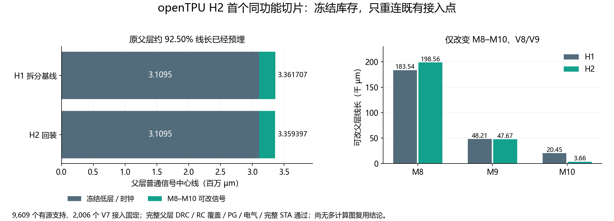

# openTPU H2：冻结资源与限定层互联

[Issue31](https://github.com/rayggxia-workspace/LLMHardwareDesign/issues/31)，负责人 YUZE-LU，审查人／优先级待指定。分支 `task/31-opentpu-h2`，依赖 [H1 PR17](https://github.com/rayggxia-workspace/LLMHardwareDesign/pull/17) @ `ce5896de47921fcdc422c4ac9c05cefcb6666bff`。H1 封存结果不修改；PR17 已在本轮期间由另一项授权整合合入 main@0cc36f3，H2 分支通过 merge 继承主线，保留原 runner 祖先。

## 当前结论

完成首个同功能、同资源的受限层实例：ACT/MXU 子块不重做，有源库存、位置、接线、引脚、PG、时钟和低层线冻结；仅重布父层 M8–M10 信号线及 V8/V9。真实回装／RC 提取、PG、天线、电容／slew／fanout、宏级及真实子网表分层 STA 通过。上层原生 DRT 最终 DRC 0，独立几何图证实全部 1,003 个上层连通森林完整接通。**独立完整父层 DRC 89877／89878 已自然完成，两组均零标记；完整分层 RC 覆盖审计 89881 也通过。本同功能切片已通过本轮全部工程门槛，待审查。**

这是从 H1 目标条件化资源构造出的第一个 H2 切片。3,109,501.80 µm 原父层线已预埋，占原父层线长约 92.50%；未验证第二计算图、任意 685 bit 重排或独立于目标的通用底座。单 small／typical／固定布局与引脚，synthetic SRAM 无 GDS，未完成制造签核；不能把细小线长差解释成普遍优化收益。

## 先冻结的资源预算

原始合同 [resource-contract-v01.json](../../project/experiments/opentpu_h2/results/resource-contract-v01.json) 在合格受限层路由之前建立，保留当时的候选 `state`；资格结论另存 [selected-evidence.json](../../project/experiments/opentpu_h2/results/selected-evidence.json)。合同含逐宏引脚电容、slew 限值／实测／余量和来源摘要，不事后重定义预算。

| 项目 | 预算与证据 |
| --- | --- |
| 计算与接口 | 169,109 初始映射单元、37,023 DFF、12 synthetic SRAM；40 端口 1,662 bit；ACT/MXU 边界 685 bit；沿用 H1 small |
| 外部约束 | 2.5 ns 时钟、0.5 ns IO delay；输入 BUF_X4/Z，输出 5 fF；时钟入口 transition 0.05 ns |
| 父层有源支持 | 9,609 个，数据 9,605、时钟 4；包括 H1 修复新增的全部支持开销 |
| 库存细分 | BUF_X1 3,674；X2 949；X4 4,780；X8 115；X16 34；X32 3；CLKBUF_X1 35、X3 18；INV_X32 1 |
| 时钟资源 | 三个 BUF_X16：clkbuf_0_clk、clkbuf_1_0__f_clk、clkbuf_1_1__f_clk，加 INV_X32 clkload0；位置、方向、连接和全部时钟导体固定 |
| 接入资源 | 2,006 个唯一 V7 信号接入位置，全部预付且固定；禁止新增／移动 V1–V7。真实信号 pin 4,774 个形状记录最高 M6，均低于 M8 定制面 |
| 冻结对象 | 205,331 个父层实例（含 filler、tap、两个宏）的 master／位置／状态／连接、pin、PG 一致；144,496 个低层／时钟 wire/via 原语完全相同 |
| 定制集合 | M8、M9、M10；V8、V9；不能通过增加缓冲、升规格或移位消除违例 |

最紧 H1 宏接口 slew：u_mxu/act_data[136]，限值 0.199000001 ns、实测 0.197450966 ns，余量 +0.001549039 ns。最紧宏电容：u_act/r_data[336]，限值 60.653995514 fF、实测 51.496192932 fF，余量 +9.157801628 fF。**抽象宏余量不等于真实子块可分配给外部的负载预算**，仍需计入内部负载和父层 RC，以完整分层 STA 验收。

H1 父层时钟到 MXU／ACT 入口 arrival 为 0.103687562／0.102252588 ns；宏内部时钟路径最大值 0.624880016／0.211229995 ns。包含内部路径的 skew 报告不能当父层分支 skew。本轮保留时钟，并重新验证完整负载与时序。

## 制造与几何边界

子块 M1–M9 保持原样。常规顺序工艺若在 M7 之后定制，子块 M8/M9、固定 V7 上侧落点、上层固定 PG／时钟仍需在后续步骤制造，与定制图形共处后续层。**不能称整个 M9 子块已在 M8 定制之前制造完毕。** 此次验证固定图形与限定改变层集合；没有证明只有三道工序／三张 mask，具体 mask 数需 PDK／流程确认。

## 违例驱动的调整

1. 直接限定层 DRT 受到旧低层 guides、总线转义和上层 guides 与低层 pin 不连通影响。早期 read_def -incremental 虽返回 0，却漏载全部冻结普通线，严格几何审计拒绝；改用完整 DEF 重建，并在路由前审计。
2. 以真实 V7 上侧落点作路由端口，子块 M8/M9 OBS 转固定障碍，保留 PG。旧 pin-access 缓存路径的 SIG11，ELF 地址校正定位到 odb::dbMPin::getPinAccess；干净 tech LEF＋代理 DEF 导入后消失。未证明精确 C++ 根因，未安装调试器或更换工具。
3. route-proxy-m8-08 /89869 上层 DRC 0，但把全部落点在原逻辑网上重连增加负载。composite-m8-01 /89871 实际电容 wire15719/Z 为 254.362640381 fF，超过 242.309997559 fF，差 −12.052641869 fF。
4. route-proxy-m8-09 /89872 按低层连通分量选端点，仍在回装02出现 wire17656/Z 301.617858887 fF、wire15400/Z 255.520614624 fF，限值均 242.309997559 fF。H1 两点为 128.601165771／127.867660522 fF，问题是新增绕行，不能放宽阈值。
5. route-proxy-m8-10 /89875 保留低层已有连接，只重连原上层 **1,003 个森林，各含两个既有 V7 落点**；低层分量＋上层森林二部图仍连通 **690 个原信号网**。真实最终矩形导体图独立验证全部森林。回装恢复原网名／有源端点，没有增加或增强驱动。
6. composite-m8-03 /89876 回装、RC、电气和完整时序全部通过。此前 PG 适配器缺 H1 根目录 Tcl 别名也已修正，并记录上传 SHA。所有失败目录和真实终态保留。

代理移除 active instances 只发生于隔离的路由问题，最终从原父层回装，逐实例／连接／几何一致才接受。实际障碍和已付接入保持，不虚构高层 pin、不新增 V7。

## 成本和时序

| 指标 | H1 拆分 89829 | H2 回装 89876 |
| --- | ---: | ---: |
| 总标准单元叶面积 µm² | 484,240.4 | 484,240.4（库存／库相同） |
| 父层信号中心线 µm | 3,361,707.00 | 3,359,396.82 |
| 其中可改 M8–M10 µm | 252,205.20 | 249,895.02 |
| 父层普通信号通孔 | 73,953 | 73,915 |
| 其中 V8／V9 | 802／182 | 876／70 |
| 块内＋父层总信号线 µm | 6,647,739.00 | 6,645,428.82 |
| 块内＋父层总普通信号通孔 | 1,322,289 | 1,322,251 |
| 宏级 parent setup／hold WNS ns | +0.075443432／+0.074719347 | +0.075442545／+0.074719064 |
| 真实完整分层 setup／hold WNS ns | +0.102306／+0.036146 | +0.102306／+0.036146 |
| TNS、电容／slew／fanout、天线违例 | 0 | 0 |
| PG VDD／VSS | 通过 | 通过；75,330 PG vias 保留，删除 0 |

子块线长 3,286,032 µm、通孔 1,248,336 不变。宏 footprint 1,317,410.90905 µm²、die 2,788,900 µm² 为另一口径，不加到叶面积。父层取完整原生 DEF 中心线，H1 恰与源 DRT 相同；新 DRT 整数汇总 249,895 µm，实际 DEF 为 249,895.02 µm。普通信号成本不包括 special PG。未测动态功耗。

RC 提取覆盖 11,954 网，无 disconnected flags；独立完整层次审计确认 40,831 个未标注驱动均无原生 flat/all-arcs 实际扇出，部分未标注驱动为 0，连接时钟正控制通过。完整 STA 使用真实子网表、层次 SPEF 和原外部预算，未添加内部边界 delay。上层 DRT 0、继承的冻结低层／块内 DRC、独立完整父层 DRC 是不同证据。

## 封存数据与执行

代码和轻量回执在 [opentpu_h2](../../project/experiments/opentpu_h2/)，大体积 ODB／DEF／SPEF／原始日志保留在 `/public/home/yuzelu/project-circuit/LLMHardwareDesign/issue-31/<attempt>/`。

| 来源 | Job | 自然终态／用途 |
| --- | --- | --- |
| inventory-03 | 89840 | COMPLETED 0／实例、连接、完整 DEF |
| budget-03 | 89853 | COMPLETED 0／9 位精度电气和时钟预算 |
| boundary-01 | 89873 | COMPLETED 0／真实 pin 所处层 |
| route-proxy-m8-10 | 89875 | COMPLETED 0，44 秒／受限层原生 DRT |
| composite-m8-03 | 89876 | COMPLETED 0，4:10／回装、RC、PG、完整 STA |
| drc-h1-01／drc-h2-01 | 89877／89878 | COMPLETED 0，28:13／27:58；完整父层 DRC0，内存清 guides，前后全部制造几何一致 |
| annotation-01 | 89881 | COMPLETED 0，32 秒；全部未标注驱动原生扇出审计及连接时钟正控制通过 |

全部 c64、yzl-h2-*、sbatch --time=0，实际调度及 allocation 均核验 UNLIMITED，不设置耗时截止。早期 native-api-03/89861、native-api-04/89862 也在正常计算，不按耗时取消。这两个冗余诊断不替代已封存的 89877／89878，也不构成尚缺的验收门槛；其状态是当时观测，最终以封存终态为准。

H1 ODB SHA 6a80303ac643775321e95a49398671a4a5387b589b6eab1b7dfc6d217eec9a81，源清单 SHA d6764e403ac9ffe8744cb8c76dc302706e877e0526024178c372ad8dbdb4b459。完整 DEF 基线 SHA 4350947f2a6d42a98ba97d67abfb0aca38a53379a3d7dd8b61b4f54bfec5ef27、回装 SHA 75e47ee1d27d89a71ce224a195682ad07376fd54524040ca88575e1535fc4ed5。子块 ODB／网表／SPEF、宏视图、镜像／工具、配置和 runner commit 摘要均绑定提交与封存回执。

collect.py 核对终态清单 SHA，较大文本用确定性 gzip 保留原始字节。summarize.py 验证选定证据／工具身份／完整 DEF 成本和允许层范围，本次要求八份选定来源均自然成功、UNLIMITED、工具一致，并单独核验完整 DRC 输入 ODB 与回装源相符；局部／短路控制不能替代完整检查。实际 DEF 负例测试拒绝 master、坐标、低层 wire、V7 改动；独立图负例拒绝物理开路与错网别名，两组通过且不改变原结果。命令见 [ARCHITECTURE](../ARCHITECTURE.md)。

完整 DRC 及关键驱动局部 H1／H2 对照均通过。另用独立复制 DEF 人为添加两条 M8 重叠线作原生检测正控制：01 使用旧 ODB 重载方式发生 SIG11，精确根因未证明；02 改为干净 LEF＋DEF 导入，自然 COMPLETED0，确实检出 Short 和两个信号名，qualification_eligible=false，不冒充合格实现；原封存设计未改。

下一步提交本切片独立审查；更强复用需冻结独立于目标的接入／预埋线模板，再用第二计算图检验资源税。层数／接入变化另建版本，不静默修改 v01。

登记沿用 management-hub PR5 pending；Projects GraphQL 实际返回 INSUFFICIENT_SCOPES（缺 read:project），条目 unverified、同步 pending，管理员待指定。不改权限、不自合并、不标 done。
