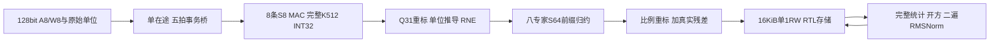

# Issue82：精确归一化专用化与真实 M 完整消费者

2026-10-25 UTC+08；Liangruizhi。[Issue82](https://github.com/rayggxia-workspace/LLMHardwareDesign/issues/82) / [PR83](https://github.com/rayggxia-workspace/LLMHardwareDesign/pull/83)，task/82-norm-circuit，独立工作目录D:/Projects/LLMHardwareDesign-norm-circuit，base PR81@7ad23a73c49f199beed20f682decca897c4f487f。本轮闭合精确RMSNorm和真实down矩阵消费者，不代表全部Block、制造宏或整模型已完成。

## 1. 决策结果

归一化高周期已有可复查的电路解法。对相同原码、精度、16KiB单口存储，专用控制/宽算术和SFU将完整H1536归一化降至258244、209092或61492周期，结果逐码一致。不能将其与旧512B通用byte控制器直接称同库存对照；旧18函数V/ROM/程序也没有因此自动获得替代。

真实M接入后，P0→P2归一化周期少76.19%，但完整消费者链只少2.166%（有等待时1.842%），logic-only面积多约26.44%。因此不冻结4步SFU为默认制造版本。当前更重要的下一实验是减少M重复取数和检验重定标乘法器共享，随后才按真实时序选择SFU步数。

PROFILE0/1/2是不同硬件库存版本，不是同一底座通过后定制互联就能免费切换的能力。保留三候选及单步低面积基线，不宣称已得唯一最优方案。

## 2. 完整性和精度合同

实际RTL在project/rtl/norm_service；[工具和命令](../../project/experiments/norm_circuit/README.md)、[冻结协议](../../project/experiments/norm_circuit/PROTOCOL.md)说明实现。所有数据提取、Verilator执行、Yosys综合和独立数学接收只本人CPU服务器lrz-i82-*，无新模型、软件或其他机器任务。

这个同top表示功能连接，不是已冻结的M/V/S合宏或实际物理布线。

- 矩阵W8A8，8条真实S8乘法器；每专家完整K512后才消费INT32结果。最坏512×128²=8388608，INT32安全；没有把中间partial提前重新量化。新原型没有实现通用对外PARTIAL接口。
- 从真实midA8、动态选定8个专家的W8切入，router、SiLU和入口量化在外部cut。M实际产生全部1536×8个acc，继续Q31 RQ、gateQ15全8归约、Q20输出比例、真实residual、完整1536 RMSNorm；没有host注入acc/down/joined。
- 最终输入保存mantS32Q31、权重expS16、A单位deltaS16、gateU16Q15、residualS32Q12。RTL以18bit有符号算术推导31-exp-delta、拒负值，并按S64大右移RNE恒零证明处理>=64；原130/131等码不变。epsilon/输出比例各32bit在命令接受时锁存，驱动随后置零仍需正确。
- Norm输入S32Q12、gammaS32Q20、epsilonU32Q24；U128平方和，floor(sum/H)+epsilon，isqrt(var<<40)，signedI128分子后独立RNE除法至S32Q12。零分母/非法H给错误，输出范围失败拒绝；无浮点、近似倒数或静默饱和。
- H<=1536下平方和小于2^73、分子绝对值不超过2^74；宽加减/比较/移位及迭代除法/开方真实存在且计面积。P0只表示乘法分片，不能说整个单元只有8bit硬件。

原始Granite模型revision为a02780686e08a03fe0d2679a293b5c74a90efa89，沿用Issue74静态整数常量/数据SHA；两层0/13，各取evaluation token0/64/71。它们是六个固定输入，不把重复配置当成更多独立模型样本。旧BF16/FP32质量证据及Granite原chunk路由FAIL保持原状态，新整数RTL与自身参考一致不能修复原质量问题。

## 3. 三个候选与实际成本

|候选|归一化乘法|SFU实现|H1536周期 静默/等待|norm logic-only面积 µm²|完整消费者logic-only面积 µm²|
|---|---|---|---:|---:|---:|
|P0|U8乘法16个digit组成S32乘积|128步除法/64步开方|258244 /259780|22546.692|49342.468|
|P1|专用S32×S32|同单步SFU|209092 /210628|27558.664|54461.638|
|P2|专用S32×S32|每拍展开4步SFU|61492 /63028|34887.230|62387.640|

完整链公共部分还含一个实际S32乘法器，时分执行RQ、gate乘及比例乘；P0也不例外。P1/P2增加norm侧S32乘法器。generic中未完全化简的U8分支按原网表保守列出，不能据其单元数宣称硬乘法宏数量；最终面积独立从实际mapped标准单元及原Liberty求和。

|同一个完整M消费者|P0周期|P1周期|P2周期|
|---|---:|---:|---:|
|静默接口|9084871|9035719|8888119|
|确定事务编号等待|10684231|10635079|10487479|

表为L0/token0；全部六输入/三配置/双环境均保留，没有按误差或速度挑选样本。矩阵及外部传输工作相同，周期差恰为norm部分差。若共享时钟，静默P2相对P0的频率至少需保持97.834%才能保住这点完整链时间收益；相对P1需保持约98.37%。未做STA前不能把cycle减少当真实纳秒或功耗收益。

固定库为OpenROAD-flow-scripts@cca3a717920067d8f6e085ce886fe4ecdc876614的Nangate45 typical，SHA256 8d540a4d4cf6d09d27c87ad067857a9c0c2eeb023ab7a56e058cd3113db4e9b1。它是非制造研究库。Verilator5.042/Yosys0.63及实际命令入档，没有商业SRAM/ROM宏、布局/CTS/RC/STA、门级等价或功耗验收。

## 4. 端口、生命周期与传输

|项目|实际账本及限制|
|---|---|
|共享存储|唯一1024×128bit/16KiB单1RW，无byte mask。X与最终输出原位6144B、gamma6144B，高水12288B，余4096B；不是任意hidden都适配。|
|Norm内部访问|1152次128bit读（统计X、二遍X、gamma各384）及384次写，总24576B；不是免费多读口。|
|M→存储|每4个joined值形成一行，384次128bit写；不驻留49152B全8返回，也不赠完整1536个S64 merge缓冲。逐坐标八专家前缀在寄存中归约。|
|caller|完整链gamma写384行/768边沿，结果读384行/768边沿；命令捕获1边沿及完成保持/ack4边沿另列。命令epsilon/比例为64bit旁带输入，CSR/总线适配未实现。|
|临时buffer|norm X/gamma/output各一个128bit行寄存；SFU宽状态、M输入/输出行、桥和控制寄存按实际generic/mapped网表逐层计入，host观察器数组不是硬件存储。|
|完整链generic寄存|P0/P1/P2分别3720/3655/3655bit，norm单元则2088/2023/2023bit，见comparison.json；包括真实controller/观察寄存和存储wrapper，不能与排除wrapper的logic-only面积重复相加。|
|M输入|798720个128bit payload，12779520B；每次完整事务5beats，实际3993600beats/63897600B。含W8 6291456B、重复A8同量和196608B header/padding。|
|并发/容量|一个外部在途事务；M先写完全部joined，norm才开始，统计全部完成后再覆盖输出。源打包镜像约12.78MB/条件，外部128MiB候选预算容纳；不是无限免费FIFO。|

打包为8A+8W/beat，反复传A，没有A-cache或权重预取。CPU打包/动态dispatch/真实DMA时延未计入RTL周期，原始输入版本及Slurm耗时可查；不能把当前保守接口当成最终部署或真实DRAM带宽测量。M→RQ/merge为同top局部连接，若拆成物理宏，还须另验typed接口/仲裁/布线费用。

当前8lane M不是最终16×16阵列，也没有实现原候选M32KiB SRAM；“库存有预算”不等于已经有免费宏。整个store82 wrapper在logic-only映射中blackbox，131072bit存储及generic寄存另记；其宏面积/时序为未验，不是0。

## 5. 验证、失败和接收

正式174命令：14个数值/真实行×6配置=84；9个RNE正负半值/维度上界/零分母等边界×6=54；6个真实M全链×6=36。独立参考从实际物理payload重做完整K乘积、RQ、merge/residual和完整norm，同时逐码对照旧原码。每个接收都有实际改码、重新SHA后拒绝；复位、busy cfg、完成保持有实际断言。

最终M原始单位批为03，input02、map04、源码phase7；早期72条M命令保留为前序证据，分别使用预合成shift和epsilon锁存版本，不能冒充最终raw单位合同。standalone正式norm来自phase1，边界来自phase6，独立最终对照analysis02。最终raw-unit执行源commit为6b9a3f7b3b59bad1e335e018ef799265314e611c，冻结交付phase8为e0e845efbbed280e91bfa8d3bd755fe6539350bd；文档commit见PR head。所有used RTL与对应构建/映射来源SHA一致。复位采用单context/协调复位模型；未验fabric独立不复位时旧应答、CDC或R两代原子状态协议。

100个本人已接受Slurm作业：97 COMPLETED /3 FAILED；三次M综合入口top名称错误（90518/90524/90530）保留并新目录重跑。一次过期已完成依赖的sbatch拒绝，在sacct核齐前置完成后重新提交；它不是一项已执行实验。新工作目录索引初始化异常已在上传前修复，PR差异无基线删除。未中断他人任务或覆盖原实验输出。

8个新数值边界检查、16个相关既有检查及管理结构通过。完整包与精选服务器逐成员SHA、PC精选字节及八phase150条原Git源码绑定均PASS。精选含收据及小规模整数原码，缺少M二进制payload，不能称离线完整重跑或仅有标量metadata。

[统一索引](../../project/experiments/norm_circuit/results/issue-82/index.json)：授权服务器/public/home/yuzelu/RuizhiLiang/issue82-norm-circuit-20261025/delivery03/full-results.zip，493855753B/1253成员，SHA256 b84301765a83eb37db7dfd04f5b3b84e53e079344d140843c7cf082556a6100d。精选3283478B/708成员入仓库，SHA256 f38b5e4eb9b2767a2c35a24fd51c3f789690e847fa60931d5aae93f5b0fbb505。归档/接收之后的终态和命令另在work82记录，不声称原archive包含其自身后续日志。

## 6. Block边界的收敛与下一实验

制造内优先保留M完整K的INT32反馈、norm完整统计屏障、有限本地行buffer/单口仲裁及精确重标接口。宽算术/迭代SFU需要真实库存；PROFILE是制造版本，不能靠产品金属连接增加乘法位宽或展开步骤。跨M/V/S的物理划界、专用SFU数量、相邻布局及产品互联端点仍未冻结。

下一最小实验是：同16KiB/同端口下为8个A向量缓存4096B并减少重复payload，核对是否挤占norm/general-V live数据；以及时分复用公共RQ的S32乘法器与norm乘法，付清仲裁/接口费用。它们直接检验当前瓶颈和物理边界；先不用增加模型。目标宏/STA到位后，再检验4步SFU的全局时钟和面积是否值得。H2560/更大完整行、通用18函数V/ROM整合和完整模型质量仍未验，不能以本轮H1536推成所有模型通用合格。

登记management-hub PR5 pending；board.json404、Projects缺read:project，条目unverified/同步pending，管理员和审查人待指定。Issue82/PR83交付待审查合并，不done，不自行合并。
