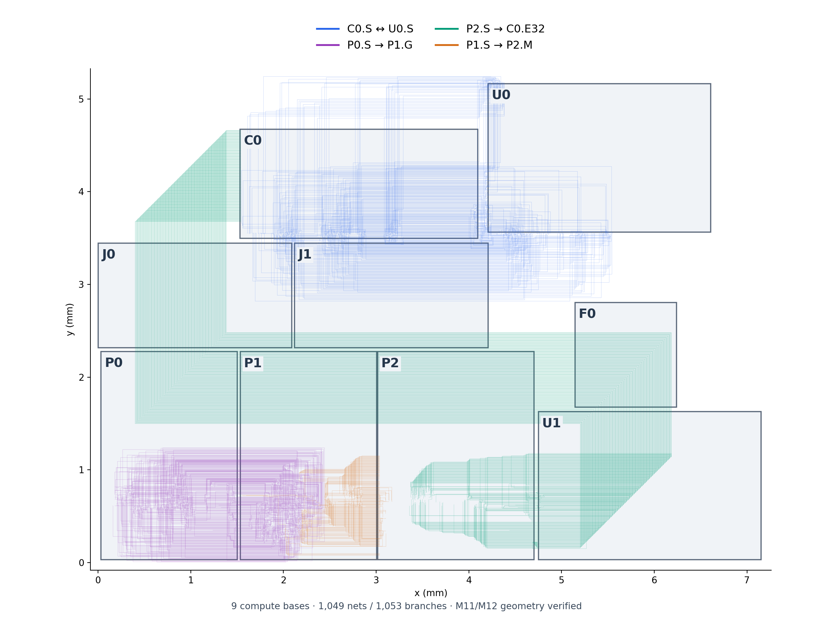

# #271 九底座：原生接口与四组 M11/M12 连线

按本轮要求，版图只保留 **P0、P1、P2、C0、U0、U1、F0、J0、J1**。以 [#271](https://github.com/rayggxia-workspace/LLMHardwareDesign/pull/271) 为布局参考，调整位置和 C0/P2 内部接口，不放置独立 reader，也不放置 dma、mc、sw。四组顶层连线全部通过独立几何校验。该版本替代此前含 14 个实例的紧凑版作为 [PR #285](https://github.com/rayggxia-workspace/LLMHardwareDesign/pull/285) 的当前交付，原记录保留作历史对照。



| 顶层通路 | 连通分支 |
| --- | ---: |
| C0.S ↔ U0.S | 306 / 306 |
| P0.S → P1.G | 335 / 335 |
| P2.S → C0.E32 | 206 / 206 |
| P1.S → P2.M | 206 / 206 |
| 合计 | **1,053 / 1,053，1,049 条独立网** |

外框 **7.182 × 5.27827 mm，37.9085 mm²**，九个底座不重叠。相对于此前含独立 reader 的紧凑版，外框面积约减少 2.05%；这同时包含移除外围块与调整底座的影响，不能解释为同功能整芯片面积改善。为保证全部连通，P2→C0 使用绕行通道，顶层中心线总长为 **4,005.7844 mm**，长于前一版；尚未据此证明时序或能耗改善。

## 接口补在既有逻辑内部

C0 在既有 `ucf_s_compute_client` 的 READ_REQ / READ_RSP 状态中选择远端 A 操作数，新增 `projection_s_*` 原生端口。E32 描述符的 `native2[19]` 选择该路径；B/C 操作数与写回仍走本地路径。返回按 tag 匹配，数据进入实际 E32 运算口，不先写入 C0.S，不新增 reader 状态机。

P2 将既有 M 的 A 供数前端 `ar_*` 连接到新增 `down_s_*` 原生端口，沿用窗口、提交边界、tag、排空及累加控制。P0/P1 继续使用原始视图，P2 是单独生成的原生接口变体。P2 左边界向现有空隙扩展 216 µm，原有 M/G/S 实例整体平移到对应坐标；左侧区域只是 P2 内的端口接入空间，没有独立 reader 实例。

C0/U0 上移为投影总线留出通道，P0/P1 原连线保留。C0 的 Attention 端点在核对实际 M10 电源及信号几何后重选接入点，最终两处局部接入另行修正。顶层端点方向也与真实 ODB 的 INPUT/OUTPUT 属性逐项核对。

接口变体的八个修改文件、原始差分及测试依赖保存在[源码快照](../../work/huangpingyang04-lgtm/250/pr271-data-link-routing/nine-native/release-support/native-rtl)和[压缩差分](../../work/huangpingyang04-lgtm/250/pr271-data-link-routing/nine-native/release-support/native-interface.patch.gz)。它们是本次布线实验输入，尚未替换项目生产 RTL。

## 实际完成的检查

- 独立 Python 几何检查：1,049 网全部连通，无游离铜岛；声明的 M11/M12 线距、孔距、边界及 2,102 个 V10 包围检查通过。
- 原生 ODB 回读：C0 的 512 个及 P2 的 412 个端点坐标、方向、网归属与连线一致；实际 M10 铜按 1.5 µm 间距复核，无端点冲突。
- 新原生接口局部详细布线：C0 512 网、P2 `down_s_*` 206 网均 DRT 零违规。增量合回完整原生网表后，逐网 ITerm/BTerm 集合与合并前完全一致，分别保留 77,762 / 164,914 个网的逻辑连接。
- RTL 定向回归：真实 C E32 的 ADD2 / ADD3 / PRODUCT、远端 A、本地回退、背压和过期 tag 拒收通过；P 原生 A 前端连续三个 K 窗口、48 次带 tag 读取、提交前缀、256-bit 输出背压及槽位复用通过。完整 P2 层次 lint/elaboration 通过。
- KLayout OASIS 回读：顶层导出形状与输入逐层一致；2,102 个 V10 均由原生铜或既有低层引出铜支撑。覆盖证明排除了顶层过孔自身的 M10 垫片，避免用新增垫片自证连接。

本地复核：

```bash
python -B work/huangpingyang04-lgtm/250/pr271-data-link-routing/nine-native/verify_nine.py
```

Linux / Verilator 环境下重跑打包的 RTL 定向测试：

```bash
bash work/huangpingyang04-lgtm/250/pr271-data-link-routing/nine-native/run_tests.sh /absolute/new-output-directory
```

服务器上须在 Slurm 分配的计算节点运行。完整物理重建还依赖项目服务器的叶宏、Liberty、工艺及工具镜像；本仓库不声称包含这些外部依赖。

## 证据与验收边界

[OASIS](../../work/huangpingyang04-lgtm/250/pr271-data-link-routing/nine-native/final/271-nine-native-four-links.oas) · [逐位连线表](../../work/huangpingyang04-lgtm/250/pr271-data-link-routing/nine-native/final/connections.csv) · [九块坐标](../../work/huangpingyang04-lgtm/250/pr271-data-link-routing/nine-native/final/placement.json) · [检查结果](../../work/huangpingyang04-lgtm/250/pr271-data-link-routing/nine-native/final/checks.json) · [原生 ODB 指纹](../../work/huangpingyang04-lgtm/250/pr271-data-link-routing/nine-native/final/native-provenance.json) · [完整证据索引](../../work/huangpingyang04-lgtm/250/pr271-data-link-routing/nine-native/provenance.json)。

这里完成的是**九底座上的四组 M11/M12 顶层几何连通和指定原生接口的接入验证**。P2 新增 Down 接口的 206 网已经详细布线；P2 另外 206 个 S 源端点已回读且顶层已连接，但其既有内部供数网不在该次局部 DRT 通过范围内。最初尝试重布 P2 全部 412 个接口网时，原 S 抽象 LEF 的 `storage/rsp_data[0]` 无可用访问点，失败记录保留。因此这不是整个 P2 或整芯片内部布线完成的证明。

C/P 原生网表合并检查证明逻辑连接未改变，不等于全芯片 LVS。仍待整机 56 分片提交/读完释放回放、P2.M 同一次累加跨窗口数值验证，以及完整工艺 DRC、LVS、PG、RC、setup/hold 和电气签核。导出的 OASIS 含实际 M7–M10 接口/抽象导出几何及 M11/M12 覆盖层，`physical_qualified=false`；不作为完整制造签核版图。对应 [Issue #250](https://github.com/rayggxia-workspace/LLMHardwareDesign/issues/250) 继续保持实施中。
