# 同一组 P/U/C/F/J 如何配置三个模型

返回[宗旨与组合定义](../LOCAL_BLOCK_DESIGN.md)；对照[七宏执行图](SEVEN_MACRO_MODEL_FLOWS.md)。这是候选配置，不是三个产品的物理通过报告。示例资源固定为 `P0/P1/P2、U0/U1、C0、F0、J0/J1`；每块只有自己的 S，容量、宏实例计数和单上下文约束见总说明。

图中一个实例可多次出现不同任务标签，表示复用，不增添实例。所有跨块张量边均按“源保活→TX/RX→目的私有 S→实际 stored ACK→源可释放”解释。图中简写为 `→目的.S`。小片段按预留窗口滚动；每项数据的尺度/布局/版本必须随任务描述绑定。MEM/母控服务有独立固定端点，不在 P/U/C/F/J 的三个或四个宏计数里。

## 1. Qwen 全局注意力配置

[Mermaid](diagrams/block-qwen-attention.mmd)。一个可执行的候选顺序：

1. J0.S 留住 X；U0 做输入 RMS0，把结果分片写 P2.S。
2. P2 依次执行 Q/gate、K、V 投影。Q/K 写 U0.S，做头内 RMS0 和部分 RoPE；K/V 写 MEM 缓存。gate 写 F0.S 等待 context。
3. P0.S 接收 Q 和按头读取的 K 分片，M 执行 QK、scale 与最终转换；scores 写 U1.S。U1.N 做 max/EXP/sum/回放，概率写 P1.S。
4. P1 从自身概率和 MEM 的 V 分片做 PV，context 写 F0.S。F0.G 对 gate 做 Sigmoid，E 按对应通道门乘，结果写 P2.S。
5. P2.M 做 Wo，输出写 J0.S，与 X 相加形成 Y；J0.T 逐完整片段交给 U0.S 做 FFN 前 RMS0，并向 J1.S 复制残差 Y。
6. 共用密集 FFN 路线见第 6 节。C0 在这一层空闲，其面积仍计入同底座。

**本层与 GDN 的区别不是仅换程序名**：QK→Softmax→PV 的 `P0→U1→P1` 路线和 `P1→F0→P2` 的后门乘要真实可达；GDN 所需 C 回路不参与本层。整块芯片同时支持两类层时，静态金属覆盖两类所需端点，运行时程序选择现有路线。

## 2. Qwen GDN 配置

[Mermaid](diagrams/block-qwen-gdn.mmd)。

1. U0 输入 RMS0→P2 投影；P2 的 QKV→C0.S，z/β→F0.S，a→模型系数表服务。
2. C0 的 R 卷积→E 转换→G SiLU，Q/K 写 U0.S 做 L2/Q 缩放，再写回 C0.S；V 留在 C0 的有界窗口。形成 **C0→U0→C0** 回路。
3. F0 做 SiLU(z)、Sigmoid(β)，β 经预制格式适配转 UQ1.31；系数表给 decay。C0 从 MEM 导入旧状态块执行 R GDN，读出先由 E 转 S16，再写 U1.S。
4. U1 做每头 128 通道 RMS，结果返回 C0.S；C0.E 与从 F0.S 导入的 SiLU(z) 门乘，再写 P2.S 做 Wout。形成 **C0→U1→C0** 回路，不能在 C0 中永久焊死一个 GDN 专用 Norm。
5. J0 合并投影与 X，进入共用密集 FFN。状态/卷积历史用 old/next 版本独立服务，不能因为一块 R commit 就发布整个 token 成功。

Q/K 头重复由局部地址复用实现；读出及门的块/头/列编号随描述符匹配。C0.S 不保存整层 2 MiB 状态。当前 R 的 `READ_OUTPUT` 必须在本地 `COMMIT` 清除 output_valid **之前**完成；新状态块导出到私有 next 候选区，全任务结束后母控发布 next 根。中途失败保留 old 根；若没有真实 MEM old/next 服务，不得声称整层事务原子性。

## 3. Falcon 双分支配置

[Mermaid](diagrams/block-falcon-layer.mmd)。U0 的同一 RMS 输入扇出给各分支，需分别完成目的 S 存储确认。示例 P2 前端投影按任务串行；当所需片段已送出后，下游 Attention/SSM 可以在不冲突资源上重叠。

| 分支 | 实例与中间数据落点 |
| --- | --- |
| Attention | P2 投影→U0.S（K 缩放、完整 RoPE）→P0.S（QK）→U1.S（Softmax）→P1.S（PV）→P0.S（复用做 Wo）→J0.S 的 A；KV 在 MEM |
| SSM | P2 投影→C0.S（卷积/SiLU、分块状态）和 F0.S（z 门）；C0 门乘后的输出→U0.S（全 4096 Norm）→P2.S（Wo）→J0.S 的 B |
| 汇合 | J0.S 保存 X/A/B 共 15 KiB，E 依次做两个加法及相应尺度转换；得到 Y 后才封存 T。输出先经过 .15/.088388… 分支缩放 |

P0 的 attention Wo 与之前 QK 使用同一个 M；不能同时占用两个未退休的 M 结果上下文。U0 处理输入 RMS、Q/K RoPE 和后续 SSM Norm 也需要明确串行/片段调度。图显示数学双分支，**不承诺全程并发或吞吐优势**。

## 4. Falcon SSM 的局部/跨块边界

[Mermaid](diagrams/block-falcon-ssm.mmd)。C0 复用 R/G/E/S 进行卷积、SiLU、状态块和输出门乘；F0 计算 z 门并保存，U0 做跨 4096 Norm，P2 做输出投影。dt/decay 与注入系数从显式模型系数服务送入，不能通过画一条线隐去其数值实现。

区别于 Qwen 的 `C0→U1→C0→P2`，这里是 **C0 内门乘→U0→P2**，没有 Norm 后回 C0 的必要；J0 则必须等待另一支 Attention。为了不掩盖当前合同差异，图中 SSM 仍标研究 R/系数服务候选；当前 R 的注入顺序、卷积 bias、B/C 格式和整数误差都必须按[差异表](SOURCES_AND_GAPS.md)落实。

## 5. Granite 的 Attention 与专家配置

[Mermaid](diagrams/block-granite.mmd)。注意力使用同一 `P2→U0→P0→U1→P1→P2→J0` 基本路径，但没有 Qwen 的 F0 后门；score scale 使用 0.015625，输出与残差处按图谱 .22 缩放。

MoE 的具体调度是：

1. J0 交接 Y，J1.S 保留残差；U0 做 pre-MoE Norm，把输入 F 分片复制到 P0/P1.S，并送 P2 做 40 个路由 logits。
2. U1.S 保存 40 个 logits（80 B）。N 选八个 ID；局控从 S gather 八个分数，N Softmax8 得到八个 Q1.14 权重（16 B）。ID 与权重版本一并交给母控/参数服务。
3. 八任务分给两条物理执行 lane P0/P1，各四个。每个任务在本 P 内依次 `M gate→S，M up→S，G SiLU×up→S，M down→S`；同一 M 不同时保留这三条累加上下文。I512 的 Mid 为 1 KiB，F 为 3 KiB。
4. 每 lane 四份 S16 输出 12 KiB，可先保存在本地 32 KiB S，再送 P2.S。P2 先完成路由并释放无用输入，再预约八份返回 **24 KiB**；归并工作片段和 16 B 权重另有有界窗口。
5. P2 的同一 M 从路由投影切换为加权归并：每次处理八个输出通道，以权重 `[1,8]` 乘返回 `[8,8]`，S64 累加后一次 RNE。H1536 共 192 个八通道片段，最终写 J1.S 做 .22 缩放及残差，T 交下层。

此配置要求专家返回**同一尺度 S16**，不宣称等价于历史 S32 专家整数实验。若不同专家有独立输出尺度，必须先显式重标度/重新验证，或扩大真实归并合同；不能只把八个 S32 返回塞给 E。

C0 与 F0 在本配置空闲，保留其真实面积。动态 ID 主要改变权重地址及任务归属；后制物理差异主要是宽专家返回/归并路线和局部 P 数据组织，而不是八条 ID 线。

## 6. Qwen/Falcon 共用密集 FFN 配置

[Mermaid](diagrams/block-dense-ffn.mmd)。U0 Norm→P0/P1；P0 计算 gate，P1 计算 up，up 写 P0.S；P0.G 输出 Mid 写 P2.S，P2.M down→J1.S 加保活 Y。Qwen I9216 的完整 Mid18 KiB 超过旧 S16 KiB，所以该示例明确采用 **P 私有 S32 KiB**，没有借 U1.S。可以改为更小窗口流式方案，但要证明 M 累加上下文/数据重用与上游进展匹配，不能只删容量标注。

Granite 则把 gate/up/down 收回 P0/P1 内串行完成专家，跨块 `P1→P0.G→P2.down` 变为 `P0/P1→P2.merge`。这是同一组合资源的不同用途；能否换来物理收益，仍须与固定共同互联按同资源比较。

## 7. 三份产品配置实际要产出什么

每个模型编译结果至少包含：母控程序、每类局部任务程序、参数/表版本、私有 S 地址与生存期表、物理端点绑定、预连/后制路线清单，以及实际场景轨迹。可共用局部程序模板，但不能预先固化整个模型程序目录。

| 差异 | Qwen3.5 | Falcon-H1 | Granite 图谱 |
| --- | --- | --- | --- |
| 层程序 | 3 GDN＋1 Attention，重复8组；每层密集 FFN | 32 次双分支层＋密集 FFN | 32 次 Attention＋动态 MoE |
| C 与 U 的绑定 | QK Norm 回路、读出 Norm 回路 | 门乘后通往全通道 Norm，无读出回环 | 不使用 C |
| P 的局部程序 | 前端/后端投影、分工 FFN | 前端双支投影、两支 Wo、分工 FFN | 两条串行专家 lane＋路由/加权归并 |
| F/J 的任务 | attention 后门、GDN 门参数；普通残差 | z 门与双支等待/三输入相加 | F 空闲；注意力/专家归并后的残差 |
| 程序合法性检查 | 有效路线、层种类、状态旧/新版本 | 分支就绪、共享 P/U 调度、状态发布 | 动态 ID 范围、专家参数版本、八返回完整性 |

表是配置的具体差异，不是必须为每条逻辑箭头新增一束金属。最终路线数、位宽、并行度与端点复用方案要由调度和物理反馈收敛。

## 8. 三模型的数据路线并集与有限端点

下面把图中复用后的有向关系列出，便于审查哪些连接真的有产品差异。“使用”表示该模型至少一个局部任务需要这条张量关系，包含分片及反向 stored ACK；不代表该关系持续占用总线。全局控制/参数、MEM和clock/reset另列，不把它们混入这张张量路线表。

| 源→目的私有S | Qwen3.5 | Falcon-H1 | Granite图谱 |
| --- | --- | --- | --- |
| U0→P2 | Norm/投影输入 | Norm/投影输入、SSM后Norm | Norm/路由输入 |
| P2→U0 | 注意力Q/K | 注意力Q/K | 注意力Q/K |
| U0→P0 | Q、FFN输入 | Q、FFN输入 | Q、专家输入 |
| U0→P1 | FFN输入 | FFN输入 | 专家输入 |
| P2→F0 | attention门、GDN z/β | SSM z | — |
| P2→C0 | GDN QKV | SSM XBC | — |
| C0→U0 | GDN Q/K | SSM门乘结果 | — |
| U0→C0 | 归一化Q/K回传 | — | — |
| C0→U1 | GDN读出 | — | — |
| U1→C0 | GDN每头Norm回传 | — | — |
| F0→C0 | z门/β | z门 | — |
| C0→P2 | GDN门乘结果 | — | — |
| P0→U1 | QK scores | QK scores | QK scores |
| U1→P1 | attention概率 | attention概率 | attention概率 |
| P1→F0 | attention context | — | — |
| F0→P2 | attention门乘结果 | — | — |
| P1→P0 | FFN up | FFN up、attention context | — |
| P0→P2 | FFN Mid | FFN Mid | 专家返回 |
| P1→P2 | — | — | attention context、专家返回 |
| P2→U1 | — | — | router logits |
| U1→P2 | — | — | 八个路由权重 |
| P2→J0 | attention/GDN投影 | SSM投影 | attention投影 |
| P0→J0 | — | attention投影 | — |
| P2→J1 | FFN down | FFN down | 专家加权归并 |
| J0→U0 | Y→FFN Norm；下一层X→输入Norm | 同左 | Y→MoE Norm；下一层X→输入Norm |
| J0→J1 | 残差Y保活 | 残差Y保活 | 残差Y保活 |
| J1→J0 | 输出O→下一层X | 输出O→下一层X | 输出O→下一层X |

合计27个有向关系；该映射下Qwen使用23个、Falcon18个、Granite15个。**这些是逻辑关系计数，不能代替物理线长/面积结论。** 同一母控程序会时分调用固定实例，多个关系可能通过有限预制端点复用；真正可布线的通道数量需要再做并发/带宽/引脚约束。

一种有界端点预算上界，是每个关系预留独立RX槽/入队接口，再由所属局控串行搬入私有S；按并集计算，P2有6个潜在生产者、C0有4个，U0/U1/J0各3个，P0/P1/F0/J1各2个。槽有真实容量/holding/选择电路及返回通路，全部在M1–M10固定并计价；不用的槽仍占面积。可以依据证明过的互斥/调度减少槽数，但要给出真实有源选择器和进展保证，不能把多个驱动直接接在同一输入上。

局部M/G/N/E/R之间的绑定同样由局部程序和后制连接共同确定：P在密集FFN的“接收外部up→G→送down”与MoE的“本地gate/up→G→本地down”之间变化，U在Softmax纯N回放与Q/K的N→E之间变化，C在Qwen的外部Norm回路与Falcon的门后Norm外送之间变化。S helper/宏命令/holding可预连；预连覆盖了哪几条关系，应在后续物理绑定文件中逐项标识。
