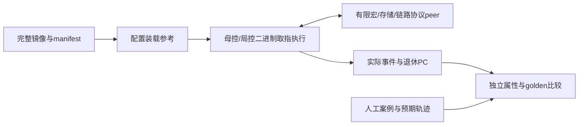

# 二进制控制执行模型 v0.1

2026-11-04 19:46 CST，Asia/Shanghai。Issue179／Draft PR180，负责人Melodydt；父提交8cb31090ed936906f4cf5a7a9a5ce4fa8ce7f864。上游PR176仍08f2ea20，开始核对无正文／讨论变化，上传前再核并追加[同步记录](../../work/Melodydt/179/pr176-sync.json)。
本轮为R2首个有界执行切片；[代码与复现](../../project/control_exec_v0_1/README.md)。完整Block实现仍为外部依赖。

## 1. 本轮新增的执行证据

先前81组检查属于编码、接口、人工观察oracle及软件装载准入；loader.START只把镜像置RUNNING，不取指。本轮新增Machine，在装载准入后按PC读取完整镜像的16B机器字并解码执行。
母控与局控有各自PC、8个寄存器、步骤预算、任务／服务序号和令牌；task／execution／transfer等描述符直接从相应镜像段读取。
每次指令退休记录target、PC、原始word_hex、操作、寄存器和调度tick。等待可以多次读取同一PC，但不重复发射、不重复计步。

已有3案例／7镜像在本轮共运行9次：3次正常、3次背压、1次非正常M peer错误，以及同一装载／同一Machine连续运行2个job。
合计100次指令退休、193条状态／握手观察；全部与独立预期比较通过。原机器码、镜像及人工参考未为迎合执行器而修改。
另外改变二进制中的MOVI或插入合法MOVI，实际CALL／READY值随之改变，原人工参考会拒绝差异，证明运行端由机器码驱动。

## 2. 模型如何连接

machine.py运行端不导入oracle／compare／run_campaign，不读取cases.json或golden_traces.json；bundle名只用于报告标签，不选择程序。
run_campaign在执行结束后调用compare.py，将观察的操作序号／路线ID映射为人工参考名称，不生成缺失事件、不调整属性检查前的顺序。
既有oracle检查身份、背压保持、READY／ACK／对象义务与终态；再比较接受事件／payload的多重集合，允许合法并发交错；退休PC另与人工程序比较。
job、epoch及连续任务序号由测试主机独立指定，不能用被测执行器报告的序号反向充当预期值。
codec与部分静态准入工具仍共用；已有手写机器字／头部向量提供部分独立约束。这不是形式化或全ISA完备证明。

## 3. 有限状态和完成条件

| 状态／资源 | 本轮实现及边界 |
|---|---|
| 控制器 | 1母控＋最多2局控，每局控1任务；程序只读快照绑定已提交manifest与实际字节 |
| 局控对象／服务 | 每局控最多1个打开对象、1个在途服务；令牌WAIT消费后复用，service_sequence递增 |
| S | 每局控真实有限16KiB Python bytearray，初始0xcd；OPEN只建立无效对象，不把旧RAM当新数据 |
| 消息holding | 最多8个通道，每通道1个完整包／命令；valid受背压时tuple保持，接受后回调推进 |
| 母控返回 | 最多2个任务完成信用，CALL前预约；单READY事件槽，禁止覆盖；G_WAIT消费后释放信用 |
| 链路／外部输入 | 最多2个路由事务槽及2个外部数据包；首版RAW16，接收方必须已准备 |
| 记录与实验界限 | 2048观察，默认256、最多1024调度tick；每任务沿用镜像非零max_steps |

支持既有profile的14类指令：G_CALL／G_WAIT／G_EVENT／G_MOVI／G_END；L_OPEN／L_EXEC／L_RX／L_TX／L_WAIT／L_MOVI／L_DROP／L_REPORT／L_END。
L_REPORT仅READY，native执行仅M service0/op6；未扩展ISA编码或profile注册范围。

M命令接受只说明已送达peer，响应握手后令牌才完成。peer清除有效标志并保留非零scale，没有实现GEMM或其他宏数值。
外部RAW16数据包由scenarios.json提供，匹配实际RX描述符后才能进入链路。存储peer在给定延迟后实际写bytearray，再产生store_ack；其后ACK发送接受才完成本用例RX。
跨Block源必须实际收到匹配ACK才完成TX，WAIT消费令牌后才可DROP。ACK校验包含身份及stored_bytes，接收完成不自动等于源已收到ACK。

G_EVENT把READY scalar写入母控寄存器；G_CALL快照R0..R7；局控再按argument_mask装入参数，寄存器另清零。已验证READY=1→母控R0=1→后续CALL arg0=1→未选择的局部参数为0。
正常结束时所有对象、服务、holding、链路、事件及返回信用排空，装载模型回READY。同一Machine可直接运行下一job：S／native peer状态及任务序号保留，活动对象／寄存器按新任务规则建立，不依靠reset或内部RAM注入。

## 4. 错误与复位边界

M rsp_error为显式非正常peer注入，控制器在L_WAIT消费后产生ERROR终态，status9、error_pc指向服务发射PC；母控G_WAIT消费错误返回后发布global_error。该路径不退休成功L_END／G_END；不把合法原生op6本应成功的事实改成真实RTL会报错。
错误命令可能已有副作用，不假定撤回或RAM回滚。

永久背压／缺输入达到ModelBound时仅报告实验界限耗尽，不生成成功DONE，也不能据此断言硬件死锁。非法外部包、容量／身份违约通过模型异常拒绝。
失败实验清镜像valid、要求重新准入，并保留失败原因／义务及RAM；这只是模拟器的失败收束，**不是已经实现运行取消或provider协同复位协议**。
当前没有注入可跨job到达的独立旧native响应；实际无tag宏的复位确认、holding清理及旧响应隔离仍是下一步研究门。软件generation没有变成native硬件tag。

## 5. 实际验证与限制

新增26组测试，包括9实验重建、原始字节与退休PC、改变机器码、8种随机种子×3案例、调换局控调度顺序、消息保持、真实字节复制、READY和ACK先后、令牌回收、连续任务与独立身份预期、错误终态、缺输入／永久背压及错误外部包。
连同既有81组共107组通过；管理结构另计。实际工具、固定输入、输出位置与SHA见[来源](../../work/Melodydt/179/control-exec-sources.json)及[验证](../../work/Melodydt/179/control-exec-validation.json)。

run_reports.json的instructions_executed=true只表示软件解释器取指执行；rtl_tested=false。旧oracle回执仍表示它自身不执行PC；loader.START仍仅准入。
整包握手与tick不是配置／控制总线的逐flit传输或时钟周期；不能从这些tick推出频率、时延、吞吐、面积或功耗。S没有真实bank／端口仲裁，M只有清有效位peer，没有执行原生宏／S RTL、完整Block或LLM数值。

下一步先补R2的运行取消／协同复位：停止新发射、排空／poison、provider确认、迟到响应和连续job恢复，并明确不能安全排空时的终态；随后冻结首个局控RTL的周期级接口、队列深度和写口互锁。
循环／分支、其他native服务、一般拓扑与全部ISA尚未覆盖；R2整体、控制RTL／真实Block／物理验收均未标完成。本轮没有服务器作业或自动监测。

## 第5步接续（2026-11-04 20:58 CST）

[取消与恢复研究](CONTROL_RECOVERY_PLAN_V0_1.md)新增RecoveryMachine和独立native源／复位协调peer，补充本切片的安全取消、poison及有条件迟到响应隔离；30新增、累计137组。既有Machine仅加默认不改变行为的生命周期扩展点，原9次报告可逐字重建。运行恢复在软件模型中验证，真实RX关闭／RESET_ACK和完整Block复位域仍待接收，tick不是硬件周期。

