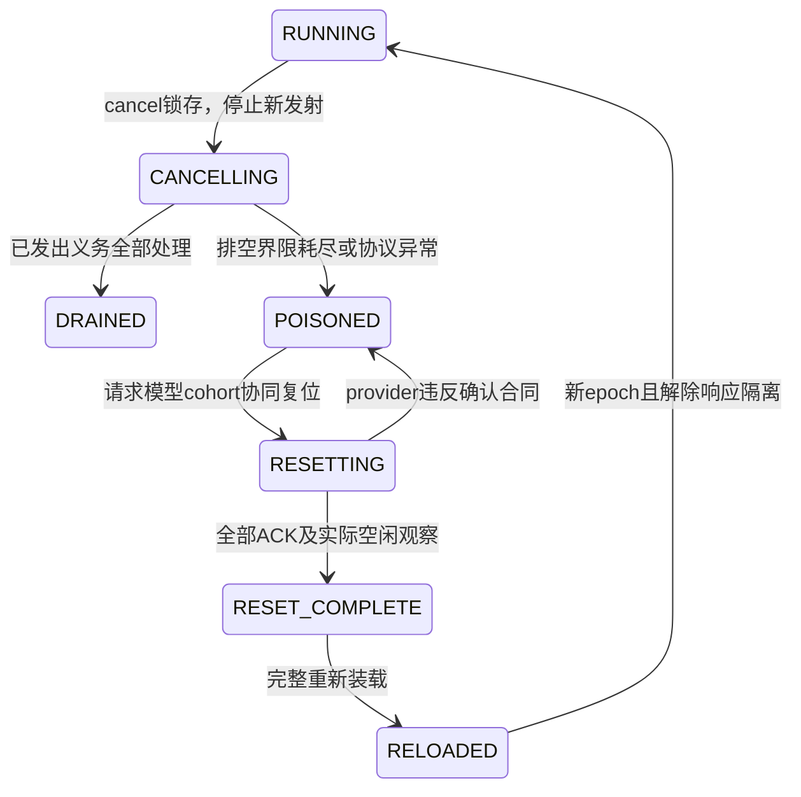

# 两级控制取消、协同复位与迟到响应研究 v0.1

2026-11-04 20:58 CST，Asia/Shanghai。Issue179／Draft PR180，负责人Melodydt；本轮父提交c22dde6972e0f86600ecdc4060409e6947b19fb8。
PR176开始仍08f2ea20，正文与讨论无变化；上传前再核，见[同步历史](../../work/Melodydt/179/pr176-sync.json)。
实现位于[执行模型目录](../../project/control_exec_v0_1/README.md)。这是R2软件控制模型的恢复扩展，尚无控制RTL或完整Block实现。

## 1. 已有程序如何进入恢复

运行程序与镜像编码保持不变，既有task_message.kind=1用于CANCEL，不新增运行ISA操作码。
本轮上层测试主机按实际协议观察触发job级取消，母控协调器停止所有新指令／任务／服务发射，再通过共享命令holding向已接单局控发送带原job／epoch／task_sequence、镜像／拓扑身份的CANCEL，参数清0。
这些是外部控制刺激，不是用人工案例替代PC调度。正常执行仍从二进制取指。

既有Machine只增默认无副作用的生命周期扩展点；原9次正常／背压／错误／连续任务报告可逐字重建。
恢复行为由RecoveryMachine执行。独立check_recovery只读取结果，不参与调度，另用原oracle／golden检查恢复后的正常任务。

## 2. 安全取消与终态规则

- 锁存取消后不再发新CALL、EXEC、RX或TX，也不再取新指令推进。此前已经offered的CALL、REPORT、END及宏命令须保持valid／payload到接受；不能因取消撤回背压中的包。
- CALL若尚在holding，先完成原握手，再向实际接单的局控发送CANCEL；未接单任务不能伪造局部完成。
- 已发出的native命令等实际响应握手；已启动DATA继续写入及ACK，源收到匹配ACK后才可退休TX。取消清理用独立cancel_wait／cancel_drop观察，不冒充执行L_WAIT／L_END。
- 被动RX若尚无DATA在途，只有源侧关闭门及RX_close_req/ack合同确认后才能取消该预约。该关闭合同是新增协议peer假设，**没有现有硬件实现证据**；真实端点无法确认时必须走poison／复位。
- 未消费READY可以按当前身份显式丢弃；已锁存／背压中的TASK_DONE或ERROR不得改写。取消到达晚于局部DONE锁存时，局部包可保持成功status0，但job级结果仍为取消，不能发布成功G_END。
- 已接单且安全清理的局控发ERROR／status11 CANCELLED，error_pc=0xffffffff；实际native错误status9优先，error_pc保留服务发射PC。全部局部返回消费、对象／令牌／holding／链路及无tag义务清空后才回READY。

确认计数来自模型实际S读及store_ack，flags bit2表示本fixture计数有效；已知写入时另置bit1。取消不回滚S／外部副作用，不能把partial=0解释为没有物理写入。
已锁存的旧终态保持原字段，额外计数只能留在job级观察中，不能修改其背压payload。

## 3. 无法排空时的poison

drain_ticks是本轮实验界限，不是已冻结的硬件超时或死锁证明。
达到界限或发现空闲期无tag响应后，协调器记录status13 DRAIN_OR_RESET_REQUIRED、实际五类义务及原因，关闭所有native响应准入，清全部镜像valid并要求协同复位。
此时保留在途事务和S数据，不能把服务标成成功，也不能把尚未排空的任务伪装成已完成。status13是软件协调器诊断，不伪造一条来自未接单局控的ERROR消息。

五类义务仍为tasks、data、returns、contexts、untagged；后者还包含独立native源队列中的未来响应。
实验异常／ModelBound也进入poison并保持失败原因；不通过直接清空计数恢复执行。

## 4. 协同复位证据及重新准入

本模型的一局控cohort有7个参与者，两局控有11个：母／局控controller、每局控adapter、M provider、S端口，加transport和ingress。
这些只覆盖当前模型清单。真实P还须把G、feeder、仲裁及其他可能留存状态的实现单元纳入；**7／11不是实际Block完整复位域的验收结论**。

每次请求分配独立reset_sequence；只有对应参与者实际执行模型复位动作后才接受其ACK。旧／未知／重复／未执行复位的ACK及布尔值冒充序号均拒绝。
provider复位清所有待发／未来响应，不按observer_origin或旧job标签选择清除；adapter清无tag绑定，controller清活动控制状态，transport清holding及链路，并显式记录事务被复位中止。
S payload及程序RAM保留，不执行回滚。M的数值复位默认值未在本轮表征，provider动作只证明模型协议队列清理，不能据此接收其他native服务的复位资格。

全部参与者ACK匹配后，还检查实际队列／上下文／五类义务为0，并至少多观察1个调度tick，才形成软件复位证据并解除loader的待确认位。这个tick不是CDC／硬件复位释放时长。
镜像仍INVALID，所有响应门继续关闭；必须经BEGIN→WRITE16→VERIFY→COMMIT完整重装，装载generation递增，并使用高于poison时的epoch才能运行。
新epoch可隔离带身份的控制／数据包，**不能给无tag native响应补出硬件tag**。

RESET_ACK后若在保持隔离期间又出现响应，复位证据撤销，镜像重新失效，必须发起新一轮复位。缺任意参与者ACK时一直保持关闭，不能用一个外部true代替整个协调过程。
实际RESET_ACK产生方、覆盖范围、时钟／复位释放关系和硬件写口互锁，仍须在R3接口与真实provider接入时验证。

## 5. 无tag迟到响应的能力边界

NativePort有有限2项独立源队列，可以注入旧响应，且排程与controller请求表分离。
observer_origin仅用于观察证据，接收逻辑只看隔离门及当前命令上下文；它不是传到宏上的job／epoch，也不参与响应过滤。

已验证：空闲期／隔离期迟到响应不会完成新任务；ACK前响应被隔离，ACK后隔离期响应会撤销证据；复位清除队列中的全部未来旧响应，重新装载后正常任务能执行。
另保留反例：若provider违反静默保证，在新命令等待响应时送来与合法响应相同的旧payload，接收端无法从无tag导线判明来源。模型不会利用观察标签虚假识别它。
因此安全依赖provider静默／复位确认、队列清理及解除隔离前的门控；若真实宏无法提供这些保证，应扩大复位域或增加有代价的适配措施，不能只增加软件epoch就宣称解决。

## 6. 实验、验证及下一步

9组取消／poison实验中7组安全排空、2组status13；各自随后恢复运行，共9次正常恢复、2个完整模型cohort复位。
恢复前显式撤除了测试注入的永久背压，恢复环境也留在报告；这不表示复位能够修复永久硬件故障或保证外部peer一定恢复。
覆盖CALL held、native在途、被动RX、ingress写后、DATA held、目的写后、DONE held、native响应卡住及ACK卡住；取消阶段退休53条、恢复阶段115条，共168条。
新增30组测试，含独立检查器的缺响应、篡改终态／字节计数、holding变化、缩小复位范围等负例；连同既有107组共137组通过。旧9次执行报告、原镜像及人工参考均保持不变。
实际命令、工具、来源及产物SHA见[来源](../../work/Melodydt/179/control-recovery-sources.json)／[验证](../../work/Melodydt/179/control-recovery-validation.json)。

本轮仍是Python解释器／协议peer；无控制／宏／S RTL、完整Block、LLM数值、性能或物理验收，没有服务器作业或自动监测。
下一步冻结首个局控RTL的周期级接口和状态机：取指／配置写口互锁、命令保持、对象／令牌／返回信用及复位确认清单；先实现同一14类直线profile的局控RTL＋有限peer对照。
循环分支、其他服务、一般拓扑与真实provider复位保证继续保留为后续研究／外部接入门，R2整体与R3均不标完成。

