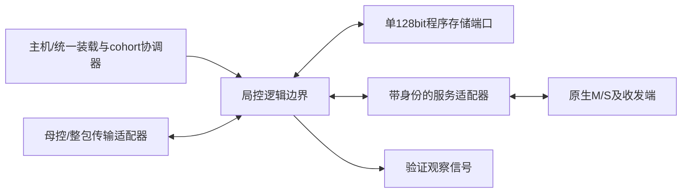

# 局控RTL接口、状态机与存储互锁候选 v0.1

2026-11-04 21:54 CST，Asia/Shanghai。Issue179／Draft PR180，负责人Melodydt；父提交e079924c7956c1fddf0994db5ba7cc67fede691a。
PR176开始仍08f2ea20，正文／讨论无变化，上传前再核并记录[同步历史](../../work/Melodydt/179/pr176-sync.json)。
本轮形成R3入口的可审查接口候选，不等于共同底座／物理接口已冻结。[机器合同、端口表与复现](../../project/control_rtl_contract_v0_1/README.md)为主入口。

## 1. 研究边界与产物

本轮固定首个局控原型的逻辑端口、握手时点、状态编号、状态转移条件、缓冲深度及最小存储预算。
生成lc_boundary_v0_1.sv与lc_contract_v0_1_pkg.sv，仅包含SystemVerilog interface／modport和常量声明，没有功能控制器DUT、计算宏、S或完整Block。
PATH中未发现iverilog／verilator／yosys，**HDL编译／lint／仿真未执行**；Python合同检查不能替代HDL检查。

92个逻辑信号按clock、cohort、config、program_memory、task、service、return、rx_close、observation分组，方向均相对局控。
它们是未来局控模块边界，不是已经存在的基础宏pin，也不代表全部要直接布成芯片外部或M11/M12引脚。
首个profile仍仅支持9类局控指令（L_OPEN/EXEC/RX/TX/WAIT/MOVI/DROP/REPORT/END），服务限M clear与RAW16，母控的5类指令在原模型中保留；ISA编码与旧镜像未改。

## 2. 模块分工和关键接口

| 边界 | 候选字段及位宽 | 接受／完成含义 |
|---|---|---|
| 配置请求／响应 | op3、generation32、byte_address14、data128；BEGIN另含total_bytes16及各ID32；响应status16/data128/generation32 | valid&&ready接受一项请求；实际PM响应后才能报WRITE/READ成功；响应保持到主机消费 |
| 程序存储 | 单1RW、128bit、byte_address14；独立req/rsp valid-ready，write、error | 最多1在途，响应至少晚1个边沿；不允许同拍消费旧响应并补发新请求 |
| 母控任务 | task_message512＋credit1，valid-ready | 整个64B包被局控接受且CALL有最终返回信用；CANCEL复用已有任务身份，不申请新信用 |
| 适配服务 | kind2=EXEC0/RX1/TX2、token3、service_sequence32、job/epoch/task_sequence各32、descriptor1024、object_base64/length32/version32 | 请求接受才分配令牌；响应须带匹配内部身份及status16、确认字节数，按已登记完成强度退休 |
| 局控返回 | event_message512，valid-ready | 整包被母控接受后才释放对应holding／任务预约；不能用第一flit代替 |
| RX关闭 | 独立req/rsp握手，携带任务／服务身份与token；rsp status16 | 只在取消时关闭尚未完成的RX；ACK必须证明相关源已关闭，不是S写确认 |
| cohort | release sequence32/epoch32握手；deploy_valid＋generation32；poison输出 | local reset不等于provider复位；local PREPARE不等于全cohort部署成功 |
| 观察口 | PC32、opcode8、retire、PM owner2、IREG valid、cancel cleanup脉冲及两个4bit状态 | 供原型验证使用；不作为编译程序输入或免费物理资源 |

execution记录完整128B进入descriptor总线；transfer记录64B放低512bit，高512bit清0。请求接受时求值并快照对象窗口，背压期间不得继续追随可变寄存器。
这是便于首个原型验证的宽逻辑边界，尚未证明引脚／布线成本最优；若收窄／串行化须版本化更新接口与成本。
M的原生cmd/rsp、G流式及S实际端口仍由原[接口合同](CONTROL_INTERFACE_CONTRACT_V0_1.md)定义。内部服务tag由适配器保存，不能把它说成原生宏已有job/epoch引脚。
RX完成继续采用实际写确认＋ACK发送接受，TX须匹配远端stored ACK；busy下降不升级为完成。

## 3. 程序存储与配置写口互锁

局控完整镜像最多8320B＝8192B内容＋128B头。统一1个128bit端口供配置写／读回、取指及描述符读取使用，均为16B对齐的字节地址。
PC为32bit指令索引，取指地址在宽中间值中计算instruction_offset＋16×PC，先检查PC和范围再截为14bit地址。不能把PC当字节地址或先截位后检查。
不直接让局控访问张量S裸口，张量存取由服务helper沿既有S客户接口完成。

内部配置操作码与运行ISA分离：

| cfg op | 编号 | 要求与效果 |
|---|---:|---|
| BEGIN | 0 | 仅INVALID或空闲READY；检查元数据后清旧valid、绑定新generation／各ID／长度，进入LOADING |
| WRITE16 | 1 | 按0,16,...连续写；必须等实际PM写响应才计入已写前缀 |
| READ16 | 2 | 全部写确认后按顺序完整读回；主机消费响应后才计入已读覆盖 |
| VERIFY_PASS | 3 | 完整读回＋主机SHA／静态／bundle验证通过；LC仍须做本地头部必要检查，进入VERIFIED |
| PREPARE | 4 | 只提交本局控准备就绪，进入PREPARED；不能独立接CALL |
| ABORT | 5 | 取消候选，保持不可执行；不自动回滚旧镜像 |
| reserved | 6～7 | 拒绝，不访问程序存储 |

此编码只冻结本研究的局控内部API候选；外部MMIO、配置总线和物理线编码尚未冻结。
VERIFY_PASS来自受信统一装载器，本局控不假定免费片上SHA；LC还须检查角色、magic／版本／保留位、头部身份、总长度、段对齐／范围、容量及entry PC；运行时检查opcode、资源、描述符、tag、对象范围、令牌与max_steps。
完整数值／Q格式／通用映射检查仍在主机与后续编译器。

本局控prepared后，只有外部协调器确认母控及相关所有局控均prepared、bundle相容，才广播同generation的deploy许可；单时钟目标在相同边沿看到全局提交。跨时钟CDC未实现。
运行任务期间配置req_ready必须为0，不能改活动镜像。空闲同拍BEGIN与新CALL竞争时BEGIN优先；其他同拍请求不能绕过单端口和单事务约束。
BEGIN元数据错误在切换前拒绝，保留旧提交；已接受装载中的错误使候选INVALID，并锁存错误响应，不把“接单”当“已写”。

## 4. 生命周期、顺序机及同拍规则

生命周期4bit：RESET_WAIT0、INVALID1、LOADING2、VERIFIED3、PREPARED4、READY5、RUNNING6、CANCELLING7、POISONED8。
reset后先等cohort release，再装载；poison只在相应复位／新release后解除，不能靠改image_valid恢复运行。

顺序机4bit：IDLE0、TASK_REQ1、TASK_WAIT2、FETCH_REQ3、FETCH_WAIT4、DECODE5、DESC_REQ6、DESC_WAIT7、ISSUE8、WAIT9、REPORT10、END_HOLD11、FAULT_DRAIN12。
TASK／DESC多拍聚合完整记录；FETCH先等实际读响应进入单个IREG，再在后续边沿解码；无prefetch。
各转移与guard、9类指令提交条件、错误码保存在contract.json，不通过“经过固定若干拍”推定服务完成。

优先级为：local reset → poison／cancel锁存 → 已offered握手／响应消费 → 空闲BEGIN优先于新CALL → 普通发射。
输出valid由holding产生，不等待ready才拉高；valid&& !ready之后必须保持完整tuple。
取消禁止新的服务／取指发射，但此前已经offered且仍在背压的请求可继续接受并按原义务处理，不能撤回；取消cleanup有独立观察脉冲，不伪造L_WAIT／L_END退休。

本原型采用保守bubble：

- PM最多1在途；请求与对应响应不能同拍，响应消费边沿不补发下一请求。
- 适配服务最多1在途；响应边沿不接下一服务。WAIT最早在响应已于前一边沿接受后消费done令牌。
- 配置响应未消费前不接受下一请求；cfg输入及输出各有1槽。
- REPORT／END保持IREG和返回tuple，整包接受时才退休；WAIT阻塞顺序机，不阻塞服务／返回／关闭握手。

## 5. 信用、缓冲与最低成本

CALL前母控必须实际预约最终返回信用，task_credit只表示协调器／传输适配器提供的该事实，本局控不能自行证明母控全局队列容量。
局控有1任务槽、1活动对象、1在途服务，保留8个32bit GPR及8个参数；令牌范围8个但原型不允许多个服务同时活动。

返回采用1个READY事件holding＋1个最终结果holding。仲裁器只在没有已offered包时选择终态优先，选择后锁定到整包接受，不能抢占背压中的READY。
这两槽属于本轮RTL候选成本，原Python模型的单逻辑返回通道不等于已经实现或验证该物理缓冲。

除8320B程序存储，已列payload寄存器下界为688B：头部128、任务64、对象64、IREG16、descriptor union128、任务入口64、事件64、终态64、GPR32、参数32、配置写16、配置读响应16。
不含tag／valid／状态／地址／计数／错误等元数据，适配器、cohort协调器、网络、CDC、PG／CTS及真实存储宏成本另计。688B不是控制器总面积或最优值，也不能从它推出300MHz／功耗。

## 6. 传输与复位清单

512bit是局控内部整包观察边界；候选外层32bit×16flit、低字先传、包内不交织，端到端接单不能用第一flit或中间缓冲收满代替。
serializer／deframer／路由及接单回执尚未实现；event_ready必须明确代表母控整包接受，若未来改成中间队列接收，必须转移信用与holding义务并重新审查。

cohort release的来源是外部协调器，不是本局控复位输出。协调器在暖复位时保留／推进release sequence和epoch；监测器检查该源合同，不声称局控普通寄存器可跨掉电保持。
真实复位清单至少要审查M、G、S包装／仲裁、feeder、service adapter、收发端／ACK、网络部分帧、程序存储pending、返回holding、母控信用及cohort许可。
第5步7／11参与者只覆盖模型，不能直接作为真实P全域清单。具体复位端口覆盖与物理/CDC释放时序待真实provider接入。
无tag迟到响应的不可区分边界保持不变，不能用内部service tag或软件epoch宣称原生wire已隔离。

## 7. 本轮验证与下一步

新增36组检查，连同既有137组共173组。4份人工期望时序共829个采样边沿（129／286／115／299），另1份16flit包背压示例；它们标记authored_expected、rtl_tested=false、controller_execution=false。
检查器验证位宽／holding、BEGIN优先、配置真实写确认／完整读回、单存储端口、部署准入、取指PC／IREG、服务快照／身份、WAIT bubble、返回信用、RX关闭及取消cleanup等边界。
它不实现完整顺序机，不证明全部状态guard、对象生命周期或所有错误路径；对象／取消语义仍结合原R2 oracle，错误响应正向向量及真实DUT须后续补齐。人工时序通过不能写成DUT通过。
实际命令、工具检测、输入／输出SHA见[来源](../../work/Melodydt/179/control-rtl-sources.json)／[验证](../../work/Melodydt/179/control-rtl-validation.json)。

下一步实现首个局控功能RTL切片：配置／程序存储仲裁 → CALL／任务描述符 → FETCH／IREG → 空任务与M clear的EXEC／WAIT／END → 不变终态返回；再扩RX/TX及取消。
用有限PM／服务peer产生实际DUT观察，与本合同和R2提交事件对照；不要求Python调度tick与RTL周期相等。HDL工具和真实provider确认就绪后再授予对应资格。
本轮未运行RTL编译／仿真、服务器作业、物理流程或自动监测，也不接管完整Block实现。

## 第7步接续说明

本文件上述“尚无功能DUT／HDL未执行”是第6步当时的证据边界。第7步新增[最小功能RTL](LOCAL_CONTROL_MIN_RTL_V0_1.md)，仅实现空任务／M clear子集并完成10场景Verilator验证；本文件机器合同与人工时序不改，不能把该子集通过扩展为所有候选指令／恢复路径或物理接口验收。
