# 三模型如何落到 M/N/E/G/R/S/T

返回[设计宗旨](../LOCAL_BLOCK_DESIGN.md)；下一层看[组合 Block 图](COMPOSITE_MODEL_FLOWS.md)。本册按 `main@4b1df2c7` 的宏合同解释**候选执行映射**，没有完成三个 LLM 的 RTL/整数质量/物理验收。模型语义来源、版本和明确差异见[接收边界](SOURCES_AND_GAPS.md)。

M＝矩阵乘加/完整累加；N＝统计/归一化/Softmax/TopK；E＝S16 算术/配对 RoPE/S32 转 S16；G＝激活/门控；R＝研究中的卷积/递推引擎；S＝工作存储；T＝完整片段交接。图中的 `M_QK`、`M_proj` 等是**功能调用**，不是各占一个硬件宏；下一册明确这些调用复用哪个实例。S 的功能标签也不表示另增一个整块 S，具体容量和局部所有权在下一册给出。

所有跨功能阶段的中间张量都标出工作存储或 MEM；同 Block 内经适配的直接流水另标 `local`。箭头不表示可以无条件裸接。权重/参数、gamma、RoPE cos/sin 均由显式 MEM/参数服务供给；为控制图幅，重复的权重边在 M/N/E 标签处合并，不能理解为权重已藏在宏中。

## 1. Qwen3.5-4B：全局注意力层

[可编辑 Mermaid](diagrams/macro-qwen-attention.mmd)。Q/K 头内 RMS0 后只旋转 64/256 通道；16 个 Q 头共享 4 个 KV 头的地址，不物化四份 KV。score 在 S 回放给 N，概率写 S 后送 M 做 PV；PV 的 context 和独立 gate 都落 S，G 的 Sigmoid 与 E 的门乘发生在 PV **之后**。权重是 INT8 不代表 Q/K、概率或累加器也用 INT8：M 用 S8/S16 分解能力执行，输出按模型整数合同显式 RNE/缩放。

全层为 `X→输入 RMS0→Attention→加 X→Y→RMS0→密集 FFN→加 Y→O`。32 层排列为 `[GDN,GDN,GDN,全局注意力]×8`；GDN 层见下图，不能把两个子图相加成同一层必做的操作。

## 2. Qwen3.5-4B：GDN 层

[可编辑 Mermaid](diagrams/macro-qwen-gdn.mmd)。R 先卷积，E 转换后 G 执行 SiLU；Q/K 暂存后交 N 做 L2，E 做 Q 缩放，按地址复用 16→32 头，返回 R。V 不走 Q/K 的 L2。递推读出 S32 必须由 E 按声明尺度转 S16，再由 N 做每个 value head 的 128 通道 RMS，**之后**才与 SiLU(z) 门乘。

`decay=exp(-exp(A_log)·Softplus(a+dt_bias))` 的系数表是模型确定后的参数数据，图中明确从 MEM 输入，不能写成当前 G 已有通用 EXP。β 的 Sigmoid 输出 Q1.14，转为 R 的 UQ1.31 需要独立预制打包/移位适配；不能把同一个 16bit 数原样接到 32bit β。

GDN 每头状态为 128×128；S32 整层为 2 MiB。候选按 128×8 列块（4 KiB）进 R，32×16＝512 块；每个列块读出对应八个 value 通道。R 的 active/shadow 与外部旧/新状态根分开管理，图中的 MEM 是必要服务。

## 3. Falcon-H1-3B：双分支层

[可编辑 Mermaid](diagrams/macro-falcon-layer.mmd)。同一 RMS 输入产生 Attention 与 SSM 两支；图上的分叉是数学依赖，不保证示例的单个投影 M 能同时执行两次投影。注意力 K 先乘 `0.044194…` 再执行完整 128 通道 RoPE；QK 后另乘 `1/√128`，两者不可合并成遗漏一次乘法的图。

Attention 输出乘 0.15，SSM 输出乘 0.088388…，先相加再加 X，随后进入带 MuP 缩放的密集 FFN。J 对应的 S 必须保留 X/A/B，不能在第一支结束时提前把结果当整层完成。

## 4. Falcon-H1-3B：SSM 分支展开

[可编辑 Mermaid](diagrams/macro-falcon-ssm.mmd)。投影前 `ssm_in=0.5`，投影后 z/x/B/C/dt 的 MuP 向量分别为 `[0.353553…,0.25,0.176776…,0.5,0.353553…]`；卷积带 bias，B/C 从 1 组按地址广播到 32 头。dt 需 bias、Softplus 与 clip，再形成 decay/注入系数。图将系数服务单列，不假装 R/G 自动具备整条函数链。

R 读出含 skip；E 转换后先与 SiLU(z) 相乘，保存在 S，再交 N 跨 **4096 通道** RMS，最后做输出投影。它与 Qwen GDN 的“128 通道 Norm 后门乘”顺序不同。

每层 S32 状态为 32×128×256＝4 MiB；候选按 256×8（8 KiB）分块，共 512 块。历史整数 Falcon 使用 `RNE(dt·B)→乘 X`；当前 R 的 SSM 原语接受 `inject→乘 B`，若 inject 为 `RNE(dt·X)`，中间舍入不同，**不满足同一位精确合同**。本图表达算法位置，不声称当前 R 已实现原整数模型；可用现有 M 在外部按原顺序形成注入，或修改并重新验收 R，必须选定合同后验证。细节见[差异表](SOURCES_AND_GAPS.md)。

## 5. Granite：Attention＋40 选 8 MoE

[可编辑 Mermaid](diagrams/macro-granite.mmd)。采用项目算子图中 H1536、每专家 I512、Q24/KV8/D64、40 选 8 的**图谱配置**，不把命名不一致的 Granite 发布版本混为一个权重版本。

Attention score 乘配置值 **0.015625**，不是默认 `1/√64`。MoE 中 N TopK 输出 ID，控制器从 logits 的 S gather 选中分数，再用 N Softmax8 得到权重；地址生成/权重搬运由控制与 MEM 承担。八个专家任务不是八个固定硬件专家。

本提案让专家输出都采用同一 S16 尺度，保存在 S；M 把路由权重作为 1×8、专家返回作为 8×8 分片，形成 S64 加权和后一次最终 RNE，输出交 E 做残差缩放/相加。历史整数 MoE 的 S32 专家输出＋S64 归并不能原样降成 E 的 S16 加法；若坚持历史格式，必须另补真实宽归并/格式能力，不能借此图宣称已覆盖。

## 6. 共用的密集 FFN 展开

[可编辑 Mermaid](diagrams/macro-dense-ffn.mmd)。Qwen I9216，Falcon I6144；Falcon gate 投影后乘 0.353553…，down 后乘 0.078125。gate 与 up 必须按同一 token/位置对齐，Mid 经 S 保存或逐片转移给 down；残差 Y 保活到最终相加。M 不会在一个累加上下文中同时保留 down 并计算另一条 gate 链。

图册显示哪些宏负责什么；**能否在当前合同下逐位重现目标整数模型**，以来源/差异表和后续真实轨迹验收为准，不以图中使用了某个功能名字为准。
