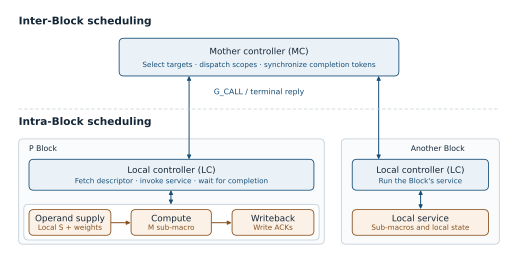
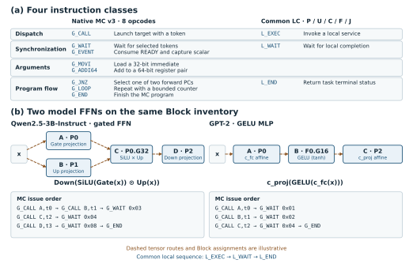

# Hierarchical Control and Instruction Set

## Two-level scheduling

Model dependencies determine which Blocks can execute together and when a consumer can start. Within a Block, the order and timing of memory accesses, sub-macro operations, and writes depend on the local service and its available resources. Driving all of those steps from the mother controller would tie the global program to each Block's internal sequence and expose local backpressure to the global scheduler.

The selected NoPool base candidate comprises nine Block instances across five types (three P, two U, one C, one F, and two J). The mother controller (MC) uses its own 16 KiB program SRAM and issues calls to the per-Block local controllers. A separate data plane provides product-bound inter-Block paths and access to off-chip DDR through a shared two-channel DMA. The Block outlines in Figure 1 denote control ownership over independently placed leaf macros and their adapters.

The C group illustrates the two scheduling levels. Its local controller (LC) receives a task from the MC, fetches its own program, and invokes services through adapters connected to private SRAM S, recurrent-state macro R, activation macro G, and vector-arithmetic macro E. The local program and adapters handle operand readiness and write acknowledgments. The independent C fixture also provides a product-wired G-to-E bypass through separate endpoints and adapters. The C program can use that path for a dependent arithmetic step or select SRAM replay. [C fixture and replay evidence](https://github.com/rayggxia-workspace/LLMHardwareDesign/blob/9abd46f5cbb4534bcfc614571ccd6d402ad11882/work/YUZE-LU/211/README.md#L65-L73)

A single global call covers a range of local operations. Independent Blocks can advance at their own pace before the MC reaches a dependency barrier, and a Block's internal schedule can change while the MC program stays valid if the service parameters and completion contract are preserved.

**Figure 1. NoPool base candidate and C local control.** (a) The row shows all nine candidate Block instances. The MC dispatches tasks and receives terminal replies. (b) Solid blue arrows group control and data exchange through the controller and adapters. The orange dashed arrow marks the product-specific physical link that connects the G output to the E input through their adapters. The bypass has independent C fixture evidence. The nine-instance top-level integration remains a separate qualification step.

## Instruction set and topology mapping

The two levels use separate 64-bit instruction streams. Figure 2 groups the eight native MC v3 opcodes and the three LC instructions used by all five Block classes in the bounded native programs. Dispatch uses `G_CALL` to select a target and token and `L_EXEC` to invoke a registered local service. Synchronization uses `G_WAIT` for selected terminal tokens, `G_EVENT` to consume a bound READY event and capture its scalar, and `L_WAIT` for the matching local completion. Argument setup uses `G_MOVI` to load a register and `G_ADDI64` to advance a 64-bit register pair. Program flow uses `G_JNZ` to select one of two forward PCs, `G_LOOP` for a counted backward branch, `G_END` to finish the MC program, and `L_END` to return task status after local obligations are closed.

The common local sequence is `L_EXEC → L_WAIT → L_END`. `L_EXEC` takes the operation and operands from an execution descriptor admitted by the target Block. The Block-specific program image and descriptor bind that operation to available hardware.

Figure 2(b) compares the feed-forward sublayer of Qwen2.5-3B-Instruct with the GPT-2 MLP. Qwen's input fans out to independent Gate and Up projections. The two results feed `SiLU(Gate(x)) ⊙ Up(x)`, which is then projected down. The example maps Gate and Up to P0 and P1, combines them using the candidate P0 G32 path, and maps the down projection to P2. The MC issues both projection calls before `G_WAIT 0x03` and dispatches the gate service after both projection results are visible to it. [Qwen2.5 configuration](https://huggingface.co/Qwen/Qwen2.5-3B-Instruct/blob/3ca5f5bff0f44b2b436a9aba99b900ab157c9a27/config.json) · [Qwen2 MLP implementation](https://github.com/huggingface/transformers/blob/v4.51.3/src/transformers/models/qwen2/modeling_qwen2.py#L42-L55)

GPT-2 maps its `c_fc → GELU → c_proj` chain to P0, F0, and P2 in the example. Each task produces the sole input of the next, so the MC places a single-token wait between calls. The F0 G16 provider supplies the catalog's tanh-GELU function. The affine stages include the GPT-2 biases, and their implementation and the fixed-point format boundaries require compatible service and adapter bindings. The figures compare operator graphs and scheduling fragments. The numeric behavior and end-to-end deployments require separate validation. [Original GPT-2 MLP, GELU and affine projection](https://github.com/openai/gpt-2/blob/master/src/model.py) · [G provider contracts](https://github.com/rayggxia-workspace/LLMHardwareDesign/blob/9abd46f5cbb4534bcfc614571ccd6d402ad11882/project/experiments/w8a16_g/PROVIDERS.md)

**Figure 2. Common instructions for two model FFNs.** (a) The figure groups the native MC v3 instructions and the common LC subset by function. (b) Qwen2.5 requires fan-out and a two-input join, while GPT-2 uses a serial projection–activation–projection chain. Dashed tensor edges and Block assignments are illustrative. The MC fragments abstract address setup and data movement. A consumer starts only when its required inputs have arrived and been acknowledged.

## Implementation example

In the programmed three-P feed-forward network (FFN), each call and each terminal reply crosses the MC–LC interface as four 128-bit flits. The MC validates the source, token, job, epoch, task sequence, generation, and topology before recording a terminal reply. It uses `G_MOVI` to initialize registers, issues three `G_CALL` instructions per iteration, and advances the descriptor pointer by 128 bytes with `G_ADDI64` after each call. `G_WAIT 0x7` waits for all three tokens before `G_LOOP` advances the bounded loop. The 272-byte MC image contains 17 static instructions and dispatches 192 calls over 64 iterations.

Each P LC runs the same three-instruction kernel from a 352-byte image. The LC obtains each 128-byte descriptor through two 64-byte transfers from the shared DMA. The programmed RTL experiment exercised Qwen2.5-3B FFN dimensions with deterministic synthetic integer weights. Both weight-provider variants passed all 36 cases, including checks of quantized intermediate tiles and outputs read back from the original SRAM bank models. With the program images and traffic held fixed, the early-execution provider reduced FFN cycles by 0.52–1.20% across the matched cases. This comparison measures a provider scheduling change within the same control interface. The fixture sequenced K-tile movement and the outer Gate/Up and Down phases.

## Native MC v3 and the common LC subset

The 64-bit MC word places the opcode at bits `[63:56]`, three operand bytes at `[55:48]`, `[47:40]`, and `[39:32]`, and the immediate at `[31:0]`. The table lists the eight decoded MC opcodes. The programmed FFN uses `G_MOVI`, `G_CALL`, `G_ADDI64`, `G_WAIT`, `G_LOOP`, and `G_END`.

| MC instruction | Opcode | Operands used |
| --- | --- | --- |
| `G_EVENT` | `0x12` | Selects a destination register and event binding. Consumes READY and captures its scalar. |
| `G_MOVI` | `0x13` | First operand selects the destination register. The immediate supplies its value. |
| `G_JNZ` | `0x15` | Selects one of two encoded forward PCs according to whether the tested register is nonzero. |
| `G_CALL` | `0x10` | First and second operands select target and token. The LC entry in the third operand is zero. |
| `G_ADDI64` | `0x16` | First operand selects the low register of an even-indexed register pair. The immediate is the unsigned increment. |
| `G_WAIT` | `0x11` | The immediate holds the token mask. |
| `G_LOOP` | `0x17` | First operand selects the loop counter. The immediate is the backward target PC. |
| `G_END` | `0x1F` | No operands. |

| LC instruction | Opcode | Shared action | Example word in the native P kernel |
| --- | --- | --- | --- |
| `L_EXEC` | `0x41` | Invoke the service selected by the execution record. | `0x4100000000000000` selects resource, token, and record 0. |
| `L_WAIT` | `0x44` | Wait for the selected local completion. | `0x4400000000000001` uses mask `0x1`. |
| `L_END` | `0x4F` | Return task terminal status after local obligations are closed. | `0x4F00000000000000` releases the native P scope before replying. |

