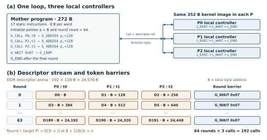

# Hierarchical Control and Instruction Set

## Two-level scheduling

Model dependencies determine which Blocks can execute together and when a consumer can start. Within a Block, the order and timing of memory accesses, sub-macro operations, and writes depend on the local service and its available resources. Driving all of those steps from the mother controller would tie the global program to each Block's internal sequence and expose local backpressure to the global scheduler.

The selected NoPool base candidate comprises nine Block instances across five types (three P, two U, one C, one F, and two J). The mother controller (MC) uses its own 16 KiB program SRAM and issues calls to the per-Block local controllers. A separate data plane provides product-bound inter-Block paths and access to off-chip DDR through a shared two-channel DMA. The Block outlines in Figure 1 denote control ownership over independently placed leaf macros and their adapters.

The C group illustrates the two scheduling levels. Its local controller (LC) receives a task from the MC, fetches its own program, and invokes services through adapters connected to private SRAM S, recurrent-state macro R, activation macro G, and vector-arithmetic macro E. The local program and adapters handle operand readiness and write acknowledgments. The independent C fixture has fixed paths from S to the R, G, and E service adapters for operand reads and result writes. Its SRAM clients share an arbiter. A separate product-wired G-to-E bypass can deliver an activation result to E through dedicated endpoints and adapters. The C program can select that path or replay the result through S. Additional bypasses involving S or R would require compatible source and sink endpoints and adapter support in the base before product-specific routing. For example, routing an R result directly to E would require a result endpoint on R and an E input that can accept its format and handshake. [C SRAM clients and macro adapters](https://github.com/rayggxia-workspace/LLMHardwareDesign/blob/9abd46f5cbb4534bcfc614571ccd6d402ad11882/project/rtl/block_cfj_v1/block_cfj_cf.sv#L75-L139) · [C fixture wiring and replay evidence](https://github.com/rayggxia-workspace/LLMHardwareDesign/blob/9abd46f5cbb4534bcfc614571ccd6d402ad11882/work/YUZE-LU/211/README.md#L63-L73)

A single global call covers a range of local operations. Independent Blocks can advance at their own pace before the MC reaches a dependency barrier, and a Block's internal schedule can change while the MC program stays valid if the service parameters and completion contract are preserved.

**Figure 1. NoPool base candidate and C local control.** (a) The row shows all nine candidate Block instances. The MC dispatches tasks and receives terminal replies. (b) The blue arrows cover controller exchanges and fixed SRAM access via service adapters. The orange band groups product-specific bypass paths as in (a). The connected G and E arrows show the verified bypass in the independent C fixture. Open-ended S and R stubs mark candidate endpoints that require further interface and routing design. The nine-instance top-level integration remains a separate qualification step.

## Instruction set and topology mapping

The two levels use separate 64-bit instruction streams. Figure 2(a) groups their functions into dispatch, synchronization, argument setup, and program flow. The MC dispatches tasks to Blocks, while the LC invokes services within its own Block. Synchronization enforces cross-Block dependencies and local completion conditions. Argument setup initializes parameters and advances descriptor addresses. Program flow expresses branches, bounded loops, and termination. The bounded programs for P, U, C, F, and J share the local invoke, wait, and return sequence. Each Block's execution descriptors select compatible services, operands, and destination buffers.

Figure 2(b) compares query and key preparation in Llama 3.2-3B and Qwen3-4B. Both project the attention input into Q and K and apply rotary position embeddings (RoPE). Llama sends the projections directly to RoPE. Qwen3 applies a separately weighted RMSNorm over the head dimension of each projected Q and K before RoPE. The figure covers this part of the attention layer, from its input tensor to the rotated Q and K. [Llama implementation](https://github.com/huggingface/transformers/blob/v4.53.3/src/transformers/models/llama/modeling_llama.py#L187-L215) · [Qwen3 implementation](https://github.com/huggingface/transformers/blob/v4.53.3/src/transformers/models/qwen3/modeling_qwen3.py#L159-L190) · [Qwen3-4B configuration](https://huggingface.co/Qwen/Qwen3-4B/blob/e619e22b5609bd7c38a835536155c19825f8fa5e/config.json)

The illustrative mapping uses P0 and P1 for the two projections and the E macros in U0 and U1 for RoPE. Llama routes the two projection outputs to the corresponding U inputs, where the E services consume them. Qwen3 inserts an N service on each U. In this example, each N service writes its normalized output into a local S buffer for the corresponding E service. The mother program launches both projections, waits for their input transfers to complete, and then dispatches the next pair of tasks. For Qwen3 that pair performs normalization, with a further wait before the same RoPE services can start. This schedule exposes the added dependency with the same call and token-wait semantics. The mapping requires compatible fixed-point formats, per-head weights and epsilon, the RoPE coefficient and lane layout, and confirmed writes to the consumer buffers. The N and E capabilities are documented separately from these model schedules. [U macro grouping](https://github.com/rayggxia-workspace/LLMHardwareDesign/blob/9abd46f5cbb4534bcfc614571ccd6d402ad11882/project/experiments/pu_leaf_base/README.md#L18) · [RMSNorm contract](https://github.com/rayggxia-workspace/LLMHardwareDesign/blob/9abd46f5cbb4534bcfc614571ccd6d402ad11882/docs/BLOCK_V2.md#L62-L70) · [RoPE contract](https://github.com/rayggxia-workspace/LLMHardwareDesign/blob/9abd46f5cbb4534bcfc614571ccd6d402ad11882/docs/BLOCK_V2.md#L46-L50)

**Figure 2. Instruction classes and two Q/K preparation schedules.** (a) The four classes summarize the functions of the two instruction streams. (b) Both examples use paired projection and RoPE tasks. Qwen3 inserts per-head RMSNorm and its completion barrier between these stages. Arrows show tensor dependencies. The Block assignments and MC fragments illustrate a mapping and abstract parameter setup, transport operations, and address binding.

## Program and descriptor reuse in a three-P FFN

The programmed three-P feed-forward network (FFN) illustrates how the instruction set separates a recurring schedule from task-specific parameters. The mother controller (MC) stores one bounded loop body. Each round issues a call to each of P0, P1, and P2, advancing the descriptor pointer by 128 bytes after each call. Each call captures the current descriptor reference. A single `G_WAIT 0x07` retires the three terminal tokens before the next round reuses them. The 272-byte MC image contains 17 static instructions and dispatches 192 calls over 64 rounds. The image comprises a 128-byte header, 136 bytes of instructions, and 8 bytes of alignment padding. [Program emitter](https://github.com/rayggxia-workspace/LLMHardwareDesign/blob/9abd46f5cbb4534bcfc614571ccd6d402ad11882/project/experiments/block_local_native/ffn_program_emit.py#L20-L49)

The three P local controllers (LCs) each load the same 352-byte kernel image and run its three instructions. They obtain each referenced 128-byte descriptor through two 64-byte transfers via the shared DMA. In round $r$, target $P_i$ receives descriptor $D_{3r+i}$ at byte address $B+128(3r+i)$, where $B$ is the descriptor base. Fields such as weight addresses, output-column bounds, and local SRAM destinations vary across records. The four program images occupy 1,328 bytes in total, and the separate DDR descriptor region occupies 24,576 bytes. [Local kernel generator](https://github.com/rayggxia-workspace/LLMHardwareDesign/blob/9abd46f5cbb4534bcfc614571ccd6d402ad11882/project/experiments/shared_x_control/make_lc_kernel.py#L15-L34) · [Programmed FFN experiment](https://github.com/rayggxia-workspace/LLMHardwareDesign/blob/9abd46f5cbb4534bcfc614571ccd6d402ad11882/docs/experiments/issue-250-three-p-ffn.md#L17-L25)

**Figure 3. Program and descriptor reuse in the programmed three-P FFN.** (a) The MC repeats one call-and-wait loop while each P uses the same local kernel image. The call carries a descriptor reference, and the LC fetches the referenced record via DMA. (b) Each round selects the next three records, with the wait mask covering all three tokens before they are reused. The displayed rounds are indexed from zero.

Each call and terminal reply crosses the MC–LC interface as four 128-bit flits. The MC validates the source, token, job, epoch, task sequence, generation, and topology before recording a terminal reply. The programmed RTL experiment exercised Qwen2.5-3B FFN dimensions with deterministic synthetic integer weights. Both weight-provider variants passed all 36 cases, including checks of quantized intermediate tiles and outputs read back from the original SRAM bank models. With the program images and traffic held fixed, the early-execution provider reduced FFN cycles by 0.52–1.20% across the matched cases. This comparison measures a provider scheduling change within the same control interface. The fixture sequenced K-tile movement and the outer Gate/Up and Down phases.

## Native MC v3 and the common LC subset

The 64-bit MC word places the opcode at bits `[63:56]`, three operand bytes at `[55:48]`, `[47:40]`, and `[39:32]`, and the immediate at `[31:0]`. The table lists the eight decoded MC opcodes. The programmed FFN uses `G_MOVI`, `G_CALL`, `G_ADDI64`, `G_WAIT`, `G_LOOP`, and `G_END`.

| MC instruction | Opcode | Operands used |
| --- | --- | --- |
| `G_EVENT` | `0x12` | Selects a destination register and event binding. Consumes READY and captures its scalar. |
| `G_MOVI` | `0x13` | First operand selects the destination register. The immediate supplies its value. |
| `G_JNZ` | `0x15` | Selects one of two encoded forward PCs according to whether the tested register is nonzero. |
| `G_CALL` | `0x10` | First and second operands select target and token. The LC entry in the third operand is zero. |
| `G_ADDI64` | `0x16` | First operand selects the low register of an even-indexed register pair. The immediate is the unsigned increment. |
| `G_WAIT` | `0x11` | The immediate holds the token mask. |
| `G_LOOP` | `0x17` | First operand selects the loop counter. The immediate is the backward target PC. |
| `G_END` | `0x1F` | No operands. |

| LC instruction | Opcode | Shared action | Example word in the native P kernel |
| --- | --- | --- | --- |
| `L_EXEC` | `0x41` | Invoke the service selected by the execution record. | `0x4100000000000000` selects resource, token, and record 0. |
| `L_WAIT` | `0x44` | Wait for the selected local completion. | `0x4400000000000001` uses mask `0x1`. |
| `L_END` | `0x4F` | Return task terminal status after local obligations are closed. | `0x4F00000000000000` releases the native P scope before replying. |
