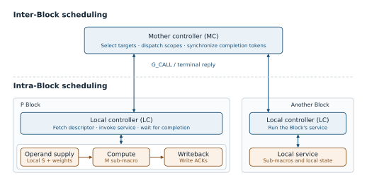
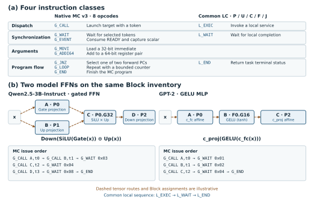

# 控制章节图解

[可编辑的 diagrams.net 源图](control-figures.drawio)包含两个页面。方框、文字和连线均可单独选择，带端点的连线可拖动或重新连接。两张 SVG 也保留独立的矢量对象和文字，适合在矢量编辑器中微调或放入论文。

## 图 1　整体底座与 P Block 控制

**图 1(a) 从全局看。** 横排的 `P0、P1、P2、U0、U1、C0、F0、J0、J1` 是 NoPool 候选中的九个 Block 实例，字母表示 Block 类型，数字区分同类实例。图上的序号是示意标签，实际目标 ID 由部署配置绑定。母控在上方，按全局程序向某个实例发任务，并用 token 跟踪该任务的终态。蓝线把调用与返回的逻辑关系画在一起。下方的橙色带表示由产品映射绑定的数据路径，跨 Block 的张量搬运和片外 DDR 访问都需要相应路径。实际路径由合法端点和连线决定，图上用虚线表达这层依赖。

**图 1(b) 顺着一条调用读。** 母控端口把调用送进 P 局控。局控从独立的程序存储取指，并通过 Scope DMA 获取这次任务的描述符。描述符告诉服务逻辑要处理哪个范围、从哪里取操作数以及将结果写到哪里。程序存储用于取指，图下方的私有 S 用来保存数据和中间结果。

**三个叶宏如何接在局控下面。** 局控向 scope/service 逻辑发出任务并接收完成返回。服务逻辑给 M 发计算命令，跟踪 S 的读写与写确认。M 承担矩阵计算，S 保存输入片段、临时结果和写回数据，G 承担 SiLU 与门乘。图中的 G 是 NoPool 为 P 选择的 G32 服务，其局部接入用虚线标出。已有三 P FFN 夹具用一个共享 G32 服务，并由夹具协调外层阶段。对已验证的 P 范围任务，服务逻辑收到所需写确认后才能上报成功，局控释放描述符后再回送终态。

**二级控制解决的问题。** 母控只需判断目标 Block 是否可以启动、哪些任务必须等齐。权重到达、局部 SRAM 仲裁、计算命令和写回背压由局控与服务逻辑处理。这样，一个全局调用可以覆盖一段局部工作。只要描述符与完成语义保持一致，调整 P 内部供数或提前发令时，同一母控程序仍能使用。原三 P RTL 对照中，固定程序镜像和搬运量，仅改变供数侧提前发令，就使匹配案例的 FFN 周期减少 0.52–1.20%。[三 P RTL 实验记录](https://github.com/rayggxia-workspace/LLMHardwareDesign/blob/9abd46f5cbb4534bcfc614571ccd6d402ad11882/docs/experiments/issue-250-three-p-ffn.md)

## 图 2　指令用途与两种 FFN 映射

### 每条指令的用途

图 2(a) 按派发、同步、参数准备、程序流归类。母控栏覆盖 native MC v3，局控栏覆盖 native P scope 内核。U、C、F、J 有各自的局控 profile。

| 类别 | 指令 | 读图时怎样理解 |
| --- | --- | --- |
| 派发 | `G_CALL` | 指定目标 Block 和本次调用的 token，快照八个参数寄存器。图中的 `G_CALL B,t1` 表示给 B 所绑定的 P0 派发 Gate 投影，并用 t1 追踪这次调用。当前 native MC 每个目标同时只允许一个活动调用。 |
| 派发 | `L_EXEC` | P 局控开始执行已注册的本地服务。该内核先读程序元数据和描述符，再向服务逻辑提交请求。实际访存、子宏执行和结果写回由服务逻辑推进。 |
| 同步 | `G_WAIT` | 等掩码选中的活动 token 都收到对应终态，然后释放这些 token 及对应目标槽。位 0 代表 t0，位 1 代表 t1。例中 `0x06` 同时选 t1 和 t2，因此两路都结束后才能派发 D。 |
| 同步 | `G_EVENT` | 消费镜像中事先绑定的 READY 事件，将该事件携带的标量写入指定寄存器。它适用于已注册的阶段就绪通知。图中门控汇合需要完整终态，因此使用 `G_WAIT`。 |
| 同步 | `L_WAIT` | 局控等待与本地调用的 owner、ticket 匹配的服务结果。对于已验证的 P 范围，成功结果包含必要的目的写确认。 |
| 参数准备 | `G_MOVI` | 把一个 32 位立即数写入寄存器。例中先用两条分别写地址低、高字，建立描述符指针。其余参数按部署 ABI 初始化。 |
| 参数准备 | `G_ADDI64` | 向一个偶数索引开头的寄存器对加无符号立即数并检查溢出。例中每次调用前将指针推进到对应描述符，第一条调用使用已初始化的首地址。 |
| 程序流 | `G_JNZ` | 检查寄存器是否非零，在镜像明确给出的两个前向目标 PC 中选择其一。可用于条件选择后续工作。本例固定采用一种部署映射，程序中无需条件分支。 |
| 程序流 | `G_LOOP` | 递减有界计数器。仍有迭代时跳回指定的较早 PC，最后一轮退出。可用于重复一段层或分片控制程序。本图展开单个门控 FFN 的一次调度。 |
| 程序流 | `G_END` | 结束母控程序并报告终态。示例先用 `G_WAIT 0x20` 等最后的残差加法结束，再执行 `G_END`。 |
| 程序流 | `L_END` | 在匹配的本地完成后释放描述符 scope，并返回终态。母控收到并核对这次返回后，后续 `G_WAIT` 才能释放对应 token。 |

[母控原生解码和状态机](https://github.com/rayggxia-workspace/LLMHardwareDesign/blob/9abd46f5cbb4534bcfc614571ccd6d402ad11882/project/rtl/mother_control_native/mc_native_controller.sv#L327-L396) · [G_JNZ 取指与目标选择](https://github.com/rayggxia-workspace/LLMHardwareDesign/blob/9abd46f5cbb4534bcfc614571ccd6d402ad11882/project/rtl/mother_control_native/native_instruction_fetch.svh) · [P 局控执行顺序](https://github.com/rayggxia-workspace/LLMHardwareDesign/blob/9abd46f5cbb4534bcfc614571ccd6d402ad11882/project/experiments/shared_x_control/rtl/lc_native_scope_controller.sv#L233-L276)

### A–F 代表什么

这是一个带前置归一化和残差的门控 FFN。原始输入 `x` 一路进入归一化，另一路保留给残差加法。A–F 是算子或服务的名字，方框中的 U0、P0 等是示意的 Block 实例。同一个物理 Block 可以在不同时间执行不同字母对应的服务。

| 任务 | 输入与输出 | 图中的部署 |
| --- | --- | --- |
| A 归一化 | 输入 `x`，输出归一化向量 `n`。 | U0，两图相同 |
| B Gate 投影 | `n → g`，计算 Gate 分支。 | P0，两图相同 |
| C Up 投影 | `n → u`，计算 Up 分支。 | 左图 P1，右图复用 P0 |
| D 激活与门乘 | 等 B 和 C 的输出可用后，计算 `m = SiLU(g) ⊙ u`。 | P0 的候选 G 服务 |
| E Down 投影 | 把中间向量 `m` 投影回残差宽度，输出 `y`。 | P2 |
| F 残差加法 | 读取 `y` 和保留的原始 `x`，写出 `y + x`。 | J0 的两路汇合服务 |

### 顺着两段母控程序读

1. **共同入口。** 准备 A 至 F 的描述符和兼容的部署参数。示例按调用顺序摆放描述符，母控用 `G_MOVI` 建立指针，随后用 `G_ADDI64` 在各调用之间前进。母控发 A（t0），用 `0x01` 等归一化结果。
2. **左图，归一化结果扇出到 P0 与 P1。** B 和 C 都依赖 A，但分别占用不同目标，母控可以先后发 B（t1）和 C（t2），让两路计算重叠。到 D 前执行 `G_WAIT 0x06`，释放两个终态 token。D 随后才能在 P0 使用两路结果。
3. **右图，归一化结果只需送到 P0，两个投影复用同一目标。** B 完成并经 `G_WAIT 0x02` 释放 P0 后，母控才能把 C 发给 P0。随后 `G_WAIT 0x04` 等 Up 结果。B 的结果必须在 P0 中保留到 D 消费，B 与 C 使用的目的位置由描述符及数据寿命约束保证。图中 B 到 C 的灰虚线代表同一目标的资源顺序。C 的计算输入仍来自 A。
4. **共同收尾。** 两路投影结果都可用后发 D，依次等待 `0x08`、`0x10`、`0x20`，使门控中间值、Down 结果和最终残差结果分别在下一步使用前完成。最后执行 `G_END`。橙色残差边表示 F 还需要原始 `x`，它由数据路径和缓冲寿命保证。

两种部署保持相同的数学依赖。左图需要归一化结果到两个 P 的可用路径，右图复用一个目标并增加串行等待。母控通过改变 C 的目标 ID 和等待位置适配部署，描述符与可用端点必须一起重新绑定。这里核对的是 ISA、依赖及目标复用规则。六阶段端到端图以及 P 内 G 服务属于候选映射，实际准入取决于各服务、数据路径和写回保证。
