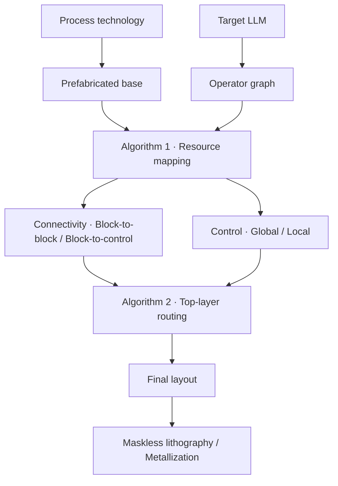

# Algorithm 2：冻结底座的 M10 接点与 M11/M12 路线联合选择

状态：实施方案，待评审。关联 [Issue #228](https://github.com/rayggxia-workspace/LLMHardwareDesign/issues/228)。

## 1. 与总体框架的关系

沿用总体图的主链路。工艺决定可预制的底座和可后制的规则，目标模型提供算子图。Algorithm 1 选择资源、生成连接关系和两级控制。Algorithm 2 完成固定底座上的物理连接，经验证的版图交给后续直写光刻与金属化流程。

Algorithm 1 交接时引用冻结底座、工艺规则和物理视图。Algorithm 2 使用 `Connectivity` 的静态逐位网，以及 `Control` 中实际需要后制的命令、完成、握手和确认信号。控制程序用于交接一致性检查和最终功能回放。搜索核心仅接收驱动端、接收端、资源和物理约束，母控到局控、同组叶宏和跨组叶宏都采用同一端点合同。实现时用任意实例名、数量、位宽、协议字段名和来源映射器做回归。

固定底座采用当前项目的 M1–M10 与 via1–via9 预制边界。Algorithm 2 只生成 M11/M12 与 via10/via11 图形。M10 过孔下包围落在已有导体内。底座摆位、驱动尺寸、供电、固定预连、选择逻辑和中继制造属于冻结前工程。Block 是控制归属，顶层以实际叶宏、局控、适配器和它们的 pin 为单位，无需组合硬框或按控制组外框禁布。Algorithm 2 内的重试只调整上层连接和已有中继的使用。未闭合时输出可追溯的失败诊断。若调用方重新映射，则以新的 Algorithm 1 交接包启动一次运行，保持框架图的步骤及职责。

## 2. 已有证据和实施起点

- **当前硬件与综合输入。** [#251](https://github.com/rayggxia-workspace/LLMHardwareDesign/pull/251) 汇总 #250 新底座，实际 P、U、C/F、J 物理视图各有对应实施源和验收范围。[#257](https://github.com/rayggxia-workspace/LLMHardwareDesign/pull/257) 是事件状态 DP 的审查分支。截至本方案起草，其本地 `task/219-event-frontier` 工作树另有待提交的 Algorithm 1 交接代码，可输出 `program.json`、`requirements.json`、`algorithm2-input.json` 和 `handoff.json`。实施复验应固定实际源码、输入和底座散列。
- **交接已到的范围。** 本地记录中的作业 102856/102860 使用真实 U0/U1 的 N→E M10 接点。36 次派发合并为 130 根静态网，故障注入后可改绑 U1 并同步重出程序和布线输入。真实 U 用例验证到接口准入，合成回归的 135 网另有几何布通记录。Qwen2.5-3B 的 36 层 B1/S2 prefill 无 KV 图在接口范围保留 1,083 次派发，产品范围仍需实际母控到局控分发端点。三项证据分开计。U 接点用例的物理视图以当次回执为准，新版 Block 到位后重新导出端点并复跑。
- **可复用实现。** [#227](https://github.com/rayggxia-workspace/LLMHardwareDesign/pull/227) 有逐位绑定合同，[#229](https://github.com/rayggxia-workspace/LLMHardwareDesign/pull/229) 有两层粗网格、多源 A*、多接收端树、拥塞重布和独立检查。保留原始输入兼容和无中继回归。旧物理后端的实际 DEF/ODB/GDS、原生不变性、RC 和 STA 检查可单独复用，版本及证据在接入时锁定。旧 [#231](https://github.com/rayggxia-workspace/LLMHardwareDesign/pull/231) 的 690 网是声明资源网表试验，其实际旧 #220 计划路径新增 0 网。
- **参考实验。** [#194](https://github.com/rayggxia-workspace/LLMHardwareDesign/blob/0381824a14eed0642eca1e759774eb168cab82b3/work/YUZE-LU/191/electrical-closure.md) 在冻结前给旧 P16 增加一个 BUF_X32，实际一条 VALID 从单段改成两段，高 RC 下该路径 setup 由 −239.1 ps 到 +33.9 ps。[#206](https://github.com/rayggxia-workspace/LLMHardwareDesign/pull/206) 验证旧 Qwen 九宏的 2,491 网几何布通，可参考走廊规划。上述结果保留各自电气和系统范围，实例名、固定分列和专用协议不进入通用搜索。

新版硬件交接优先从各实施视图登记。P 对应 `task/250-p-guard-slot-ownership`，U 对应 `task/250-u-native-n32-control`，C/F 对应 `task/250-c-block-ap64`，J 对应 `task/250-j-native-e32`。Dot 叶宏和 Attention 接入还可追到 [#253](https://github.com/rayggxia-workspace/LLMHardwareDesign/pull/253) 与 [#254](https://github.com/rayggxia-workspace/LLMHardwareDesign/issues/254)。这些是实施来源，产品清单仍需逐个绑定实际冻结交付的物理视图。

## 3. 输入、校验和输出

| 工件 | 字段和用途 |
| --- | --- |
| `algorithm2-input.json` 与交接回执 | 每条静态网的 ID、一个驱动、接收端列表、固定接收端、可选线束归属和物理约束。保留映射或 binding ID 用于诊断。核对程序、需求、底座及路由输入的版本和散列。 |
| `base.json` | 冻结的 ODB/GDS/网表及电气视图、坐标单位、真实 M10 pin 图形和原生网身份、固定连接、障碍物和上层预留。几何从实际数据库读取或导出，清单关联对象和来源。 |
| `repeaters.json` | 独立、可选的中继资源输入。每个候选有唯一实例 ID、坐标或场景变换、输入和输出端点、Liberty 或估算模型、状态 `physical` 或 `virtual`。另给用来判断物理合法性的占地、供电要求和相关视图。可以是空清单，资源格式无需绑定某个 Block 或特定底座版本。 |
| `rules.json` | 布线边界、DBU、允许层与方向、轨道、金属宽度／间距、via10/via11 切孔与包围、固定上层障碍以及 RC、时序约束的版本。 |

首版保留现有 `upper-router/1` 独立输入。现有 `requirements.json` 保留预连及绑定来源，中继清单和线束提示通过附加工件传入，适配器负责校验和转换。已有最小输入可继续使用。各清单独立维护。每次运行把实际使用的资源投影到同一坐标系并核对互不冲突、供电条件、pin 归属及层规则，记录各自散列。虚拟中继可以放在当前无中继底座的可用区域，输入其占地、供电接入假设、候选 M10 接点和表征模型。能检查的几何和资源约束照常检查，尚未取得实际物理视图的项记录为假设。底座和中继可独立表征，连接后的每级电容、驱动、耦合与时序在组合场景中计算。使用虚拟中继的结果标为研究候选，获得实际有源实现并复验后才具备生成产品版图的资格。

上游按真实协议导出宽度、位序、方向、握手和 ACK，区分已接的原生服务、外部边界和待定制网。路由器按实际信号位工作。诸如 64 B 数据通道对应 512 根数据线及独立控制线，其物理宽度由合同确定。路线长度或接入困难产生诊断，改位宽或变更协议由上游决定。

输出至少包含逻辑网到物理分段的对应表、落点／线段／过孔、中继分配、各次搜索和修复回执、实际版图与读回检查、寄生和 STA。缺端点、驱动冲突、接入与拥塞失败、超预算、负载或时序失败分别记录，携带实际网、端点、测量值、限值、对应场景及输入散列。搜索预算耗尽仅描述本次搜索。

## 4. M10 接点与 M11/M12 路线联合选择

1. 从实际 M10 导体枚举 via10 候选，核对下包围、上包围、切孔、真实网身份及障碍物。直接能上主干的落点直接加入搜索。如果合法落点避开粗网格或出口拥堵，在 pin 附近用相同的 M11/M12 两层尝试短接或换层，把可用短线和过孔一起作为接入候选。接点和路线在同一次候选搜索中选择。这段局部连接无需独立工序或新增金属层。
2. 全局保留粗轨道图和多源 A*。按端点候选少、时序预算紧和局部争用程度安排优先级。输入带线束标识时，先按位数和端点分布估算走廊与出口容量，再逐位占用真实轨道。路径允许按规则分束，位序或相邻约束来自输入。无分组提示时，逐网流程仍可运行。多接收端沿用树形布线。
3. 将候选接入段和长线的金属、切孔占用一起检查。局部细化时同网切孔间距也需显式验证。保留冲突资源与占用网的对应关系，优先拆除争用同一出口或走廊的相关网，重新选点和重布。独立检查器从实际几何复验，细化的规则和导出单位与搜索一致。

实现顺序是保留 `search.py` 的单网搜索和粗网格回归，扩展接入候选、占用和独立 `check.py`，再实现局部冲突重布。先用几何用例验证合法性，再测实际引脚密度和宽束接入率。

## 5. 中继分配与仅修改上层的修复

对每条逻辑网比较直连、经预制中继及必要时多级中继。首个可运行版本先支持直连与单中继，按可配置的候选和迭代预算扩展多级。候选来自本次清单，与中继数量、所在 Block 和放置策略解耦。用走廊可达性、线长、通孔、拥塞与估算 RC 排序，估算的负载和传播延迟指导搜索，最终电气资格由实际提取决定。中继稀缺时，将竞争同一中继或出口的网一起重新分配。

例如逻辑网 `A → B` 选中 R7 后，输出两条物理网 `A → R7.in`、`R7.out → B`。前段负载含 R7 输入电容，后段由 R7 驱动。对多接收端可只把需修复的一支交给中继，固定原生分支保持其真实连接。中继两端由器件的时序弧相连，物理验证检查两段金属各自连通、相互绝缘，且逻辑接收端与原网表一致。各段路线和实例占用一次提交，失败时整组释放。静态电气网以实例为单位独占中继通道，程序分时只有在实际共用同一个物理网时才复用该通道。组合中继维持原协议拍数，门延迟、slew、setup 和 hold 仍需验证。

布通后基于组合视图抽取实际寄生。按 cap、slew、fanout、setup、hold 的违规对象定位待修网。先尝试改变落点、轨道、分支位置或预制中继分配，再提取和校核。受影响范围包括改线的耦合邻网和关联时序路径，最终以全量复验收口。已有器件、底座位置、M1–M10 和固定时钟／电源拓扑在该阶段冻结。传统后端可以用于读回、提取、STA 和检查，自动修复只允许生成上层几何和已有资源的连接。

## 6. 实施验收与对照

| 阶段 | 输入与完成条件 |
| --- | --- |
| A · 接上新版交接 | 接收新版 `algorithm2-input.json`，校验来源和真实端点。保留旧粗网格回归。拒绝缺失 pin、多驱动、伪预连、错误 ACK 归属或版本失配。用同样代码跑改名、不同实例数、不同位宽的用例。 |
| B · 真实 M10 联合选路 | 先把已有真实 U 接点用例推进到实际 DEF/ODB/GDS 和几何读回，再以新版已验收物理视图复跑。对照粗网格与加入局部接入候选的版本。覆盖直上 M11、偏离粗网格、切孔冲突、宽束和多接收端。 |
| C · 独立中继输入和修复 | 同一冻结底座与静态网表下对照只允许直连、允许使用已有中继。先复现单网，再测实际宽数据与握手束，保持实际位宽。覆盖两个网争同一中继、重分配释放、分支中继、虚拟中继的研究回执。输出真实 RC、cap/slew 和 setup/hold 前后数据。 |
| D · 产品版图 | 同一底座用至少两份映射，再换一版物理资源清单，沿用相同的路由入口和规则机制。接齐真实母控／局控、数据和返回信号，使用同一次映射的程序回放。验证 GDS/ODB 连通、原生几何不变、上层规则、实际寄生和规定电气及时序门槛。当前 TT 300 MHz 研究 RC 资格、其他 PVT 和实际制造资格按各自证据记录。 |

独立 GDS 回读检查原生层的图形差集为零，覆盖固定预连、PG 与接点。实际中继存在于本次冻结基准时一并纳入检查。输出上层图形、实际合成版图、DEF/ODB、最终网表、SPEF/SDC、验证回执和输入/输出散列。在声明的物理与功能范围内全部通过后才标为 `Final layout`。合成回归、接口回归、虚拟中继研究、真实网物理验收和整产品验收分别记录。

对照统一报告布通率、接点失败类型、拥塞位置、线长、via10/via11 数、实际中继通道占用、负载与时序违规、最差 setup/hold、运行时间和重布次数。DAC 实验可在同一冻结基准上分别关闭局部接入搜索和中继分配，测量各自对物理闭合的作用。中继预制面积和不同底座的资源预算另作为底座设计变量报告。
