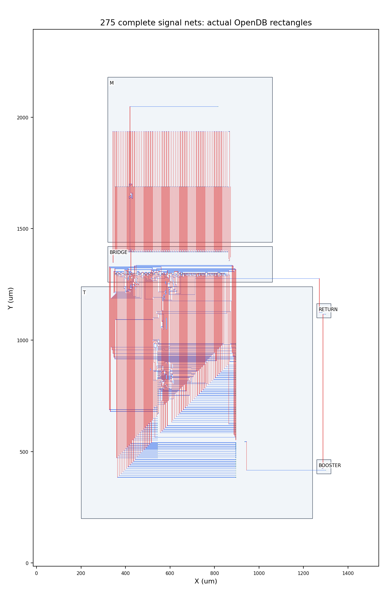
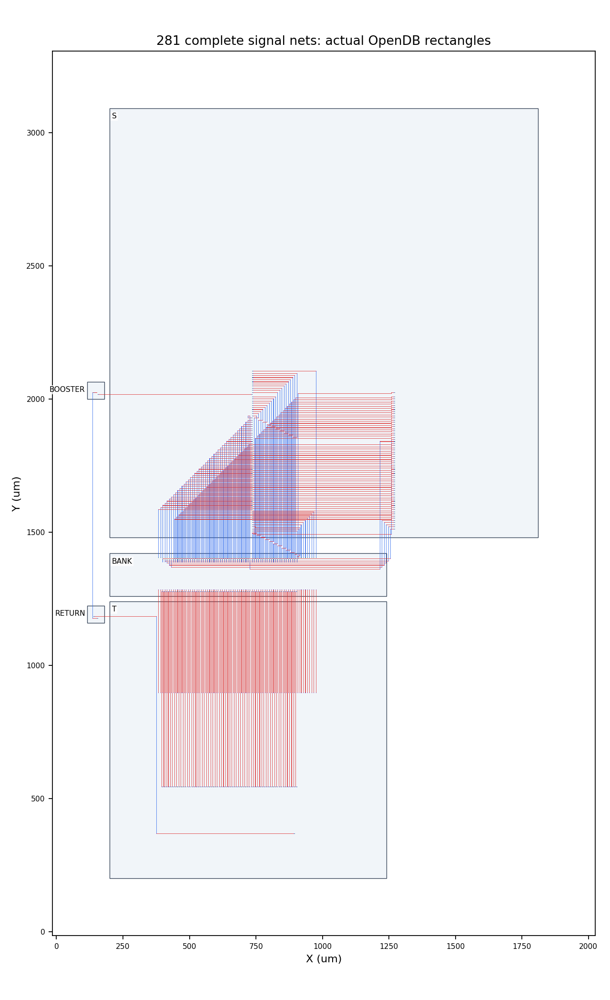

# M/S/T全宽互联与原生输出驱动修复实验

Refs #121，更新现有[PR #133](https://github.com/rayggxia-workspace/LLMHardwareDesign/pull/133)。独立侧线，只修改实验副本，不替换主线交付。

**本轮实验已完成：M/T/S选定接口增强驱动副本通过完整原生验收，M→T的275根及T→S的281根全宽链路在三种声明RC条件下全部通过。** 完成时间：2026-10-29 23:57 CST。

## 本轮要解决的问题

此前报告已完成有限测量，却停在了“弱驱动至外置缓冲距离过长、完整275/281根未布通”。本轮直接修复这两个问题；代表17/15根的资格不转移到全宽设计。

1. 实查原生最终ODB和继承GRT中的端口驱动：M132、T140、S1，共273个选定驱动，均为BUF_X4。
2. 在继承GRT的独立副本中将这些真实实例换为BUF_X16；重新连接PG、保护实例、合法化、增量全局布线，再新做详细布线、填充、finish与RCX。原始综合/布局/CTS被继承，不能声称本轮重新执行了这些阶段。
3. 每份新最终源重新验收：300MHz原预算及50fF原生输出条件、全有效端点setup/hold、C/slew、PG、M10精确pin合同、原生完整DRC、未修改FreePDK45 GDS全规则与严格最终LEC。50fF下通过仍不能代替实际跨宏负载通过。
4. 使用完整275/281根数据、索引及控制/ready连接，分别验证实际M11/M12几何与真实原生寄生下的链路时序。共同理想时钟根、外部阶段控制与研究RC情景仍是边界。

## 源码与物理边界

原生产M/S/T不可变。最终修复源为run928的`linkfix-native-m/t`及run940的`linkfix-s-finish`；M由run930、T由run932独立接收，S由run940四个独立门及`linkfix-s-combine`接收。S的两处同网M2修补之后重新fill/finish/RCX。每份最终Verilog/SDC/DEF/ODB/SPEF、独立原生GDS及实际接口LEF都在结果索引中绑定路径和完整SHA。

新增线路只在M11/M12；M10新增landing必须完全落在原2×2µm pad内。固定宏内部的有源修复属于预制M1–M10副本，不能把BUF新增到定制金属上。额外bridge/bank/booster仍是原已验收的固定有源宏，面积与实例占地继续计价。

M全宽采用重新摆放及OpenROAD详细布线结果mf4。T/S通道试验预留未来接点的实际接入线段，分别比较原H/V偏好与适合水平bank端口至竖直S端口的正交通道。后者含逆首选方向线段；金属DIRECTION是偏好，宽度/间距/cut间距/M10归属并未放宽。显式通道生成的DEF重新读入真实OpenDB，再由独立KLayout检查全部连接、短路、线宽、间距、通孔包围及M10所有权；不称其为TritonRoute自动布线结果。

最终tf9利用139根T→bank信号X坐标一一对齐这一事实：两组源/目的Y行分别固定，给交叠行对分配原X或X−4µm的M12直通轨道，避免先布的线包围后续接点。其余139根bank→S及3根ready线才使用预留接入通道的正交搜索；新的换层点按棋盘网格安排，避免相邻via11 cut间距失败。全部281根在第一个完整候选中布通；不是把失败总线缩成代表子集。

实际上层几何图（蓝M11、红M12，保留真实坐标与几何SHA，宏内部省略）：

## 电容估算的历史澄清

早期手算为C′=ε0εr(w/h+2t/s)。w=t=s=2µm、h=0.8µm、εr=3.9，得0.155390996fF/µm；568µm为88.2621fF，high人为乘1.5后才是132.3931fF。2t/s是两侧壁平行板近似，不是已求解的边缘场；还假定下方连续平面和两侧固定电位邻线，不是工艺提取值或最大负载证明。

本轮链路沿实际DEF线段/via建立RC图，保留原生完整ground/coupling C和R；使用此前三维coupon构造的grounded/opposite/guarded情景，不再用上述手算值作为最终依据。20%裕量与via预算仍是研究假设，不是制造签核或任意布局的已证明上界。

## 调度及失败记录

所有run源码与输入不可变；失败尝试不覆盖。925的完整MF1/MF2实际详细布线通过，TF1/TF2未收敛；926的原生修复因只读流程目录中的相对日志路径失败，未获资格；927未分配。928完成三份原生修复和MF4完整几何，原生接收遗漏了同父目录约束控制依赖，三项接收按失败保留。

929/930曾借用93339内两组16CPU，具有互斥CPU、内存和依赖宽度检查；但外部cohost不在父batch的生命周期依赖中，父batch结束会终止未完成cohost。M独立已关闭回执有效，T/S未完成不授予资格。该长任务入口已删除；T/S完整验收在932普通共享dispatcher中重新接收。没有因耗时或失败而取消主线任务，也不继承被终止工作的资格。

934/935只在已核验空闲CPU中执行有限短步骤：父队列剩余最大依赖宽度≤4且实际计算线程均在前64核，子步骤硬限定第65–80核或65–96核；内存同时检查预测保留、live RSS×1.2及16GiB guard。935最多两个独立16核电气任务，即完即补第三个，不整批等待。父batch不为它们延寿，因此只接受完全关闭且SHA绑定的子回执；任何中断必须换目录重试。完整原生验收仍是普通dispatcher的独立最终门，不由这些短步骤授予。

935先导出诊断I/O视图与原生验收并行，其S928后来因原生DRC失败而不合格。最终采用940的TQ3完整重测；I/O视图本身仍不授予DRC/PG/STA/LEC资格，最终汇总逐项关联相同source receipt的独立完整验收。CPU并发受实际依赖宽度和内存限制。

最后三个独立功能门的就绪宽度只有3：936最初按普通96CPU节点排队，实查整96核无空闲、48–88核碎片存在。在任何任务claim之前核验并hold/cancel本人的93413/PENDING，再以937新不可变源申请48CPU，保持3×16和M16/T24/S128GiB预测不变，普通6×16调度器未修改。93425实际在node22启动，三任务同时执行；后续线程实查中T23个线程、S53个线程均限制在各自互斥16CPU集合，M已自然完成。`functional-affinity.json`保存原始读回。减少的是没有第四项独立工作可用的CPU申请，并未降低三个任务的并发度。

940的S流程内LEC实测RSS为122.294GiB，说明原finish/strict门48GiB预测低估；原始不可变队列保留，不改写历史预算，详见`native-memory-observation.json`。该时刻finish独立运行，实际内存与CPU均在本节点资源内；后续S finish/严格LEC及功能视图重任务按128GiB、其他门按32GiB作为更合适的预测起点。即使两项128GiB与四项32GiB同时执行，乘1.2并加16GiB guard为476.8GiB，小于该节点503.543GiB，无须因此降低六槽并发。最后的process-tree峰值和就绪依赖记录仍以关闭回执为准。

931/932通道的有限失败及全部原始回执保留。933的旧tf7/tf8尚未领取，在替代tf9完整规划已成功后，核验job93373的本人/任务名/PENDING身份，再hold并再次核对身份后取消这一项未执行的旧候选；原因是方案被替代，不是耗时。未取消任何运行中的主线EDA。

932的S全未修改GDS规则检查虽为零项，原生整片DRC仍有3条M2间距违规，候选不合格，93369自然FAILED/1:0。938借用93425空闲16CPU只完成修补前检查，父任务正常结束后step被终止，无关闭回执和修补后资格。939同一OpenROAD进程中修改后检查仍报告旧3项，按失败保留；940改由全新进程加载已保存patched.odb后原生整片DRC为0。939/940的patched.odb SHA相同，修补只向words[674][3]及words[232][62]追加两处精确RECT，其他DEF字节完全一致；不删规则、不放宽间距。940在同一普通队列生命周期重新fill/finish/RCX、独立四门验收并重测完整TS。

## 实际结果

两个完整总线的六项复测全部执行并通过；每项setup、hold、capacitance、slew、fanout违规均为0，实际连接寄生覆盖和原生R/C保持检查均通过。最终TS使用940修补后新提取的S寄生，935的旧TS结果保留为历史，不替代此验收。

| 完整总线 | RC条件 | 最小链路setup ns | 最小链路hold ns |
| --- | --- | ---: | ---: |
| M→bridge→T，275根 | grounded | +0.806589 | +0.194295 |
| M→bridge→T，275根 | opposite | +0.751833 | +0.225451 |
| M→bridge→T，275根 | guarded | +0.729773 | +0.238665 |
| T→bank→S，281根 | grounded | +0.373397 | +0.572308 |
| T→bank→S，281根 | opposite | +0.297243 | +0.613259 |
| T→bank→S，281根 | guarded | +0.266221 | +0.629279 |

| 修复副本 | BUF_X4→X16 | 外框µm | 有源单元面积µm² | 单宏setup/hold ns | 原生DRC/完整GDS DRC/严格LEC |
| --- | ---: | --- | ---: | --- | --- |
| M | 132 | 740×740 | 223342.644 | +0.009080 / +0.013637 | 全部通过，两个DRC均0项 |
| T | 140 | 1040×1040 | 431915.106 | +0.429431 / +0.008062 | 全部通过，两个DRC均0项 |
| S | 1 | 1610×1610 | 1068587.436 | +0.682665 / +0.012231 | 全部通过，两个DRC均0项 |

S16KiB与T6KiB均为标准单元存储；本轮没有改变逻辑容量、RTL数值定义或接口协议。

三个宏的有源面积共增加1307.124µm²，外框和原M10接点保持。基线回执与SHA见`baseline-area.json`；这仅是宏内增强驱动增量，额外预制bridge/bank/booster/return仍完整计入下表。

| 布局 | 实际宏占地合计mm² | 布线路径外框mm² | 信号段数 |
| --- | ---: | ---: | ---: |
| MQ1 | 1.755792 | 3.627120 | 275 |
| TQ3 | 3.848292 | 6.612900 | 281 |

275根按实例对为M→bridge 132、bridge→M 1、bridge→T 139及返回3段；281根为T→bank 139、bank→S 139及返回3段。汇总器强制`representative_subset=false`且原始完整宽度相等。M采用真实详细布线，TS采用实际OpenDB通道布线，两者都重新接受独立几何检查。

TS最长返回线为1572µm，6个新增via；guarded情景新增线路/转接C为913.409989fF。测量同时保留原生负载和寄生，线路C不是总驱动负载。

M/T/S的实际最终信号网表各三初态通过：M每初态319932检查/298097拍，T每初态2839953断言/224032拍，S每初态98424检查并覆盖1024地址与4096连续读字。S940完整信号视图与937已仿真网表逐字节相同，同时核对库、bench及三份仿真日志SHA才复用功能结果；其几何、RC、STA及DRC全部重验。此前协议组合是M/T/S RTL＋bridge最终门级15例×三初态，保留该准确边界，不称为三宏全部最终网表的组合仿真。

最终文件入口为[repair-results.json](../../work/YUZE-LU/121/interconnect-fix-20261029/repair-results.json)，含每个宏六份原生交付文件、接口LEF、源及验收回执。工具原始`6_final.sdc`的3.3333ns舍入版保留供审计；组合与验收使用索引`accepted_sdc`指向的原批准`input.sdc`，其300MHz精确周期和其余预算未放宽。

## 验证、资源与接收边界

- 18项本地测试、项目管理结构、差异格式及报告链接检查通过；结构检查不代替EDA验收。
- 最终证据包612份成员、3319546字节，逐成员SHA核验并重开归档比对；大ODB、GDS、原始SPEF继续留在授权服务器，原SHA和路径完整保留。
- 最后普通队列实测峰值6个任务、CPU上限合计96，每项硬限制16CPU，即完即补；功能尾部只有三项独立工作时采用48CPU的3×16。
- 源/资源最终审计覆盖925–940全部16个不可变run，含失败、中断和未执行候选；本侧线allocation全部结束，原生产18文件逐一SHA未变。

本轮证明的是所列M→T、T→S两个固定摆放及选定驱动端口在声明研究RC条件下的可组合性。M132/T140/S ready 1个驱动被实际增强；S读数据输出等其他方向由后续角色接口验证决定。M11/M12仍只有导线和通孔，有源驱动和中继均在预制M1–M10宏内。研究模型包括理想共同时钟根及外部阶段控制；没有完整共同CTS、顶层PG/控制器、动态SI或foundry十二层RCX/制造资格。前后同时改变驱动及摆放/通道，不能把全部收益单独归因于某一项。

复现与证据展开见[README](../../work/YUZE-LU/121/interconnect-fix-20261029/README.md)。优先从资源审计指定的当次`source.tar`恢复实际执行代码，不能把发布文档head假定为所有历史run的执行源。登记pending（management-hub PR5未合并），看板unverified/同步pending（缺board.json），独立审查人待指定；Refs #121，本侧线不替代主线五宏整体验收。
