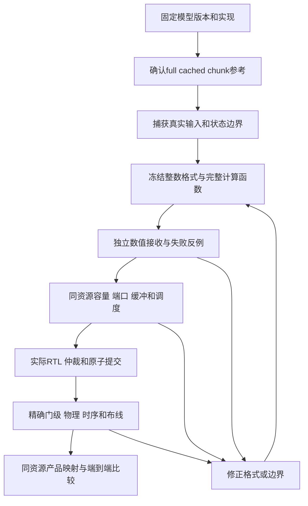

# 01｜先把研究问题拆开：从一个数到一块电路

## 1. 输入是什么，芯片究竟要做什么

给语言模型一句话，分词器先把文字变成 token ID，例如一串整数。模型把每个 ID 查表变成一个向量，随后逐层执行投影、注意力或递推、残差和前馈网络。输出是下一 token 的一组分数。这里的“向量”可以先理解成一排数字，“矩阵”是一张数字表，矩阵乘就是按行列配对相乘再相加。

例如，一个输入向量为 `[2, -1]`，一行权重为 `[3, 4]`，点积输出是 `2×3+(-1)×4=2`。模型实际会做数千维的点积，并且同时计算很多输出。矩阵单元擅长这类重复乘加，但模型还需要求最大值、平方和、指数、倒数、开方、查表、移动数据和管理状态。**有矩阵乘法器，并不意味着具备执行完整模型的所有能力。**

本项目推理优先，区分两个阶段：

- **prefill**：一次接收一段已有 token，很多投影可以批量计算，注意力要满足因果关系。
- **decode**：每次新增一个 token，必须复用之前的 KV 或递推状态，再产生新的状态。下一步不能提前使用未来 token。

同一个模型在这两个阶段的算子名字相似，资源使用却不同。prefill 更容易组成较大的矩阵；decode 可能一边读大量旧 KV，一边只产生一行新数据。因此，一个产品通常要用同一套制造后的硬件支持两者，不能在阶段切换时免费重新接金属线。

## 2. 算子划分与 Block 划分分别决定什么

**算子划分**决定计算图中有哪些可以单独说明数学语义的步骤。例如 `Linear → RQ → SiLU → Multiply → Quantize`。RQ 是把一个整数单位转换到另一个单位；Quantize 是按规则把数编码成低位整数。这些步骤即使在软件中融合为一次调用，分析时也要知道它们在哪里舍入、检查范围和产生 scale。

**逻辑功能域**决定谁对某一组语义负责。本报告沿用 M/V/A/R/S/D。M 负责矩阵与完整归约，R 负责连续状态及其发布。逻辑责任不必对应独立硬宏；两个控制器可以共享一个乘法器，仍分别承担不同的正确性责任。

**物理 Block**决定制造时哪些晶体管、存储端口、局部导线、供电、时钟和引脚一起做成固定资源。两个逻辑域做进同一物理块，可能减少外部端点，也可能增加内部仲裁、拥塞、长线或时钟负载。是否值得，必须用同一精度、同一库存和可实现时序比较。

以八个专家的输出合并为例：

1. M 算出一个专家的完整点积。
2. RQ 将结果变到约定的共同单位。
3. 乘以该专家的路由权重。
4. 八路前缀和保留足够宽度，最后舍入一次。

这些语义必须明确。但 RQ/merge 可以候选地放在 M 附近，也可以用共享 V 服务。不能因为图上连续，就跳过容量和端口证明直接合成一个宏。

## 3. 三个时间尺度不能混在一起

| 时间尺度 | 举例 | 改变它需要什么 |
| --- | --- | --- |
| 制造前固定 | 8个S8乘法 lane、单口16KiB存储、32位乘法器、可达引脚 | 改 RTL、工艺/宏及物理实现，重新计面积时序 |
| 产品确定后的定制 | 允许的高层金属/通孔连接，哪个Block接哪份存储 | 满足冻结底座、可达端点、合法层和布线规则 |
| 运行时控制 | 选择expert、发命令、切换owner、读KV、改变合法地址 | 已存在的mux/队列/控制器和协议；这些资源本身付费 |

例如，RTL里有一个选择器，能让 M 和 R 分时使用同一个乘法器，这是运行时复用。它并没有证明只改 M9/M10 金属就能实现任意产品互联。相反，产品金属连好了，也不会凭空增加 INT16 乘法器或多一个 SRAM 读口。

## 4. 数据不是“过一条边”就结束：还要追踪状态

对每个数据对象，至少问六件事：谁产生它，谁读取它，格式是什么，什么时候变有效，什么时候可以释放，失败时谁恢复它。

以 KV 为例，当前 token 的 K/V 产生后，要先检查格式和位置，再追加到对应 head 的缓存。以后许多 query 会读取它。若新 token 使用了不同 scale，却不通知消费者，旧码值就会被误解释。若所有 query 都复制一份 KV，容量和写入负担都会增加；若只存一份，就要说明如何广播或重读，以及共享端口是否拥堵。[S47](10-evidence-index.md#s47)

以 R 状态为例，当前状态表示之前所有 token 的累积结果。更新到一半发生范围失败，不能让下一步读到半旧半新的矩阵。候选设计通常使用旧状态、私有试算和一次提交点。暂存和备份需要容量，重试需要周期，发布需要明确 ACK 语义。[S99](10-evidence-index.md#s99)

因此，我们真正要划分的基本单位是：**计算事务＋它必须拥有的状态＋有限资源上的读写和提交义务**。仅用“矩阵/向量/存储”三个颜色标算子图还不够。

## 5. 研究怎样从粗分析走到电路

每一步排除的错误不同：

1. 参考一致性排除错误 cache 位置、错误历史和后端差异。
2. 整数参考排除舍入顺序、scale 单位、溢出及非线性定义不清。
3. 有限服务排除无限缓存、零成本元数据、同时占用同一个端口。
4. RTL 排除只在 Python 中成立、实际握手却丢响应或半途发布的问题。
5. 物理实现排除面积放不下、驱动带不动、setup/hold失败或无法合法布线。

后一步通过不会追溯改变前一步失败。例如 Granite 的一个冻结整数函数可以逐码执行正确，但它对浮点模型的误差仍然保留；不能用 RTL PASS 宣称原生路由质量已经解决。

## 6. 什么叫公平比较

设方案A把 RQ 放近 M，方案B把 RQ 放在共享 V。要比较位置，至少固定：输入、权重、位宽、scale、舍入/饱和顺序、K 归约范围、乘法器总数、存储容量/端口、FIFO、链路宽度、允许的调度策略和输出消费者。

若A新增一个宽乘法器，B没有，测到的差距包含资源变化。若A允许两窗口流水，B被迫串行，差距包含调度不公平。若A每组先舍入，B最后只舍入一次，两者甚至不是相同函数。若把B的通信都放在关键路径、A却允许重叠，位置收益也会被放大。

项目早期有一个很好的反例：同一 attention 服务，固定单策略时状态放置差距约14.39%，双方都用相同四策略择优后只剩3.37%。这没有证明最终最优，但说明优化基线本身会显著改变解释。[S27](10-evidence-index.md#s27)

另外必须做“只改标签”的零效应对照：如果资源、连接、事件和时序完全一样，只把 split 改名为 joined，结果应当不变。项目在多阶段保留这类对照，防止把命名当收益。[S64](10-evidence-index.md#s64) [S74](10-evidence-index.md#s74)

## 7. 数值更好、字节更少、周期更短、芯片更好是四个问题

输入量化误差更小，可能让更多组使用独立 scale，需要更多元数据和对齐。传输有效数据更少，可能因包头和对齐一拍也没省。周期更少，可能因为组合路径更长而使时钟变慢。面积更小，可能增加服务争用或重读。

手算一个纯示意：A需要100周期、每周期1ns，总100ns；B需要80周期、每周期1.4ns，总112ns。只比较周期会选错。项目实际归一化实验同样发现：专用SFU显著减少norm周期，但完整消费者减少幅度小得多，逻辑面积又增加，因此不能直接固定最展开的版本。[S82](10-evidence-index.md#s82)

本报告始终写明指标的分母：一行、一个head、一个切口、整个命令、软件条件图或实际研究物理核。它们不能随意乘层数，变成整模型结果。

## 8. 为什么保留失败和被修正的判断

失败告诉我们哪些边界具有硬约束。Llama 的静态 scale 反例阻止了“所有投影共用统一A8量化”的过早冻结。Falcon/Qwen的状态饱和阻止了“换成S32就够了”的简化。Granite的生命周期修订则提醒我们：把所有对象大小静态相加，也会错误排除本来可行的方案。

因此，本报告会分别标明参考失败、数值候选失败、工具/夹具失败和权限/数据阻塞。工具超时不自动证明 RTL 错，作业退出0也不自动证明每个数值条件通过。每一种失败都应有准确的恢复入口，而不是从表里删掉。

## 9. 手算一次注意力：为什么QK、概率和PV是三个不同边界

下面是教学数例，省略模型投影/norm/RoPE，并令score缩放为1，方便手算；真实模型通常还除以head维度平方根。

输入query `Q=[1,0]`，两个key为 `K0=[1,0]、K1=[0,1]`，value为 `V0=[2,0]、V1=[0,4]`。假设当前位置是第二个token，两key都合法。

1. QK点积分别是1和0，输出score `[1,0]`。这是完整head维度归约，不能少算一半再当最终score。
2. 为数值稳定，减去最大值1，得到 `[0,-1]`。exp后是 `[1,0.367879…]`，总和约1.367879。
3. 各除以总和，概率约 `[0.731059,0.268941]`。这是softmax，不是另一个矩阵乘。
4. PV加权输出 `0.731059×[2,0]+0.268941×[0,4]≈[1.4621,1.0758]`。

若当前位置其实是第一个token，第二个key属于未来，mask必须把它排除，概率变成 `[1,0]`，输出 `[2,0]`。所以query位置、有效长度和mask是数学输入；它们不是可以随意丢掉的控制附件。

量化时Q/K的小误差会改变score，exp/div近似会改变概率，V量化又会改变最终加权。QK正确不代表softmax正确，概率码和V格式分别决定PV宽度。当前A电路的实际阶段正是把这些责任逐个落实，而非假设“注意力是一条INT8矩阵指令”。

## 10. 手算一次FFN与norm：为什么要读完整一行

先看一个只有一维隐藏量的教学FFN：输入x=2，gate投影得到3，up投影得到2。SiLU(3)=3/(1+exp(-3))≈2.857722；门乘MID约5.715445；假设down权重1/4，输出约1.428861；加原残差2，得到3.428861。真实FFN会有数千个MID共同参与down点积，A8的scale就决定这些MID能否被保存。

再单独看二维RMSNorm教学例，X=[3,4]，gamma=[1,2]，为简算令epsilon=0（真实合同有非零epsilon）：

- 先平方，得到[9,16]，总和25，除元素数2得到均方12.5。
- 开方约3.535534，得到同一整行分母。
- 输出为 `[3/3.535534×1,4/3.535534×2]≈[0.848528,2.262742]`。

如果把两个元素当两个独立tile各算一个分母，输出会成为[1,2]，已经换了函数。合法流式做法可以先扫全部X统计，再一段段读取X/gamma输出；**分块搬运可以，完整统计不能删。** 这正是流式gamma实验保留全H屏障的原因。

## 11. 手算一次R：状态、输出和发布为什么不同

先用一个简化衰减更新说明持续状态：旧S=[1,2]，alpha=0.5，当前注入=[0.25,-0.5]，新S=[0.75,0.5]；若readout系数C=[2,-1]，输出是1。下一token必须从这个新S继续，不能重新用[0,0]。

GDN还包含prediction/correction。用K2、V1的教学矩阵列S=[1,2]，decay=0.5，k=[1,0]，目标value=2，beta=0.25：

1. decay后S变[0.5,1]。
2. 完整K prediction为k与该state点积，即0.5。
3. residual=2−0.5=1.5，correction=0.25×1.5=0.375。
4. outer更新k×correction=[0.375,0]，新S=[0.875,1]。
5. 若q=[1,1]，readout为1.875。

这是解释数据依赖的实数玩具例，省略真实归一化、整数单位、舍入与guard，不是Qwen实际模型测量。它说明state不仅是一个保存结果的数组，还参与当前完整prediction和后继输出。若第4步才发现范围失败，必须能恢复旧合法S再试。

新S算完也可能只是私有candidate。假设消费者最后拒绝，已发布指针仍应指向旧S；只有规定的accept和root ACK之后才让下一步看到新代。这就是“计算完成”和“状态发布”分开的原因。

## 12. 手算一次MoE：为什么router变化可能突然放大

用三个专家选两个的教学例，router logits为[3,2,0]，选择ID0/1。假设本例在所选集合归一化，gate约[0.731059,0.268941]，两个专家输出为2和−1，merge约1.1932。真实Granite有40选8、向量输出和固定整数gate合同，规模与格式完全不同。

连续误差改变一个logit时，输出不一定连续平滑：若第二、第三名原来只差极小量，排序反转会直接换专家权重和输出。这个选择还改变要读哪一份权重、哪个队列接请求、merge等待哪几路。

因此必须分别检查：当前hidden是什么；量化router对同hidden选什么；专家计算误差；gate单位；所有选路是否齐全。只固定原生ID测专家不能验证路由；只看最后选集相同也可能遗漏误差抵消。

## 13. 读后续电路表时需要的几个词

| 词 | 实际意思与例子 |
| --- | --- |
| shape | 数据各维大小，如[32,128]表示32行、每行128数；它不自动说明内存排布 |
| layout | 数在存储中的先后位置；转置/pack通常需要实际读写，不能只改shape标签 |
| bank/端口 | bank是一份存储；单1RW每次读或写，不能同拍给两个消费者免费各一次 |
| register/holder | 有限寄存器；holder保存已返回但消费者暂时没取走的结果，也要计位数 |
| latency/II | latency是一次输入到结果的等待；II是两次新输入最小间隔，流水单元可不同 |
| ready/valid/ACK | valid表示有数据，ready/take表示愿接，双方同拍满足才算接受；ACK确认已接受操作的约定效果 |
| backpressure | 下游暂时不能接，例如FIFO已满；上游必须保持数据或等待，不能覆盖尚未消费结果 |
| FIFO/credit | 有限队列和可用槽信用；2KiB FIFO不允许先读8KiB再假设都存得下 |
| owner/lease | 谁在这段命令生命周期内占用资源；未排空响应不能换成另一个owner |
| position/version/epoch | 位置、提交代际、格式或传输代号；它们可关联但不可随意合成一个计数器 |
| oracle/receiver | 独立数学参照与接收检查；应能在坏结果重算SHA后仍发现数值/语义错误 |
| cut | 明确实验切口：输入从哪里开始，输出到哪里结束；切口外计算不能算已验证 |
| RTL/gate/STA | 寄存器传输实现、映射标准单元功能、静态时序分析；三者解决不同问题 |
| LUT/ROM | LUT是索引到数值的表；ROM是实现只读存储的一种资源。表有多少字节与同时能读几个值分别计 |
| SFU | 处理除法、开方等特殊计算的服务单元；要说明算法、迭代、合法输入和返回错误，不是万能算术盒 |
| SRAM/scratch/backing | SRAM是存储实现；scratch是当前任务临时工作区；backing承载更大或持久对象，不能因都叫存储就混算 |
| synthesis/mapping | 把RTL运算和状态转换成逻辑，再映射到库标准单元；通过后仍需实际放置和连接 |
| CTS | 时钟树综合：用真实缓冲分发时钟，改变面积、负载和到达时刻，可能引入hold问题 |
| RCX/SPEF | RCX从当前布局布线提取电阻电容；SPEF保存这些寄生。不同阶段的估计和实际提取不能混用 |
| PG | power/ground供电接地网络；信号连通正确不代表VDD/VSS合法、完整或无短路 |
| PVT | 工艺、供电电压、温度角；一个典型角通过不代表其他温度/电压都通过 |
| DRC/LVS | DRC查版图规则；LVS核版图提取连接与网表。零DRC不等于功能或时序正确 |
| PPA | 性能、功耗、面积；本项目多阶段只取得其中部分，没测功耗就保持未测 |
| SAT | 对声明的有限位向量性质求反例；无反例只证明该性质和输入域，不自动证明整机所有行为 |

## 14. 误差指标怎样读才不误会

maxabs是最大单元素绝对误差。relative L2通常是误差向量长度除以参考向量长度；相同元素数下，常见relative RMSE写法与此等价，但要核原脚本分母和零参考处理。

教学例：参考[100,1]、结果[100,0]，整体相对L2约1%，但第二个元素信息全丢了。再小的整体误差也不能自动证明每个状态码无饱和，或路由/语言任务质量可接受。

所以表里同时列误差、clip/sat/overflow、路由集合、提交数、状态连续性和质量门。它们不是重复指标，各自会发现另一项看不见的问题。后续遇到“PASS”，先问是哪一种PASS，再读其输入范围和未覆盖项。
