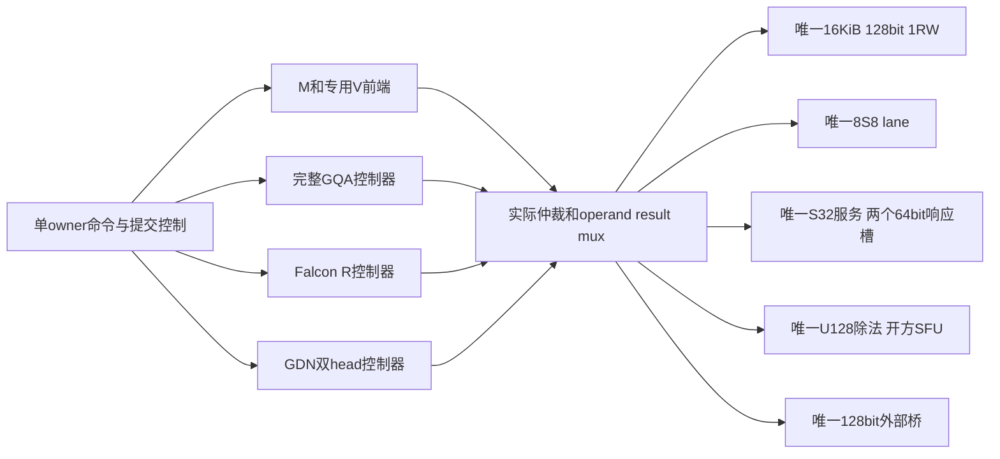

# 06｜具体划分候选：计算、状态、接口和预连线

本章给出能够继续实施的候选方案，依据是前几章真实反例、完整整数合同和后续电路。**M/V/A/R/S/D是六类逻辑责任，不预设必须制造六个独立硬宏。** 已可确定的是不能省略的计算/状态边界；最终宏的形状、数量、相邻关系和金属定制拓扑仍须物理与产品比较。

主要来源：[S41](10-evidence-index.md#s41)、[SV2](10-evidence-index.md#sv2)、[SC2](10-evidence-index.md#sc2)、[S109](10-evidence-index.md#s109)。

## 1. 先把所有工作负载写成明确计算图

普通注意力模型的一段可以写成：

```text
hidden → 全行norm → Q/K/V投影 → Q/K norm(模型需要时) → RoPE
       → KV格式转换/追加/发布 → 完整GQA的QK → mask/max/exp/sum/P
       → PV完整归约 → 输出格式/投影 → residual
       → norm → gate/up → 非线性×门 → 整K范围/量化
       → down完整K → 对齐/RQ → residual → 后继norm
```

Qwen3.5还需卷积history、GDN旧state→新state/输出；Falcon有Attention与R分支、最后同token汇合；Granite把FFN替换成router→top-k→dispatch→各专家→merge。量化、格式转换、舍入/饱和、metadata和完成事件都是图中的实际节点，不能只画GEMM和激活。

每条边至少说明：数据shape/布局、位宽和单位、owner/context、生产者完成条件、消费者读完条件、物理包/路径、持久或临时属性。不适用的字段可以明确N/A，未知的字段保持待定，不能默认为免费。

## 2. 六类逻辑域总表

| 域 | 必须完成的计算/操作 | 拥有的状态 | 接口输出的关键内容 |
| --- | --- | --- | --- |
| M：矩阵/归约 | S8 MAC、同单位部分和、完整K、可选宽对齐/RQ | 当前tile、acc、K进度、A/W单位引用 | typed partial或complete；目的坐标、K范围、单位及结果格式 |
| V：向量/非线性/宽辅助 | 加乘、广播、norm、SiLU/GELU候选、量化、top-k/merge等有界服务 | 行统计、LUT/参数引用、临时frame、delta有效域 | 输出码＋scale/版本、完整行barrier、错误和完成 |
| A：注意力控制 | GQA关联、合法key遍历、score/max/exp/Psum、PV顺序 | KV profile、有效前缀、head/窗口、概率统计与输出反馈 | 完整组输出及单位，KV版本/长度、概率合法性 |
| R：递推控制 | 模型特定状态更新、完整headguard、重标重试、readout | history、旧态/私有态、unit/epoch、版本/位置/发布root | candidate state/Y描述符、accept/reject/commit-drain |
| S：存储服务 | 明确bank/端口/地址/读改写和有限响应 | 真正存储位、响应holder、owner/lease | req/ready、valid/take；实际读写ACK和错误 |
| D：命令/搬运/同步 | 命令锁存、owner切换、路径选择、packet、背压/排空 | transport generation、在途事务、credit、done/error | 显式cmd_accept、provisional结果、完成/取消和同步 |

V列的是逻辑需求，不表示当前一个通用V ISA已经全部实现。A/R控制器可以调用同一M/S32/SFU；S的“归属”不能变成每画一个框就多一块存储。

## 3. M边界：为什么先保完整归约

输入是A8/W8、维度、布局、单位及输出坐标。M读A/W tile，执行真实乘加并检查INT32前缀。完整K未结束时只可输出声明partial；结束后才执行该合同允许的最终RQ，或将complete宽结果交给共享服务。

同单位INT32反馈应作为优先固定的局部连接：乘法lane→加法/acc→下一K片。原因不是“矩阵通常融合”，而是Llama等真实输入证明提前RQ会改变函数，跨块传partial又增加位宽/同步。

混合单位时，组内INT32和组间对齐是两步。对齐可以候选地近M或共享V，必须保足够宽和guard。当前证据支持**保留ACC宽旁路以及ACT8/16等可选输出能力**，不支持所有产品必须经过同一个不可绕过近端RQ。

当前实际M电路只是一组8S8、固定K512/8专家/H1536的有界消费者，不是全部候选16×16阵列，也不是通用GEMM资格。将来扩K/N/尾块、并发累加或矩阵批处理都需再验。[S97](10-evidence-index.md#s97)

## 4. V边界：完整统计与窄码生成应连在同一责任链

以SiLU/gate-up为例，输入为S32Q12 gate和up。当前有界V前端查SiLU表、做共享S32乘法和RNE12，得到完整512个MID；扫描全512范围后选最小合法delta，再重读MID生成A8。最后一次A写ACK后才发布delta/valid，所有专家完成后发布A的owner/version/epoch。

为什么不是每16B传输块单独定标？因为那会改变A8的组粒度，M端RQ必须接收更多单位，并重新证明整个整数函数。传输tile和数学量化组是不同概念。[S97](10-evidence-index.md#s97)

以RMSNorm为例，输入完整H的X、gamma和epsilon。必须先完成所有X平方和，形成单一分母，再逐块生成输出。gamma可以流式，每次只装256元素；完整统计与原位输出控制不能按gamma tile各自独立归一化。H2560的实际布局说明保留X、流式gamma比盲目分块X更合适，但这不是所有H的通用最优。

值得预连的候选是有限frame/RMW反馈、宽乘响应、guard/RNE、统计累加与SFU请求返回。不同非线性需要真实LUT/域/插值合同；目前SiLU证明不覆盖Gemma GELU。SFU目前也不是任意操作码都合法的通用算术单元。

## 5. A边界：保留GQA共享与概率不变量

输入为post-RoPE Q、已提交K/V前缀、scale、query位置、window和owner/version。输出为完整GQA组的PV码及单位，后继output projection另接。

当前A102采用Q8、KV16、P15，三个K limb和九个PV基础乘积，三遍materialized score。制造前候选应保留：

- head关联与合法前缀遍历；未来key不读取。
- 完整d的QK和guard，以及max/sum/Psum到PV完整归约的关系。
- 明确有限score/P/tile/output存储与请求返回。
- KV同一版本下地址、单位和长度单调合同。

必须区分KV物理存放与A控制责任。KV可以在S/backing，A负责如何正确读取。若产品选局部窗口、广播或多个attention引擎，具体bank与端口可变，但不能丢失版本/释放条件。

当前RTL没有KV append/淘汰、online softmax、投影/RoPE。若改成online算法，O反馈的单位/重标和误差是新合同，不能借materialized P15的真值和界直接接受。[S102](10-evidence-index.md#s102)

## 6. R边界：全head数值域和提交域

输入包含当前token的系数、合法旧state/root、context、position、version、units和numeric_epoch。输出先是candidate，不是立即可见的新旧混合状态。

R控制器应负责：读取合法旧代；完整尝试；全headguard；必要时对合法旧整数状态重编码、改变单位、重试同token；完成readout；消费者接受后不可撤销地写原子root；等ACK确认，再更新镜像和DONE。

Falcon与GDN的责任域不同：当前Falcon99是单完整head恢复域；原软件32head共同epoch不能被单head轨迹冒名。GDN104是两个共享K关系的完整head共同发布，两个unit可以不同，group epoch和root一致。把GDN拆成两个独立提交会允许消费者看到不同代head。[S99](10-evidence-index.md#s99) [S104](10-evidence-index.md#s104)

值得固定的内部候选包括state tile地址、完整归约/guard、试算控制、shadow与root发布顺序；完整state不一定全在R片内。若外部存储承载trial/proposal，其端口、带宽、旧引用和ACK仍属于R/S/D联合合同。

当前两代bank只支持当前与下一代。在DONE ACK释放旧引用的单owner合同下可复用；若多个消费者保留旧快照，就要新增引用计数/credit或spill，而不是宣称两bank提供无限immutable历史。

## 7. S边界：端口比方框名称更具体

当前共享候选是真正一个16KiB、1024×128bit、单1RW的store82。一次请求只能读或写；无byte mask，部分修改要RMW。返回valid在take前保持。reset清valid/dout，**不初始化words内容**，读取前必须由加载或有效性证明保证已写。

不同profile先后复用S，不意味着各自保留一份16KiB。M产生的4KiB A在A/R lease后可能被覆盖，下一M需要重建。持久KV和R state位于各自有版本的backing，不能依赖上一命令在scratch留下的数据。[SC2](10-evidence-index.md#sc2)

真实存储宏还会带来读延迟、最小周期、读写冲突、时钟/复位和供电/阻挡约束。行为wrapper接口与1RW合同已验证，不等于商业SRAM/ROM宏已经找到或完成映射。

## 8. D边界：完成不是busy变低

命令生产者保持valid直到cmd_accept。cfg pending可能使busy=0但cmd_ready仍低；不能见busy=0就认为命令已接收。接收时锁存所有参数，忙时外部输入变化不得改变执行。[S85](10-evidence-index.md#s85)

共享服务的返回属于原命令。S、S32、SFU、外部桥的已接受事务必须被消费或合法丢弃，才能换owner。soft_abort停止新工作，排空旧响应，不允许旧结果进入下一消费者。transport generation不回卷；耗尽后拒新命令，协调fabric/core硬reset才能恢复。[S92](10-evidence-index.md#s92)

M/A输出的前缀是provisional。若最后才报错，已收前缀需要丢弃。R/GDN则先candidate导出，全部ACK后accept/reject；accept之后进入不可取消commit-drain。不能只把result_take拉高就宣称下游完整消费链成立。

## 9. 四类计算共享银行：当前具体电路候选



这张图是已实现共享服务的组织解释，不是电路原理图、版图或最终制造拓扑。[S109](10-evidence-index.md#s109)

| 结果/状态 | 当前完整输出 | 当前接口上的责任 |
| --- | ---: | --- |
| M完整H1536 | 6144B | 从S导出；最大下游provisional暂存6KiB另计 |
| A完整8头 | 4096B | 从S导出；KV append仍是caller责任 |
| Falcon单head Y | 512B | candidate导出后accept；state/root另在外部窗口 |
| GDN两头Y | 2048B | 同外部桥128×16B读出；全部ACK后决定发布 |

外部桥每事务5×128bit线拍，generation请求/响应侧带另8B/事务；环境两响应槽至少320bit加控制。GDN窗口active709,776B。四套控制器、宽比较/shift/RNE、行寄存、mux与观察逻辑都计入实际网表，不能只数8个乘法器就说面积很小。

此候选一次只有一个owner，尚未证明多profile并行吞吐。它从不同模型交替执行，证明资源复用和恢复，不是一个模型端到端链。

## 10. 哪些连接优先固定，哪些留产品确定后选择

| 内容 | 当前建议 | 理由及验证状态 |
| --- | --- | --- |
| MAC→同单位acc→K反馈 | 制造前局部预连候选 | 保持完整归约，避免早RQ；有真实整数/RTL证据 |
| 有限frame→RMW/宽算术反馈 | 优先固定候选 | 实际LOCAL相对BUS-frame显著减少已定义桥事务周期；宏/布线仍需验 |
| 完整统计→分母/SFU→同row输出 | 固定语义及局部控制候选 | 全H屏障不能省；gamma可流式，不必整行常驻 |
| R试算/guard→shadow/root提交 | 固定责任和合法顺序 | 全head/双head恢复与原子发布已测；fabric物理原子性仍有外部义务 |
| M↔V RQ/宽旁路 | 保留可选路径 | 受控位置收益很小或条件反转，无法冻结单一路径 |
| expert dispatch、权重bank/backing分布 | 产品映射/连接选择 | 动态ID仍由固定控制器处理，不固化当前输入所见expert |
| KV局部/全局bank、广播/重读 | 产品资源与调度选择 | 模型窗口/GQA不同，必须计端口、缓冲及版本 |
| V/R是否同宏、M/A是否同宏 | 继续物理比较 | 逻辑闭包不等于同宏，当前没有同资源全产品PPA结论 |
| M9/M10定制拓扑 | 待真实固定端点/底座后选择 | 运行时mux与研究route不能代替制造时定制证据 |

这里的“建议”以研究证据支持优先级，不是已完成目标工艺冻结。若目标宏/端点证明某预连线无法容纳负载或造成时序失败，应保留失败并修改候选。

## 11. P1–P15与六域如何对应

| 能力 | 具体输入→操作→输出 | 主要逻辑责任 |
| --- | --- | --- |
| P1乘加/点积 | A/W→乘积累加→partial/complete | M；R/V调用宽路径 |
| P2逐元素/广播 | 两向量或向量+标量→加乘/门控→同shape结果 | V/R |
| P3归约 | 整K/整行/head→sum/sumsq/dot→统计 | M/V/A/R，保持各自完整范围 |
| P4 exp/exp2 | 有界score/gate→LUT或明确近似→指数码 | A/V/SFU；当前并非每路径已硬化 |
| P5倒数/rsqrt | 平方和/分母→除法开方或其他明确实现→缩放 | V/SFU |
| P6比较/选择/带索引极值 | router/scores→topk/max/guard→值+ID | V/A/R |
| P7转换/量化/RQ/打包 | 宽码+单位→RNE/sat/guard→目的码+metadata | M/V/D |
| P8查表 | 索引+表版本→有限读口→表值 | S/ROM服务，A/V消费 |
| P9 stride/二维DMA | 地址/shape→有界搬运→存储结果与ACK | D/S |
| P10 gather/scatter | expert/稀疏索引→间接访问→分发/收集 | D/V/M映射 |
| P11转置重排 | 布局输入→实际读写/pack→新布局 | D/V/S，不能只改shape标签 |
| P12多播/保留重读 | 共享KV/A→广播、缓存或重读→多消费者数据 | D/S及端口仲裁 |
| P13状态读改写 | 旧代+输入→私有更新→合法发布 | R/S/D |
| P14循环/动态索引 | 维度/边界→计数寻址→下一访问 | 各控制器与D |
| P15队列/事件/同步 | 请求/完成→credit/barrier/owner→可见状态 | D及所有服务端 |

P编号是一份能力检查清单，不是15个制造宏，也不是概率P15的同义词。[SP](10-evidence-index.md#sp)

## 12. 一版可实施的划分方案究竟“确定”到哪里

可以据此继续写RTL的内容已经具体：数学切口、完整归约、输入格式、状态所有者、候选输出、服务响应、有限scratch、提交/恢复和共享库存。第07章给出相应执行证据。

尚不能确定的是这些逻辑域最终封成几个物理块、每块多少副本、哪些长线值得固定、制造后允许哪几层变化以及整系统收益。定这些问题前，必须完成真实事务消费者、宏/driver/PVT、精确共享top物理和受限定制层对接，见第09章。
