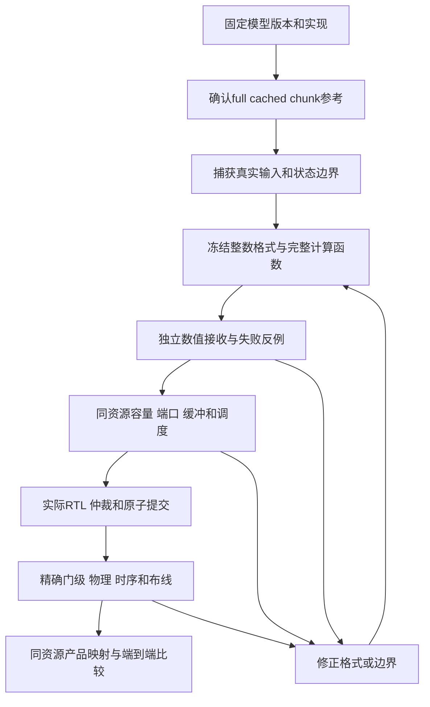
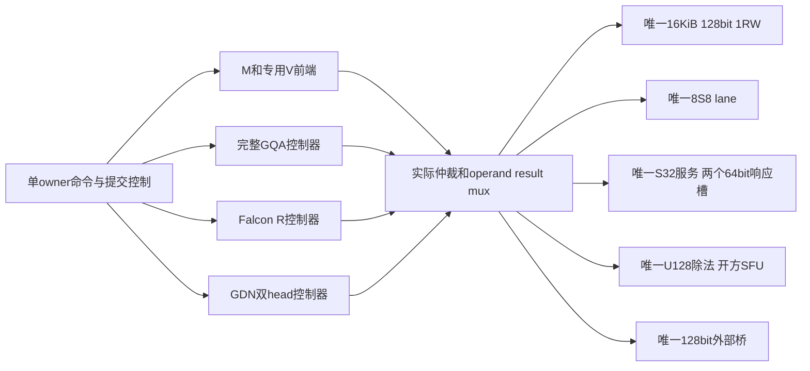

# 从真实模型到Block电路：完整研究总报告

2026-10-26；Liangruizhi；Issue117。本文由11章原文完整拼接，没有删节。
章节分别阅读见[阅读入口](README.md)。章节内交叉链接保留到同目录独立文件，便于定位；本全文已包含其全部正文。
这是一份已有证据的整理与教学分析；原实验、当前候选和制造验收严格分开，本次没有重新跑模型或电路。

1. [01｜先把研究问题拆开：从一个数到一块电路](#full-ch01)
2. [02｜模型结构与选型：每个代表到底增加哪一种问题](#full-ch02)
3. [03｜注意力模型逐项档案：Qwen3、Qwen2.5、Llama、Gemma 与 Phi](#full-ch03)
4. [04｜连续状态与 MoE：Qwen3.5、Falcon 和 Granite 的完整推理链](#full-ch04)
5. [05｜整数合同：从一个码值讲到宽归约、端口和数据包](#full-ch05)
6. [06｜具体划分候选：计算、状态、接口和预连线](#full-ch06)
7. [07｜已经实现了哪些电路：从宽微程序到四类共享服务](#full-ch07)
8. [08｜物理、端点、映射与其他已完成工作](#full-ch08)
9. [09｜怎样复查这些结论，以及接下来真正值得做什么](#full-ch09)
10. [10｜固定版本证据目录](#full-ch10)
11. [11｜全项目任务总账：执行成果与协作状态分别看](#full-ch11)

---

<a id="full-ch01"></a>

# 01｜先把研究问题拆开：从一个数到一块电路

## 1. 输入是什么，芯片究竟要做什么

给语言模型一句话，分词器先把文字变成 token ID，例如一串整数。模型把每个 ID 查表变成一个向量，随后逐层执行投影、注意力或递推、残差和前馈网络。输出是下一 token 的一组分数。这里的“向量”可以先理解成一排数字，“矩阵”是一张数字表，矩阵乘就是按行列配对相乘再相加。

例如，一个输入向量为 `[2, -1]`，一行权重为 `[3, 4]`，点积输出是 `2×3+(-1)×4=2`。模型实际会做数千维的点积，并且同时计算很多输出。矩阵单元擅长这类重复乘加，但模型还需要求最大值、平方和、指数、倒数、开方、查表、移动数据和管理状态。**有矩阵乘法器，并不意味着具备执行完整模型的所有能力。**

本项目推理优先，区分两个阶段：

- **prefill**：一次接收一段已有 token，很多投影可以批量计算，注意力要满足因果关系。
- **decode**：每次新增一个 token，必须复用之前的 KV 或递推状态，再产生新的状态。下一步不能提前使用未来 token。

同一个模型在这两个阶段的算子名字相似，资源使用却不同。prefill 更容易组成较大的矩阵；decode 可能一边读大量旧 KV，一边只产生一行新数据。因此，一个产品通常要用同一套制造后的硬件支持两者，不能在阶段切换时免费重新接金属线。

## 2. 算子划分与 Block 划分分别决定什么

**算子划分**决定计算图中有哪些可以单独说明数学语义的步骤。例如 `Linear → RQ → SiLU → Multiply → Quantize`。RQ 是把一个整数单位转换到另一个单位；Quantize 是按规则把数编码成低位整数。这些步骤即使在软件中融合为一次调用，分析时也要知道它们在哪里舍入、检查范围和产生 scale。

**逻辑功能域**决定谁对某一组语义负责。本报告沿用 M/V/A/R/S/D。M 负责矩阵与完整归约，R 负责连续状态及其发布。逻辑责任不必对应独立硬宏；两个控制器可以共享一个乘法器，仍分别承担不同的正确性责任。

**物理 Block**决定制造时哪些晶体管、存储端口、局部导线、供电、时钟和引脚一起做成固定资源。两个逻辑域做进同一物理块，可能减少外部端点，也可能增加内部仲裁、拥塞、长线或时钟负载。是否值得，必须用同一精度、同一库存和可实现时序比较。

以八个专家的输出合并为例：

1. M 算出一个专家的完整点积。
2. RQ 将结果变到约定的共同单位。
3. 乘以该专家的路由权重。
4. 八路前缀和保留足够宽度，最后舍入一次。

这些语义必须明确。但 RQ/merge 可以候选地放在 M 附近，也可以用共享 V 服务。不能因为图上连续，就跳过容量和端口证明直接合成一个宏。

## 3. 三个时间尺度不能混在一起

| 时间尺度 | 举例 | 改变它需要什么 |
| --- | --- | --- |
| 制造前固定 | 8个S8乘法 lane、单口16KiB存储、32位乘法器、可达引脚 | 改 RTL、工艺/宏及物理实现，重新计面积时序 |
| 产品确定后的定制 | 允许的高层金属/通孔连接，哪个Block接哪份存储 | 满足冻结底座、可达端点、合法层和布线规则 |
| 运行时控制 | 选择expert、发命令、切换owner、读KV、改变合法地址 | 已存在的mux/队列/控制器和协议；这些资源本身付费 |

例如，RTL里有一个选择器，能让 M 和 R 分时使用同一个乘法器，这是运行时复用。它并没有证明只改 M9/M10 金属就能实现任意产品互联。相反，产品金属连好了，也不会凭空增加 INT16 乘法器或多一个 SRAM 读口。

## 4. 数据不是“过一条边”就结束：还要追踪状态

对每个数据对象，至少问六件事：谁产生它，谁读取它，格式是什么，什么时候变有效，什么时候可以释放，失败时谁恢复它。

以 KV 为例，当前 token 的 K/V 产生后，要先检查格式和位置，再追加到对应 head 的缓存。以后许多 query 会读取它。若新 token 使用了不同 scale，却不通知消费者，旧码值就会被误解释。若所有 query 都复制一份 KV，容量和写入负担都会增加；若只存一份，就要说明如何广播或重读，以及共享端口是否拥堵。[S47](10-evidence-index.md#s47)

以 R 状态为例，当前状态表示之前所有 token 的累积结果。更新到一半发生范围失败，不能让下一步读到半旧半新的矩阵。候选设计通常使用旧状态、私有试算和一次提交点。暂存和备份需要容量，重试需要周期，发布需要明确 ACK 语义。[S99](10-evidence-index.md#s99)

因此，我们真正要划分的基本单位是：**计算事务＋它必须拥有的状态＋有限资源上的读写和提交义务**。仅用“矩阵/向量/存储”三个颜色标算子图还不够。

## 5. 研究怎样从粗分析走到电路



每一步排除的错误不同：

1. 参考一致性排除错误 cache 位置、错误历史和后端差异。
2. 整数参考排除舍入顺序、scale 单位、溢出及非线性定义不清。
3. 有限服务排除无限缓存、零成本元数据、同时占用同一个端口。
4. RTL 排除只在 Python 中成立、实际握手却丢响应或半途发布的问题。
5. 物理实现排除面积放不下、驱动带不动、setup/hold失败或无法合法布线。

后一步通过不会追溯改变前一步失败。例如 Granite 的一个冻结整数函数可以逐码执行正确，但它对浮点模型的误差仍然保留；不能用 RTL PASS 宣称原生路由质量已经解决。

## 6. 什么叫公平比较

设方案A把 RQ 放近 M，方案B把 RQ 放在共享 V。要比较位置，至少固定：输入、权重、位宽、scale、舍入/饱和顺序、K 归约范围、乘法器总数、存储容量/端口、FIFO、链路宽度、允许的调度策略和输出消费者。

若A新增一个宽乘法器，B没有，测到的差距包含资源变化。若A允许两窗口流水，B被迫串行，差距包含调度不公平。若A每组先舍入，B最后只舍入一次，两者甚至不是相同函数。若把B的通信都放在关键路径、A却允许重叠，位置收益也会被放大。

项目早期有一个很好的反例：同一 attention 服务，固定单策略时状态放置差距约14.39%，双方都用相同四策略择优后只剩3.37%。这没有证明最终最优，但说明优化基线本身会显著改变解释。[S27](10-evidence-index.md#s27)

另外必须做“只改标签”的零效应对照：如果资源、连接、事件和时序完全一样，只把 split 改名为 joined，结果应当不变。项目在多阶段保留这类对照，防止把命名当收益。[S64](10-evidence-index.md#s64) [S74](10-evidence-index.md#s74)

## 7. 数值更好、字节更少、周期更短、芯片更好是四个问题

输入量化误差更小，可能让更多组使用独立 scale，需要更多元数据和对齐。传输有效数据更少，可能因包头和对齐一拍也没省。周期更少，可能因为组合路径更长而使时钟变慢。面积更小，可能增加服务争用或重读。

手算一个纯示意：A需要100周期、每周期1ns，总100ns；B需要80周期、每周期1.4ns，总112ns。只比较周期会选错。项目实际归一化实验同样发现：专用SFU显著减少norm周期，但完整消费者减少幅度小得多，逻辑面积又增加，因此不能直接固定最展开的版本。[S82](10-evidence-index.md#s82)

本报告始终写明指标的分母：一行、一个head、一个切口、整个命令、软件条件图或实际研究物理核。它们不能随意乘层数，变成整模型结果。

## 8. 为什么保留失败和被修正的判断

失败告诉我们哪些边界具有硬约束。Llama 的静态 scale 反例阻止了“所有投影共用统一A8量化”的过早冻结。Falcon/Qwen的状态饱和阻止了“换成S32就够了”的简化。Granite的生命周期修订则提醒我们：把所有对象大小静态相加，也会错误排除本来可行的方案。

因此，本报告会分别标明参考失败、数值候选失败、工具/夹具失败和权限/数据阻塞。工具超时不自动证明 RTL 错，作业退出0也不自动证明每个数值条件通过。每一种失败都应有准确的恢复入口，而不是从表里删掉。

## 9. 手算一次注意力：为什么QK、概率和PV是三个不同边界

下面是教学数例，省略模型投影/norm/RoPE，并令score缩放为1，方便手算；真实模型通常还除以head维度平方根。

输入query `Q=[1,0]`，两个key为 `K0=[1,0]、K1=[0,1]`，value为 `V0=[2,0]、V1=[0,4]`。假设当前位置是第二个token，两key都合法。

1. QK点积分别是1和0，输出score `[1,0]`。这是完整head维度归约，不能少算一半再当最终score。
2. 为数值稳定，减去最大值1，得到 `[0,-1]`。exp后是 `[1,0.367879…]`，总和约1.367879。
3. 各除以总和，概率约 `[0.731059,0.268941]`。这是softmax，不是另一个矩阵乘。
4. PV加权输出 `0.731059×[2,0]+0.268941×[0,4]≈[1.4621,1.0758]`。

若当前位置其实是第一个token，第二个key属于未来，mask必须把它排除，概率变成 `[1,0]`，输出 `[2,0]`。所以query位置、有效长度和mask是数学输入；它们不是可以随意丢掉的控制附件。

量化时Q/K的小误差会改变score，exp/div近似会改变概率，V量化又会改变最终加权。QK正确不代表softmax正确，概率码和V格式分别决定PV宽度。当前A电路的实际阶段正是把这些责任逐个落实，而非假设“注意力是一条INT8矩阵指令”。

## 10. 手算一次FFN与norm：为什么要读完整一行

先看一个只有一维隐藏量的教学FFN：输入x=2，gate投影得到3，up投影得到2。SiLU(3)=3/(1+exp(-3))≈2.857722；门乘MID约5.715445；假设down权重1/4，输出约1.428861；加原残差2，得到3.428861。真实FFN会有数千个MID共同参与down点积，A8的scale就决定这些MID能否被保存。

再单独看二维RMSNorm教学例，X=[3,4]，gamma=[1,2]，为简算令epsilon=0（真实合同有非零epsilon）：

- 先平方，得到[9,16]，总和25，除元素数2得到均方12.5。
- 开方约3.535534，得到同一整行分母。
- 输出为 `[3/3.535534×1,4/3.535534×2]≈[0.848528,2.262742]`。

如果把两个元素当两个独立tile各算一个分母，输出会成为[1,2]，已经换了函数。合法流式做法可以先扫全部X统计，再一段段读取X/gamma输出；**分块搬运可以，完整统计不能删。** 这正是流式gamma实验保留全H屏障的原因。

## 11. 手算一次R：状态、输出和发布为什么不同

先用一个简化衰减更新说明持续状态：旧S=[1,2]，alpha=0.5，当前注入=[0.25,-0.5]，新S=[0.75,0.5]；若readout系数C=[2,-1]，输出是1。下一token必须从这个新S继续，不能重新用[0,0]。

GDN还包含prediction/correction。用K2、V1的教学矩阵列S=[1,2]，decay=0.5，k=[1,0]，目标value=2，beta=0.25：

1. decay后S变[0.5,1]。
2. 完整K prediction为k与该state点积，即0.5。
3. residual=2−0.5=1.5，correction=0.25×1.5=0.375。
4. outer更新k×correction=[0.375,0]，新S=[0.875,1]。
5. 若q=[1,1]，readout为1.875。

这是解释数据依赖的实数玩具例，省略真实归一化、整数单位、舍入与guard，不是Qwen实际模型测量。它说明state不仅是一个保存结果的数组，还参与当前完整prediction和后继输出。若第4步才发现范围失败，必须能恢复旧合法S再试。

新S算完也可能只是私有candidate。假设消费者最后拒绝，已发布指针仍应指向旧S；只有规定的accept和root ACK之后才让下一步看到新代。这就是“计算完成”和“状态发布”分开的原因。

## 12. 手算一次MoE：为什么router变化可能突然放大

用三个专家选两个的教学例，router logits为[3,2,0]，选择ID0/1。假设本例在所选集合归一化，gate约[0.731059,0.268941]，两个专家输出为2和−1，merge约1.1932。真实Granite有40选8、向量输出和固定整数gate合同，规模与格式完全不同。

连续误差改变一个logit时，输出不一定连续平滑：若第二、第三名原来只差极小量，排序反转会直接换专家权重和输出。这个选择还改变要读哪一份权重、哪个队列接请求、merge等待哪几路。

因此必须分别检查：当前hidden是什么；量化router对同hidden选什么；专家计算误差；gate单位；所有选路是否齐全。只固定原生ID测专家不能验证路由；只看最后选集相同也可能遗漏误差抵消。

## 13. 读后续电路表时需要的几个词

| 词 | 实际意思与例子 |
| --- | --- |
| shape | 数据各维大小，如[32,128]表示32行、每行128数；它不自动说明内存排布 |
| layout | 数在存储中的先后位置；转置/pack通常需要实际读写，不能只改shape标签 |
| bank/端口 | bank是一份存储；单1RW每次读或写，不能同拍给两个消费者免费各一次 |
| register/holder | 有限寄存器；holder保存已返回但消费者暂时没取走的结果，也要计位数 |
| latency/II | latency是一次输入到结果的等待；II是两次新输入最小间隔，流水单元可不同 |
| ready/valid/ACK | valid表示有数据，ready/take表示愿接，双方同拍满足才算接受；ACK确认已接受操作的约定效果 |
| backpressure | 下游暂时不能接，例如FIFO已满；上游必须保持数据或等待，不能覆盖尚未消费结果 |
| FIFO/credit | 有限队列和可用槽信用；2KiB FIFO不允许先读8KiB再假设都存得下 |
| owner/lease | 谁在这段命令生命周期内占用资源；未排空响应不能换成另一个owner |
| position/version/epoch | 位置、提交代际、格式或传输代号；它们可关联但不可随意合成一个计数器 |
| oracle/receiver | 独立数学参照与接收检查；应能在坏结果重算SHA后仍发现数值/语义错误 |
| cut | 明确实验切口：输入从哪里开始，输出到哪里结束；切口外计算不能算已验证 |
| RTL/gate/STA | 寄存器传输实现、映射标准单元功能、静态时序分析；三者解决不同问题 |
| LUT/ROM | LUT是索引到数值的表；ROM是实现只读存储的一种资源。表有多少字节与同时能读几个值分别计 |
| SFU | 处理除法、开方等特殊计算的服务单元；要说明算法、迭代、合法输入和返回错误，不是万能算术盒 |
| SRAM/scratch/backing | SRAM是存储实现；scratch是当前任务临时工作区；backing承载更大或持久对象，不能因都叫存储就混算 |
| synthesis/mapping | 把RTL运算和状态转换成逻辑，再映射到库标准单元；通过后仍需实际放置和连接 |
| CTS | 时钟树综合：用真实缓冲分发时钟，改变面积、负载和到达时刻，可能引入hold问题 |
| RCX/SPEF | RCX从当前布局布线提取电阻电容；SPEF保存这些寄生。不同阶段的估计和实际提取不能混用 |
| PG | power/ground供电接地网络；信号连通正确不代表VDD/VSS合法、完整或无短路 |
| PVT | 工艺、供电电压、温度角；一个典型角通过不代表其他温度/电压都通过 |
| DRC/LVS | DRC查版图规则；LVS核版图提取连接与网表。零DRC不等于功能或时序正确 |
| PPA | 性能、功耗、面积；本项目多阶段只取得其中部分，没测功耗就保持未测 |
| SAT | 对声明的有限位向量性质求反例；无反例只证明该性质和输入域，不自动证明整机所有行为 |

## 14. 误差指标怎样读才不误会

maxabs是最大单元素绝对误差。relative L2通常是误差向量长度除以参考向量长度；相同元素数下，常见relative RMSE写法与此等价，但要核原脚本分母和零参考处理。

教学例：参考[100,1]、结果[100,0]，整体相对L2约1%，但第二个元素信息全丢了。再小的整体误差也不能自动证明每个状态码无饱和，或路由/语言任务质量可接受。

所以表里同时列误差、clip/sat/overflow、路由集合、提交数、状态连续性和质量门。它们不是重复指标，各自会发现另一项看不见的问题。后续遇到“PASS”，先问是哪一种PASS，再读其输入范围和未覆盖项。

---

<a id="full-ch02"></a>

# 02｜模型结构与选型：每个代表到底增加哪一种问题

## 1. 选模型的依据是结构覆盖

我们不希望把模型名字列满，却重复验证同一种数据流。有效的代表应当使某个设计选择面临新的反例：不同GQA共享比例、局部窗口、不同归一化、持续递推、动态专家选择，或者独立保留验证。

例如，Qwen3-0.6B足以用真实权重发现缓存位置和量化合同错误。再跑Qwen3-4B可以扩规模，但未必增加一种新注意力结构。相反，Granite即使每token只激活部分参数，仍带来路由、专家分发、不同输出单位和宽合并，是更有区分度的补充。

下表的“已测”仅表示后文明确说明的范围，不表示整模型全整数或全部质量验收。

| 实际模型 | 关键结构 | 已测代表切口 | 对划分增加的约束 |
| --- | --- | --- | --- |
| Qwen3-0.6B | 28层，H1024，16Q/8KV，显式head_dim128，Q/K norm | 真权重FP32参考、2Q/1KV、投影前16输出 | head_dim不能盲算成H/Q；全GQA共用KV变换；缓存与临时量分开 |
| Qwen2.5-3B base | 36层，H2048，16Q/2KV，d128，QKV bias | layer0完整8Q/1KV；q/o/down探针；后续完整A RTL | 共享读口、bias单位对齐、KV精度及完整概率归约 |
| Llama-3.2-1B-Instruct | 16层，H2048，MLP8192，32Q/8KV，d64 | layer0完整4Q/1KV，q_proj256输出、down16输出 | 更长K、不同RoPE/norm；Qwen校准策略不能无验证移植 |
| Gemma-3-4b-it文本 | 5局部:1全局、局部窗口1024、Q/K norm、多处norm、门控GELU | layers0/5，完整2Q/1KV、d256、窗口两侧及H2560 norm | 不同缓存生命周期；GELU不能用SiLU测试替代；effective gamma需核实现 |
| Phi-4-mini-instruct | 32层，H3072，24Q/8KV，d128，partialRoPE=.75、LongRoPE、融合投影 | layer0完整3Q/1KV；参考与采集封存 | 融合投影布局和旋转/直通通道；冻结后独立验证 |
| Qwen3.5-4B文本 | 32层中24递推、8全局；短卷积/GDN；全局组4Q/1KV、d256 | global layer3、layer0两完整128×128状态head、连续非零初态 | KV和固定递推状态共存；全head范围、宽correction及双head一致提交 |
| Granite-3.1-3B-A800M-Instruct | 40专家选8；H1536、专家I512；动态router | layers0/13、全部被选专家和后继norm | router误差会改变离散选择；全专家权重/索引/merge/缓冲都收费 |
| Falcon-H1-3B-Instruct | Attention与Mamba-2并行、汇合；R分支32heads、D128×N256 | 完整layer0 R软件链；head0 RTL；4096共同gated norm | 两种分支状态、不同R方程、跨head归约、三输入join和事务恢复 |

Qwen/Llama基础尺寸与实际实现见[S23](10-evidence-index.md#s23)、[S56](10-evidence-index.md#s56)；四模型采集与GQA比例见[S61](10-evidence-index.md#s61)；混合和MoE见[S70](10-evidence-index.md#s70)、[S72](10-evidence-index.md#s72)。Gemma的GELU是架构需求，当前Granite SiLU RTL不因此获得GELU资格。

## 2. 普通 GQA：共享什么，不共享什么

标准注意力把输入投影成Q、K、V。一个query要与合法过去keys比较得到score，经归一化成为概率，再加权求values。GQA让多个Q头共用一个KV头：8Q/1KV表示同一份K/V被八组query使用。

这省去按Q头复制KV的逻辑容量，但仍需要八次不同的QK和PV计算。硬件可以广播KV、缓存tile后复用，或逐头重读；每种办法的端口、buffer和控制不同。当前A RTL采取明确的逐头重读，不把广播当作免费已有能力。

Q/K norm在投影后增加按head的归约和缩放；RoPE按位置变换配对通道。Qwen3和Llama没有完全相同的前处理，因此采集边界要说明是在投影前后、norm前后、RoPE前后。把post-RoPE cache误标成原始投影会让后续整数参考比较错对象。

## 3. 局部窗口：旧 token 可淘汰，但不是所有状态都能淘汰

Gemma局部层只允许读取当前窗口内的key，而全局层保留更长前缀。输入长度1023、1024、1025恰好位于1024窗口两侧，能检验边界是否差一个位置、旧KV何时失效。

硬件候选可以用ring buffer保存局部层，用另一类backing保存全局层。它必须同时处理当前位置、有效长度、逻辑token到物理槽的映射、scale与版本。覆写一个槽位前，旧消费者是否已经读完，也要有信用或屏障。

框架里一个小view可能仍引用大base数组，所以“逻辑只需要窗口大小”和“当前框架实际保留多少storage”要分别测。后者帮助发现对象生命周期问题，却不是目标芯片必需SRAM的直接答案。[S61](10-evidence-index.md#s61)

## 4. GDN 与 Mamba-2：都叫递推，更新公式却不同

可以先把递推理解成 `旧记忆＋当前输入→新记忆＋当前输出`。相比每步读取所有历史token，状态形状可以固定。但每步可能要读改写一整张状态矩阵，且数值变化会积累。

Qwen3.5 GDN需要decay旧state，利用完整K计算prediction，形成value residual，经beta修正后更新outer product，再从新state读出Y。它包含数据相关correction和完整归约，不能用一个简单标量累加器代表。

Falcon的Mamba-2状态更新、输入系数、readout和skip有另一套公式；还需连续卷积历史和gate后4096维共同norm。两模型可以共享某些乘法、开方、存储接口，但控制器、单位和提交域需要分别验证。[S99](10-evidence-index.md#s99) [S104](10-evidence-index.md#s104)

“状态容量不随序列增长”也不等于每步带宽小。例如单个Falcon完整S32 head就有128KiB；若旧态、trial、proposal都反复外存搬运，协议成本非常大。小scratch不能靠画在同一个R框里就吸收全部状态。

## 5. MoE：选择本身也是计算和控制

Granite对当前输入算40个router分数，再选top8专家。每个被选专家执行自己的gate/up、非线性和down，最后按gate权重合并。

这里有三种不同的错误：router改变专家集合；专家内部量化误差；合并单位/舍入错误。若只固定原生专家ID做后两项，就不能声称整数router也正确。若最后集合恰好相同，也可能是上游误差与router误差抵消。

制造前可固定通用top-k、索引、分发、端口和队列能力；产品确定后可以安排权重分布和可达路径。但不能只把某批输入实际用过的专家接上，假定未来token永远不访问其余专家。少量活跃参数也不等于只保存活跃专家的一份权重就能部署整个模型。[S74](10-evidence-index.md#s74)

## 6. 训练方法与本项目的关系

训练、微调、强化学习和蒸馏会改变权重分布、离群值、路由margin及生成长度，因此会影响校准和状态质量。它们不必然改变推理计算图。我们首轮研究推理，不在本报告中冒称执行了训练、反向传播、优化器状态或训练硬件验证。

DeepSeek-R1蒸馏到Qwen/Llama学生后，推理图仍主要由学生架构决定。它可以检验不同训练所得权重和长答案分布，却不能代表教师原版R1的MLA压缩潜变量、MoE专家路由和通信。原版R1/V3的缩小数学核在早期研究中做过，但没有加载原版权重。[S21](10-evidence-index.md#s21)

所以，结构研究应读实际config/实现；质量研究应冻结具体checkpoint与校准/评价数据。不能仅凭品牌名或训练方法给模型分配一种Block。

## 7. 已讨论但没有列为本轮必跑的模型

| 模型/系列 | 本轮实际状态 | 为什么不把它写成已经完成的实验 |
| --- | --- | --- |
| Qwen3-4B | 不恢复为必跑 | 现有0.6B已覆盖普通Qwen3注意力，增规模不是新的结构轴 |
| Gemma3-12B/4bit | 条件跳过 | 当前4B文本已覆盖窗口/全局差异；4bit后端是另一精度与资源合同 |
| Llama-3.1-8B、Llama3.2-3B | 讨论过，未作为本轮新实验执行 | 已用1B做跨模型反例；不能拿1B结果替代这些SKU |
| R1-Distill-Qwen-1.5B等蒸馏学生 | 条件跳过 | 不能补上原版MLA/MoE证据，也没有本轮真实权重实验 |
| 原版DeepSeek-R1/V3 | 配置/缩小数学研究，未跑原权重 | 规模和独特架构超出本批已验证范围；Granite只覆盖MoE轴，不覆盖MLA |
| Qwen3-30B-A3B、Qwen3.5-0.8B等调研项 | 架构/尺寸参考 | 没有因此自动增加已跑模型数量 |
| Gemma/Qwen3.5视觉与多模态路径 | 未执行 | 文本路径不能代替视觉编码器、跨模态投影及其状态/带宽 |

这些取舍不是“模型难下载所以随便不测”。首要判断是它会不会改变当前划分决策。如果下一阶段要宣称支持MLA或4bit，必须新增明确合同与最小实验；在此之前，结论主动限制在已经覆盖的结构上。

## 8. 固定模型版本

| 模型 | 本项目实际绑定的模型revision |
| --- | --- |
| Qwen3-0.6B | `c1899de289a04d12100db370d81485cdf75e47ca` |
| Qwen2.5-3B base | `5defd2796acd3cb2051bb4c787eddc7f8f35e113`（官方ModelScope来源） |
| Qwen3.5-4B | `851bf6e806efd8d0a36b00ddf55e13ccb7b8cd0a` |
| Gemma-3-4b-it | `093f9f388b31de276ce2de164bdc2081324b9767` |
| Phi-4-mini-instruct | `cfbefacb99257ffa30c83adab238a50856ac3083` |
| Llama-3.2-1B-Instruct | ModelScope `d3e551343d4d81508a0d226656b826c217e463cd`；对应官方公开元数据 `9213176726f574b556790deb65791e0c5aa438b6` |
| Granite-3.1-3B-A800M-Instruct | `a02780686e08a03fe0d2679a293b5c74a90efa89` |
| Falcon-H1-3B-Instruct | `01087ec4c132d7f186908716b3530ea187f062a1` |

revision是模型文件版本，代码commit是实验脚本版本，框架实现SHA又是第三件事。完整复现必须同时核对，不能把模型config中的transformers_version直接当成当时实际安装的版本。

## 9. 每个模型下一步最有价值的方向

以下是研究方向，本次文档整理不启动这些实验，也不增加下载。

| 模型 | 复用什么输入 | 最小下一问题 | 何时才值得扩大 |
| --- | --- | --- | --- |
| Qwen3-0.6B | 已验post-RoPE、GQA和cache样本 | 用作轻量协议回归，核量化profile/版本更换是否保护旧KV | 接口增加新能力或发现回归时；不用重复下载/全跑来充进度 |
| Qwen2.5-3B | A102完整组和真实cached快照 | 真正append/消费者接口、共享读与有限端口；同函数比较后再谈online | 新算法改变Psum/单位不变量时另立数值合同 |
| Llama-3.2-1B | down完整K、原校准和新旧评价记录 | 固定输出合同后接真实后继，计K组对齐/metadata；需要时补完整输出维度 | 新质量预算和未见数据预先冻结后；旧5%失败不得抹掉 |
| Gemma-3-4b-it | 窗口两侧、local/global、两条H2560行 | window append/淘汰与真实存储生命周期；若宣称通用V再补GELU | 文本代表边界暴露新问题时；多模态/12B另属新范围 |
| Phi-4-mini | 已封存参考和采集 | 方案/精度/资源/阈值冻结后作一次独立接收 | 解封前不看误差调方案；失败后区分新能力缺口与数值质量 |
| Qwen3.5-4B | 双head非零checkpoint与实际重标轨迹 | 完整Y事务消费者、gated norm及发布/引用释放，校准状态搬运 | 真正需要生命周期稳定性或全图覆盖时再扩长度/head数量 |
| Falcon-H1-3B | 单head RTL与原32head完整整数分支 | 接跨head4096消费者，比较共享服务/缓冲并保持原恢复域 | 资源与接口可容纳后再扩完整层电路，不能拼接不同切口误差 |
| Granite-3.1-3B-A800M | 两层路由及完整43stage | 进一步隔离router与gate/up误差、真实有限dispatch/merge消费者和成本 | 新假设会改变路由/分组选择时；不再盲换mid小数位或加同构模型 |

每行都应最终给出“输入固定—只改变一个关键因素—独立接收—成本与失败—是否改变划分”的结果。若不影响任何边界决策，就优先复用已有证据，把资源留给真实消费者、宏和物理问题。

---

<a id="full-ch03"></a>

# 03｜注意力模型逐项档案：Qwen3、Qwen2.5、Llama、Gemma 与 Phi

本章按“为什么做—输入—执行过程—结果—解释—未完成”展开。relative RMSE/L2都是所述张量上的相对误差，**不是模型准确率下降百分比**。校准数据用来定scale，评价数据用来观察误差；已经观察过的评价样本不能再改称未见保留集。

## 0. 先统一读懂批次条件

后文服务器四模型批次（Issue61）固定seed20261023、B1、eager、chunk128，原BF16权重加载成CPU FP32。使用Python3.12.7、Torch2.10.0+cpu、NumPy2.2.6；Qwen使用隔离Transformers5.20.2，Gemma/Phi为4.57.6。这些版本只属于该批次，不能套到早期本机或GPU实验。

其GQA一致性门为atol/rtol各1e-4；logits检查是**最后33个位置**，门为maxabs0.005与relativeL2 1e-4，不是保存/复算每个位置完整词表。线性探针完整K但只前16输出；注意力取首4/末4个prefill query和32个decode query，保留每query全部合法key。每个捕获都记录shape/dtype/布局、有效长度、scale和实际token IDs。[S61](10-evidence-index.md#s61)

校准输入长度128不表示128个独立校准行：该批只捕获16代表行。下面若写“最坏误差”，是所声明模型/层/长度/所选切片中的最坏，不是所有层、所有prompt或所有未来输入的全局最坏。其他批次按各自输入和manifest阅读。

## 1. Qwen3-0.6B：建立第一条可信的真实权重链

### 1.1 为什么先用它

小模型能在本机重复跑完整权重，适合先验证cache、采集工具和错误检查。若这些入口不可信，后续再多模型也可能只重复错误。固定revision见第02章；原权重约1.503GB，BF16检查点在本机用CPU FP32/eager计算，4线程，torch2.10.0+cpu、transformers4.57.6。[S23](10-evidence-index.md#s23)

### 1.2 输入和操作

固定token IDs，不把模型预测反馈成下一输入，称teacher-forced。它让两种执行方式接受完全相同的输入，避免第一步输出微差导致以后输入也不同。

主实验先处理32个token，再逐个处理16个新token；另一条先16+16分块，再处理同样16个新token；每一步另算一遍完整prefix作为参考。再用96+8和48+48分块确认长度变化。全部28层的KV长度、形状和数值逐步核对；选层0/13/27的边界做更细比较。

### 1.3 实际结果

54次正例调用通过事前 `abs(error)≤1e-4+1e-4×abs(reference)`；4个真实状态负例检出，包括错位置和交换KV head。最大logits绝对差约2.64645e-5，最大相对L2约1.54324e-6。KV最大绝对差约4.04358e-4仍可满足带相对项的门，不能错误简写成“所有绝对误差小于1e-4”。两轮五份科学文件逐字节相同。

同一最终32-token前缀，全28层持久KV都是7MiB，续到48-token都是10.5MiB。分块使单次最大FFN中间乘积从384KiB降到192KiB，单次最大注意力概率从64KiB降到32KiB。它改变临时工作区，**没有减少同一前缀的最终KV**。

### 1.4 得到什么划分依据

KV是跨调用的持久状态，FFN/score是短时工作区，两者应分别建生命周期。固定连接基线也必须允许合法分块，否则会把软件调度收益误写成物理合块收益。此阶段尚无真实INT8或芯片周期证据。

## 2. Qwen3：从量化问题到全 GQA 因果合同

### 2.1 投影和KV初探

Issue33捕获layer0 q/gate/down投影，完整K1024/3072、只取前16输出，比较prefill16/32/64和一个decode。原prefill64前8行作校准，其余行作评价；矩阵使用整数GEMM/RQ，scale编译和原模型其余部分仍浮点。[S33](10-evidence-index.md#s33)

长度64逐行A8、Y8时，局部RMSE为q_proj1.63%、gate_proj2.66%、down_proj6.88%。down改Y16仍约6.90%，提示输出增加位数并不能自动修复校准范围。KV静态和块scale也分别记录；动态块scale当时使用完整块极值，属于离线诊断，不是在线因果证明。

### 2.2 第一版QK balance为什么还不够

Issue39对post-RoPE Q/K按通道施加互逆幂二变换，实数点积保持不变。块长8、P15时，prefill局部误差42.5905%降至2.3120%，decode15.2032%降至4.0788%。但它用当前完整捕获拟合g和块scale，含未来信息，而且只测一个query head。因此只能定位离群通道问题，不能宣称因果cache或全GQA已成立。[S39](10-evidence-index.md#s39)

### 2.3 后续怎样补上缺口

Issue47改成独立32-token校准；评价用systems/arithmetic两段，各prefill32+decode8。选KV0及其完整Q0/Q1、d128。变换g由校准中整个共享组计算，评价不重拟合，K/V scale冻结，当前Q只读当前行。检查未来离群点不改变已编码cache、profile改变拒绝且不修改旧前缀。[S47](10-evidence-index.md#s47)

| 评价文本 | direct固定KV scale的相对RMSE | 校准冻结、全GQA共享变换 |
| --- | ---: | ---: |
| systems | 64.5595% | 1.7980% |
| arithmetic | 49.2894% | 1.9031% |

4条件输入裁剪0，量化后full/cached码与输出相同。独立检查79,360个oracle值、81,920个输入码、640个M/r和160条cache发布事件。40-token单份K/V8为10,240B，按两Q头复制为20,480B；实际48-token单份容量12,288B。

由此保留的边界是“全GQA共享的格式/变换＋不可变旧KV＋显式发布位置/版本”。误差下降仍是局部结果，没有语言质量接受阈值；变换、动态scale、广播及端口成本不能省掉。

## 3. Qwen3 CPU 迁移：验证服务器适合做哪些实验

Issue53将同一模型迁到Xeon Platinum8488C节点，申请32CPU，约503.53GiB实际内存。测试8/16/32线程×FP32/BF16，每条件full136、128+8 cached及chunk32；性能另测prefill128/512、decode16，预热一次、三次样本。没有测INT8内核。[S53](10-evidence-index.md#s53)

| FP32线程 | prefill128 token/s | prefill512 token/s | decode接128 token/s | decode接512 token/s |
| --- | ---: | ---: | ---: | ---: |
| 8 | 687.28 | 794.87 | 29.24 | 25.20 |
| 16 | 1093.94 | 1296.97 | 40.85 | 35.93 |
| 32 | 1226.44 | 1696.88 | 42.37 | 39.49 |

FP32三条件通过。BF16的8/16线程各17项超过事前2%探索门，32线程条件相等；独立重复再现同样数值现象。32线程512-token prefill两轮约1316–1697 token/s，说明共享节点波动明显。

结论是CPU适合参考、采集、整数oracle和端口研究，不能按核数线性推96核速度，也不能用CPU时间替代GPU吞吐或目标Block周期。BF16差异根因尚未定位，不能仅凭AMX指令集标志解释。

## 4. Qwen2.5-3B：普通GQA、bias与真实整数矩阵

### 4.1 GPU批次与修订链

Issue32在RTX4060Ti16GB上固定版本、固定输入，FP16短参考128+16通过。初版8192一次prefill OOM，后续明确memory-efficient SDPA、GQA repeat与显存上限后，8192一次/分块可比较，峰值约6.671/6.114GiB，最大cache相对L2约0.00536987，通过该批门。[S32](10-evidence-index.md#s32) [S32R](10-evidence-index.md#s32r)

实际CUDA `torch._int_mm`执行W8A8→INT32，不能与假量化混称。初版逐行A8候选四个小样本均未整体通过；后续K128真实矩阵候选在冻结的16×256诊断与原回归集通过。其平均KL约0.00752991、NLL增量0.00312464、top1一致95.5811%。但scale/dequant、bias和非线性仍有浮点，embedding/head未替换。这是局部量化敏感性证据，不是全整数模型或通用质量基准。

### 4.2 CPU代表层与完整GQA

Issue61用原BF16权重加载为CPU FP32，layer0、完整8Q/1KV，B1，prefill128/1024后decode32，full/cached/chunk128。捕获513个严格张量；q/o/down都取完整K、前16输出。校准128-token文本只保存16个代表行，不能说有128个独立校准行。[S61](10-evidence-index.md#s61)

参考最大logits绝对差约0.000045300，通过事前门。60线性、8注意力格式条件完成。down最坏局部RMSE：静态A/Wout27.45%，动态整行18.27%，动态A-K128/Wout3.48%，再用W-K1283.37%。这支持优先研究激活组scale，并不证明所有算子都必须分组权重。

QKV bias不能在整数函数外随意浮点相加。此批先编码为S32Q20，再在最终RQ前按单位对齐加入。否则即使矩阵partial本身核对正确，最终输出仍可能错。

注意力最坏局部RMSE：KV8/P8为13.98%，KV8/P16为12.50%，KV16/P16降至0.58%。这里主要瓶颈是KV8，而不是只增加概率位数就解决。

### 4.3 从数值走到A电路

Issue64把exp/div热路径改为显式整数参考，保持Q8/KV16、scale、LUT、Psum和完整PV归约。Issue102再落实完整8头、d128、单16KiB/128bit/1RW、8S8、共享S32/SFU的RTL，三遍materialized算法。[S64](10-evidence-index.md#s64) [S102](10-evidence-index.md#s102)

两等待模式各79查询，其中76真实、3合成；每路632完整head。每路119,904个QK及同量score/exp/P、80,896个PV独立核对；另有恢复、错误版本、非法范围和实际中止测试。选定18query/144heads的实际零延迟门级也通过。

它没有做投影/RoPE、KV append/淘汰或output projection。cached使用已提交前缀快照，不能称硬件已经实现cache增长。逐Q头重读共享KV是有费用的当前实现，不是理论最优广播。

**划分依据：** M应保留完整点积和guard；A应对合法前缀、概率不变量及KV版本负责；S和D必须携带格式、长度、owner/version，而不能只搬裸数组。M+A合宏仍需同资源物理比较。

## 5. Llama-3.2-1B：一个使统一scale方案失败的跨模型测试

### 5.1 来源和输入

用户旁支已从ModelScope下载原BF16权重并校验。本任务复用9个文件，未重新下载；官方对应关系见第02章。原权重约2.472GB，CPU FP32计算。B1、layer0、Q0..3/KV0、d64，校准32 token，两评价文本各prefill32+decode8。[S56](10-evidence-index.md#s56)

full/cached所选Q/K/V/输出通过1e-4绝对/相对门，最大观测差约3.81e-6。完整GQA注意力直接量化误差3.778%/4.022%，校准共享QK变换后3.237%/3.107%。这说明GQA接口可复用，但误差大小不能继承Qwen的约1.8%。

### 5.2 down_proj出了什么问题

q_proj取256完整输出、K2048，局部误差约1.14%–1.36%。down取前16输出、完整K8192：静态A误差70.34%–82.87%，动态整行降到6.17%–16.86%。静态约99.84%–99.89%的A变为0，动态约33.45%–43.53%；没有输入裁剪、没有最终INT8饱和、INT32也无溢出。

原因可以逐步解释：一个很大的激活决定整行步长，大量接近零的小激活不到半个步长，就全舍到零。它们虽然各自很小，却可能通过不同权重共同影响输出。因此“没有溢出”不等于保留了有效信息。

分阶段诊断显示静态down在最终RQ前已经有约70.40%–82.64%误差，单激活量化也接近这个范围，不能把错误主要归给RQ放置。权重量化误差与激活误差存在相互作用，不能直接相加当因果分解。

### 5.3 扩校准、MSE和scale粒度比较

Issue59新增科学/代码/对话各32校准token，扩到128；冻结新的园艺heldout，仍prefill32+decode8。24候选×三文本×prefill/decode，共144条件。MSE只搜索预先固定的7个dyadic指数，不读取评价输出调参；Y合同在全部候选中一致。[S59](10-evidence-index.md#s59)

| A/W方案 | 六局部条件最坏RMSE |
| --- | ---: |
| 静态整K，原/扩校准、max/MSE，Wout | 91.83% |
| 静态K512，原校准MSE，Wout | 30.97% |
| 动态整行，Wout | 16.88% |
| 动态K2048，Wout | 11.34% |
| 动态K512，Wout | 8.85% |
| 动态K128，Wout | 7.36% |
| 动态K128，W-K128 | 5.39% |

24个候选都未过事前5%局部探索门。最好的heldout prefill在最终RQ前4.81%、后5.39%，decode2.33%→3.41%，所以下一步有理由检查输出合同，而不是继续盲扩校准。

输入最大值约19.66–30.41，中位绝对值约0.00357–0.00419，扩校准仍选同一整K指数。这解释了扩数据没有自动解决动态范围问题，但不能推广为所有校准或平滑方法都无效。

### 5.4 输出合同与真实后继不能省略

Issue64固定原A/W/partial，只改最终Y：原Y8最坏5.3938%，同范围Y16为4.8113%，整数tile-delta Y8为4.9264%。这些是同一批旧样本的新诊断，不可回写成原24候选过门，更不能改称独立heldout接受。[S64](10-evidence-index.md#s64)

每16输出一个delta，可能使下一矩阵的K维出现混合单位，需ALIGN_REDUCE或再编码。它也需要搜索、比较、buffer与包字段。在当时显式delta协议里，一行包从128B变192B；并不是只多一字节就没有成本。

### 5.5 容量和划分结论

完整K8192、16行的W16×K与A16×K已占256KiB，当前预装合同放不下参数/结果，明确拒绝后改8行tile。384配置/192位置对及后续1152配置属于有限服务研究，不是全FFN电路。

完整40-token K/V8单份5120B，按4Q复制为20,480B。完整K独立INT64/Fraction核对43,520输出；早RQ错误改变28,950个，直接支持完整归约边界。

最终保留共享GQA、可配置norm/RoPE、按算子选择scale粒度、显式mixed-unit宽归约；不制造Llama专属Block，也不冻结全算子统一静态A8。Llama最终语言质量、全层N2048和长上下文未在这些实验中验收。

## 6. Gemma-3-4b-it：窗口、概率和归一化的另一家代表

### 6.1 执行范围

Issue61固定原BF16文件，经公开镜像传输后核官方元数据和实际SHA；CPU FP32文本路径。B1，layers0/5分别代表local/global，完整2Q/1KV、d256，长度128、1023、1024、1025、4096，各接32 decode，chunk128。共300线性、40注意力格式条件、3618严格张量。[S61](10-evidence-index.md#s61)

参考logits最大差0.000389576，通过事前0.005绝对/1e-4相对L2门；这是执行一致性，不是数学/代码回答质量。视觉路径没有跑，GELU也没有由后来的Granite SiLU电路自动覆盖。

### 6.2 数值结果

| 组/算子 | 粗格式 | 改善后的格式 | 最坏局部RMSE变化 |
| --- | --- | --- | --- |
| layer0 down | 静态整K A/Wout | 动态A-K128/W-K128 | 28.40%→3.81% |
| layer5 down | 静态整K A/Wout | 同上 | 21.22%→4.00% |
| local注意力 | KV8/P8 | KV8/P16；再KV16/P16 | 34.47%→3.52%→0.50% |
| global注意力 | KV8/P8 | KV8/P16；再KV16/P16 | 6.89%→4.49%→1.74% |

local层低概率精度很重要，global所选组也受KV影响。P零码包含mask，不能将全部零概率归给量化。部分q/o投影虽然RMSE低于5%，仍分别出现21/5个输出饱和；本批不是“所有线性通过”。

### 6.3 窗口与真实对象生命周期

4096+32条件，KV逻辑412,114,944B（393.02MiB），full prefill底层storage1,149,763,584B（1096.5MiB），cached最后约393.25MiB。逻辑窗口正确，view仍可能保留大base。划分时既要算数学有效窗口，也要算实现的对象释放，不能照搬框架分配为SRAM必需值。

### 6.4 实际归一化行进入RTL

Issue93取既有prefix128的layers0/5第0行，完整H2560，先核实际公式effective gamma=1+raw_weight，再编码X32Q12、gamma32Q20。使用单16KiB/1RW、流式256元素gamma，保留4KiB A区与512B frame。[S93](10-evidence-index.md#s93)

两行整数输出对捕获FP32的relL2分别5.64224835e-5和8.82139829e-5，换成百分比分别约0.005642%和0.008821%；quiet active356,038周期。它们是两条完整norm行，不是Gemma全部层、GELU或整模型电路。

**划分依据：** 支持局部/全局KV不同生命周期；保持完整head/整行统计；gamma可有界流式搬运，没必要为保存整行gamma增加免费端口或强行拆norm。窗口append/淘汰的完整目标硬件仍未在A102中实现。

## 7. Phi-4-mini-instruct：已经采集，故意不用于调方案

固定revision、CPU FP32，B1，layer0、完整3Q/1KV，prefill128/1024+decode32，full/cached/chunk128。340严格张量，最大logits绝对差0.000141144，通过本批参考门。partialRoPE=.75与LongRoPE、融合QKV/gate-up是保留结构差异。[S61](10-evidence-index.md#s61)

之后将数据单独封存，没有用于量化选择、Block参数搜索或新误差分析。封存包30,232,659B，SHA-256 `373a030cc3f4087664d69d20bb13a9ed504e9753972c8a52cf1d5edaa4c668ed`。本次只引用公开的来源报告与封存事实，没有打开包研究里面的分布。

这样做的意义是：若所有模型都参与调方案，就缺少一次真正的“先定方案，再看新数据”。待接口、数值合同、资源和接受门冻结后，才用Phi检验新形状/部分RoPE是否需要新增能力或连接。当前没有Phi量化质量、数学代码基准或冻结后验证结果，不能填成通过。

## 8. 这些实验共同排除了什么

1. 统一静态A8足够覆盖所有投影：Llama/down等反例排除。
2. 所有数据按8位估容量即可：KV/P/state/宽归约反例排除。
3. 先局部RQ再相加只是摆放变化：真实整数反例排除。
4. 共享KV等于免费广播：容量可省，端口/重读仍要验证。
5. 分块自动减少持久状态：Qwen真实KV不变。
6. 一个模型的局部误差小，就可以套到所有品牌：跨模型分布、norm和window差异排除。

因此后续重点应转到完整消费者、有限端口和物理资格，不再靠增加同构模型数量代替划分推理。

---

<a id="full-ch04"></a>

# 04｜连续状态与 MoE：Qwen3.5、Falcon 和 Granite 的完整推理链

这三种模型使研究从“几个相邻算子放在哪里”推进到“计算、数值范围和可见状态由谁负责”。以下软件整数、有限服务、RTL及物理层次分别记录。

## 1. Qwen3.5-4B：先确认连续执行参考

### 1.1 为什么不能把窗口清零再拼起来

Qwen3.5文本网络同时有全局注意力KV、短卷积历史和GDN递推矩阵。处理下一段时必须保留三者。若每个窗口把state清零，得到的是几段互不相关计算，不是原连续模型。

Issue32初版FP16短参考通过，但长512/2048部分状态相对L2超过0.02；BF16短参考也失败。后续修复显存后，8192的FP16一次/分块状态误差仍约0.0670345；FP32计算诊断约0.00015652，通过本批门。说明“能跑到8192”和“连续状态一致”是两个结果。[S32](10-evidence-index.md#s32) [S32R](10-evidence-index.md#s32r)

再固定归约树、卷积求和、逐token递推和逐query因果attention，以真实INT8矩阵＋规范FP32辅助执行，所测128+16和512/2048/4096/8192+32的整段/分块输出及比较缓存逐位一致。这解决了**指定语义下的执行延续**，不代表没有浮点，也不指定目标硬件一定采用该软件后端。

### 1.2 原始容量说明什么

24递推层每层FP32 `[1,32,128,128]` 为2MiB，共48MiB；卷积按实际4槽分配共1.5MiB；8个全局层FP16 KV共32KiB/token。因此原条件有49.5MiB固定状态，再加随长度增长的KV。不能因为用了线性注意力，就删掉全局KV或把递推状态视为几个标量。

若想存INT16/INT8，必须另证精度、scale和更新方法；不能直接把48MiB除二或除四当实测新结果。源GPU批次的状态敏感性是量化—反量化后浮点更新，后来的整数R才解决不同的问题。

## 2. Qwen3.5消费者：只看矩阵出口会漏掉什么

### 2.1 从16输出扩到完整hidden

Issue61的layer3 down前16输出提示：动态A/W K128后，最终RQ前最坏误差约0.84%，Y8后约4.83%，输出合同成为主要疑点。Issue64在固定partial上试Y16和tile delta，随后Issue66真正接上完整H2560的残差、layer4 input RMSNorm及下一投影前16输出。[S61](10-evidence-index.md#s61) [S64](10-evidence-index.md#s64) [S66](10-evidence-index.md#s66)

输入是独立校准/评价文本，B1、prefix128+cached32；down完整K9216/N2560。四种出口：静态ACT8、相同物理范围ACT16、base+tile16 delta ACT8、delta后再转K128单位。上游A/W和完整I64对齐归约保持一致。

| 出口 | prefill down/next局部RMSE | decode down/next | 出口饱和prefill/decode |
| --- | --- | --- | --- |
| 静态ACT8 | 3.380% /3.513% | 2.805% /3.150% | 36/1 |
| 同范围ACT16 | 3.010% /3.285% | 1.847% /3.101% | 36/1 |
| tile delta ACT8 | 2.256% /3.261% | 2.202% /3.086% | 0/0 |
| delta再转K128 | 2.256% /3.285% | 2.202% /3.244% | 0/0 |

此表的next是该轮明确的后继探针，不是整模型最终质量；初版RMSNorm仍是FP32桥。ACT16和ACT8端点相同，因此两者饱和次数相同。预先把tile delta统一成K128只省当时协议128B/row，却可能增加下一环节误差，不能默认所有边界都必须统一scale。

### 2.2 整数norm补上了什么

后续整数norm用当前整数行生成X16，U64平方和、明确epsilon和gamma编码、restoring isqrt/divide、RNE，生成fresh A8K128再给下一矩阵。8条件共160行、每行2560通道。同X16时整数norm对浮点norm最坏RMSE约0.000050%；含重编码后约0.05862%。下一投影相对旧FP桥链最大差约0.4975%，说明很小的norm变化也可能改变A8码。

容量检查同时发现：完整I64对齐行20,480B、sum+unit25,600B都超V16KiB。必须两遍源读，或显式spill再读；gamma+norm也不能免费同时驻留。当前动作下界6084/6404 beats不是已调度的真实周期，SFU、依赖和端口争用还要另算。

**划分依据：** 保留 `ALIGN→残差→全H统计→norm→新A8` 的语义责任。它可以物理分片，但完整统计屏障、单位和版本不能省。输出格式必须与真正消费者共同选择。

## 3. Qwen3.5连续整数状态：先发现范围失败

### 3.1 捕获与整数更新

Issue66取layer0、共享Khead0的Vhead0/1，完整K128/V128，非零初态，32步真实连续输入和33个R/conv边界。另接收旧层0/14/30、终点2048/2049/8192/8193的真实状态窗，不拼接互不连续的窗口。

整数顺序明确为：decay及RNE→完整K prediction→value减prediction→beta及RNE→outer更新及RNE→range检查→用新state读出output→同版本发布。S16/S32保持相同物理范围，S32只是更细单位。conv的SiLU和部分输入生成在这个早期阶段仍有FP桥。

| 新32步格式 | 输出局部RMSE | final state局部RMSE | state饱和 |
| --- | ---: | ---: | ---: |
| S16/D15 | 0.64384% | 0.49519% | 0 |
| S16/D31 | 0.64217% | 0.49579% | 0 |
| S32/D15 | 0.05666% | 0.02774% | 0 |
| S32/D31 | 0.05667% | 0.02767% | 0 |

S32降低了短程舍入误差，但旧256步窗里，同范围S16/S32在layer0/end2048都有184次饱和，end8192都有193次。即使某条件输出误差只有约0.04821%，仍是范围失败。[S66](10-evidence-index.md#s66)

### 3.2 三种策略回答三个问题

Issue68固定三策略：static_sat用于诊断会裁掉多少；static_guard越界拒绝，保护旧发布；guard_rescale只观察当前尝试，重编码越界head的旧整数state、单位变粗，再完整重试同token，最多8次，不看未来误差。[S68](10-evidence-index.md#s68)

原六个256步窗×四格式共24源条件：static_sat复现1508次state饱和；guard有8条件提前停、16完整；adaptive全部24完整、零发布饱和，16次重编码波次，新增重编码读写1,572,864B，尚未包括所有备份与重试流量。

固定layer0/end8192 S32/D31：static193次饱和；guard在第4token拒绝；adaptive两波后完成256步，units从[-27,-33]到[-27,-31]，epoch2，重编码自身262,144B读写。输出约0.04821%→0.04724%，不以这点误差改善宣称placement收益：adaptive已改变数值函数。

### 3.3 为什么必须全head，而非每tile各自改scale

head是一个共同单位解释的矩阵。若只把当前tile单位变粗，后续prediction会混合不同单位；若不传完整元数据，就会错误相加。tile可以控制搬运粒度，不能偷偷改变全head数值合同。

重试还必须保留旧合法状态、私有proposal、输出和版本。guard拒绝时零发布饱和，不等于把全部token成功跑完。统计必须同时给提交数、拒绝位置、重标次数和额外读写。

## 4. 从Qwen整数参考到完整双头GDN RTL

Issue104不再用Falcon方程替代Qwen：实际实现两完整128×128头，S32状态非对称上界为32767<<16，Q/K/V对称S16，decay U32Q31、beta U16Q15；prediction/residual/correction/proposal/Y保留I64。[S104](10-evidence-index.md#s104)

真实轨迹含33位中间量，合成边界补到34位。宽乘用radix2^31拆31/31/1位，三次使用同一个S32乘法服务，精确合成后一次RNE；不是将宽量截成S32，也没有免费新增128位乘法器。

| RTL数据 | 完整提交 | 重标波次 | quiet命令周期 | 有等待/peer周期 |
| --- | ---: | ---: | ---: | ---: |
| native32 | 32步 | 0 | 73,441,693 | 87,399,518 |
| portable12非零checkpoint | 12步 | 2 | 30,763,438 | 36,490,030 |

portable最终position7950、version14、units[-27,-31]、numeric_epoch2。position表示处理到哪里，version表示提交代际，epoch表示数值单位更新，它们不是同一个字段。

单16KiB/1RW scratch放不下全部持久状态；固定外部1MiB窗口包含双state、trial、I64 proposal、双Y、metadata/root及32槽系数，实际active709,776B。每轮两个head收齐guard、按同一root发布，不能各头先后独立对外可见。

真实两检查点（普通步/重标步）×两等待的选定门级通过。连续32/12步来自RTL，不能写成全部门级连续。conv/输入投影/L2norm/gate生产、输出gated norm和所有heads不在此核内。Issue109后来将该控制器接入实际共享资源，并补上2048B候选Y真实导出，但下游完整事务消费者仍待实现。[S109](10-evidence-index.md#s109)

## 5. Falcon-H1：用另一种递推检验R不是模型专用框

### 5.1 原生参考与初期反例

固定revision见第02章，BF16原权重转CPU FP32。Issue70独立cal16/eval72，prefill64+decode8，完整hybrid layer，chunk1/8/16，head0完整D128×N256。23项参考门和独立FP64重放通过。每8步清状态的错误实现，输出相对L2约16.8128%，直接说明连续历史不可删。[S70](10-evidence-index.md#s70)

S16与S32存储诊断都出现4次饱和，输出误差约0.606194%/0.606038%。当时更新、conv、SiLU和系数仍浮点，所以不能称整数R，更不能与后来的全32head新合同直接比较。

### 5.2 完整软件整数R分支

Issue72建立 `输入RMSNorm→MuP/in_proj→conv4/SiLU→dt/alpha→32head state/readout→gate→4096共同norm→out_proj/MuP→A+residual+R→H2560 nextnorm`。外部A分支与MLP仍在切口之外。输入、history是I32Q12，gamma/MuP/skip Q20，alpha U32Q31，state S16/S32配每headI16单位，运行内有显式整数LUT/宽算术。[S72](10-evidence-index.md#s72)

| full R策略 | S16 | S32 | 如何解释 |
| --- | --- | --- | --- |
| static_sat | 72提交/9529饱和 | 72/9535 | 程序跑完，但范围失败 |
| static_guard | 仅1步提交 | 仅1步提交 | 保护旧态，未完成72步 |
| 因果重标 | 72提交/0发布饱和 | 72/0 | 51个head事件，25次group epoch |

full S32重标对native局部L2：inputnorm0.0181%、projection2.4868%、scan1.5086%、gatednorm3.1250%、outlinear6.7257%、join3.1516%、nextnorm3.0289%；S16 nextnorm3.0297%。状态加位并未解决主要下游误差，不能用更多状态位替代输出投影研究。

独立接收完整stage/state/unit/epoch；软件checkpoint核73个边界，chunk8/16及prefill64+decode逐码一致。late-consumer失败后旧conv/state不发布，再试恢复正确。这仍是软件事务证据，硬件另验。

### 5.3 只改变输出投影A粒度的受控实验

冻结同一gatednorm输入和W8/静态参数，仅把A8从整row改K512/K256：

| A粒度 | outlinear L2 | nextnorm L2 | 72步partial wire |
| --- | ---: | ---: | ---: |
| 整row K4096 | 6.7257% | 3.0289% | 751,104B |
| K512 | 4.3136% | 1.8675% | 6,008,832B |
| K256 | 3.9044% | 1.6733% | 12,017,664B |

这是声明partial协议下的成本，局部对齐可能改变通信，但需新buffer/端口证明。最大绝对误差并非全面改善，不能只挑L2最小的一栏。完整K先对齐再最终RQ，提前各组RQ是另一函数。

### 5.4 同资源边界比较为什么没定出独立R宏

Issue72比较R32KiB D8、V16KiB D2、R D16+Sspill，完整compute和恢复费用计入。S32条件相对R8，V2慢约0.013574%，D16spill反而快约0.001951%。这是保守串行条件图，不是实际时钟周期，微小差异不足以冻结物理边界。

Issue74对whole/K512/K256分别固定相同函数，再比较nearM/sharedV，近M完整链条件slot节省约0.001007%/0.008010%/0.016005%。不同g之间数值不同，不能把其误差收益称位置收益。[S74](10-evidence-index.md#s74)

### 5.5 Falcon完整head进入RTL

Issue99实际实现一个完整D128×N256 head，32768个S32码、72连续步、全headguard、重标、完整N256 readout和原子root发布；一个16KiB scratch、共享S32乘法。真实position27→28发生重标，单head本地epoch0→1，不能与原32head group epoch25混同。[S99](10-evidence-index.md#s99)

quiet总148,909,146周期，有等待175,736,069；首步2,047,764、重标步3,419,094 quiet周期。两处checkpoint×两等待的真实门级通过。外部state128KiB/head，active mutable656,400B，加72步coeff共843,024B，明确占1MiB窗口。

conv、其他31head和完整4096消费者仍不在该RTL内。后续106/109的R candidate导出和共享资源验证补上另一些接口，没有使全部Falcon分支自动成为端到端电路。

## 6. Granite：先让路由参考自洽

### 6.1 初期为什么不能只保留通过项

Issue70的FP32 full/cached很接近，但eval chunk16的relativeL2约0.00582334、maxabs1.18297，超过事前2e-4/2e-3双门。首集合变化在零基层13/token42：第8/9分数差2.9802e-8，小于logit扰动1.8179e-6，专家7变1；累计10个layer-token集合改变。[S70](10-evidence-index.md#s70)

固定full专家ID、仍用当前logits算softmax后，误差明显回落，支持离散路由放大解释，但不能定位具体kernel根因。原FAIL保留，局部数学只标PARTIAL_DIAGNOSTIC。

Issue72提高router本身到FP64仍使失败移到cached，说明只提高router不够。显式eager专家后，model64条件参考的cal/eval full/cached/chunk四项通过、路由集合0变化；框架norm/RoPE/softmax仍有FP32 cast，所以不称全FP64真值。

### 6.2 冻结hidden后，单独看router精度

同上游hidden，实际40logits重新top8，32层×3执行profile×72token=6912相关行：

| router | top8集合变化/6912 | 证书可保证稳定 |
| --- | ---: | ---: |
| 静态W8A8 | 2040 | 0 |
| 动态row W8A8 | 720 | 0 |
| 静态W16A16 | 9 | 5244 |
| 动态row W16A16 | 6 | 6249 |

校准+评价合计13,824行，保守W8区间证书全部失败，实际全部先W8再W16；不能按“偶尔回退”预算便宜路由。证书不通过不等于每行实际选错，W16变化少也不等于全模型质量接受。[S72](10-evidence-index.md#s72)

W16不是免费能力：K1536粗界需42signed bits，按当前S8 lowering要9份dot及宽重组；Q15gate还要exp2、宽logit差、除法和索引元数据。router权重每层W8/W16为61,440/122,880B，都超过M32KiB。

## 7. Granite完整专家到merge整数链

Issue74取layers0/13、cal/eval各72行。外部切口为真实post-attention residual，不用hidden减MoE倒推。完整链：I32Q12 residual→全H RMSNorm→R8/R16 router→top8/Q15→全部所选expert gate/up W8A8→SiLU/门乘→完整K512量化→down→共同Q12→S64八路merge→0.22系数/残差→nextnorm。8条件、每项43stage/576专家路径，独立数学全部接收。[S74](10-evidence-index.md#s74)

| eval层/路由 | 对native专家集合变化 | MoE L2 | nextnorm L2 |
| --- | ---: | ---: | ---: |
| L0 R8 | 15/72 | 8.4195% | 9.4843% |
| L0 R16 | 0/72 | 7.7125% | 8.6287% |
| L13 R8 | 3/72 | 7.7869% | 1.1581% |
| L13 R16 | 0/72 | 7.7314% | 1.0196% |

L13 R16最终集合虽与native0差，对同一current norm的FP64 router仍有1处差，存在上游和router误差抵消。它说明观察基线的选择很重要：只看最终集合会误判router本身稳健。

整数PASS表示冻结函数正确执行，误差约8.63%等事实并未被消除。中间误差在最后Q12 RNE前已较大；只把mid换更多小数位，动态A8 shift可能同步增加，并不增加有效信息。因此没有盲加“midQ20就会好”的新实验。

## 8. Granite有限端口与容量：修正过的一次重要判断

八份S32专家完整输出共49,152B，放不进V16KiB；S64全hidden累加器12,288B，如果再静态加一份完整6,144B输出也超限。但后者不必同时活跃。

Issue76先缓存8份midA8到S0，释放前端临时量；down用O16小返回，完成八路prefix后分片写外部，最后释放merge再norm。fullH sharedV峰14,224B，保留2160B，因此完整merge实际可以放下。24配置含两层×window128/256/1536×M/V×标签，有限端口/FIFO独立接收通过。[S76](10-evidence-index.md#s76)

这不是给先前错误“找借口”，而是用真实生命周期修正过强的排除结论：不能把所有对象无差别相加，也不能把整输出暂存在Python而不付硬件费用。

每层全部40专家W8仍为94,371,840B，scale614,400B，不能以800M活跃参数名义只存少数权重。两层也不能同时塞进同一EXT128MiB。数据布局和权重分页仍是产品映射问题。

同函数nearM/sharedV每对少5,308,416B协议wire、774,144条件slots，但完整服务近M优势仅约0.0008405%。公共byte microframe策略占约99.75% wire和99.46% slots，掩盖当前放置差；这些巨量字节不是模型不可避免通信，而是保守实现暴露的瓶颈。

由此研究转向局部frame、宽算术与SFU电路，见第07章。后来的约44%局部frame周期降低和A-cache约34.68%链周期降低，各有具体电路原因，不能倒写成“MoE宏融合提升44%”。

## 9. 三种结构共同确定与尚未确定的边界

已经有依据保留的内容：完整K及最终RQ顺序；全hidden/head统计；单位/位置/版本；范围guard和因果重试；旧态与私有态分离；共同提交；动态expert索引和全所选路径；有限端口、scratch和响应holder。

尚不能从这些结果决定：独立R硬宏或V/R合宏；M/V/A物理融合；最终tile大小；ROM片内外；真实SRAM延迟/容量裕量；所有产品只改哪几层金属就可覆盖；全模型纳秒、能耗和成本优势。

下一步应把这些明确责任落实到可计价的真实接口和物理资源。增加更多同构模型，不会自动补上缺失的存储宏、事务消费者缓冲或受限层布线证明。

---

<a id="full-ch05"></a>

# 05｜整数合同：从一个码值讲到宽归约、端口和数据包

本章的短数字例子标为“手算示例”，用于教学，不是新增模型实验。真实结果仍由相应 S 编号约束。

## 1. INT8 不是一种完整的精度方案

一个整数码必须连同单位解释。若码值 `q=20`、单位 `s=1/16`，实际近似值是 `q×s=1.25`。同样的码20在单位1/256下只表示0.078125。因此传给另一个 Block 的不只是20，还应有格式、scale以及它适用的行、通道、head或组。

项目优先使用幂二单位，写成 `s=2^e`。指数 e 可以是整数元数据，单位变换可由位移及舍入构成。实际实验中 e 的容器有I8或I16等不同合同，不能自行把它们统一。Q12通常表示真实值为码值除以4096；S32Q12表示码值有符号32位。U16Q15只在声明域内表示非负数，不可按有符号负数解释。

W8A8指矩阵权重和输入为8位。完整输出可能是INT32，后续使用S64、U128、查表、除法或开方。它不是“整台硬件所有线都是8位”。openTPU带FP32后处理不能充当无浮点能力的证据；llaccel也必须取得完整数值定义才可称逐位复现。项目自行定义的整数合同不能冒名为原参考RTL的完整规范。[S33](10-evidence-index.md#s33)

## 2. 为什么完整 K 先归约，再做最终重新量化

矩阵点积 `y=Σ(k=0..K-1) a[k]w[k]` 中，K是每个输出需要相加的乘积个数。若A与W单位在整个K中相同，整数累加器中的每一项有同一单位，可直接相加。

手算示例：两个部分和都为1，最后要除以2并最近偶数舍入。分别做 `RNE(1/2)+RNE(1/2)=0+0=0`；先完整相加再做 `RNE((1+1)/2)=1`。结果不同。若还夹着饱和，差异可能更大。

所以“每个tile先RQ再送出去”不是无代价的摆放调整，而可能改变函数。Llama真实输入已给出反例：每K128提前RQ/饱和再加，改变28,950/43,520个输出。[S56](10-evidence-index.md#s56)

这支持把完整归约和最终舍入边界保留为合同。它不强制所有K必须在同一物理阵列内计算。若要拆到多个Block，可以传递足够宽、单位一致的未最终舍入部分和，但要支付传输、缓冲、同步和最终归约费用。

## 3. K 分组 scale 为什么引入 ALIGN_REDUCE

为了减少离群值影响，可以每128个K元素选一套scale。此时第g组累加 `p[g]` 对应单位 `u[g]=sA[g]sW[g]`，各组可能不同。

手算示例：第一组码10、单位1/4，表示2.5；第二组码10、单位1/16，表示0.625。直接相加码得到20是错的。选共同单位1/16后，应将第一组变成40，再加第二组10，得到50，即3.125。

真实实现需明确：共同单位怎么选，左移多少，是否超过宽度，右移在哪一步舍入，bias如何加入，完整和最后怎样RQ。项目将其记为显式 `ALIGN_REDUCE` 节点。组内INT32安全不等于组间对齐后仍安全。Llama/服务器批次使用受检I64参考；后续宽RQ还会涉及I128候选。[S59](10-evidence-index.md#s59) [S74](10-evidence-index.md#s74)

metadata可以因式分解。例如每输出一份静态Q31乘子和指数，加每K组的动态单位，通常无需复制G份完整Q31参数。但接收方仍需重构单位、读元数据并做对齐；“减少参数份数”不等于零端口、零寄存和零控制。

## 4. 怎样判断 INT32 是否安全

先区分三类界：

1. **全码域粗界**：对称S8取[-127,127]时，K项最坏绝对和不超过 `K×127²`。如果允许-128，最负×最负可到16384，必须用相应域。
2. **固定权重界**：已知W后，可用 `max|A|×Σ|W|`，通常更紧。
3. **语义不变量界**：例如概率归一化限制总和，不能把每个概率都同时当作最大值。

Llama的K2048/K8192对称127域粗界分别为33,032,192和132,128,768，低于INT32正上界。这个结论不覆盖任意bias、不同单位的左移或后续宽乘。[S56](10-evidence-index.md#s56)

早期工具对包含-128的通用域，K131072全(-128)×(-128)明确拒绝。保守拒绝说明当前合同不为这种输入背书，不表示每个大K真实输入都会溢出。[S33](10-evidence-index.md#s33)

计算时还需检查**每个前缀**，因为先正后负的累加可能中途溢出，最终结果却很小。C/RTL的隐式wrap不是合法“近似”；必须选择拒绝、更宽路径或有证据的重标策略。

## 5. 舍入、饱和、溢出是三回事

本项目多处采用RNE：round to nearest, ties to even，最近值、恰好一半时选偶数。手算示例：2.5→2，3.5→4，-2.5→-2。负数不能只套正数加半再移位；应按合同处理符号、余数、tie和偶数。

饱和是在最终结果超出目的格式时截到端点，例如S8上界127。它会丢失信息。溢出是中间算术超出容器范围；若发生wrap，再做最终饱和也不能补救。

三种常见误判都已在研究中暴露：

- 没有饱和，仍有大量小值变零：Llama静态down就是例子。
- 增加位数但保持相同物理范围，饱和次数不变：Qwen3.5消费者ACT8/ACT16和连续状态都有例子。
- 最终误差小，仍发生过状态饱和：旧Qwen3.5长窗说明输出误差不能代替范围验收。[S66](10-evidence-index.md#s66)

因此每个格式同时记录单位、端点、舍入、饱和/拒绝、累加宽度和误差。用INT16保存一个值，若单位也同步缩小，增加的是分辨率，不必然扩大范围。

## 6. 实验中的几种格式应按阶段阅读

| 对象 | 典型已测合同 | 必须随对象携带或可重构的信息 |
| --- | --- | --- |
| 投影A/W | 对称S8，静态/逐行/按K组单位 | 行/输出/组粒度，scale版本，完整K范围 |
| 矩阵部分和 | 同单位INT32 | partial/complete、K范围、目的行列及单位 |
| 投影输出 | Y8/Y16、tile delta或S32Q12等 | 目的格式、scale、delta有效域、舍入/饱和状态 |
| 注意力Q/K/V | Q8，KV8或KV16等独立候选 | head映射、静态KV单位、有效长度、mask和版本 |
| 概率 | 历史P15/32767与后续Q15/32768均出现 | 分母规范、码域、总和预算；两种合同不能静默替换 |
| R状态 | Qwen非对称S32+I8单位，Falcon S32+I16单位等 | owner/context、position、version、numeric_epoch、bank |
| 非线性/归一化 | S32Q12、gammaQ20、U128统计等 | LUT版本、epsilon编码、归约和除法次序 |

这张表故意不把历史不同合同拼成唯一最终格式。每次复用要读对应冻结协议；第07章会说明实际RTL用了哪一种。FP32→整数入口编码、静态参数编译和最终误差计算可以在运行外使用浮点，但运行内的浮点回退必须另列。

## 7. 只有8位乘法器，较宽乘法怎样实现

手算示例可以把整数拆成若干位组，再利用分配律：`(a0+B·a1)(b0+B·b1)=a0b0+B(a0b1+a1b0)+B²a1b1`。实际signed8单元需要正确处理符号和可表示的digit，项目使用特定radix128或radix2^31分解，不能随意套示例公式的积数。

在已定义radix128合同中，16×8可能需要3个S8基础乘积，16×16需要9个，32×32需要25个，64×32需要45个。还要做digit提取、移位、进位、符号扩展、宽加、RNE、guard及读写。GDN后续使用共享S32的3段lowering，又是另一种已验证实现。[S76](10-evidence-index.md#s76) [S104](10-evidence-index.md#s104)

“25个乘积”不是25周期。Issue76的有限byte微程序中，`mul_s32_s32`需要2033个byte ALU动作，并有1768B frame读、1553B写，另外支付控制和端口。Issue80才把取指/寻址/循环真正放入RTL。这个过程解释了为什么需要实际电路校准，而不能用Python大整数一条乘法推算硬件成本。

除法和开方也必须有实现。当前一些SFU用128轮除法、64轮开方；每拍展开4轮是另一硬件库存，会改变面积和关键路径，不能靠产品后期换连线免费获得。[S82](10-evidence-index.md#s82)

## 8. 注意力概率为什么不能一律8位

手算示例：256个key都同样重要，每个概率是1/256。若步长1/128，用RNE会把0.5个码舍到0，所有概率都可能消失。P15可避开这个特定失败，但需要更宽PV乘法、存储和数据流。[S33](10-evidence-index.md#s33)

范围证明还可利用概率总和。服务器后续证明中，P15码和满足与有效key数相关的预算，在最长4128 key的声明条件内，PV各limb前缀仍能进INT32；实际1,474,560个PV输出核对通过。这只适用于已归一化P、固定head的V单位和声明长度。跨页换scale或online未归一化反馈O，要重新证明。[S61](10-evidence-index.md#s61)

所以A边界需要传或保持这些不变量。若只传裸数据、丢掉有效长度/单位/预算，接收方可能无法继续使用原来的窄界。保持一个数学不变量，有时比盲目加宽更节约，但检查器和元数据自身也要付费。

## 9. 为什么减少有效字节不等于减少物理传输

假设每包64B头、payload按64B对齐。一行16个INT32是64B，总包128B；转成16个INT8虽只有16B，仍对齐到64B，总包还是128B。此例就是项目decode N16里出现的情形。[S51](10-evidence-index.md#s51)

如果攒多行合包，可能摊薄头部，但需要等待、buffer、credit与因果许可。不能把未来32步decode一起打包，再声称每步通信已经很小。Issue61重新按逐token打包后，纠正了旧聚合字节下界。[S61](10-evidence-index.md#s61)

当前若干RTL采用一个在途事务、128bit桥，每次读写要五个beat：请求头、响应头和16B数据合计80B。16B payload因此对应80B协议线传，另外还有generation sideband。不要把旧64B头的软件服务协议混到这个RTL桥里。[S84](10-evidence-index.md#s84)

还要分别记录：有效数据、布局padding、静态scale驻留、初始化传输、动态metadata、总线线传、bank读写、FIFO占用和持久状态生命周期。它们可以相互关联，却不是同一个“字节数”字段。

## 10. 重新量化应放在哪里

现在可以逐步理解这个选择：

1. 完整归约之前，不能随意低位化。
2. 最终RQ后数据可能变小，但小包可能没有省beat。
3. 近M做RQ需要宽算术、scale读取和缓冲，可能争用端口。
4. 共享V做RQ可能多传部分和，却允许复用已有算术。
5. 两方要用同函数、同库存、同调度自由度比较，再看真实物理延迟。

项目受控服务中，近M优势从约0.57%的早期包络，到Granite完整服务约0.00084%，都绑定各自完全不同的图和费用模型。不能把它们平均成“近M一般提升多少”。这些结果支持保留typed宽旁路和可选RQ路径，尚不足以冻结不可绕过的M/V物理融合。[S51](10-evidence-index.md#s51) [S76](10-evidence-index.md#s76)

---

<a id="full-ch06"></a>

# 06｜具体划分候选：计算、状态、接口和预连线

本章给出能够继续实施的候选方案，依据是前几章真实反例、完整整数合同和后续电路。**M/V/A/R/S/D是六类逻辑责任，不预设必须制造六个独立硬宏。** 已可确定的是不能省略的计算/状态边界；最终宏的形状、数量、相邻关系和金属定制拓扑仍须物理与产品比较。

主要来源：[S41](10-evidence-index.md#s41)、[SV2](10-evidence-index.md#sv2)、[SC2](10-evidence-index.md#sc2)、[S109](10-evidence-index.md#s109)。

## 1. 先把所有工作负载写成明确计算图

普通注意力模型的一段可以写成：

```text
hidden → 全行norm → Q/K/V投影 → Q/K norm(模型需要时) → RoPE
       → KV格式转换/追加/发布 → 完整GQA的QK → mask/max/exp/sum/P
       → PV完整归约 → 输出格式/投影 → residual
       → norm → gate/up → 非线性×门 → 整K范围/量化
       → down完整K → 对齐/RQ → residual → 后继norm
```

Qwen3.5还需卷积history、GDN旧state→新state/输出；Falcon有Attention与R分支、最后同token汇合；Granite把FFN替换成router→top-k→dispatch→各专家→merge。量化、格式转换、舍入/饱和、metadata和完成事件都是图中的实际节点，不能只画GEMM和激活。

每条边至少说明：数据shape/布局、位宽和单位、owner/context、生产者完成条件、消费者读完条件、物理包/路径、持久或临时属性。不适用的字段可以明确N/A，未知的字段保持待定，不能默认为免费。

## 2. 六类逻辑域总表

| 域 | 必须完成的计算/操作 | 拥有的状态 | 接口输出的关键内容 |
| --- | --- | --- | --- |
| M：矩阵/归约 | S8 MAC、同单位部分和、完整K、可选宽对齐/RQ | 当前tile、acc、K进度、A/W单位引用 | typed partial或complete；目的坐标、K范围、单位及结果格式 |
| V：向量/非线性/宽辅助 | 加乘、广播、norm、SiLU/GELU候选、量化、top-k/merge等有界服务 | 行统计、LUT/参数引用、临时frame、delta有效域 | 输出码＋scale/版本、完整行barrier、错误和完成 |
| A：注意力控制 | GQA关联、合法key遍历、score/max/exp/Psum、PV顺序 | KV profile、有效前缀、head/窗口、概率统计与输出反馈 | 完整组输出及单位，KV版本/长度、概率合法性 |
| R：递推控制 | 模型特定状态更新、完整headguard、重标重试、readout | history、旧态/私有态、unit/epoch、版本/位置/发布root | candidate state/Y描述符、accept/reject/commit-drain |
| S：存储服务 | 明确bank/端口/地址/读改写和有限响应 | 真正存储位、响应holder、owner/lease | req/ready、valid/take；实际读写ACK和错误 |
| D：命令/搬运/同步 | 命令锁存、owner切换、路径选择、packet、背压/排空 | transport generation、在途事务、credit、done/error | 显式cmd_accept、provisional结果、完成/取消和同步 |

V列的是逻辑需求，不表示当前一个通用V ISA已经全部实现。A/R控制器可以调用同一M/S32/SFU；S的“归属”不能变成每画一个框就多一块存储。

## 3. M边界：为什么先保完整归约

输入是A8/W8、维度、布局、单位及输出坐标。M读A/W tile，执行真实乘加并检查INT32前缀。完整K未结束时只可输出声明partial；结束后才执行该合同允许的最终RQ，或将complete宽结果交给共享服务。

同单位INT32反馈应作为优先固定的局部连接：乘法lane→加法/acc→下一K片。原因不是“矩阵通常融合”，而是Llama等真实输入证明提前RQ会改变函数，跨块传partial又增加位宽/同步。

混合单位时，组内INT32和组间对齐是两步。对齐可以候选地近M或共享V，必须保足够宽和guard。当前证据支持**保留ACC宽旁路以及ACT8/16等可选输出能力**，不支持所有产品必须经过同一个不可绕过近端RQ。

当前实际M电路只是一组8S8、固定K512/8专家/H1536的有界消费者，不是全部候选16×16阵列，也不是通用GEMM资格。将来扩K/N/尾块、并发累加或矩阵批处理都需再验。[S97](10-evidence-index.md#s97)

## 4. V边界：完整统计与窄码生成应连在同一责任链

以SiLU/gate-up为例，输入为S32Q12 gate和up。当前有界V前端查SiLU表、做共享S32乘法和RNE12，得到完整512个MID；扫描全512范围后选最小合法delta，再重读MID生成A8。最后一次A写ACK后才发布delta/valid，所有专家完成后发布A的owner/version/epoch。

为什么不是每16B传输块单独定标？因为那会改变A8的组粒度，M端RQ必须接收更多单位，并重新证明整个整数函数。传输tile和数学量化组是不同概念。[S97](10-evidence-index.md#s97)

以RMSNorm为例，输入完整H的X、gamma和epsilon。必须先完成所有X平方和，形成单一分母，再逐块生成输出。gamma可以流式，每次只装256元素；完整统计与原位输出控制不能按gamma tile各自独立归一化。H2560的实际布局说明保留X、流式gamma比盲目分块X更合适，但这不是所有H的通用最优。

值得预连的候选是有限frame/RMW反馈、宽乘响应、guard/RNE、统计累加与SFU请求返回。不同非线性需要真实LUT/域/插值合同；目前SiLU证明不覆盖Gemma GELU。SFU目前也不是任意操作码都合法的通用算术单元。

## 5. A边界：保留GQA共享与概率不变量

输入为post-RoPE Q、已提交K/V前缀、scale、query位置、window和owner/version。输出为完整GQA组的PV码及单位，后继output projection另接。

当前A102采用Q8、KV16、P15，三个K limb和九个PV基础乘积，三遍materialized score。制造前候选应保留：

- head关联与合法前缀遍历；未来key不读取。
- 完整d的QK和guard，以及max/sum/Psum到PV完整归约的关系。
- 明确有限score/P/tile/output存储与请求返回。
- KV同一版本下地址、单位和长度单调合同。

必须区分KV物理存放与A控制责任。KV可以在S/backing，A负责如何正确读取。若产品选局部窗口、广播或多个attention引擎，具体bank与端口可变，但不能丢失版本/释放条件。

当前RTL没有KV append/淘汰、online softmax、投影/RoPE。若改成online算法，O反馈的单位/重标和误差是新合同，不能借materialized P15的真值和界直接接受。[S102](10-evidence-index.md#s102)

## 6. R边界：全head数值域和提交域

输入包含当前token的系数、合法旧state/root、context、position、version、units和numeric_epoch。输出先是candidate，不是立即可见的新旧混合状态。

R控制器应负责：读取合法旧代；完整尝试；全headguard；必要时对合法旧整数状态重编码、改变单位、重试同token；完成readout；消费者接受后不可撤销地写原子root；等ACK确认，再更新镜像和DONE。

Falcon与GDN的责任域不同：当前Falcon99是单完整head恢复域；原软件32head共同epoch不能被单head轨迹冒名。GDN104是两个共享K关系的完整head共同发布，两个unit可以不同，group epoch和root一致。把GDN拆成两个独立提交会允许消费者看到不同代head。[S99](10-evidence-index.md#s99) [S104](10-evidence-index.md#s104)

值得固定的内部候选包括state tile地址、完整归约/guard、试算控制、shadow与root发布顺序；完整state不一定全在R片内。若外部存储承载trial/proposal，其端口、带宽、旧引用和ACK仍属于R/S/D联合合同。

当前两代bank只支持当前与下一代。在DONE ACK释放旧引用的单owner合同下可复用；若多个消费者保留旧快照，就要新增引用计数/credit或spill，而不是宣称两bank提供无限immutable历史。

## 7. S边界：端口比方框名称更具体

当前共享候选是真正一个16KiB、1024×128bit、单1RW的store82。一次请求只能读或写；无byte mask，部分修改要RMW。返回valid在take前保持。reset清valid/dout，**不初始化words内容**，读取前必须由加载或有效性证明保证已写。

不同profile先后复用S，不意味着各自保留一份16KiB。M产生的4KiB A在A/R lease后可能被覆盖，下一M需要重建。持久KV和R state位于各自有版本的backing，不能依赖上一命令在scratch留下的数据。[SC2](10-evidence-index.md#sc2)

真实存储宏还会带来读延迟、最小周期、读写冲突、时钟/复位和供电/阻挡约束。行为wrapper接口与1RW合同已验证，不等于商业SRAM/ROM宏已经找到或完成映射。

## 8. D边界：完成不是busy变低

命令生产者保持valid直到cmd_accept。cfg pending可能使busy=0但cmd_ready仍低；不能见busy=0就认为命令已接收。接收时锁存所有参数，忙时外部输入变化不得改变执行。[S85](10-evidence-index.md#s85)

共享服务的返回属于原命令。S、S32、SFU、外部桥的已接受事务必须被消费或合法丢弃，才能换owner。soft_abort停止新工作，排空旧响应，不允许旧结果进入下一消费者。transport generation不回卷；耗尽后拒新命令，协调fabric/core硬reset才能恢复。[S92](10-evidence-index.md#s92)

M/A输出的前缀是provisional。若最后才报错，已收前缀需要丢弃。R/GDN则先candidate导出，全部ACK后accept/reject；accept之后进入不可取消commit-drain。不能只把result_take拉高就宣称下游完整消费链成立。

## 9. 四类计算共享银行：当前具体电路候选



这张图是已实现共享服务的组织解释，不是电路原理图、版图或最终制造拓扑。[S109](10-evidence-index.md#s109)

| 结果/状态 | 当前完整输出 | 当前接口上的责任 |
| --- | ---: | --- |
| M完整H1536 | 6144B | 从S导出；最大下游provisional暂存6KiB另计 |
| A完整8头 | 4096B | 从S导出；KV append仍是caller责任 |
| Falcon单head Y | 512B | candidate导出后accept；state/root另在外部窗口 |
| GDN两头Y | 2048B | 同外部桥128×16B读出；全部ACK后决定发布 |

外部桥每事务5×128bit线拍，generation请求/响应侧带另8B/事务；环境两响应槽至少320bit加控制。GDN窗口active709,776B。四套控制器、宽比较/shift/RNE、行寄存、mux与观察逻辑都计入实际网表，不能只数8个乘法器就说面积很小。

此候选一次只有一个owner，尚未证明多profile并行吞吐。它从不同模型交替执行，证明资源复用和恢复，不是一个模型端到端链。

## 10. 哪些连接优先固定，哪些留产品确定后选择

| 内容 | 当前建议 | 理由及验证状态 |
| --- | --- | --- |
| MAC→同单位acc→K反馈 | 制造前局部预连候选 | 保持完整归约，避免早RQ；有真实整数/RTL证据 |
| 有限frame→RMW/宽算术反馈 | 优先固定候选 | 实际LOCAL相对BUS-frame显著减少已定义桥事务周期；宏/布线仍需验 |
| 完整统计→分母/SFU→同row输出 | 固定语义及局部控制候选 | 全H屏障不能省；gamma可流式，不必整行常驻 |
| R试算/guard→shadow/root提交 | 固定责任和合法顺序 | 全head/双head恢复与原子发布已测；fabric物理原子性仍有外部义务 |
| M↔V RQ/宽旁路 | 保留可选路径 | 受控位置收益很小或条件反转，无法冻结单一路径 |
| expert dispatch、权重bank/backing分布 | 产品映射/连接选择 | 动态ID仍由固定控制器处理，不固化当前输入所见expert |
| KV局部/全局bank、广播/重读 | 产品资源与调度选择 | 模型窗口/GQA不同，必须计端口、缓冲及版本 |
| V/R是否同宏、M/A是否同宏 | 继续物理比较 | 逻辑闭包不等于同宏，当前没有同资源全产品PPA结论 |
| M9/M10定制拓扑 | 待真实固定端点/底座后选择 | 运行时mux与研究route不能代替制造时定制证据 |

这里的“建议”以研究证据支持优先级，不是已完成目标工艺冻结。若目标宏/端点证明某预连线无法容纳负载或造成时序失败，应保留失败并修改候选。

## 11. P1–P15与六域如何对应

| 能力 | 具体输入→操作→输出 | 主要逻辑责任 |
| --- | --- | --- |
| P1乘加/点积 | A/W→乘积累加→partial/complete | M；R/V调用宽路径 |
| P2逐元素/广播 | 两向量或向量+标量→加乘/门控→同shape结果 | V/R |
| P3归约 | 整K/整行/head→sum/sumsq/dot→统计 | M/V/A/R，保持各自完整范围 |
| P4 exp/exp2 | 有界score/gate→LUT或明确近似→指数码 | A/V/SFU；当前并非每路径已硬化 |
| P5倒数/rsqrt | 平方和/分母→除法开方或其他明确实现→缩放 | V/SFU |
| P6比较/选择/带索引极值 | router/scores→topk/max/guard→值+ID | V/A/R |
| P7转换/量化/RQ/打包 | 宽码+单位→RNE/sat/guard→目的码+metadata | M/V/D |
| P8查表 | 索引+表版本→有限读口→表值 | S/ROM服务，A/V消费 |
| P9 stride/二维DMA | 地址/shape→有界搬运→存储结果与ACK | D/S |
| P10 gather/scatter | expert/稀疏索引→间接访问→分发/收集 | D/V/M映射 |
| P11转置重排 | 布局输入→实际读写/pack→新布局 | D/V/S，不能只改shape标签 |
| P12多播/保留重读 | 共享KV/A→广播、缓存或重读→多消费者数据 | D/S及端口仲裁 |
| P13状态读改写 | 旧代+输入→私有更新→合法发布 | R/S/D |
| P14循环/动态索引 | 维度/边界→计数寻址→下一访问 | 各控制器与D |
| P15队列/事件/同步 | 请求/完成→credit/barrier/owner→可见状态 | D及所有服务端 |

P编号是一份能力检查清单，不是15个制造宏，也不是概率P15的同义词。[SP](10-evidence-index.md#sp)

## 12. 一版可实施的划分方案究竟“确定”到哪里

可以据此继续写RTL的内容已经具体：数学切口、完整归约、输入格式、状态所有者、候选输出、服务响应、有限scratch、提交/恢复和共享库存。第07章给出相应执行证据。

尚不能确定的是这些逻辑域最终封成几个物理块、每块多少副本、哪些长线值得固定、制造后允许哪几层变化以及整系统收益。定这些问题前，必须完成真实事务消费者、宏/driver/PVT、精确共享top物理和受限定制层对接，见第09章。

---

<a id="full-ch07"></a>

# 07｜已经实现了哪些电路：从宽微程序到四类共享服务

本章区分软件整数、实际RTL、映射门级和物理实现。RTL中的一个周期是真正状态机推进一次，但在没有合格时钟前不能换算成芯片纳秒。logic-only面积是声明研究库的标准单元之和，行为SRAM/ROM、外部fabric或下游存储没有计入时，必须另列。

## 1. 为什么研究转向宽算术和局部反馈

Granite有限服务发现，公共byte microframe读写几乎淹没M/V放置差。问题不再是“merge换一个owner有没有更快”，而是：宽乘、进位、RNE的中间值每一步是否都绕公共BUS取存？[S76](10-evidence-index.md#s76)

一个32×32乘法不仅有基础S8积，还需要digit提取、移位、carry、符号与范围控制。如果每读写一个byte都变成48B协议包，软件账本会非常慢。这是明确实现策略的后果，不是模型数学不可避免的带宽。

## 2. Issue80：把取指、循环和完成协议真正做成RTL

实现包括8条S8/byte ALU、512B单1RW frame、16B两指令cache、CALL/RET、动态shift选择、真实单口ROM、128bit五beat外部桥、busy配置保护和done保持。程序不是由host逐输出调度；RTL自己读取指令、寻址、循环和完成。[S80](10-evidence-index.md#s80)

BUS候选让frame访问经过桥，LOCAL直达**同一份**frame；两侧取指/CALL表仍用共同桥。保持程序、输入、8lane、容量/端口和数学动作一致，才能把差异归到该局部连接。

最终895命令包括807 typed宽算术、69 ROM、7协议负例、4 RQ链、6真实八专家单坐标merge、2个合成8元素norm。两组织×两等待，共3580命令，完整frame逐位一致。

| 环境 | BUS执行周期 | LOCAL执行周期 | 减少 |
| --- | ---: | ---: | ---: |
| 无额外外存等待 | 69,215,400 | 38,740,445 | 44.029% |
| 同事务序号等待 | 71,746,249 | 41,271,294 | 42.476% |

精确少30,474,955周期＝7×4,353,565个frame事务；少348,285,200B桥wire。没有少做乘加、frame读写或ROM查询。LOCAL逻辑面积24,412.416µm²，BUS24,374.112µm²，多38.304µm²约0.157%；共同frame/ROM wrapper排除。

含义是局部RMW反馈值得优先预连，不是M/V宏融合带来44%收益。任务集分布不是模型算子频率；8元素norm的LOCAL平均约5,787,401周期，绝对代价仍高，推动下一步专用化。

外部程序1,928,832B占明确EXT配额，ROM预留131,072B；不能因为片内cache只有16B，就忽略程序部署。reset保留存储也必须明确，未写内容不能读作零。

## 3. Issue82：精确norm和真正M消费者

新norm使用X32Q12、gamma32Q20、epsilonQ24、U128平方和、整数开方/除法及RNE。它没有近似倒数或浮点回退。真实M从已有midA8/W8开始，用8个S8产生全部8专家×H1536×K512的acc，再RQ、gate、merge、残差和完整norm；host不提供acc/down/join中间答案。[S82](10-evidence-index.md#s82)

| 硬件候选 | 归一化乘法/SFU | H1536 quiet norm周期 | 完整链周期 | 完整链logic-only面积 |
| --- | --- | ---: | ---: | ---: |
| P0 | U8 digit乘法、128步除/64步sqrt | 258,244 | 9,084,871 | 49,342.468µm² |
| P1 | 专用S32乘法、同单步SFU | 209,092 | 9,035,719 | 54,461.638µm² |
| P2 | 专用S32乘法、每拍展开4步SFU | 61,492 | 8,888,119 | 62,387.640µm² |

norm P0→P2少76.19%周期，完整链只少2.166%，面积多约26.44%。如果P2因展开路径更长导致频率低于P0的约97.834%，完整链纳秒收益就可能消失。没有STA前不能只因cycle小就选P2。

174正式命令覆盖真实行、数值边界和六个完整M输入，三profile/双等待分别验证；P0/P1/P2是不同制造库存，不能说相同硬件运行时免费切换。原80的通用18函数V也没有被norm专用单元完全替代。

## 4. Issue84：A缓存与S32共享，找到了更大的真实瓶颈

### 4.1 缓存究竟存什么

八专家每个512个A8，共4096B。原M每次读一块W时重复从外部取A；可以在同16KiB中使用原空余4KiB保存A，让全部1536输出复用。没有新增bank或第二端口。

存储布局：X/Y6144B、gamma6144B、A4096B，恰好16KiB。A读和M结果/norm/cfg争同一1RW口。缓存不是“带宽变小所以一定好”，而是用外部读换片内读。[S84](10-evidence-index.md#s84)

| 候选 | 缓存 | S32乘法器 | quiet周期 | 背压周期 | logic-only面积 |
| --- | --- | ---: | ---: | ---: | ---: |
| v0 | 关 | 2 | 9,061,831 | 10,690,375 | 57,603.630µm² |
| v1 | 关 | 1共享 | 9,061,831 | 10,690,375 | 50,130.626µm² |
| v2 | 开 | 2 | 5,919,175 | 7,155,270 | 58,961.028µm² |
| v3 | 开 | 1共享 | 5,919,175 | 7,155,270 | 51,627.142µm² |

每命令实际6,291,456次S8 MAC，全部acc/down/join/norm逐位相同。v3相对本批v0 quiet少34.6801%、背压少33.0681%，协议wire少49.1987%，logic-only面积净少10.3752%。这不是同算术库存位置收益：乘法器数量确实改变，面积结果将变化计了进去。

外部A payload从6,291,456B降到4096B冷装载，W仍6,291,456B。总事务798,720→405,760，五beat wire63,897,600→32,460,800B；片内操作1920→395,392。六个真实输入工作量固定，不把84命令当84个独立模型样本。

### 4.2 为什么共享乘法器没增加本轮周期

M/RQ与norm严格分阶段，一个S32服务加两个64bit响应槽即可。实际同时eligible为0，所以共享与独立周期相同。另有4096请求/版本的真实仲裁压力，验证有限响应和背压，却没有证明M/norm并行时仍零代价。

### 4.3 缓存存在端口反例

| 每次S访问额外等待 | 无缓存周期 | 有缓存周期 | 缓存周期减少 |
| --- | ---: | ---: | ---: |
| 0 | 9,061,831 | 5,919,175 | 34.6801% |
| 4 | 9,069,511 | 7,500,743 | 17.2972% |
| 8 | 9,077,191 | 9,082,311 | −0.0564% |
| 12 | 9,084,871 | 10,663,879 | −17.3806% |

break-even约7.98699额外授予edge/操作。这是确定性端口压力实验，不是实测NoC争用。它要求保留旁路和明确端口服务，不能把cache always-on写成普遍最优。

## 5. Issue85/92：补上运行时和代际的真实安全边界

Issue85让一个M在命令接受时锁存cache_mode，开关不复制两套M。cmd_ready/cmd_accept正式化，pending cfg阻止命令；busy=0仍可能不ready。两等待各30完整输出，覆盖六输入×两模式、多个中止/错误后恢复。动态核心比静态cache/shared面积增约1.52715%，选择能力真实付费。[S85](10-evidence-index.md#s85)

随后Issue92发现一个实质边界错误：最后合法generation为0xffffffff时中止，tag无法再递增，迟到相同tag响应可能留在idle而无法排空。修复只在终止空闲/abort时discard，活动的最后命令仍接受正常同tag响应；不回卷、不再接新命令。reset/abort同拍还屏蔽cfg/done假握手。[S92](10-evidence-index.md#s92)

原缺陷由真实仿真和门锥SAT复现，修复版10条一周期性质通过。它不是整核任意状态的死锁自由证明；边界注入只在RTL验证后门进行，也不能冒充门级FF注入。fabric/core必须协调硬reset，是系统义务。

## 6. Issue91/93：先证明生命周期，再实现流式gamma

Issue91只做结构和符号行，不运行张量/RTL。它证明H2560的X/Y10KiB、gamma1KiB、frame512B、A4KiB共15,872B，单16KiB可放。原位Y只能在全行统计后写，gamma按256元素装入/释放。[S91](10-evidence-index.md#s91)

Issue93将其实现成真实RTL：保留六组Granite完整M消费者，并加入两条Gemma H2560 norm。H1536 stream相比resident quiet总边沿多3840，但释放大量常驻gamma容量；resident由cfg预装、stream由五beat桥读取，两入口不同，不能把差值当统一外存比较。[S93](10-evidence-index.md#s93)

H2560 quiet active356,038、有等待365,636；gamma640次外部读、10,240B payload、51,200B wire；S1920读/1280写、共享S32运算5120次。全行den只有一次。两等待各51完成记录，含正常结果、预期零分母错误和错误gamma内容负例。

错误gamma内容下RTL可能返回正常status，但独立oracle发现数值不对；当前接口没有内容语义签名，因此不能声称硬件自行识别所有坏数据。

本批新chain逻辑面积54,810.630µm²，配对旧基线52,599.904µm²，增4.20291%。不能混用旧批ABC映射面积。旧成本曾把16B beat错算成4B，正式cost02纠正，原失败和包都保留。

## 7. Issue97：动态A真正从RTL产生

此前midA8与delta仍由主机编译。Issue97从原真实gate/up Q12开始，实际做SiLU/LUT、门乘、RNE12、全512范围扫描、A8和delta，再给驻留M，直到merge/residual/完整norm。旧host delta字段必须零，非零直接拒绝，避免测试悄悄注入中间答案。[S97](10-evidence-index.md#s97)

同16KiB/1RW、8S8、一个共享S32和SFU；两等待各50 accepted命令、29成功输出，含27完整消费者和2V边界。全部MID/A8/8delta/12,288acc及down/1536join/norm独立检查，旧整数码不变。

| 六真实输入范围 | quiet | 有等待 |
| --- | ---: | ---: |
| 完整top active周期 | 6,003,222–6,003,235 | 7,258,386–7,258,399 |
| V active | 82,506–82,519 | 101,191–101,204 |
| norm active | 213,700 | 219,460 |

每完整命令412,032外部事务，6,592,512B line payload、32,962,560B五beat wire；观察读回/canary/cmd setup另列。logic-only70,102.970µm²、5344 DFF。四次选定门级运行共8输出，与同driver RTL和独立原码一致；错误/中止50命令套件仍只有RTL资格。

此结果支持A和scale/version在最后写ACK后一起发布、V/M/norm复用同S。它仍不包含router/gate-up矩阵、通用V ISA或整模型。

## 8. A、Falcon R与GDN R各自硬化到了哪里

| 核 | 已实现 | 实际完整范围 | 仍在切口外 |
| --- | --- | --- | --- |
| A102 | QK/score/max/exp/sum/P/PV、版本/中止 | 79query×两等待，各632head；选定18query门级 | 投影/RoPE、append/淘汰、online、output projection |
| Falcon99 | 全head更新/重标/readout、原子发布 | D128×N256、72连续RTL；两checkpoint×两等待门级 | 其余31head、conv、完整4096消费者 |
| GDN104 | 双128×128head、宽lowering、guard/重标/共同root | native32/portable12连续RTL；两checkpoint×两等待门级 | 输入生产链、所有head、输出gated norm |

独立A/R每个都有16KiB预算，并不代表整合后可以把三份存储相加。下一步必须真正抽出共享资源。[S102](10-evidence-index.md#s102) [S99](10-evidence-index.md#s99) [S104](10-evidence-index.md#s104)

## 9. Issue106：第一次实际三类共享

M/V前端、完整A、FalconR只保留各自控制/局部寄存，实际共用唯一16KiB/1RW、8S8、S32双响应holder、U128 SFU与外部桥。七命令交替包括INIT、两真实M、full/cached A和两连续R，双等待完整数学/协议通过。[S106](10-evidence-index.md#s106)

总周期17,103,407/20,314,135，外部1,015,495事务，结果导出21,504B。27命令恢复验证已接受S/S32/SFU/link排空、cfg ACK冲突、版本和旧tag。原型曾存在公开valid屏蔽但内部take仍消费的问题，修复后保留旧源与实际新测试。

logic-only125,966.694µm²、9397 DFF，全部controller和mux计入。面积超过旧98物理预算79,600.5µm²，不能直接继承旧物理资格。三类交替使用来自不同模型的输入，不是一条模型端到端链。

M导出6KiB、A4KiB、Falcon512B由环境sink暂存，provisional失败需丢弃；sink最大6KiB未在core面积内。真实下游事务buffer仍是待实现义务。

## 10. Issue109：扩为四类，GDN候选真实导出

把104 GDN接入上述同一资源，没有隐藏第四份存储或第二个宽乘法器。两头完整Y为2048B，经同外部桥128次16B读出，pending与取消排空归D管理。候选身份含owner/context/position/version/units/numeric_epoch/bank，共273bit逻辑身份；字段可引用既有稳定寄存，不等于新增273个FF。[S109](10-evidence-index.md#s109)

| 两种等待的主实验 | quiet | 有等待 |
| --- | ---: | ---: |
| 完整混合命令 | 13 | 13 |
| D总周期 | 27,900,245 | 32,753,641 |
| 外部事务 | 1,418,349 | 1,418,349 |
| S读/写 | 1,536,736 /189,484 | 同左 |
| S32端口0/1 grants | 1,204,752 /14,336 | 同左 |
| 恢复命令 | 44 | 44 |

GDN主序列含native连续三步跨其他owner，以及真实legacy重标checkpoint；每路4commit/1wave，全部state/stage/Y独立核。44恢复命令包含接受后的不可取消root、候选导出在途abort、stale、拒绝/恢复、错误身份；root实际写生效但ACK保持24拍时，不提前更新published镜像。

两路选定raw gate各8完整命令通过，含真实重标。首轮2400s超时保留，唯一6000s续跑分别约41:43/50:46完成；不是无限重试。完整32/12轨迹仍沿104原RTL资格，不因共享选定门级而扩写。

logic-only163,901.220µm²、109,574cells、12,767DFF；generic寄存14,291bit、行为memory131,072bit另列。相对106是功能新增，不是等功能面积退化结论。当前没有这份新top的真实宏、STA、route和制造验收。

## 11. Issue110：宽度精化得到小而可信的面积改善

固定106同一功能/库存，比较64动态shift、64常量mux、证明后的QK34/PV45。不是直接删位：先对真实proc组合锥证明完整值与每个I32前缀，再对实际limb寄存做reset+一步归纳，合法limb≤2。删除该条件会产生真实SAT反例，说明可达域条件不能隐藏。[S110](10-evidence-index.md#s110)

| STYLE | 实际共享top逻辑面积 | 对本批STYLE0变化 |
| --- | ---: | ---: |
| 0：64动态 | 126,029.470µm² | 基准 |
| 1：64常量mux | 125,300.098µm² | −0.57873% |
| 2：QK34/PV45 | 125,009.626µm² | −0.80921% |

24完整套件（3变体×2等待×4套）全部字段、周期、实际事务一致；6路选定门级通过。面积降低约0.81%，没有周期加速，没有STA/功耗结果，尚未合入109。历史106面积与本批STYLE0略不同，不能换用较有利baseline。

## 12. 参考项目怎样帮助，而没有替我们完成什么

Gemmini提供矩阵阵列、scratchpad、累加与搬运组织的启发；llaccel展示INT8矩阵/INT32累加、INT16向量及更宽内部算术；openTPU提示矩阵之外还可能有FP32后处理/VPU。NVDLA/VTA等也作为有限资源、队列和数据流组织参考。[SCR](10-evidence-index.md#scr)

| 参考部件 | 输入→内部处理→输出 | 对我们具体有用的启发 |
| --- | --- | --- |
| Gemmini MeshWithDelays | 对齐的A/W、任务标签→局部MAC/acc反馈与流水→矩阵结果 | 保留乘加局部反馈、标签和数据对齐；参考包4×4核心不是完整默认16×16系统 |
| llaccel gemm_engine | A行/W双buffer→INT8/INT32完整归约/RQ→有限输出FIFO | 将供数、归约完成和结果背压同时落实；缺数值依赖时不猜舍入 |
| llaccel vec_engine | 两路walker数据/参数→完整norm两遍、标量sqrt/div→回写 | 宽SFU、两遍扫描、credit和存储端口要共同设计 |
| llaccel attn_engine | Q/K/V→score缓冲、max/exp/除法→输出FIFO | 注意力统计与概率/输出生命周期明确；不能另赠64lane或第二阵列 |
| llaccel sram_xbar | 请求/地址→bank仲裁→grant/rvalid返回路由 | 逻辑crossbar只到bank引脚，不等于16bank存储宏已存在 |
| openTPU MXU/VPU | FIFO/取数和start/go→矩阵、量化、向量后处理→消费者 | 生产/启动分开、有限队列；FP32辅助必须明确，不能列成全整数 |
| openTPU TMEM/ACT_RAM | 数据与scale→共享/多读或复制组织→各消费者 | ACT_RAM不是激活运算器；多读口可能靠物理复制，容量/布线不能只按逻辑数组 |

借鉴组织与照搬数值是两回事。参考核对记录指出NVDLA采用的half-away-from-zero与本项目RNE不同：教学例2.5在前者变3、后者变2。若只复制一个叫mulshift/convert的函数名，就可能逐位不等。VTA的FIFO、单读写SRAM和micro-op组织可启发减少展开指令，但它的ISA/额外并行能力不能当当前电路已有资源。

本项目做的是定向读已需片段与接口，不主动维护或重算整个ref-project。缺少完整数值pkg/LUT规范时，不声称逐位复现；缺少完整原数据库和工具时，不声称仓库能重跑参考包全部物理流程。

## 13. 当前电路工作的完成边界

已完成的不是纸面框图：有实际乘法器、存储口、控制器、有限响应、真实输入及错误/恢复/selected gate。尤其完整K、整行统计、单位发布、head范围和root提交已经形成可执行合同。

仍缺真实事务消费者buffer、目标存储宏/drive/PVT、四类共享top完整物理、产品图同资源映射及受限定制层。第08章说明已有物理证据；第09章列出下一步的输入、验收条件及失败时如何改变划分。

---

<a id="full-ch08"></a>

# 08｜物理、端点、映射与其他已完成工作

算子和数值决定“必须算什么”，物理决定“固定资源与连接是否真的容纳得下”。本章同时汇总团队较早工程与最新通信研究，保留原作者、范围和未完成项。本次只读取固定文档与任务记录，没有接管成员工程或重跑服务器实验。

## 1. 怎样理解面积、布线、setup与hold

逻辑面积是标准单元面积和；宏占地是硬宏外框；die是整个版图边界。三者不能直接相加，因为宏内部单元已经在宏里，die又包含布局空隙。行为SRAM被cut时，剩下逻辑面积也不能冒称整个芯片面积。

setup检查数据能否在下一采样边沿之前稳定；hold检查当前采样后是否保持足够久。修得更快可能改善setup，却使hold更差，因此不能只优化最长路径。slew是信号边沿转换时间，cap是驱动实际负载；违例可能要求缓冲、驱动尺寸、布局或导线调整。

RC是导线电阻电容。综合后没有真实线，GRT是全局估计，详细route后的RCX更接近当前实际布线。GRT过门不保证DRT/RCX也过，项目已有实际反例。DRC零只说明相应几何规则检查，不能替代逻辑、连接、时序、供电或LVS。

## 2. 早期参考分析与分层实现入口

最初整理了Gemmini、openTPU、OpenTallas、fable5、llaccel的参考布线、线长和模块/接口材料。参考包帮助识别计算核心、宽向量、存储、接口和高层金属占用，保留了来源与复现边界。它不是完整原工程/数据库/工具环境，不能仅靠包内HTML重跑全部物理流程。

Issue7实际开展llaccel VECTOR及多核心分层工程。VECTOR可详细route，后续处理宏供电接入，顶层DRC/双网PG和接口检查取得通过项，但原块setup/cap和父级setup失败仍在。它说明“硬宏可以接进顶层”和“核已时序合格”要分开。[S7](10-evidence-index.md#s7)

后续parallel-blocks对ACT/MXU/GEMM等形成实际宏视图和分层验收工具；这些是各自固定参数/工艺案例，不是最终LLM六类库。第11章逐任务索引保留多个Issue7报告，避免只看最早或最成功的一页。

## 3. 抽象冻结互联：先把可达性与搜索失败分开

Issue11固定8种合成底座、4种图、种子17/43/101，192例；顺序搜索32/96成功，多顺序44/96成功。所有76成功解独立电气/映射/数值检查，24小例穷举15可行/9不可行。[S11](10-evidence-index.md#s11)

多顺序用14次尝试，比单顺序预算更多，不能称等预算新算法优势。启发式没找到路，也不自动证明物理不可行。固定线长相同，端点暴露位置/接入白名单不同，就可能改变可行性。

Issue13在同master库存上做384严格配对消融：只放宽tap容量仍44/96，扩接点后71/96，联合也71/96。9个映射有原白名单cut证书而放宽后有合法解，说明接入限制确实挡住这些映射；其余失败保留未知。[S13](10-evidence-index.md#s13)

结论是优先校准实际接入位置和允许层，而不是盲增抽象容量。它仍是合成模型，不是DRC/STA或目标金属证明。

## 4. 真实端点与三视图接口：把一条粗线拆到每个bit

Issue16冻结ACT/MXU/GEMM三份普通LEF，共1,094,468B，保留PIN/PORT/LAYER/RECT层次、原字符串和精确DBU。信号位分别860、2172、3753，共6785；主要在M5/M6。矩形中心不是合法via/access point，PG与OBS也不能忽略。[S16](10-evidence-index.md#s16)

Issue19对ACT/MXU的Yosys/Liberty/LEF共3032信号位匹配，建立685bit既有连接：640bit ACT→MXU、45bit反向；父层40端口/1662bit。保留别名、常量和共享时钟，不因逻辑同名就删除物理pin。[S19](10-evidence-index.md#s19)

原输入有两处Liberty缺分号、四处PG方向不一致。显式窄兼容解析记录差异，不能把它写成所有视图制造合格。也不能将旧wave2视图当后来H1 matched宏的新版本。

这项工作回答“实际端点在哪里、叫什么、方向与位序是否一致”，尚未回答“M5/M6怎样沿合法固定导体真正引到M8”。后者是制造分层所需的独立证据。

## 5. openTPU H1：真正同资源拆分与合并物理对照

Issue15由YUZE-LU完成small固定布局的ACT/MXU拆分/合并，三叶块、两父层以及六类证明匹配。共同2.5ns时钟、0.5ns IO预算、BUF_X4/Z输入driver、5fF输出、50ps时钟转换；拆分685bit边界不串行化、不赠buffer。[S15](10-evidence-index.md#s15)

| 完整结果 | 拆分ACT+MXU | 合并ACT/MXU |
| --- | ---: | ---: |
| 块内＋父层叶面积 | 484,240.4µm² | 482,252.4µm² |
| 硬宏占地 | 1,317,410.90905µm² | 1,311,883.890625µm² |
| 共同die | 2,788,900µm² | 同左 |
| 总信号线 | 6,647,739µm | 6,204,600µm |
| 总信号通孔 | 1,322,289 | 1,284,106 |
| 完整提取setup WNS | +0.102306ns | +0.065642ns |
| 完整提取hold WNS | +0.036146ns | +0.013027ns |

拆分叶面积+0.412%、总线长+7.142%、通孔+2.974%。块内少线，但父层多线抵消，说明边界不能只看块内部。父层还含外部IO/时钟，不能把全部增量都归给685bit。

验证不只看父层黑盒宏时序，还恢复真实子网表并拼接层次SPEF、全setup/hold、PG、RC覆盖、功能和库存。主快照SHA为 `f65688a957f13ef70216e923891ef6ff539adfc6f81c3e29a74ba5d10332720d`；全量清线重布21补充只多42µm线、少2via，不把微小差异解释成普遍算法优势。

**H1允许有源修复和完整父层布线。** 这是真实工程对照，仍不能直接宣称制造前有源底座冻结、后期仅少数金属定制已经普遍成立。

## 6. H2受限层切片：成功范围很具体

Issue31在既有H1同功能切片上，冻结实例/位置/连接、PG/时钟/低层导体，只重布父层M8–M10和V8/V9。预付2006个V7信号接入位置，真正重连1003个上层森林，覆盖690原信号网。[S31](10-evidence-index.md#s31)

最终原生DRT、完整父层DRC、回装RC、PG与完整分层STA通过。总叶面积保持484,240.4µm²；总线长6,647,739→6,645,428.82µm，完整setup/hold仍+0.102306/+0.036146ns。3,109,501.80µm原父层线已预埋，约92.50%。

因此它证明的是目标条件化、同功能、单small/typical/固定布局的一个H2切片。没有第二计算图，也不是任意685bit可重排的通用底座。子块M8/M9还有固定图形，不能说整个M9子块在M8定制前就制造完毕；具体mask数仍需工艺流程。

这也与成员55主方案“M1–M8固定、M9/M10定制”不同，不能把H2切片的M8可改直接借给该主方案。

## 7. 小组合锥和完整底座集成分别进展到哪里

Issue42把同一两门底座、M1–M10固定、M11/M12/接入via改变的两个组合控制片段提炼成可重放程序。openTPU b_req真值0001，llaccel do_push为0010；15测试、两例重放和60项证据hash通过。它不包含完整FIFO状态、整核心、全DRC/LVS/STA。[S42](10-evidence-index.md#s42)

Issue55由huangpingyang04-lgtm负责完整openTPU small与llaccel_core资源并集，已完成原顶层展开、归属清单、四宏原生库存、llaccel补测和open20例/87,160行公开trace。原VECTOR setup/cap失败保留。[S55](10-evidence-index.md#s55)

首次ACT真实迁线89967虽保持原实例/非目标/PG且清空M9/M10，独立几何仍发现43异网接触、router1项short，因此失败。没有共同冻结底座、没有真实M8固定引出资格、两完整案例定制尚未完成。不能以小组合锥或原宏存在替代此任务验收。

## 8. 五参考项目容量调研和Block数量估计

Issue43/PR46比较Gemmini、openTPU、fable5、llaccel、OpenTallas，并区分板上、仿真、分析规划和本仓库小切片。[S43](10-evidence-index.md#s43)

核心认识是：B数不能直接定Block数。权重容量取决于实际格式和全/活跃参数；计算量取决于每步参与的矩阵及利用率；供数又受最窄端口/链路/主机换入影响。openTPU含FP32、fable5 W4A8、OpenTallas BF16规划、llaccel仿真不能按一个“INT8 PE数”直接横排性能。

若假设一个矩阵Block有256个乘法位置，某阵列算术规模可对应1或2块，这只是计算规模换算。它不包含norm、KV/state、存储供给、频率、利用率和场景目标，更不是完整模型支持声明。调研中的外部板卡数字仍是原作者证据，本项目没有重新测它们。

Issue48/PR50进一步提供严格≤4,000,000,000参数的W8A8/INT32输入规范与标准库资源估计器：权重/scale/padding、KV/R状态、tile、FIFO、物理打包、多跳和线性/带宽下界分开；31 tests、四示例双轮一致。缺参数保持unknown，不能报免费0。[S48](10-evidence-index.md#s48)

一个假设4B包络即使计算下界只需2块，也可能要求41.25GB/s而外部只有32GB/s。说明算力够不等于能供得上数据，最终库存要同时满足计算、容量、端口和场景。

## 9. Issue63：把工作负载变成可检查的通信/生命周期输入

此前PR78已把Block v2文档与旧估计器做字段对照，明确哪些可直接复用、哪些只能保存数量、哪些需新typed合同、哪些缺证据；另有两个合成小图/expected用于离线接续。它不把字段存在当硬件实现，也没有代做真实R算术或物理。旧报告中“离线/pending”按当时读取条件保留，后来发布为独立草稿；不能只看首段就认定从未上传。[S78](10-evidence-index.md#s78)

成员huangpingyang04-lgtm建立显式图、有限事件、候选Block、分配和有向路径→规范通信需求/生命周期→独立消费端校验。不自动推断完整LLM图，也不将软件导出当物理可达。[S63](10-evidence-index.md#s63)

原软件达到200测试、10独立重放，本机/CI/服务器科学SHA一致；导入真实ACT860/MXU2172/GEMM3753信号pin及3032旧bit对照。C层真实同版实例/M8/冻结底座仍blocked。

2026-10-26追加通信优化：1/4层、prefill128/512、逐token decode16/64，最大13,120任务；固定两个合成M池、一个V池和明确容量/FIFO。比较fixed、greedy、beam，并追加更强tie基线，全部原表和退化保留。[S63R](10-evidence-index.md#s63r)

| 同12主格sum(wire) | 字节 | 相对fixed少 |
| --- | ---: | ---: |
| fixed | 10,119,300,544 | 基准 |
| greedy | 9,135,129,664 | 9.7257% |
| beam | 9,012,513,536 | 10.9374% |
| 强化greedy | 8,673,527,488 | 14.2873% |

发现即时tie总选M0后，用相同12格追加强化greedy，反而比beam少3.7613% wire、10胜2负。主要收益来自权重驻留和使用已有M1，不能把较宽搜索或弱baseline写成普遍创新。保留long-prefill beam退化、631,328B工作集超512KiB的infeasible格和穷举gap。

最终223 tests/0skip、10旧场景及研究smoke通过；这是合成资源和形状内核下的串行通信研究，不是完整模型质量、实际Block能力或芯片PPA。其gemm_complete_rq能力接到真实M时，仍要重新确定RQ位置和跨块费用。

## 10. 新整数电路的物理资格：先暴露问题，再修复

Issue86在84四静态网表上跑8条真实完整消费者门级，功能通过；无线RC的受限STA却有数千slew/cap违例，原始R2R诊断周期也不同。未修复网表的诊断不是合格Fmax。[S86](10-evidence-index.md#s86)

Issue88固定研究库/10ns/双load/整store切口，以有界缓冲/tie/驱动和hold修复，再跑精确门级。修复增加约10.93%–11.25%标准单元面积，不能只按乘法器面积选共享。该阶段仍无placement/CTS/线RC，且历史native电气摘要后来被发现会过滤小超限；严格资格应采用下一节完整表复核。[S88](10-evidence-index.md#s88)

## 11. Issue98：完整V→M核的有限研究物理闭环

### 11.1 固定输入和预算

对精确chain93/97新网表，Nangate45 typical1.1V/25°C，core399×399、die448×448，单元预算79,600.5µm²；10ns、uncertainty0，I/O max0.1ns/min0、输入slew0.05ns，输出1/10fF两档。整个store82被显式cut，保留真实reset连接，全部其他端点和观测逻辑保留。[S98](10-evidence-index.md#s98)

流程包括placement、CTS、GRT、有限电气/hold修复、详细route、OpenRCX、全部端点时序、电气覆盖、精确最终网表门级。没有通过加false path、移除debug或放宽min0来制造通过。

### 11.2 工具摘要不足，怎样发现并纠正

固定OpenSTA的 `-violators` 用1e-15F、即1fF的fuzzy零比较，会省略小cap超限。**1fF不是项目允许的设计裕量。** 某详细route候选setup/hold已正，但实际cap26.169408798fF大于limit26.054399490fF，仍判失败。

最终接收改成每driver actual≤limit，并重建完整slew输出脚集合。97覆盖58,359库输出脚，其中4597未用脚也列入；两load同时删掉同脚或换假脚并重新算SHA的负例被拒。顶层理想输入没有对应driver限制，fanout库/SDC未给上限，不能将“0违例”写成上游drive或fanout已合格。

另发现GRT SPEF writer在CAP中遗漏pin-node接入半电容，不能称无损RC传输。最终用真实DRT/OpenRCX，检查ground/coupling、连通、单位、总量及独立进程读回；工具读回一致也不等于独立电磁真值。

### 11.3 最终固定来源结果

| 最终核 | chain93 | chain97 V→M完整消费者 |
| --- | ---: | ---: |
| 实际单元面积 | 59,619.910µm² | 76,964.174µm² |
| 预算剩余 | 19,980.590µm² | 2636.326µm² |
| RCX最差setup | +3.488219ns | +3.680569ns |
| RCX最差hold | +0.037797ns | +0.036780ns |
| 全setup/hold端点 | 5826 | 7465 |
| 每load cap/slew检查数 | 45,136 /45,147 | 58,346 /58,359 |
| 严格cap/slew | 0/0 | 0/0 |
| 详细route/DRC/天线 | 通过 | 通过 |
| 最终精确门级接收 | 固定快照尚未全部完成 | 选定4×2正常完整链通过 |
| 该研究切口physical_stage_accepted | false | true |

chain93 quiet作业91391已完成51记录；held原91392实际10500s超时，原失败保留，20条完整前缀只作诊断，唯一续跑91580及接收91581/82在**2026-10-25来源快照**尚未完成。本次未查询服务器新终态，不作“现在仍运行”或“现在已完成”的推断。

97完整包844,691,935B、5451成员、展开9,312,602,381B，原报告记录服务器与PC逐成员核验；新收据SHA-256为 `4691173d1376bba0af92be2b4de6ac4abcfc644848b85163e3a8963c74220ec8`。这是97冻结部分，不是整个Issue98最终归档。

### 11.4 通过范围之外还有什么

真实SRAM宏面积/时序/clock/PG/阻挡、上游driver阻抗、目标PDK、多PVT、tap/fill、完整PG/LVS没有验收。信号M2–M10、M5/M6边界pin和实际clock接入也不符合成员55要求的共同固定M8底座资格。

109四类共享top的logic-only163,901.220µm²与97的76,964.174µm²功能/阶段不同，不能相减成融合收益，也不能让109继承97的10ns和79,600.5预算。新top必须重新冻结物理合同。

## 12. 这些物理与映射工作怎样反馈划分

1. 端点位置、内部已有负载和合法接入会限制产品可定制边，不是图上画一条线就能连。
2. 拆分可能使父层线更长、控制驱动更多；合并也可能加mux/争用。必须比较完整层次成本。
3. 存储、时钟、PG和观测端点不应在某个方案中被隐藏。
4. 更强软件基线可改变算法排序，物理和调度都应保留公平比较。
5. 一份研究核的闭环是扎实里程碑，但制造前固定资源、多个产品后定制和端到端收益仍是独立门槛。

---

<a id="full-ch09"></a>

# 09｜怎样复查这些结论，以及接下来真正值得做什么

## 1. 本次文档整理检查了什么

本次从Liangruizhi认证连接读取目标仓库，核对最新Issue/PR/评论和成员范围，建立独立Issue117/分支。主线基线为 `2113afef4afc1f16391e0ed929158bdfc3f70b94`。读取的每份报告/索引绑定PR实际head、Git blob、原文件字节数和SHA-256；文本来源副本存入本任务轻量证据包，不包括权重、大张量或凭据。

本次可以验证的事项：文档引用的版本明确；同一数字没有换单位/分母；来源原文含对应关键片段；相对链接/显式锚点有效；正文和全文拼接一致；章节所列八模型、失败与限制均存在；管理结构及Git文件范围正确。实际检查回执在本任务work目录。

本次没有重新执行模型forward、量化生产器、独立整数接收器、RTL、综合、SAT或物理实现。原报告所写“独立接收通过”是**原实验阶段记录**，不改称本轮第三次复现。要获得新复现证据，必须取相应数据和同源工具实际运行。

## 2. 源码版本、模型版本、数据版本要分别看

手算式示意：模型revision为A，采集代码commit为B，量化代码为C，receiver为D，最后写报告为E。E不是所有结果的运行源码，不能把E填进每一行“实验commit”。

项目后期用逐phase binding记录真实脚本SHA、命令、环境和输入。即使文档提交更晚、源码只做空白规范化，旧实验仍绑定原字节；需要勘误时新增errata/回执，不改写旧档。

恢复任何实验前应核：

1. 当前Issue、关联PR/评论和交接是否已有后来结果；该目录是否有人正在写。
2. 模型revision/权重分片SHA是否一致，token IDs及输入数据是否一致。
3. 实际使用的Torch/Transformers/NumPy和模型实现文件SHA。
4. producer/receiver源commit和逐文件SHA、数值协议/配置。
5. 本次要读取的结果索引、原始输出和独立接收是否相互绑定。
6. 数据/工具是否真的可访问，若缺失先记录阻塞，不把“有路径字符串”当作已取得数据。

## 3. 每种“通过”要查什么文件

| 想确认的说法 | 需要读的实际材料 | 常见误判 |
| --- | --- | --- |
| 模型参考一致 | token、full/cached/chunk配置、全部状态/输出误差与门 | 下载成功、生成一句话就叫通过 |
| 整数实现正确 | 格式/scale、partial、中间码、独立oracle与边界负例 | producer自写PASS或只比最终浮点误差 |
| 量化误差可接受 | 预先冻结的质量预算、独立评价与失败 | 将5%局部探索门当语言准确率 |
| 有限容量服务合法 | 逐对象live-range、bank/端口/FIFO/credit、packet事件 | Python数组自动当硬件buffer |
| RTL实际执行 | 源/binary、完整命令、真实握手/计数、输出、复位/背压 | 有SV脚本就叫电路完成 |
| 选定门级通过 | 精确mapped网表、同driver、库布尔函数、逐值/协议核验 | 视为全状态形式等价或SDF时序仿真 |
| 物理合格 | 同网表/库/SDC/几何/RCX、完整端点、电气/DRC/PG及功能 | 只看GRT、只看setup或native零摘要 |
| 制造后定制成立 | 同一冻结底座、合法层/via、真实pin接入、多个目标的回装验收 | 运行时mux当金属定制证明 |

项目管理CI只检查管理结构。它能发现缺Issue链接等问题，不能替代任何一行数值或物理业务验收。

## 4. 怎样使用统一结果索引

第10章链接各实验的固定报告和`index.json`。索引一般包含：服务器根目录、科学源码/phase、完整包与精选包大小/SHA、成员表、接收回执和限制。字段名称在不同阶段不完全相同，要读schema，不能硬套同一个解析器。

关键数据分为四类：

- **仓库内小样本/metadata**：适合看字段、指标与部分独立重放。
- **授权服务器完整包**：有全捕获/编码/输出/日志/网表，通常大得多。
- **模型权重与外部工具**：是独立输入，不会因为拿到结果zip就自动拥有。
- **封存保留集**：Phi等不能在方案冻结前用来调参；本次没有解封。

原报告有些本机捕获随后只把指定子集转到服务器，这不能扩写成所有历史本机大数据已共享。成员服务器目录也不是公共下载站，访问需要已有权限。

## 5. 代表成果的位置与SHA示例

下面给最常用的包，完整目录以第10章固定索引为准。表中“来源记录已核”表示本次核对了报告/索引，**不是再次下载这些大包并逐成员验证**。

单位也要一致：B是字节，bit是位，8bit=1B；KiB/MiB按1024换算，1MiB=1,048,576B，MB/GB若按十进制则分别是1,000,000/1,000,000,000B。模型名字中的“3B”通常表示参数数量量级，不是3GB文件或3GB运行内存。检查点文件、独立参数、共享权重、加载dtype和临时状态还会使大小不同。

| 成果 | 原记录大小 | SHA-256 | 适用范围 |
| --- | ---: | --- | --- |
| Qwen3真实trace evidence.zip | 350,398B | `d9f6701fcea9553e557a63a718787ade5da908b44f43f2dae7e2701da7d5de76` | FP32真实轨迹，小包无权重 |
| Llama跨模型精选 | 2,468,347B | `6f63d89990294952da0c69ffb401e1c8eeb547e9650a0e25cf6b8fad95633652` | 全编码线性/GQA输入输出，小包不含完整FP32校准 |
| Llama down精选 | 2,628,498B | `77c9ab60b61337b788498248f6b262ec1d50b8f76facf4430b72ed6a80c8c4fa` | 四代表方案24条件，非全144条件原编码 |
| 服务器三个主测原始包 | 569,140,969B | `2f03daf778c6667aae49d2edd40f3397227514e59c6342d367a552cac6ff7730` | Qwen2.5/Qwen3.5/Gemma完整本批捕获/编码 |
| 服务器批次metadata | 7,269,991B | `b2e94f70861d92debf71d5f0055a7006c6c1731db688e46c0473d0786b9530fa` | 日志、指标、源码、精选样本 |
| Qwen范围/服务完整包 | 8,024,664,381B | `745968df14258e0984028a3d6d5626753196f4082dea1591719c9235ee51b8ea` | 条件服务和范围轨迹，不能称全RTL |
| Falcon/Granite闭环完整包 | 9,898,974,561B | `80e0b598039256f576bc6280d1f677713df5d5b36b8ff8ec1e22f35ee7c60197` | Issue72完整整数/服务，外部输入仍独立 |
| 97研究物理完整归档 | 844,691,935B | `4a1f9e3449abceeaafb7e3e176b3de010bf3ccc5c10aac510c00456db1dc05f1` | 97冻结物理部分，非整Issue98最终包 |
| 四类共享109完整包 | 104,917,869B | `9de3fc27bf2fd89fbcb8d3d1a753b26910b4a73214ee8d0f42ad0f1334a19994` | 真实共享/门级/恢复；无新top物理资格 |
| 注意力110完整包 | 87,834,705B | `e3be4dadd6018b5f9dd49a6d2c25d90add4f010bdd8641216bbb28863d96eccc` | 同周期/库存、精化证明和选定门级 |

这些数字只用于定位与完整性，不代表质量。一个错误结果重新算SHA后仍可以完整传输，所以原实验还做独立数学/协议拒绝；SHA本身不是真实性签名。

## 6. 复核操作的推荐顺序

以读取Qwen服务器批次为例：先打开S61固定报告，再打开同commit的统一索引，确认自己要“看全量量化”还是“重放精选GQA”。若只拿metadata包，就只能重放里面声明的样本；全420线性条件重算需要服务器主包。

取得文件后先核SHA，再核zip成员路径/重复/大小；新目录展开，不能覆盖旧输出。然后用对应原receiver读取capture/numeric/manifest，最后才分析误差。若失败，应区分文件缺失、版本不匹配、schema错误、算术错误和候选质量失败。

本教程的离线检查不需要模型或服务器：

```powershell
python -B scripts/check_project.py
python -B work/Liangruizhi/117/audit_handbook.py
```

第一个检查管理结构，第二个检查本教程的章节/引用/原文证据包/Git blob/SHA/关键声明片段和全文一致性。它不会导入模型、连接服务器或替原实验重新签核。

原实验具体命令在各固定报告链接的README与execution清单。使用新输出目录和相应冻结源码；不要把原`run.sbatch`直接再提交到已经存在的目录，也不要因为本报告给出命令就忽略任务认领与服务器已有作业。

## 7. 下一步一：先收完已经安排的93最终门级

**输入：** PR111的完整交接、91580/91581/91582实际终态及输出、原binary/网表/51记录driver/input/SHA。

**操作：** 主研究线恢复时只读最新仓库和作业；quiet成功不重跑；检查唯一held续跑是否成功以及完整51×2receiver/精确物理receiver是否真正通过。前缀诊断或排队不能升级为接受。若续跑失败，保留准确错误，不无限延长。

**输出与判断：** 可接收则更新同PR111最终证据和归档；不可接收则保持93未accepted并写恢复条件。它完善已有物理证据，不应扩成更多模型或改数值门槛。

此处是下一步方向，本次文档任务没有查询/修改作业，也没有重新提交实验。

## 8. 下一步二：真实事务消费者与有限buffer

**为什么影响边界：** 109的环境sink保存完整provisional结果，真正下游还没实现。如果下游必须付6KiB或2048B暂存、commit/revoke和旧引用释放，原先认为便宜的跨Block连接可能变贵。

**最小输入：** 复用一个已需跨边界的完整M输出6144B或GDN输出2048B，不加新模型。固定同精度、同端口、现有响应队列及owner合同。

**实施候选：** 下游有限事务buffer；或可撤销流式消费加明确回滚/credit。两方都计存储、读写、控制、在途响应和最终提交。

**验收：** 中途abort不留下可见前缀；最后一行背压保持；accept后root不可取消且ACK前不提前发布；迟到响应不进入下一owner；旧bank读引用释放后才复用。核完整输出、state/version及逐事务计数，再计实际逻辑/周期。

**怎样改变划分：** 若接口buffer/端口超过预算，比较合并边界、不同spill或允许的流水；若真实buffer代价可控，则保留跨Block选择。不能只把take常拉高。

## 9. 下一步三：真实S宏、上下游驱动和PVT

**最小合同：** 16KiB、128bit、1RW到底有哪份可用宏；同步读延迟、读写冲突、是否byte mask、保持/复位语义、clock/reset、Lib/LEF/供电/阻挡、PVT与真实driver/load。

**操作：** 行为wrapper与宏适配；不把memory words复位成零；计入新增pipeline/holder、宏时序和PG。原数值、恢复、canary与选定门级重新验证，再运行物理约束。

**决策：** 若宏延迟使A-cache超过端口break-even或无法保持全行布局，重新比较旁路/分bank/流式；新增bank是新库存，要单列面积、时钟和互联。目标工艺/宏缺失应明确阻塞，不以Nangate逻辑数据替代。

## 10. 下一步四：实际共享top的物理与同功能比较

固定109或经完整复验后的优化源，先确定允许面积、频率、端点、修复预算和观测接口。STYLE2尚未合入109，不能直接扣掉0.81%估一个新面积。

完整执行精确网表布局/CTS/route/RCX、所有setup/hold、电气完整集合和真实宏/PG；同网表再做已选完整checkpoint门级。失败时不能删端点、放宽hold、增加未计存储或继承97结果。

然后才公平比较：集中共享与分域共享、V/R结合与分离、近M与共享RQ、ROM位置。每对功能、格式、容量、算术数量/或者明确计价后的库存、调度自由度都需一致。面积更小不能补偿数值或提交失败。

## 11. 下一步五：制造后定制、整图和保留模型

与55/63对接真实同版实例、M5/M6→M8固定引出、固定M1–M8、可定制M9/M10及合法via/PG/clock。先做两个确有差异产品图，冻结底座后分别定制并回装验证，而不是围绕某目标把92.5%线预埋后就外推通用性。

整图评估同时包含实际矩阵、状态、权重、KV、metadata、同步、端口、外存/主机路径。报告prefill/decode、有效带宽、时钟、尾延迟/吞吐、面积和能耗的实际可测范围。没有能耗工具或真实时钟时保持未测，不用GPU秒数直接换算目标PPA。

冻结方案、资源和接受标准后，才解封Phi作独立结构/精度验证；若失败，不把保留集拿来反复调参后再叫独立通过。若要宣称覆盖MLA、GELU或多模态，也应分别新增最小能力实验，而非借现有名字扩大覆盖面。

## 12. 目前适合对团队怎样表述成果

可以说：已经完成多模型工作负载差异研究，形成明确算子/状态/通信合同和六域逻辑方案；有投影、注意力、完整MoE与连续R的整数参考；多个有界核落实为RTL/选定门级，四类实际共享银行已验证；其中一条完整V→M消费者核完成声明研究条件下的物理闭环。

仍须补充：来源PR的审查/合并不等于本次文档集成；最终制造宏、真实存储与上下游、下游事务buffer、全部共享top物理、多个产品受限定制和端到端收益尚未全部完成。项目登记PR5与看板权限也按真实回执保留，不把上传文件写成看板同步或项目整体done。

---

<a id="full-ch10"></a>

# 10｜固定版本证据目录

本章由source-index.json生成。S编号是正文引用，D编号是结果索引，T编号是Issue正文的时间快照。
固定Git链接的40位commit给出本次读取版本；SHA-256绑定文件原字节。它们不表示本次重新执行原实验。

采集时间（UTC）：`2026-10-26T12:30:14.185328+00:00`；主线基线：`2113afef4afc1f16391e0ed929158bdfc3f70b94`。

[机器可读清单](source-index.json)与[原文证据包](../../work/Liangruizhi/117/source-documents.zip)可离线核对。
证据包 910,746 B，164成员，SHA-256 `32b9aa58ba196d282f4802efc13d676d2ee25bcade121364f297df7da85accf7`。
包内只有本次所读文档、结果索引和任务正文；无模型权重、封存Phi内容、原实验大张量、EDA库或凭据。

## 1. 报告、候选方案与方法

正文较早报告中的‘未完成’按当时范围阅读；后续修订另有来源。不要只读最早一份就否定后续已做工作。

<a id="s98r"></a>
### S98R · docs/experiments/issue-98-integrated-physical-readiness.md

来源：[PR111](https://github.com/rayggxia-workspace/LLMHardwareDesign/pull/111)；[固定原文](https://github.com/rayggxia-workspace/LLMHardwareDesign/blob/3a17e5e6cf792648f649256699210ae704fefdc1/docs/experiments/issue-98-integrated-physical-readiness.md)。
文件所在commit：`3a17e5e6cf792648f649256699210ae704fefdc1`；原字节15,368 B；SHA-256 `90d1de2b412afbd7d8694bbc2906c38cb27b43294e9e4ed378428bf41d6157fe`。
运行代码版本请继续读原报告的source/binding；文件所在commit可能是后续交付提交。

<a id="s98"></a>
### S98 · docs/experiments/issue-98-integrated-physical.md

来源：[PR111](https://github.com/rayggxia-workspace/LLMHardwareDesign/pull/111)；[固定原文](https://github.com/rayggxia-workspace/LLMHardwareDesign/blob/3a17e5e6cf792648f649256699210ae704fefdc1/docs/experiments/issue-98-integrated-physical.md)。
文件所在commit：`3a17e5e6cf792648f649256699210ae704fefdc1`；原字节23,994 B；SHA-256 `bc769d2d1a076a2bf2fc014e1982e1c11481839e200fa883d29fdeeff462a4d0`。
运行代码版本请继续读原报告的source/binding；文件所在commit可能是后续交付提交。

<a id="s109"></a>
### S109 · docs/experiments/issue-109-shared-gdn.md

来源：[PR113](https://github.com/rayggxia-workspace/LLMHardwareDesign/pull/113)；[固定原文](https://github.com/rayggxia-workspace/LLMHardwareDesign/blob/c03ba985e516b006ec2f936175b8588fc0de48af/docs/experiments/issue-109-shared-gdn.md)。
文件所在commit：`c03ba985e516b006ec2f936175b8588fc0de48af`；原字节10,412 B；SHA-256 `f920eddb78b91a55cf39b40a725acc28625bc5af1a2af0a2418da9d39e87cda7`。
运行代码版本请继续读原报告的source/binding；文件所在commit可能是后续交付提交。

<a id="s110"></a>
### S110 · docs/experiments/issue-110-attention-width.md

来源：[PR112](https://github.com/rayggxia-workspace/LLMHardwareDesign/pull/112)；[固定原文](https://github.com/rayggxia-workspace/LLMHardwareDesign/blob/345e97af06d3036ab5277141d935556074a051f8/docs/experiments/issue-110-attention-width.md)。
文件所在commit：`345e97af06d3036ab5277141d935556074a051f8`；原字节9,649 B；SHA-256 `163af2ddaa942abe7d7c39461e80737b41ae2a2866dac61bed6fc07c79cca1a7`。
运行代码版本请继续读原报告的source/binding；文件所在commit可能是后续交付提交。

<a id="s106"></a>
### S106 · docs/experiments/issue-106-shared-services.md

来源：[PR108](https://github.com/rayggxia-workspace/LLMHardwareDesign/pull/108)；[固定原文](https://github.com/rayggxia-workspace/LLMHardwareDesign/blob/7a9fecec1bb82af2c8af03dc89a2f42c0fdfba6c/docs/experiments/issue-106-shared-services.md)。
文件所在commit：`7a9fecec1bb82af2c8af03dc89a2f42c0fdfba6c`；原字节10,736 B；SHA-256 `e690d96691899f498e429740e375775e7d0d99e8742002310bd68617aa48da98`。
运行代码版本请继续读原报告的source/binding；文件所在commit可能是后续交付提交。

<a id="s104"></a>
### S104 · docs/experiments/issue-104-gdn-state.md

来源：[PR107](https://github.com/rayggxia-workspace/LLMHardwareDesign/pull/107)；[固定原文](https://github.com/rayggxia-workspace/LLMHardwareDesign/blob/03ab900651aa80a382316f6b8673cab4599540c8/docs/experiments/issue-104-gdn-state.md)。
文件所在commit：`03ab900651aa80a382316f6b8673cab4599540c8`；原字节13,267 B；SHA-256 `a43b75acbb3d653feb6ebcb1605b33443d9e82d5f05154cbb87bc6cc24a12dc9`。
运行代码版本请继续读原报告的source/binding；文件所在commit可能是后续交付提交。

<a id="s102"></a>
### S102 · docs/experiments/issue-102-attention-rtl.md

来源：[PR105](https://github.com/rayggxia-workspace/LLMHardwareDesign/pull/105)；[固定原文](https://github.com/rayggxia-workspace/LLMHardwareDesign/blob/a62cffbf3a0ea1b87b4ad1fbb9d1633e89e7052c/docs/experiments/issue-102-attention-rtl.md)。
文件所在commit：`a62cffbf3a0ea1b87b4ad1fbb9d1633e89e7052c`；原字节11,480 B；SHA-256 `e2211a112435e6f9fb22d794f35010028f7748d30f507c8570d61b6a8bb1b6d1`。
运行代码版本请继续读原报告的source/binding；文件所在commit可能是后续交付提交。

<a id="s99"></a>
### S99 · docs/experiments/issue-99-r-state.md

来源：[PR103](https://github.com/rayggxia-workspace/LLMHardwareDesign/pull/103)；[固定原文](https://github.com/rayggxia-workspace/LLMHardwareDesign/blob/8c51f5df74ff5658ee159ee463f13dea6f691237/docs/experiments/issue-99-r-state.md)。
文件所在commit：`8c51f5df74ff5658ee159ee463f13dea6f691237`；原字节11,895 B；SHA-256 `66dfdacf9fec113745c4d2b8b2e1e88b692c6ab74f62dd96024a78ae0758113f`。
运行代码版本请继续读原报告的source/binding；文件所在commit可能是后续交付提交。

<a id="s97"></a>
### S97 · docs/experiments/issue-97-v-consumer.md

来源：[PR101](https://github.com/rayggxia-workspace/LLMHardwareDesign/pull/101)；[固定原文](https://github.com/rayggxia-workspace/LLMHardwareDesign/blob/5820c223c41327e154869616339dded900609007/docs/experiments/issue-97-v-consumer.md)。
文件所在commit：`5820c223c41327e154869616339dded900609007`；原字节10,879 B；SHA-256 `16fa0211fe5c63965b21f53fa4607e44439629bdd58b03312386c613fce892b1`。
运行代码版本请继续读原报告的source/binding；文件所在commit可能是后续交付提交。

<a id="s93"></a>
### S93 · docs/experiments/issue-93-gamma-stream.md

来源：[PR100](https://github.com/rayggxia-workspace/LLMHardwareDesign/pull/100)；[固定原文](https://github.com/rayggxia-workspace/LLMHardwareDesign/blob/4b70b6a9a74230f10d78690dcd76263e424922e3/docs/experiments/issue-93-gamma-stream.md)。
文件所在commit：`4b70b6a9a74230f10d78690dcd76263e424922e3`；原字节11,324 B；SHA-256 `d1c298062b22cd2d135008fca321f10809c1c9f55f83d4f1a9caf930bc9a527b`。
运行代码版本请继续读原报告的source/binding；文件所在commit可能是后续交付提交。

<a id="s92"></a>
### S92 · docs/experiments/issue-92-epoch-boundary.md

来源：[PR96](https://github.com/rayggxia-workspace/LLMHardwareDesign/pull/96)；[固定原文](https://github.com/rayggxia-workspace/LLMHardwareDesign/blob/6a106885ccc1c0a75e6bfc879f8e293a97df8ae2/docs/experiments/issue-92-epoch-boundary.md)。
文件所在commit：`6a106885ccc1c0a75e6bfc879f8e293a97df8ae2`；原字节7,265 B；SHA-256 `b507e58e5e250508a8acffd5635ec8515b11e299a77859c85ecf5185370d0564`。
运行代码版本请继续读原报告的source/binding；文件所在commit可能是后续交付提交。

<a id="s88"></a>
### S88 · docs/experiments/issue-88-electrical-repair.md

来源：[PR95](https://github.com/rayggxia-workspace/LLMHardwareDesign/pull/95)；[固定原文](https://github.com/rayggxia-workspace/LLMHardwareDesign/blob/76fb94896cf51209f43316e8d8a64f660c2ee833/docs/experiments/issue-88-electrical-repair.md)。
文件所在commit：`76fb94896cf51209f43316e8d8a64f660c2ee833`；原字节9,675 B；SHA-256 `29fb44006c816107baf5906f57763c17bf74e8c59fe1ee964760d7a0e6b51ed3`。
运行代码版本请继续读原报告的source/binding；文件所在commit可能是后续交付提交。

<a id="s91"></a>
### S91 · docs/experiments/issue-91-v-integration.md

来源：[PR94](https://github.com/rayggxia-workspace/LLMHardwareDesign/pull/94)；[固定原文](https://github.com/rayggxia-workspace/LLMHardwareDesign/blob/d8d0537a80cfbedf481fb4bfd9519bdd0fa1e071/docs/experiments/issue-91-v-integration.md)。
文件所在commit：`d8d0537a80cfbedf481fb4bfd9519bdd0fa1e071`；原字节6,122 B；SHA-256 `073de18922b5d1601ebd29b50bb415a03c0f9158eccc3c5d36314b6111bcaf0b`。
运行代码版本请继续读原报告的source/binding；文件所在commit可能是后续交付提交。

<a id="s86"></a>
### S86 · docs/experiments/issue-86-gate-sta.md

来源：[PR90](https://github.com/rayggxia-workspace/LLMHardwareDesign/pull/90)；[固定原文](https://github.com/rayggxia-workspace/LLMHardwareDesign/blob/3301e1b2a396c6d1977d81e619e653c60d2a946d/docs/experiments/issue-86-gate-sta.md)。
文件所在commit：`3301e1b2a396c6d1977d81e619e653c60d2a946d`；原字节6,444 B；SHA-256 `efbe9b30d95db544b90d2816b39a859da693cec864a0a8e2c12b1f30c4373dac`。
运行代码版本请继续读原报告的source/binding；文件所在commit可能是后续交付提交。

<a id="s85"></a>
### S85 · docs/experiments/issue-85-runtime-cache.md

来源：[PR89](https://github.com/rayggxia-workspace/LLMHardwareDesign/pull/89)；[固定原文](https://github.com/rayggxia-workspace/LLMHardwareDesign/blob/eef976d328848e649f2a6e5e645024c48a7a7646/docs/experiments/issue-85-runtime-cache.md)。
文件所在commit：`eef976d328848e649f2a6e5e645024c48a7a7646`；原字节5,943 B；SHA-256 `31a33c9f517d8075745d34051eeed7c3e0c8b5557ffb069109a4d898be6454cb`。
运行代码版本请继续读原报告的source/binding；文件所在commit可能是后续交付提交。

<a id="s84"></a>
### S84 · docs/experiments/issue-84-cache-share.md

来源：[PR87](https://github.com/rayggxia-workspace/LLMHardwareDesign/pull/87)；[固定原文](https://github.com/rayggxia-workspace/LLMHardwareDesign/blob/7e57a0b8e95215f15358cc9a8241399d5e88dbbe/docs/experiments/issue-84-cache-share.md)。
文件所在commit：`7e57a0b8e95215f15358cc9a8241399d5e88dbbe`；原字节12,129 B；SHA-256 `379a69f93db2ca9a1bd79092bdac6ea849050ab2186472954bf1f9a80ac060e0`。
运行代码版本请继续读原报告的source/binding；文件所在commit可能是后续交付提交。

<a id="s82"></a>
### S82 · docs/experiments/issue-82-norm-circuit.md

来源：[PR83](https://github.com/rayggxia-workspace/LLMHardwareDesign/pull/83)；[固定原文](https://github.com/rayggxia-workspace/LLMHardwareDesign/blob/7e9ec409d90478a05547b555071d21c22ba260d7/docs/experiments/issue-82-norm-circuit.md)。
文件所在commit：`7e9ec409d90478a05547b555071d21c22ba260d7`；原字节10,927 B；SHA-256 `d685a6b45889c575c27f359a777655b953712d5666b42ffe1cfb89a99d26f385`。
运行代码版本请继续读原报告的source/binding；文件所在commit可能是后续交付提交。

<a id="s80"></a>
### S80 · docs/experiments/issue-80-block-circuit.md

来源：[PR81](https://github.com/rayggxia-workspace/LLMHardwareDesign/pull/81)；[固定原文](https://github.com/rayggxia-workspace/LLMHardwareDesign/blob/7ad23a73c49f199beed20f682decca897c4f487f/docs/experiments/issue-80-block-circuit.md)。
文件所在commit：`7ad23a73c49f199beed20f682decca897c4f487f`；原字节12,420 B；SHA-256 `6db96daa3383757f6d6bebd47353cf6656e42d337b92dde42d0c2e9ee1ac474a`。
运行代码版本请继续读原报告的source/binding；文件所在commit可能是后续交付提交。

<a id="s76"></a>
### S76 · docs/experiments/issue-76-granite-ports.md

来源：[PR77](https://github.com/rayggxia-workspace/LLMHardwareDesign/pull/77)；[固定原文](https://github.com/rayggxia-workspace/LLMHardwareDesign/blob/889ca420181c932598c8e70c500dcdb01156b59c/docs/experiments/issue-76-granite-ports.md)。
文件所在commit：`889ca420181c932598c8e70c500dcdb01156b59c`；原字节12,104 B；SHA-256 `0eb1af59e25fee2d17ed31c8c01ec5d35b4c1bff800a0de76182b9a39c197308`。
运行代码版本请继续读原报告的source/binding；文件所在commit可能是后续交付提交。

<a id="s74"></a>
### S74 · docs/experiments/issue-74-moe-grouped.md

来源：[PR75](https://github.com/rayggxia-workspace/LLMHardwareDesign/pull/75)；[固定原文](https://github.com/rayggxia-workspace/LLMHardwareDesign/blob/ce2d08f257d4052da875d73938b3090f7f214f3e/docs/experiments/issue-74-moe-grouped.md)。
文件所在commit：`ce2d08f257d4052da875d73938b3090f7f214f3e`；原字节11,900 B；SHA-256 `031459371e82a18cefb49127d86f85705f22504c2ee909603b7f41eb84551efd`。
运行代码版本请继续读原报告的source/binding；文件所在commit可能是后续交付提交。

<a id="s72"></a>
### S72 · docs/experiments/issue-72-numeric-closure.md

来源：[PR73](https://github.com/rayggxia-workspace/LLMHardwareDesign/pull/73)；[固定原文](https://github.com/rayggxia-workspace/LLMHardwareDesign/blob/88e9c4b2c3bb1b93b7155ba87ad11853e6c15512/docs/experiments/issue-72-numeric-closure.md)。
文件所在commit：`88e9c4b2c3bb1b93b7155ba87ad11853e6c15512`；原字节16,813 B；SHA-256 `7e244fa8dbe11b9cd670abdf0896d7b43a8d52d1a805c99cb593117d4c2db522`。
运行代码版本请继续读原报告的source/binding；文件所在commit可能是后续交付提交。

<a id="s70"></a>
### S70 · docs/experiments/issue-70-moe-hybrid.md

来源：[PR71](https://github.com/rayggxia-workspace/LLMHardwareDesign/pull/71)；[固定原文](https://github.com/rayggxia-workspace/LLMHardwareDesign/blob/f4d2c4643ef683336bf583739bf117cca8013118/docs/experiments/issue-70-moe-hybrid.md)。
文件所在commit：`f4d2c4643ef683336bf583739bf117cca8013118`；原字节12,734 B；SHA-256 `cc846ed876e4b031be4d3e4743dbba6004f7318060c7f13a6c96d406c712ef01`。
运行代码版本请继续读原报告的source/binding；文件所在commit可能是后续交付提交。

<a id="s68"></a>
### S68 · docs/experiments/issue-68-range-service.md

来源：[PR69](https://github.com/rayggxia-workspace/LLMHardwareDesign/pull/69)；[固定原文](https://github.com/rayggxia-workspace/LLMHardwareDesign/blob/ab2edaa005d4a249fdc5cfc6b68ed33e812f26e2/docs/experiments/issue-68-range-service.md)。
文件所在commit：`ab2edaa005d4a249fdc5cfc6b68ed33e812f26e2`；原字节10,428 B；SHA-256 `2b5779fe7a339e72d4ccaaeeaa165a3400171b1e4c7bd88ddbcf40d0860aa903`。
运行代码版本请继续读原报告的source/binding；文件所在commit可能是后续交付提交。

<a id="s66"></a>
### S66 · docs/experiments/issue-66-scale-state.md

来源：[PR67](https://github.com/rayggxia-workspace/LLMHardwareDesign/pull/67)；[固定原文](https://github.com/rayggxia-workspace/LLMHardwareDesign/blob/8bde3bf2309c2b41b68c081e9dbbe8be42d2ee19/docs/experiments/issue-66-scale-state.md)。
文件所在commit：`8bde3bf2309c2b41b68c081e9dbbe8be42d2ee19`；原字节14,498 B；SHA-256 `fc415f107c03eac6a57400c1c0214901e57d3a82b55ba9d30030dc17c4e87654`。
运行代码版本请继续读原报告的source/binding；文件所在commit可能是后续交付提交。

<a id="s64"></a>
### S64 · docs/experiments/issue-64-block-v2.md

来源：[PR65](https://github.com/rayggxia-workspace/LLMHardwareDesign/pull/65)；[固定原文](https://github.com/rayggxia-workspace/LLMHardwareDesign/blob/ec3008c665709fa3126d55719ad084d33af44428/docs/experiments/issue-64-block-v2.md)。
文件所在commit：`ec3008c665709fa3126d55719ad084d33af44428`；原字节12,666 B；SHA-256 `86c9297ff7f48fcf8ce1173ce2cb19fd72d42e2179076aadd12b7e7fdc658ab8`。
运行代码版本请继续读原报告的source/binding；文件所在commit可能是后续交付提交。

<a id="s61"></a>
### S61 · docs/experiments/issue-61-server-models.md

来源：[PR62](https://github.com/rayggxia-workspace/LLMHardwareDesign/pull/62)；[固定原文](https://github.com/rayggxia-workspace/LLMHardwareDesign/blob/30fcd63f157c04e5a7aaecedd3ff2d32f06f139d/docs/experiments/issue-61-server-models.md)。
文件所在commit：`30fcd63f157c04e5a7aaecedd3ff2d32f06f139d`；原字节16,491 B；SHA-256 `45082d759911685bb7bccadeaf2f3403c0afdd93b23d5d433d61102086713f0e`。
运行代码版本请继续读原报告的source/binding；文件所在commit可能是后续交付提交。

<a id="s59"></a>
### S59 · docs/experiments/issue-59-llama-down-scale.md

来源：[PR60](https://github.com/rayggxia-workspace/LLMHardwareDesign/pull/60)；[固定原文](https://github.com/rayggxia-workspace/LLMHardwareDesign/blob/fb4f42e01d9474c7c92676c72d363e643272a035/docs/experiments/issue-59-llama-down-scale.md)。
文件所在commit：`fb4f42e01d9474c7c92676c72d363e643272a035`；原字节12,445 B；SHA-256 `bd36e64968fc9f1d684220130416f16657aeeb5b45d84055990616951aa7e569`。
运行代码版本请继续读原报告的source/binding；文件所在commit可能是后续交付提交。

<a id="s55m"></a>
### S55M · docs/experiments/issue-55-block-integration-methods.md

来源：[PR58](https://github.com/rayggxia-workspace/LLMHardwareDesign/pull/58)；[固定原文](https://github.com/rayggxia-workspace/LLMHardwareDesign/blob/09f1876dd8eaaf0cb77005a4c094527d9ed5d9b0/docs/experiments/issue-55-block-integration-methods.md)。
文件所在commit：`09f1876dd8eaaf0cb77005a4c094527d9ed5d9b0`；原字节5,045 B；SHA-256 `111227f0e1761ebd40a4778598419bc3be68d2c45ea008b01c37feba7e29e816`。
运行代码版本请继续读原报告的source/binding；文件所在commit可能是后续交付提交。

<a id="s55"></a>
### S55 · docs/experiments/issue-55-full-block-integration.md

来源：[PR58](https://github.com/rayggxia-workspace/LLMHardwareDesign/pull/58)；[固定原文](https://github.com/rayggxia-workspace/LLMHardwareDesign/blob/09f1876dd8eaaf0cb77005a4c094527d9ed5d9b0/docs/experiments/issue-55-full-block-integration.md)。
文件所在commit：`09f1876dd8eaaf0cb77005a4c094527d9ed5d9b0`；原字节7,475 B；SHA-256 `876e88ca43c6c3a96699ef78a1e663abd3e3df7a3fc9a865d9c9854545e82d46`。
运行代码版本请继续读原报告的source/binding；文件所在commit可能是后续交付提交。

<a id="s56"></a>
### S56 · docs/experiments/issue-56-llama-cross-model.md

来源：[PR57](https://github.com/rayggxia-workspace/LLMHardwareDesign/pull/57)；[固定原文](https://github.com/rayggxia-workspace/LLMHardwareDesign/blob/2fd3e858f87e7a1bbb95adcd07395243a2334d89/docs/experiments/issue-56-llama-cross-model.md)。
文件所在commit：`2fd3e858f87e7a1bbb95adcd07395243a2334d89`；原字节9,634 B；SHA-256 `d6336bb15d3d9373a3b76b6c795498e7408c11a677f1421e758859e1e29700fc`。
运行代码版本请继续读原报告的source/binding；文件所在commit可能是后续交付提交。

<a id="s29f"></a>
### S29F · docs/experiments/issue-29-factored-synthesis.md

来源：[PR30](https://github.com/rayggxia-workspace/LLMHardwareDesign/pull/30)；[固定原文](https://github.com/rayggxia-workspace/LLMHardwareDesign/blob/d4468c175d7b466571a0a632cb00210f633f6bca/docs/experiments/issue-29-factored-synthesis.md)。
文件所在commit：`d4468c175d7b466571a0a632cb00210f633f6bca`；原字节4,232 B；SHA-256 `ce8848293e4f47af47fce8258e94410fa6efd79654e89365191f98e231e29bc7`。
运行代码版本请继续读原报告的source/binding；文件所在commit可能是后续交付提交。

<a id="s29"></a>
### S29 · docs/experiments/issue-29-port-rtl.md

来源：[PR30](https://github.com/rayggxia-workspace/LLMHardwareDesign/pull/30)；[固定原文](https://github.com/rayggxia-workspace/LLMHardwareDesign/blob/d4468c175d7b466571a0a632cb00210f633f6bca/docs/experiments/issue-29-port-rtl.md)。
文件所在commit：`d4468c175d7b466571a0a632cb00210f633f6bca`；原字节8,729 B；SHA-256 `fbbaa310830813cb6347185d8c73a4dfc8060d1879f9c11fa4d3b36ee6ff58f4`。
运行代码版本请继续读原报告的source/binding；文件所在commit可能是后续交付提交。

<a id="s53"></a>
### S53 · docs/experiments/issue-53-cpu-migration.md

来源：[PR54](https://github.com/rayggxia-workspace/LLMHardwareDesign/pull/54)；[固定原文](https://github.com/rayggxia-workspace/LLMHardwareDesign/blob/0248beb1f676fa096f9ee6e41596cb3209cd9979/docs/experiments/issue-53-cpu-migration.md)。
文件所在commit：`0248beb1f676fa096f9ee6e41596cb3209cd9979`；原字节7,239 B；SHA-256 `c2cc1f9fc3dbdd0e93c986e00a21a3d589613d0130bedaa03e3e50a9a0b8e61c`。
运行代码版本请继续读原报告的source/binding；文件所在commit可能是后续交付提交。

<a id="s51"></a>
### S51 · docs/experiments/issue-51-rq-port-placement.md

来源：[PR52](https://github.com/rayggxia-workspace/LLMHardwareDesign/pull/52)；[固定原文](https://github.com/rayggxia-workspace/LLMHardwareDesign/blob/43a599aafd2e9db3401eb0b111745d1b38a80560/docs/experiments/issue-51-rq-port-placement.md)。
文件所在commit：`43a599aafd2e9db3401eb0b111745d1b38a80560`；原字节7,055 B；SHA-256 `8f8835f9bbe44716c6f986b85319bb2b5fec78156744df79972f7e15f08f3d06`。
运行代码版本请继续读原报告的source/binding；文件所在commit可能是后续交付提交。

<a id="s47"></a>
### S47 · docs/experiments/issue-47-primitive-stream.md

来源：[PR49](https://github.com/rayggxia-workspace/LLMHardwareDesign/pull/49)；[固定原文](https://github.com/rayggxia-workspace/LLMHardwareDesign/blob/6776470d5e96258b9a235cd210d599b4495488c9/docs/experiments/issue-47-primitive-stream.md)。
文件所在commit：`6776470d5e96258b9a235cd210d599b4495488c9`；原字节7,684 B；SHA-256 `55613eb356a47ef799576f26b179339121d4de4e62264601529909e58db01ede`。
运行代码版本请继续读原报告的source/binding；文件所在commit可能是后续交付提交。

<a id="s32"></a>
### S32 · docs/experiments/issue-32-gpu-model-evidence.md

来源：[PR36](https://github.com/rayggxia-workspace/LLMHardwareDesign/pull/36)；[固定原文](https://github.com/rayggxia-workspace/LLMHardwareDesign/blob/2ada6cf6a61f5acff4b6052e81e15d20070dc0f3/docs/experiments/issue-32-gpu-model-evidence.md)。
文件所在commit：`2ada6cf6a61f5acff4b6052e81e15d20070dc0f3`；原字节14,885 B；SHA-256 `b194f0293616f6aea4d9031474a2e27a601774a1b6969efdbc2f0aa70606ada4`。
运行代码版本请继续读原报告的source/binding；文件所在commit可能是后续交付提交。

<a id="s32r"></a>
### S32R · docs/experiments/issue-32-qwen-repair.md

来源：[PR36](https://github.com/rayggxia-workspace/LLMHardwareDesign/pull/36)；[固定原文](https://github.com/rayggxia-workspace/LLMHardwareDesign/blob/2ada6cf6a61f5acff4b6052e81e15d20070dc0f3/docs/experiments/issue-32-qwen-repair.md)。
文件所在commit：`2ada6cf6a61f5acff4b6052e81e15d20070dc0f3`；原字节8,516 B；SHA-256 `d4bbb5a37e9bdcec168c503762d9624369e64fa0eafa5f1e00f913ed23654990`。
运行代码版本请继续读原报告的source/binding；文件所在commit可能是后续交付提交。

<a id="s42"></a>
### S42 · docs/experiments/issue-42-frozen-control-cones.md

来源：[PR45](https://github.com/rayggxia-workspace/LLMHardwareDesign/pull/45)；[固定原文](https://github.com/rayggxia-workspace/LLMHardwareDesign/blob/a17a0b61b68fce06e318054aad053ed669c048a5/docs/experiments/issue-42-frozen-control-cones.md)。
文件所在commit：`a17a0b61b68fce06e318054aad053ed669c048a5`；原字节2,865 B；SHA-256 `b08a3738a0c81055f6df2551827b9ad1d93c3c22885384984b2cd23356f4711e`。
运行代码版本请继续读原报告的source/binding；文件所在commit可能是后续交付提交。

<a id="s39"></a>
### S39 · docs/experiments/issue-39-kv-scale-boundary.md

来源：[PR40](https://github.com/rayggxia-workspace/LLMHardwareDesign/pull/40)；[固定原文](https://github.com/rayggxia-workspace/LLMHardwareDesign/blob/f2e55e08dad4e99b44d5532c6cc808e6537c2006/docs/experiments/issue-39-kv-scale-boundary.md)。
文件所在commit：`f2e55e08dad4e99b44d5532c6cc808e6537c2006`；原字节8,208 B；SHA-256 `6d628dd85ed86989e29b5561c9355d2a3cb91d6963e6509bbc1ee1b55287ebff`。
运行代码版本请继续读原报告的source/binding；文件所在commit可能是后续交付提交。

<a id="s37"></a>
### S37 · docs/experiments/issue-37-model-selection.md

来源：[PR38](https://github.com/rayggxia-workspace/LLMHardwareDesign/pull/38)；[固定原文](https://github.com/rayggxia-workspace/LLMHardwareDesign/blob/ec8fa3da13af29c22511977fcecb08f8cfd9a904/docs/experiments/issue-37-model-selection.md)。
文件所在commit：`ec8fa3da13af29c22511977fcecb08f8cfd9a904`；原字节1,930 B；SHA-256 `9c754efe336441feba2f86b98af7fe5fc19812c9aa20ddc74aecd48f540afa25`。
运行代码版本请继续读原报告的source/binding；文件所在commit可能是后续交付提交。

<a id="s31"></a>
### S31 · docs/experiments/issue-31-opentpu-h2.md

来源：[PR35](https://github.com/rayggxia-workspace/LLMHardwareDesign/pull/35)；[固定原文](https://github.com/rayggxia-workspace/LLMHardwareDesign/blob/d62de27811112468f39db2fe061a8df505953419/docs/experiments/issue-31-opentpu-h2.md)。
文件所在commit：`d62de27811112468f39db2fe061a8df505953419`；原字节10,876 B；SHA-256 `3a66756b5601430cf95d1e29ddea6fb2411c85de00bf6a0d98774dfe830a7630`。
运行代码版本请继续读原报告的source/binding；文件所在commit可能是后续交付提交。

<a id="s33"></a>
### S33 · docs/experiments/issue-33-integer-precision.md

来源：[PR34](https://github.com/rayggxia-workspace/LLMHardwareDesign/pull/34)；[固定原文](https://github.com/rayggxia-workspace/LLMHardwareDesign/blob/4a3f5e46238cfa5fc41a897649ff105aa72ef35b/docs/experiments/issue-33-integer-precision.md)。
文件所在commit：`4a3f5e46238cfa5fc41a897649ff105aa72ef35b`；原字节10,854 B；SHA-256 `f4843f2913026b3cdf8744c6472fbf15e2729ee75a3c9a4c83363b5f6bb91b37`。
运行代码版本请继续读原报告的source/binding；文件所在commit可能是后续交付提交。

<a id="s15"></a>
### S15 · docs/experiments/issue-15-opentpu-comparison.md

来源：[PR17](https://github.com/rayggxia-workspace/LLMHardwareDesign/pull/17)；[固定原文](https://github.com/rayggxia-workspace/LLMHardwareDesign/blob/72a3a5fca784032a4b4ffdbc7ae5489a60bb93fc/docs/experiments/issue-15-opentpu-comparison.md)。
文件所在commit：`72a3a5fca784032a4b4ffdbc7ae5489a60bb93fc`；原字节50,615 B；SHA-256 `02ac996b8827e3bea70d8c8247826bedd508459c2570d4fa3318d53ba3c7c770`。
运行代码版本请继续读原报告的source/binding；文件所在commit可能是后续交付提交。

<a id="s7-parallel-blocks-acceptance"></a>
### S7-PARALLEL-BLOCKS-ACCEPTANCE · docs/experiments/issue-7-parallel-blocks-acceptance.md

来源：[PR10](https://github.com/rayggxia-workspace/LLMHardwareDesign/pull/10)；[固定原文](https://github.com/rayggxia-workspace/LLMHardwareDesign/blob/fbf32c502c6b6b6b68945d91dbcb2a38079ed946/docs/experiments/issue-7-parallel-blocks-acceptance.md)。
文件所在commit：`fbf32c502c6b6b6b68945d91dbcb2a38079ed946`；原字节8,590 B；SHA-256 `8a5797d408715a58a133f7bc79233c32da4f15413a0be38880eabde20257f954`。
运行代码版本请继续读原报告的source/binding；文件所在commit可能是后续交付提交。

<a id="s7-parallel-blocks-repair"></a>
### S7-PARALLEL-BLOCKS-REPAIR · docs/experiments/issue-7-parallel-blocks-repair.md

来源：[PR10](https://github.com/rayggxia-workspace/LLMHardwareDesign/pull/10)；[固定原文](https://github.com/rayggxia-workspace/LLMHardwareDesign/blob/fbf32c502c6b6b6b68945d91dbcb2a38079ed946/docs/experiments/issue-7-parallel-blocks-repair.md)。
文件所在commit：`fbf32c502c6b6b6b68945d91dbcb2a38079ed946`；原字节12,640 B；SHA-256 `10256814c1b07cd2a128e44be12914ef92946fa0678a3beea2144bc8b478c2f3`。
运行代码版本请继续读原报告的source/binding；文件所在commit可能是后续交付提交。

<a id="s7-parallel-blocks-wave2"></a>
### S7-PARALLEL-BLOCKS-WAVE2 · docs/experiments/issue-7-parallel-blocks-wave2.md

来源：[PR10](https://github.com/rayggxia-workspace/LLMHardwareDesign/pull/10)；[固定原文](https://github.com/rayggxia-workspace/LLMHardwareDesign/blob/fbf32c502c6b6b6b68945d91dbcb2a38079ed946/docs/experiments/issue-7-parallel-blocks-wave2.md)。
文件所在commit：`fbf32c502c6b6b6b68945d91dbcb2a38079ed946`；原字节14,312 B；SHA-256 `eef79098b6d562573e1d7d83dfd7c0263eb1817cf0136fdd54285a2ff2c4e6ec`。
运行代码版本请继续读原报告的source/binding；文件所在commit可能是后续交付提交。

<a id="s7-parallel-blocks"></a>
### S7-PARALLEL-BLOCKS · docs/experiments/issue-7-parallel-blocks.md

来源：[PR10](https://github.com/rayggxia-workspace/LLMHardwareDesign/pull/10)；[固定原文](https://github.com/rayggxia-workspace/LLMHardwareDesign/blob/fbf32c502c6b6b6b68945d91dbcb2a38079ed946/docs/experiments/issue-7-parallel-blocks.md)。
文件所在commit：`fbf32c502c6b6b6b68945d91dbcb2a38079ed946`；原字节12,273 B；SHA-256 `1742f1165cda2dfd7d634917d7fc071674b06344db259f14ffcd90a7c87da486`。
运行代码版本请继续读原报告的source/binding；文件所在commit可能是后续交付提交。

<a id="s7"></a>
### S7 · docs/experiments/issue-7-vector-pilot.md

来源：[PR10](https://github.com/rayggxia-workspace/LLMHardwareDesign/pull/10)；[固定原文](https://github.com/rayggxia-workspace/LLMHardwareDesign/blob/fbf32c502c6b6b6b68945d91dbcb2a38079ed946/docs/experiments/issue-7-vector-pilot.md)。
文件所在commit：`fbf32c502c6b6b6b68945d91dbcb2a38079ed946`；原字节29,606 B；SHA-256 `6789741455f321e88bb53a759b2adead59b9ff10a1089c716f4701058d87c4da`。
运行代码版本请继续读原报告的source/binding；文件所在commit可能是后续交付提交。

<a id="s27"></a>
### S27 · docs/experiments/issue-27-state-port-model.md

来源：[PR28](https://github.com/rayggxia-workspace/LLMHardwareDesign/pull/28)；[固定原文](https://github.com/rayggxia-workspace/LLMHardwareDesign/blob/a3f8335287f6745bd96b9657a6279f12a142ac49/docs/experiments/issue-27-state-port-model.md)。
文件所在commit：`a3f8335287f6745bd96b9657a6279f12a142ac49`；原字节8,629 B；SHA-256 `ce79d8c5017f22382a10b1244d08e88c16fddf75234ceac7f77452c198a1d234`。
运行代码版本请继续读原报告的source/binding；文件所在commit可能是后续交付提交。

<a id="s21"></a>
### S21 · docs/experiments/issue-21-operator-partition.md

来源：[PR22](https://github.com/rayggxia-workspace/LLMHardwareDesign/pull/22)；[固定原文](https://github.com/rayggxia-workspace/LLMHardwareDesign/blob/adf077d04a5f0a3cc2ae13b77f16371bb637591d/docs/experiments/issue-21-operator-partition.md)。
文件所在commit：`adf077d04a5f0a3cc2ae13b77f16371bb637591d`；原字节6,295 B；SHA-256 `d7ed6e6a97929dd6094bd68ad843b94a591d32a83aa889dd778bbaa31ea22f0a`。
运行代码版本请继续读原报告的source/binding；文件所在commit可能是后续交付提交。

<a id="s23"></a>
### S23 · docs/experiments/issue-23-qwen3-real-trace.md

来源：[PR24](https://github.com/rayggxia-workspace/LLMHardwareDesign/pull/24)；[固定原文](https://github.com/rayggxia-workspace/LLMHardwareDesign/blob/7e0e82b7175525b3e113c791b7f1fc499b249443/docs/experiments/issue-23-qwen3-real-trace.md)。
文件所在commit：`7e0e82b7175525b3e113c791b7f1fc499b249443`；原字节6,381 B；SHA-256 `13ec75da7699086b065ecf35a16319b89bdebd1a5c6a8b35427166367ef84cda`。
运行代码版本请继续读原报告的source/binding；文件所在commit可能是后续交付提交。

<a id="s19"></a>
### S19 · docs/experiments/issue-19-interface-contract.md

来源：[PR20](https://github.com/rayggxia-workspace/LLMHardwareDesign/pull/20)；[固定原文](https://github.com/rayggxia-workspace/LLMHardwareDesign/blob/cce235975b7be6d77247c9c9c7b09ea15608e2cf/docs/experiments/issue-19-interface-contract.md)。
文件所在commit：`cce235975b7be6d77247c9c9c7b09ea15608e2cf`；原字节7,809 B；SHA-256 `5b09215f9f05579a09d6dfb8bd153afb34cc6617d13a102bbd50a469e4614e49`。
运行代码版本请继续读原报告的source/binding；文件所在commit可能是后续交付提交。

<a id="s16"></a>
### S16 · docs/experiments/issue-16-macro-endpoints.md

来源：[PR18](https://github.com/rayggxia-workspace/LLMHardwareDesign/pull/18)；[固定原文](https://github.com/rayggxia-workspace/LLMHardwareDesign/blob/19c4b829211678d1a6fefa61bc0a23e68e4f13e1/docs/experiments/issue-16-macro-endpoints.md)。
文件所在commit：`19c4b829211678d1a6fefa61bc0a23e68e4f13e1`；原字节8,448 B；SHA-256 `aec4a6f68a5baff1c19058cad8d627d5c045618b3fbeb4907bd1d1772638b1d0`。
运行代码版本请继续读原报告的source/binding；文件所在commit可能是后续交付提交。

<a id="s13"></a>
### S13 · docs/experiments/issue-13-endpoint-ablation.md

来源：[PR14](https://github.com/rayggxia-workspace/LLMHardwareDesign/pull/14)；[固定原文](https://github.com/rayggxia-workspace/LLMHardwareDesign/blob/a2769bf9fc6409816c16d5cbea1e5c8c45bc2d58/docs/experiments/issue-13-endpoint-ablation.md)。
文件所在commit：`a2769bf9fc6409816c16d5cbea1e5c8c45bc2d58`；原字节7,781 B；SHA-256 `6bbfc9eefbe2e888991b415b0e335fd6b4a5ef1672e8e875dbeafd49622e3961`。
运行代码版本请继续读原报告的source/binding；文件所在commit可能是后续交付提交。

<a id="s11"></a>
### S11 · docs/experiments/issue-11-frozen-routing.md

来源：[PR12](https://github.com/rayggxia-workspace/LLMHardwareDesign/pull/12)；[固定原文](https://github.com/rayggxia-workspace/LLMHardwareDesign/blob/47d134411775e25a0c43f9818bfbd95e69e69734/docs/experiments/issue-11-frozen-routing.md)。
文件所在commit：`47d134411775e25a0c43f9818bfbd95e69e69734`；原字节7,887 B；SHA-256 `6c0df2aff4449bdafc8991434f47bedd5d2b4698335badcf69fb7ddc40cd9cd2`。
运行代码版本请继续读原报告的source/binding；文件所在commit可能是后续交付提交。

<a id="sv1"></a>
### SV1 · docs/BLOCK_CANDIDATE_V1.md

来源：[PR113](https://github.com/rayggxia-workspace/LLMHardwareDesign/pull/113)；[固定原文](https://github.com/rayggxia-workspace/LLMHardwareDesign/blob/c03ba985e516b006ec2f936175b8588fc0de48af/docs/BLOCK_CANDIDATE_V1.md)。
文件所在commit：`c03ba985e516b006ec2f936175b8588fc0de48af`；原字节26,072 B；SHA-256 `6dc76900ab4dd3195471360543684c4eec289f9317f37b3ac3c378342bc88211`。
运行代码版本请继续读原报告的source/binding；文件所在commit可能是后续交付提交。

<a id="sc2"></a>
### SC2 · docs/BLOCK_CIRCUIT_CANDIDATE_V2.md

来源：[PR113](https://github.com/rayggxia-workspace/LLMHardwareDesign/pull/113)；[固定原文](https://github.com/rayggxia-workspace/LLMHardwareDesign/blob/c03ba985e516b006ec2f936175b8588fc0de48af/docs/BLOCK_CIRCUIT_CANDIDATE_V2.md)。
文件所在commit：`c03ba985e516b006ec2f936175b8588fc0de48af`；原字节12,185 B；SHA-256 `5ff4cd15b6297537c477ffd4d820ae0f4bea4679379035eee761ac19fecfb70a`。
运行代码版本请继续读原报告的source/binding；文件所在commit可能是后续交付提交。

<a id="scr"></a>
### SCR · docs/BLOCK_CIRCUIT_REFERENCES.md

来源：[PR113](https://github.com/rayggxia-workspace/LLMHardwareDesign/pull/113)；[固定原文](https://github.com/rayggxia-workspace/LLMHardwareDesign/blob/c03ba985e516b006ec2f936175b8588fc0de48af/docs/BLOCK_CIRCUIT_REFERENCES.md)。
文件所在commit：`c03ba985e516b006ec2f936175b8588fc0de48af`；原字节4,494 B；SHA-256 `be33037e0fd55cc567661d12b1f1ba8446b5e2c9d704bf79ec4d82374412ca57`。
运行代码版本请继续读原报告的source/binding；文件所在commit可能是后续交付提交。

<a id="sc1"></a>
### SC1 · docs/BLOCK_CIRCUIT_SPEC_V1.md

来源：[PR113](https://github.com/rayggxia-workspace/LLMHardwareDesign/pull/113)；[固定原文](https://github.com/rayggxia-workspace/LLMHardwareDesign/blob/c03ba985e516b006ec2f936175b8588fc0de48af/docs/BLOCK_CIRCUIT_SPEC_V1.md)。
文件所在commit：`c03ba985e516b006ec2f936175b8588fc0de48af`；原字节7,829 B；SHA-256 `ccc93e5f5bc4561b6909544c279b7ae9c3b8522ca0ff9dffbb5a44435de9f132`。
运行代码版本请继续读原报告的source/binding；文件所在commit可能是后续交付提交。

<a id="slib"></a>
### SLIB · docs/BLOCK_LIBRARY_ACCEPTANCE.md

来源：[PR113](https://github.com/rayggxia-workspace/LLMHardwareDesign/pull/113)；[固定原文](https://github.com/rayggxia-workspace/LLMHardwareDesign/blob/c03ba985e516b006ec2f936175b8588fc0de48af/docs/BLOCK_LIBRARY_ACCEPTANCE.md)。
文件所在commit：`c03ba985e516b006ec2f936175b8588fc0de48af`；原字节9,961 B；SHA-256 `d935f366e77afdf1c36104dc61d381d50c871133c4f55a9447862a56c0785f63`。
运行代码版本请继续读原报告的source/binding；文件所在commit可能是后续交付提交。

<a id="smin"></a>
### SMIN · docs/BLOCK_MINIMAL_EXPERIMENTS_V1.md

来源：[PR113](https://github.com/rayggxia-workspace/LLMHardwareDesign/pull/113)；[固定原文](https://github.com/rayggxia-workspace/LLMHardwareDesign/blob/c03ba985e516b006ec2f936175b8588fc0de48af/docs/BLOCK_MINIMAL_EXPERIMENTS_V1.md)。
文件所在commit：`c03ba985e516b006ec2f936175b8588fc0de48af`；原字节15,422 B；SHA-256 `ca0d03c53a9141a8238a9659d499ccb5bec0ac16d6dc535c6d94c04b47db709d`。
运行代码版本请继续读原报告的source/binding；文件所在commit可能是后续交付提交。

<a id="sv2"></a>
### SV2 · docs/BLOCK_PARTITION_V2.md

来源：[PR113](https://github.com/rayggxia-workspace/LLMHardwareDesign/pull/113)；[固定原文](https://github.com/rayggxia-workspace/LLMHardwareDesign/blob/c03ba985e516b006ec2f936175b8588fc0de48af/docs/BLOCK_PARTITION_V2.md)。
文件所在commit：`c03ba985e516b006ec2f936175b8588fc0de48af`；原字节39,283 B；SHA-256 `44bae41af584407e9c7821b0db91fb129ca82820f6561226bf2da8515667a197`。
运行代码版本请继续读原报告的source/binding；文件所在commit可能是后续交付提交。

<a id="si"></a>
### SI · docs/INTEGER_PRECISION_CONTRACT.md

来源：[PR113](https://github.com/rayggxia-workspace/LLMHardwareDesign/pull/113)；[固定原文](https://github.com/rayggxia-workspace/LLMHardwareDesign/blob/c03ba985e516b006ec2f936175b8588fc0de48af/docs/INTEGER_PRECISION_CONTRACT.md)。
文件所在commit：`c03ba985e516b006ec2f936175b8588fc0de48af`；原字节7,139 B；SHA-256 `7a709eae310cc0c074ba45c3abbaebf8d0ae035984aae22be4a95a00468d65c3`。
运行代码版本请继续读原报告的source/binding；文件所在commit可能是后续交付提交。

<a id="sarch"></a>
### SARCH · docs/MODEL_ARCHITECTURE_REVIEW.md

来源：[PR113](https://github.com/rayggxia-workspace/LLMHardwareDesign/pull/113)；[固定原文](https://github.com/rayggxia-workspace/LLMHardwareDesign/blob/c03ba985e516b006ec2f936175b8588fc0de48af/docs/MODEL_ARCHITECTURE_REVIEW.md)。
文件所在commit：`c03ba985e516b006ec2f936175b8588fc0de48af`；原字节18,359 B；SHA-256 `ed0defa3baa7188919fad82d2fa0e8d7864ab65423396e8a6b81b5dda10338a2`。
运行代码版本请继续读原报告的source/binding；文件所在commit可能是后续交付提交。

<a id="sp"></a>
### SP · docs/PRIMITIVE_CAPABILITY_MAP.md

来源：[PR113](https://github.com/rayggxia-workspace/LLMHardwareDesign/pull/113)；[固定原文](https://github.com/rayggxia-workspace/LLMHardwareDesign/blob/c03ba985e516b006ec2f936175b8588fc0de48af/docs/PRIMITIVE_CAPABILITY_MAP.md)。
文件所在commit：`c03ba985e516b006ec2f936175b8588fc0de48af`；原字节5,056 B；SHA-256 `883191e1ef61102d947ae894cf9d76bc6d22c56d9060fe8fdcc25636d0c68b87`。
运行代码版本请继续读原报告的source/binding；文件所在commit可能是后续交付提交。

<a id="s25"></a>
### S25 · docs/LLM_BENCHMARKS.md

来源：[PR26](https://github.com/rayggxia-workspace/LLMHardwareDesign/pull/26)；[固定原文](https://github.com/rayggxia-workspace/LLMHardwareDesign/blob/2cd9ca1513f904d5fd319be11aa23a3e5b9b9646/docs/LLM_BENCHMARKS.md)。
文件所在commit：`2cd9ca1513f904d5fd319be11aa23a3e5b9b9646`；原字节17,612 B；SHA-256 `dc884945ef373362665e9c7003c1b6231ea89727b733bac07e25cdb55c167670`。
运行代码版本请继续读原报告的source/binding；文件所在commit可能是后续交付提交。

<a id="s41"></a>
### S41 · docs/BLOCK_CANDIDATE_V1.md

来源：[PR44](https://github.com/rayggxia-workspace/LLMHardwareDesign/pull/44)；[固定原文](https://github.com/rayggxia-workspace/LLMHardwareDesign/blob/3fa0b45070c7ce4587240589d48703d02a1b5246/docs/BLOCK_CANDIDATE_V1.md)。
文件所在commit：`3fa0b45070c7ce4587240589d48703d02a1b5246`；原字节24,411 B；SHA-256 `3c8d0484e688a5593f429cfdd525d6d849ad8f56dddc569e2d26bcd83b9c21d4`。
运行代码版本请继续读原报告的source/binding；文件所在commit可能是后续交付提交。

<a id="sdac"></a>
### SDAC · docs/DAC_RESEARCH_PLAN.md

来源：[PR44](https://github.com/rayggxia-workspace/LLMHardwareDesign/pull/44)；[固定原文](https://github.com/rayggxia-workspace/LLMHardwareDesign/blob/3fa0b45070c7ce4587240589d48703d02a1b5246/docs/DAC_RESEARCH_PLAN.md)。
文件所在commit：`3fa0b45070c7ce4587240589d48703d02a1b5246`；原字节11,607 B；SHA-256 `c8a7944988ef7d3f8d94301d75179afba120964986bd15f66780f867e67f56c4`。
运行代码版本请继续读原报告的source/binding；文件所在commit可能是后续交付提交。

<a id="sgpu"></a>
### SGPU · docs/GPU_CAPTURE_CONTRACT.md

来源：[PR44](https://github.com/rayggxia-workspace/LLMHardwareDesign/pull/44)；[固定原文](https://github.com/rayggxia-workspace/LLMHardwareDesign/blob/3fa0b45070c7ce4587240589d48703d02a1b5246/docs/GPU_CAPTURE_CONTRACT.md)。
文件所在commit：`3fa0b45070c7ce4587240589d48703d02a1b5246`；原字节4,322 B；SHA-256 `3825c30268e0fe588dd738ddfc67afc82949da1cfe7f068d1929ea11448a0b97`。
运行代码版本请继续读原报告的source/binding；文件所在commit可能是后续交付提交。

<a id="sop"></a>
### SOP · docs/OPERATOR_BLOCK_PARTITION.md

来源：[PR44](https://github.com/rayggxia-workspace/LLMHardwareDesign/pull/44)；[固定原文](https://github.com/rayggxia-workspace/LLMHardwareDesign/blob/3fa0b45070c7ce4587240589d48703d02a1b5246/docs/OPERATOR_BLOCK_PARTITION.md)。
文件所在commit：`3fa0b45070c7ce4587240589d48703d02a1b5246`；原字节9,919 B；SHA-256 `0e799405d27b004db8a9705e9c8ca48765217b95a6e8e2a6ff1bf67d039f09d6`。
运行代码版本请继续读原报告的source/binding；文件所在commit可能是后续交付提交。

<a id="srq"></a>
### SRQ · docs/RESEARCH_QUESTION.md

来源：[PR44](https://github.com/rayggxia-workspace/LLMHardwareDesign/pull/44)；[固定原文](https://github.com/rayggxia-workspace/LLMHardwareDesign/blob/3fa0b45070c7ce4587240589d48703d02a1b5246/docs/RESEARCH_QUESTION.md)。
文件所在commit：`3fa0b45070c7ce4587240589d48703d02a1b5246`；原字节2,799 B；SHA-256 `55e623de18990a19e67887e8fc352ea299ab6a87f21d2c44f644286faa51d27a`。
运行代码版本请继续读原报告的source/binding；文件所在commit可能是后续交付提交。

<a id="s48"></a>
### S48 · docs/LLM_RESOURCE_INPUT.md

来源：[PR50](https://github.com/rayggxia-workspace/LLMHardwareDesign/pull/50)；[固定原文](https://github.com/rayggxia-workspace/LLMHardwareDesign/blob/b06d85a801a87c07f9745ccae6950dc7e4cbd0d2/docs/LLM_RESOURCE_INPUT.md)。
文件所在commit：`b06d85a801a87c07f9745ccae6950dc7e4cbd0d2`；原字节10,125 B；SHA-256 `b6714763bd92c9f0f9019198fd1cca260f12e9b731701c5fe43b3404b65667d7`。
运行代码版本请继续读原报告的source/binding；文件所在commit可能是后续交付提交。

<a id="s63"></a>
### S63 · docs/WORKLOAD_MAPPING_INPUT.md

来源：[PR79](https://github.com/rayggxia-workspace/LLMHardwareDesign/pull/79)；[固定原文](https://github.com/rayggxia-workspace/LLMHardwareDesign/blob/55192445f28b63f4b5939a36d8688e8e5df67477/docs/WORKLOAD_MAPPING_INPUT.md)。
文件所在commit：`55192445f28b63f4b5939a36d8688e8e5df67477`；原字节27,426 B；SHA-256 `2410a8e68afba47a2108b1fca3e315c3792ced08f89fee0f3b7d93fe51963318`。
运行代码版本请继续读原报告的source/binding；文件所在commit可能是后续交付提交。

<a id="s78"></a>
### S78 · docs/BLOCK_V2_FIELD_MAPPING.md

来源：[PR78](https://github.com/rayggxia-workspace/LLMHardwareDesign/pull/78)；[固定原文](https://github.com/rayggxia-workspace/LLMHardwareDesign/blob/a5ff0c5af973ffeafa441712cd3f6e491da5a2fd/docs/BLOCK_V2_FIELD_MAPPING.md)。
文件所在commit：`a5ff0c5af973ffeafa441712cd3f6e491da5a2fd`；原字节20,350 B；SHA-256 `294a888b090c896720679060d7c66ce3eba22c8da04ade8d4c344f8f938377ef`。
运行代码版本请继续读原报告的source/binding；文件所在commit可能是后续交付提交。

<a id="s114"></a>
### S114 · docs/MODEL_EXPERIMENT_ANALYSIS.md

来源：[PR115](https://github.com/rayggxia-workspace/LLMHardwareDesign/pull/115)；[固定原文](https://github.com/rayggxia-workspace/LLMHardwareDesign/blob/88f06203964b07a6e3af94162e6d4c09b9a8f2a4/docs/MODEL_EXPERIMENT_ANALYSIS.md)。
文件所在commit：`88f06203964b07a6e3af94162e6d4c09b9a8f2a4`；原字节28,727 B；SHA-256 `ba2f955faa56d1dbc18861ff46ca6110fc28e85c25b18548eb32366d721f9269`。
运行代码版本请继续读原报告的source/binding；文件所在commit可能是后续交付提交。

<a id="s43"></a>
### S43 · docs/OPEN_ACCELERATOR_CAPACITY_SURVEY.md

来源：[PR46](https://github.com/rayggxia-workspace/LLMHardwareDesign/pull/46)；[固定原文](https://github.com/rayggxia-workspace/LLMHardwareDesign/blob/409470708c9c3e09d13f7e6c029d035a591970de/docs/OPEN_ACCELERATOR_CAPACITY_SURVEY.md)。
文件所在commit：`409470708c9c3e09d13f7e6c029d035a591970de`；原字节24,763 B；SHA-256 `ee66e763b7d35bc92fef5289701f48726a9a687fc2cd113d2e8b013b325c1fbd`。
运行代码版本请继续读原报告的source/binding；文件所在commit可能是后续交付提交。

<a id="s63r"></a>
### S63R · work/huangpingyang04-lgtm/63/search-20261026/README.md

来源：[PR79](https://github.com/rayggxia-workspace/LLMHardwareDesign/pull/79)；[固定原文](https://github.com/rayggxia-workspace/LLMHardwareDesign/blob/55192445f28b63f4b5939a36d8688e8e5df67477/work/huangpingyang04-lgtm/63/search-20261026/README.md)。
文件所在commit：`55192445f28b63f4b5939a36d8688e8e5df67477`；原字节2,588 B；SHA-256 `bbc42992913fa8e8057fab7cc58813e02e9ca78e89ddbe1c354c0aa60d86ff65`。
运行代码版本请继续读原报告的source/binding；文件所在commit可能是后续交付提交。

<a id="s63n"></a>
### S63N · work/huangpingyang04-lgtm/63/search-20261026/science.json

来源：[PR79](https://github.com/rayggxia-workspace/LLMHardwareDesign/pull/79)；[固定原文](https://github.com/rayggxia-workspace/LLMHardwareDesign/blob/55192445f28b63f4b5939a36d8688e8e5df67477/work/huangpingyang04-lgtm/63/search-20261026/science.json)。
文件所在commit：`55192445f28b63f4b5939a36d8688e8e5df67477`；原字节67,177 B；SHA-256 `d7f6c3d847e3865493fff01a10b2f459f86f328e6f46bc5df93d7616efcdc14c`。
运行代码版本请继续读原报告的source/binding；文件所在commit可能是后续交付提交。

<a id="s63t"></a>
### S63T · work/huangpingyang04-lgtm/63/search-20261026/tie_science.json

来源：[PR79](https://github.com/rayggxia-workspace/LLMHardwareDesign/pull/79)；[固定原文](https://github.com/rayggxia-workspace/LLMHardwareDesign/blob/55192445f28b63f4b5939a36d8688e8e5df67477/work/huangpingyang04-lgtm/63/search-20261026/tie_science.json)。
文件所在commit：`55192445f28b63f4b5939a36d8688e8e5df67477`；原字节9,321 B；SHA-256 `b0219fc13eb1b3410d430a5aa40be4ac0683a410dc9ae7776c1fd43a1cbdccb6`。
运行代码版本请继续读原报告的source/binding；文件所在commit可能是后续交付提交。

<a id="s63c"></a>
### S63C · work/huangpingyang04-lgtm/63/search-20261026/comparison.csv

来源：[PR79](https://github.com/rayggxia-workspace/LLMHardwareDesign/pull/79)；[固定原文](https://github.com/rayggxia-workspace/LLMHardwareDesign/blob/55192445f28b63f4b5939a36d8688e8e5df67477/work/huangpingyang04-lgtm/63/search-20261026/comparison.csv)。
文件所在commit：`55192445f28b63f4b5939a36d8688e8e5df67477`；原字节2,381 B；SHA-256 `dd6434e1a45cc11d32d8837368f26b887ecfd028b2d68926baabe09d265e2c52`。
运行代码版本请继续读原报告的source/binding；文件所在commit可能是后续交付提交。

<a id="s63g"></a>
### S63G · work/huangpingyang04-lgtm/63/search-20261026/stronger_greedy.csv

来源：[PR79](https://github.com/rayggxia-workspace/LLMHardwareDesign/pull/79)；[固定原文](https://github.com/rayggxia-workspace/LLMHardwareDesign/blob/55192445f28b63f4b5939a36d8688e8e5df67477/work/huangpingyang04-lgtm/63/search-20261026/stronger_greedy.csv)。
文件所在commit：`55192445f28b63f4b5939a36d8688e8e5df67477`；原字节1,043 B；SHA-256 `deb31dd64f47fee10ae182e15eef335d760e3f7ac315f611e137aaafc934cc58`。
运行代码版本请继续读原报告的source/binding；文件所在commit可能是后续交付提交。

## 2. 结果索引

下列JSON给出数据/源码/完整包/精选范围。拿到索引不表示大文件已取得或有访问权限。

<a id="d109-0"></a>
- **D109-0**：[固定索引](https://github.com/rayggxia-workspace/LLMHardwareDesign/blob/c03ba985e516b006ec2f936175b8588fc0de48af/project/experiments/shared_gdn/results/issue-109/index.json)；130,613 B；SHA-256 `02dfc4ff8a7e43b2daa8d912094fa4275783df44c71147e66dc9917fd086deff`。

<a id="d110-1"></a>
- **D110-1**：[固定索引](https://github.com/rayggxia-workspace/LLMHardwareDesign/blob/345e97af06d3036ab5277141d935556074a051f8/project/experiments/attention_width/results/issue-110/index.json)；306,620 B；SHA-256 `cb4db434c14358911be9e4021eee8f46e97eef1438e8bae00227f0687265139f`。

<a id="d106-2"></a>
- **D106-2**：[固定索引](https://github.com/rayggxia-workspace/LLMHardwareDesign/blob/7a9fecec1bb82af2c8af03dc89a2f42c0fdfba6c/project/experiments/shared_services/results/issue-106/index.json)；83,888 B；SHA-256 `eae76903daa1a1950554ba6a018b1561edf8062e55f8b358993bcad873e9ef1f`。

<a id="d104-3"></a>
- **D104-3**：[固定索引](https://github.com/rayggxia-workspace/LLMHardwareDesign/blob/03ab900651aa80a382316f6b8673cab4599540c8/project/experiments/gdn_state/results/issue-104/index.json)；4,781 B；SHA-256 `e84c5fef7d57ad664dac3aa653435dbf44edc59649ba240e35f18adaaab77ad7`。

<a id="d104-4"></a>
- **D104-4**：[固定索引](https://github.com/rayggxia-workspace/LLMHardwareDesign/blob/03ab900651aa80a382316f6b8673cab4599540c8/project/experiments/gdn_state/results/issue-104/priority-supplement/index.json)；4,062 B；SHA-256 `a0bb68f5d0a3ea8494593d0e56e01e968d14166c5c5459088dd705ab7c806e99`。

<a id="d102-5"></a>
- **D102-5**：[固定索引](https://github.com/rayggxia-workspace/LLMHardwareDesign/blob/a62cffbf3a0ea1b87b4ad1fbb9d1633e89e7052c/project/experiments/attention_rtl/results/issue-102/index.json)；3,535 B；SHA-256 `470669559548edd1529fa21ad5f411a2a25e2002294acd28da78a6b17bbd3072`。

<a id="d99-6"></a>
- **D99-6**：[固定索引](https://github.com/rayggxia-workspace/LLMHardwareDesign/blob/8c51f5df74ff5658ee159ee463f13dea6f691237/project/experiments/r_state/results/issue-99/index.json)；4,833 B；SHA-256 `25d4f67ad81586f7e09920e3538742a459367d3093323b74d59cce2e0a61c97c`。

<a id="d97-7"></a>
- **D97-7**：[固定索引](https://github.com/rayggxia-workspace/LLMHardwareDesign/blob/5820c223c41327e154869616339dded900609007/project/experiments/v_consumer/results/issue-97/index.json)；4,741 B；SHA-256 `d85da7e35881664cab70c9f19ef03f06fc87ec67f222246f7da63dc1f6d4a742`。

<a id="d92-8"></a>
- **D92-8**：[固定索引](https://github.com/rayggxia-workspace/LLMHardwareDesign/blob/6a106885ccc1c0a75e6bfc879f8e293a97df8ae2/project/experiments/epoch_boundary/results/issue-92/index.json)；2,554 B；SHA-256 `54d00403435402c70429077c890dcc6194010ca5b70457bdd6b4ed5695d6b2de`。

<a id="d91-9"></a>
- **D91-9**：[固定索引](https://github.com/rayggxia-workspace/LLMHardwareDesign/blob/d8d0537a80cfbedf481fb4bfd9519bdd0fa1e071/project/experiments/v_integration/results/issue-91/index.json)；1,578 B；SHA-256 `e8f849639881aa1b8c017ce2c96edaa2a844b9ce7df1fe1ee63627fac89e75e2`。

<a id="d82-10"></a>
- **D82-10**：[固定索引](https://github.com/rayggxia-workspace/LLMHardwareDesign/blob/7e9ec409d90478a05547b555071d21c22ba260d7/project/experiments/norm_circuit/results/issue-82/index.json)；240,018 B；SHA-256 `41ca9693343fe23974e4897dee3d76c6db56da5b25bacf96f093b31b0a137fe5`。

<a id="d80-11"></a>
- **D80-11**：[固定索引](https://github.com/rayggxia-workspace/LLMHardwareDesign/blob/7ad23a73c49f199beed20f682decca897c4f487f/project/experiments/block_circuit/results/issue-80/index.json)；114,487 B；SHA-256 `ac9a9b1ebbfac7cadc306fb1b0d8e6f9257bd56b5fb3dc3aed44aaaf71158182`。

<a id="d76-12"></a>
- **D76-12**：[固定索引](https://github.com/rayggxia-workspace/LLMHardwareDesign/blob/889ca420181c932598c8e70c500dcdb01156b59c/project/experiments/granite_ports/results/issue-76/index.json)；14,413 B；SHA-256 `2e6f03987c72e377b47b8dae0a43f26ed817bf521da23fff0c021a1e39f29bd4`。

<a id="d74-13"></a>
- **D74-13**：[固定索引](https://github.com/rayggxia-workspace/LLMHardwareDesign/blob/ce2d08f257d4052da875d73938b3090f7f214f3e/project/experiments/moe_grouped/results/issue-74/index.json)；7,067 B；SHA-256 `edd41cf06acb25765c4f6356da8a231b509a7217014f3edf032957e5101e1828`。

<a id="d72-14"></a>
- **D72-14**：[固定索引](https://github.com/rayggxia-workspace/LLMHardwareDesign/blob/88e9c4b2c3bb1b93b7155ba87ad11853e6c15512/project/experiments/closure/results/issue-72/index.json)；3,766 B；SHA-256 `5214e1d3b79a595fa68a5cea3030213a0f4d6f5a86a0224d315aea2d27c0a943`。

<a id="d70-15"></a>
- **D70-15**：[固定索引](https://github.com/rayggxia-workspace/LLMHardwareDesign/blob/f4d2c4643ef683336bf583739bf117cca8013118/project/experiments/architecture_extensions/results/issue-70/index.json)；15,692 B；SHA-256 `8093e1885ea7abef26545e9c391bcdad10acc287b09a505ac95f3aae50725d1e`。

<a id="d68-16"></a>
- **D68-16**：[固定索引](https://github.com/rayggxia-workspace/LLMHardwareDesign/blob/ab2edaa005d4a249fdc5cfc6b68ed33e812f26e2/project/experiments/range_service/results/issue-68/index.json)；51,709 B；SHA-256 `13c0babd8d70166c2b32466280ffdecd590bc1cff83ca735706a07339d6a2870`。

<a id="d66-17"></a>
- **D66-17**：[固定索引](https://github.com/rayggxia-workspace/LLMHardwareDesign/blob/8bde3bf2309c2b41b68c081e9dbbe8be42d2ee19/project/experiments/scale_state/results/issue-66/index.json)；4,385 B；SHA-256 `d2cdd72ea8353a31fe648b9af15ce3f6688456591846085268f53710303778d1`。

<a id="d64-18"></a>
- **D64-18**：[固定索引](https://github.com/rayggxia-workspace/LLMHardwareDesign/blob/ec3008c665709fa3126d55719ad084d33af44428/project/experiments/block_decisions/results/issue-64/index.json)；2,416 B；SHA-256 `9cc63e950123fe3f6733394ea341aa3c8ab9f19d41bc55a13abb1e95e0372817`。

<a id="d61-19"></a>
- **D61-19**：[固定索引](https://github.com/rayggxia-workspace/LLMHardwareDesign/blob/30fcd63f157c04e5a7aaecedd3ff2d32f06f139d/project/experiments/server_models/results/issue-61/index.json)；2,849 B；SHA-256 `0fa1a59de663f205aaffda3f9bd4de4e1fa9957c3a4c0f1e324afe328173a2d0`。

<a id="d56-20"></a>
- **D56-20**：[固定索引](https://github.com/rayggxia-workspace/LLMHardwareDesign/blob/2fd3e858f87e7a1bbb95adcd07395243a2334d89/project/experiments/llama_cross/results/issue-56-run01/index.json)；33,174 B；SHA-256 `62624f024d4aae49269c03d170f9719d103dd66706b65ff5ce155765c7f0355d`。

<a id="d53-21"></a>
- **D53-21**：[固定索引](https://github.com/rayggxia-workspace/LLMHardwareDesign/blob/0248beb1f676fa096f9ee6e41596cb3209cd9979/project/experiments/cpu_pilot/results/issue-53-run01/index.json)；16,168 B；SHA-256 `b759f7a74f99dd73cdf6482e3bd8fd9509310550055128eeb76bbcb575e87ad8`。

<a id="d51-22"></a>
- **D51-22**：[固定索引](https://github.com/rayggxia-workspace/LLMHardwareDesign/blob/43a599aafd2e9db3401eb0b111745d1b38a80560/project/experiments/rq_ports/results/issue-51-run01/index.json)；68,064 B；SHA-256 `6af4ff5fde3eb94d9f86da345eade3bd77ae80017f28ada0395fc5409eb21bcc`。

<a id="d47-23"></a>
- **D47-23**：[固定索引](https://github.com/rayggxia-workspace/LLMHardwareDesign/blob/6776470d5e96258b9a235cd210d599b4495488c9/project/experiments/primitive_stream/results/issue-47-run01/index.json)；5,415 B；SHA-256 `e58b32c95ada9ec1db3bb08ed8f8bb645606d1be135cef473839b06f40a91d32`。

## 3. Issue快照

Issue会继续更新，故不能把网页当前正文视为冻结Git文件。本包保存了采集时原正文，更新时间和SHA在JSON中。工作流状态见第11章，最后交付状态见Issue117/PR回执。

<a id="t1"></a>
- **T1**：[原Issue](https://github.com/rayggxia-workspace/LLMHardwareDesign/issues/1)；原更新时间`2026-10-19T13:17:42Z`；1,018 B；正文SHA-256 `a3673d0cd22d95a845b4c29b6be7df47348aaaf88055ecb2b0b512aedc0b04f4`。

<a id="t3"></a>
- **T3**：[原Issue](https://github.com/rayggxia-workspace/LLMHardwareDesign/issues/3)；原更新时间`2026-10-21T08:22:33Z`；1,928 B；正文SHA-256 `835dda38f01bc1cc8182eeac201543083bc09b606973b32de0d9b0c63b22b995`。

<a id="t5"></a>
- **T5**：[原Issue](https://github.com/rayggxia-workspace/LLMHardwareDesign/issues/5)；原更新时间`2026-10-20T12:29:46Z`；3,569 B；正文SHA-256 `eb7de1807c686639e8200aa97f4d533513bc169f4463c251d615bd0d2763a3fd`。

<a id="t7"></a>
- **T7**：[原Issue](https://github.com/rayggxia-workspace/LLMHardwareDesign/issues/7)；原更新时间`2026-10-23T04:51:32Z`；2,651 B；正文SHA-256 `b210202e2cb19cee3d1b0a0df637a86a3341745efa72bc98ae02770433696f7f`。

<a id="t9"></a>
- **T9**：[原Issue](https://github.com/rayggxia-workspace/LLMHardwareDesign/issues/9)；原更新时间`2026-10-21T08:22:39Z`；1,558 B；正文SHA-256 `ad8774b4c95856fb58b8de42418ac47bb2e5f19ce9ff80dd1f69015b29beab32`。

<a id="t11"></a>
- **T11**：[原Issue](https://github.com/rayggxia-workspace/LLMHardwareDesign/issues/11)；原更新时间`2026-10-22T03:53:18Z`；4,726 B；正文SHA-256 `e4d5466578f72ccfa46bf1f606a13cf48d7ccd7c5313d2825d6dfb1cd3e044ce`。

<a id="t13"></a>
- **T13**：[原Issue](https://github.com/rayggxia-workspace/LLMHardwareDesign/issues/13)；原更新时间`2026-10-22T07:57:38Z`；5,698 B；正文SHA-256 `09481aaa2dc5b653b0adf95b616eaa536cff4f07135bbeedbb1dc8c852394132`。

<a id="t15"></a>
- **T15**：[原Issue](https://github.com/rayggxia-workspace/LLMHardwareDesign/issues/15)；原更新时间`2026-10-23T04:51:30Z`；7,329 B；正文SHA-256 `359b5edccee8d82fe4ac50c31b2210bf5a6a290fb669b2908d8383d2d0bd8d89`。

<a id="t16"></a>
- **T16**：[原Issue](https://github.com/rayggxia-workspace/LLMHardwareDesign/issues/16)；原更新时间`2026-10-22T08:54:52Z`；6,231 B；正文SHA-256 `bbe3c17871bdea0f4c8008559628ad01e81d9019f876f64ad18f62a2effd3058`。

<a id="t19"></a>
- **T19**：[原Issue](https://github.com/rayggxia-workspace/LLMHardwareDesign/issues/19)；原更新时间`2026-10-22T10:03:49Z`；6,494 B；正文SHA-256 `1dc78a43f962d5d7b9e2c8e44a575cd9ab8f30bff70d3a5124f16b101c2f37a6`。

<a id="t21"></a>
- **T21**：[原Issue](https://github.com/rayggxia-workspace/LLMHardwareDesign/issues/21)；原更新时间`2026-10-22T11:27:51Z`；3,869 B；正文SHA-256 `976eb22e9d8ba563e8449f4d08e8e29119749fc3338b492b37b6161ce84c73aa`。

<a id="t23"></a>
- **T23**：[原Issue](https://github.com/rayggxia-workspace/LLMHardwareDesign/issues/23)；原更新时间`2026-10-22T11:58:49Z`；4,075 B；正文SHA-256 `7fcd34595e283984fd51107a6d6ee3ef75f72cf223a1e3f21582a76e00d28303`。

<a id="t25"></a>
- **T25**：[原Issue](https://github.com/rayggxia-workspace/LLMHardwareDesign/issues/25)；原更新时间`2026-10-22T13:04:15Z`；3,949 B；正文SHA-256 `270a48bcc69e6863b530c059a2f0e9bdbec4e70721c35c537cd6ca6b53fb91f4`。

<a id="t27"></a>
- **T27**：[原Issue](https://github.com/rayggxia-workspace/LLMHardwareDesign/issues/27)；原更新时间`2026-10-22T13:49:34Z`；3,184 B；正文SHA-256 `104add753224986c7fcf25074298c0bec22216a675ab1a614b69d23befb1754f`。

<a id="t29"></a>
- **T29**：[原Issue](https://github.com/rayggxia-workspace/LLMHardwareDesign/issues/29)；原更新时间`2026-10-23T10:50:37Z`；6,784 B；正文SHA-256 `b6c0cfd992902511d413000ac5ec0e8eacfe636422e1c7a051620fb94fb95258`。

<a id="t31"></a>
- **T31**：[原Issue](https://github.com/rayggxia-workspace/LLMHardwareDesign/issues/31)；原更新时间`2026-10-23T05:28:30Z`；4,120 B；正文SHA-256 `1679de93d1dd189f116022d560fd6d89cc727c258fd8d1c23389936f90d8608b`。

<a id="t32"></a>
- **T32**：[原Issue](https://github.com/rayggxia-workspace/LLMHardwareDesign/issues/32)；原更新时间`2026-10-23T08:01:37Z`；3,229 B；正文SHA-256 `b0e3772bcf9db44b072a5ee76ccb9ead06c66a04936f6fe3145371d1dd8b0e84`。

<a id="t33"></a>
- **T33**：[原Issue](https://github.com/rayggxia-workspace/LLMHardwareDesign/issues/33)；原更新时间`2026-10-23T05:03:12Z`；3,966 B；正文SHA-256 `47ed2f07958bdc4766122037d59c527e4e20b0b4dd5f3b2e62a753205a8029d0`。

<a id="t37"></a>
- **T37**：[原Issue](https://github.com/rayggxia-workspace/LLMHardwareDesign/issues/37)；原更新时间`2026-10-23T06:40:00Z`；2,578 B；正文SHA-256 `91092439f47311f7a59f9d8f49786e2f57d66ad4163f46987ee65b019f7b2d8b`。

<a id="t39"></a>
- **T39**：[原Issue](https://github.com/rayggxia-workspace/LLMHardwareDesign/issues/39)；原更新时间`2026-10-23T07:14:11Z`；2,949 B；正文SHA-256 `864ea712fdfd7e8c99c4df87b28c3963cf4d1ff1a8daa9528811fe50b78ccebe`。

<a id="t41"></a>
- **T41**：[原Issue](https://github.com/rayggxia-workspace/LLMHardwareDesign/issues/41)；原更新时间`2026-10-23T07:57:21Z`；3,046 B；正文SHA-256 `9264f3bdbe2ef48b5c7e61654e9bf2766391051031c2142a2b9a2cd915696e10`。

<a id="t42"></a>
- **T42**：[原Issue](https://github.com/rayggxia-workspace/LLMHardwareDesign/issues/42)；原更新时间`2026-10-23T07:53:48Z`；2,195 B；正文SHA-256 `47db9a80ec9f9635d3ddd7a246be9da041a644b4512f34e1abce651fae359c70`。

<a id="t43"></a>
- **T43**：[原Issue](https://github.com/rayggxia-workspace/LLMHardwareDesign/issues/43)；原更新时间`2026-10-23T08:22:45Z`；4,740 B；正文SHA-256 `d105853891502d6dc76c3d0221672d9c42c0b57c0bf62cd2a936b9b4264eb94f`。

<a id="t47"></a>
- **T47**：[原Issue](https://github.com/rayggxia-workspace/LLMHardwareDesign/issues/47)；原更新时间`2026-10-23T09:16:09Z`；3,759 B；正文SHA-256 `f12345538ee468527cf4472f1c5808e386f369d3bd058ab054c5dd4d4c9bf4ac`。

<a id="t48"></a>
- **T48**：[原Issue](https://github.com/rayggxia-workspace/LLMHardwareDesign/issues/48)；原更新时间`2026-10-23T09:16:37Z`；4,844 B；正文SHA-256 `b116a6155edc5f13c4679919fe06147c0a5283b16042bdd43a9ef7a2bdf07576`。

<a id="t51"></a>
- **T51**：[原Issue](https://github.com/rayggxia-workspace/LLMHardwareDesign/issues/51)；原更新时间`2026-10-23T10:06:14Z`；3,523 B；正文SHA-256 `6764c6ca690cdb3590d7347e08dcc5bbcb10497c142a11e9c1bb19ef82121949`。

<a id="t53"></a>
- **T53**：[原Issue](https://github.com/rayggxia-workspace/LLMHardwareDesign/issues/53)；原更新时间`2026-10-23T10:44:30Z`；2,528 B；正文SHA-256 `c7395bea723d6c573642d802de9b8bb7f0b55c2d86bfe300a1865be3e364a47e`。

<a id="t55"></a>
- **T55**：[原Issue](https://github.com/rayggxia-workspace/LLMHardwareDesign/issues/55)；原更新时间`2026-10-23T11:43:58Z`；4,530 B；正文SHA-256 `b937fed984ac19f4710306eb46e5285cb5d956e752e905a1f7b039cfbce0db22`。

<a id="t56"></a>
- **T56**：[原Issue](https://github.com/rayggxia-workspace/LLMHardwareDesign/issues/56)；原更新时间`2026-10-23T11:22:50Z`；3,485 B；正文SHA-256 `2b49580311dda91ad74bff064591cb13864cd41767e37af8a12150854de90aeb`。

<a id="t59"></a>
- **T59**：[原Issue](https://github.com/rayggxia-workspace/LLMHardwareDesign/issues/59)；原更新时间`2026-10-23T12:32:55Z`；2,678 B；正文SHA-256 `7a4e03c7028c425cb047dd4830c7c10f330c5195732b326ffa572f84f0dd85f7`。

<a id="t61"></a>
- **T61**：[原Issue](https://github.com/rayggxia-workspace/LLMHardwareDesign/issues/61)；原更新时间`2026-10-23T15:34:35Z`；5,195 B；正文SHA-256 `e6b8e63c75db50a677d6a3feac94bb0fad51e219e448f73d110806d0f98e0e8b`。

<a id="t63"></a>
- **T63**：[原Issue](https://github.com/rayggxia-workspace/LLMHardwareDesign/issues/63)；原更新时间`2026-10-26T05:22:08Z`；14,483 B；正文SHA-256 `8550c499e2c9de23a5ad7eaadc9450c6ceafcca4d4fafcd9e302bfff118f05c5`。

<a id="t64"></a>
- **T64**：[原Issue](https://github.com/rayggxia-workspace/LLMHardwareDesign/issues/64)；原更新时间`2026-10-24T02:53:48Z`；4,142 B；正文SHA-256 `1bc3f237d963f28d1104de49bafa01f83aed4bfe32480dfc9cbbadfb6964fb10`。

<a id="t66"></a>
- **T66**：[原Issue](https://github.com/rayggxia-workspace/LLMHardwareDesign/issues/66)；原更新时间`2026-10-24T04:35:56Z`；5,270 B；正文SHA-256 `4a598e3933fd5b0eb0ba2a28eddd0cc6fbd2f6663abbfc36592e83cd416e4062`。

<a id="t68"></a>
- **T68**：[原Issue](https://github.com/rayggxia-workspace/LLMHardwareDesign/issues/68)；原更新时间`2026-10-24T05:41:37Z`；4,927 B；正文SHA-256 `a68f62abe08d62ab9b25a8ed55db1362ba7e8d3431108dbd5419c06658bf1691`。

<a id="t70"></a>
- **T70**：[原Issue](https://github.com/rayggxia-workspace/LLMHardwareDesign/issues/70)；原更新时间`2026-10-24T09:15:35Z`；3,784 B；正文SHA-256 `a8f72696b163ff53be11710f096bcc6f6a8aadcef3fba48cb8e6c10f2877473b`。

<a id="t72"></a>
- **T72**：[原Issue](https://github.com/rayggxia-workspace/LLMHardwareDesign/issues/72)；原更新时间`2026-10-24T11:32:45Z`；5,688 B；正文SHA-256 `f16da6920684fb8d8f6bd33a5ba1bd007651b40c9ad27008f597c8353aaec8e2`。

<a id="t74"></a>
- **T74**：[原Issue](https://github.com/rayggxia-workspace/LLMHardwareDesign/issues/74)；原更新时间`2026-10-24T13:26:55Z`；4,600 B；正文SHA-256 `8664e0c2f7317d25249e2d5016022d7f805c0dd68960b798c21178279ab4db52`。

<a id="t76"></a>
- **T76**：[原Issue](https://github.com/rayggxia-workspace/LLMHardwareDesign/issues/76)；原更新时间`2026-10-24T15:43:24Z`；4,083 B；正文SHA-256 `a347718bc135b68b38e8ba6ff35efdc8578edcb1b9c60fb67534ddd0f7aa43e9`。

<a id="t80"></a>
- **T80**：[原Issue](https://github.com/rayggxia-workspace/LLMHardwareDesign/issues/80)；原更新时间`2026-10-25T02:13:13Z`；3,863 B；正文SHA-256 `79a3c6bcd15ec263c4b7185c07703c9e3f452432fe1b6eb05403e05c95f9302c`。

<a id="t82"></a>
- **T82**：[原Issue](https://github.com/rayggxia-workspace/LLMHardwareDesign/issues/82)；原更新时间`2026-10-25T03:22:12Z`；2,228 B；正文SHA-256 `14ec02ae35ad10057daab3e2aa608e6ce2d938f395a35fb05759e76e08742e00`。

<a id="t84"></a>
- **T84**：[原Issue](https://github.com/rayggxia-workspace/LLMHardwareDesign/issues/84)；原更新时间`2026-10-25T04:17:58Z`；1,221 B；正文SHA-256 `a7ed39dc01e7b25078c4ab20ef25910208054eb82b31268425577d27d61df31e`。

<a id="t85"></a>
- **T85**：[原Issue](https://github.com/rayggxia-workspace/LLMHardwareDesign/issues/85)；原更新时间`2026-10-25T04:22:54Z`；814 B；正文SHA-256 `e1a5baba587e34dd763ca6bccc087b01c97dafcf7e26c3846d3845a8dcc25ff2`。

<a id="t86"></a>
- **T86**：[原Issue](https://github.com/rayggxia-workspace/LLMHardwareDesign/issues/86)；原更新时间`2026-10-25T04:23:03Z`；855 B；正文SHA-256 `bcfbc620b49528fea0fa164f12aa964ee8c7883811da27d6465987e010702548`。

<a id="t88"></a>
- **T88**：[原Issue](https://github.com/rayggxia-workspace/LLMHardwareDesign/issues/88)；原更新时间`2026-10-25T04:57:50Z`；1,649 B；正文SHA-256 `fd3e8b2b16b78ae81e490c8cf74aae8c6b4aa80655055dbb24e2338166bbb16f`。

<a id="t91"></a>
- **T91**：[原Issue](https://github.com/rayggxia-workspace/LLMHardwareDesign/issues/91)；原更新时间`2026-10-25T04:45:09Z`；1,157 B；正文SHA-256 `a88d719eb3de6231b7e5bb98a256d673f035d761fc1794351279cf60619f6645`。

<a id="t92"></a>
- **T92**：[原Issue](https://github.com/rayggxia-workspace/LLMHardwareDesign/issues/92)；原更新时间`2026-10-25T04:58:02Z`；1,482 B；正文SHA-256 `57fcdb6285a5def0c75e2371397f46734f674af9bff940b46511836e95957a1d`。

<a id="t93"></a>
- **T93**：[原Issue](https://github.com/rayggxia-workspace/LLMHardwareDesign/issues/93)；原更新时间`2026-10-25T05:34:27Z`；1,597 B；正文SHA-256 `6678e4d22861c3a41c68dee435fc919b580b211c59bd8d7df9b438486057030d`。

<a id="t97"></a>
- **T97**：[原Issue](https://github.com/rayggxia-workspace/LLMHardwareDesign/issues/97)；原更新时间`2026-10-25T05:45:58Z`；2,543 B；正文SHA-256 `abd251746f122318d6a429a5b39a9a38d65a6d539ee3c7b5b2885290a068b251`。

<a id="t98"></a>
- **T98**：[原Issue](https://github.com/rayggxia-workspace/LLMHardwareDesign/issues/98)；原更新时间`2026-10-25T11:13:16Z`；2,814 B；正文SHA-256 `97c54bdf0edd6bb4bd7398de1d15d95bec1fb7aad4d320ab26e9cc6f588c689a`。

<a id="t99"></a>
- **T99**：[原Issue](https://github.com/rayggxia-workspace/LLMHardwareDesign/issues/99)；原更新时间`2026-10-25T06:19:48Z`；2,854 B；正文SHA-256 `34454484368d2b89fd0ad2373a36c3ff10c3fddc08f4b3983f6a7c77c561c3d9`。

<a id="t102"></a>
- **T102**：[原Issue](https://github.com/rayggxia-workspace/LLMHardwareDesign/issues/102)；原更新时间`2026-10-25T06:46:14Z`；3,906 B；正文SHA-256 `228aab02e3c38fff9385fd8dd984e73b639e8d7b777e531e8c1eb28055a5a153`。

<a id="t104"></a>
- **T104**：[原Issue](https://github.com/rayggxia-workspace/LLMHardwareDesign/issues/104)；原更新时间`2026-10-25T07:37:11Z`；1,531 B；正文SHA-256 `c9d5eb893573acf426f965f816b5e0e5efb339cbe644ce61ba0349b4a9f8e6f4`。

<a id="t106"></a>
- **T106**：[原Issue](https://github.com/rayggxia-workspace/LLMHardwareDesign/issues/106)；原更新时间`2026-10-25T07:43:52Z`；796 B；正文SHA-256 `bcfe8deb07841ffe9cad6ceae11c092669ba629d0974ce162f8c7f0d26a8cd1b`。

<a id="t109"></a>
- **T109**：[原Issue](https://github.com/rayggxia-workspace/LLMHardwareDesign/issues/109)；原更新时间`2026-10-25T10:59:11Z`；1,106 B；正文SHA-256 `4e140e51980a3ae1c149c5a2eb5abb99327faf9c4e062886b8d346cf4e0a090f`。

<a id="t110"></a>
- **T110**：[原Issue](https://github.com/rayggxia-workspace/LLMHardwareDesign/issues/110)；原更新时间`2026-10-25T10:53:30Z`；634 B；正文SHA-256 `4f1d0ef0e4ef6846bb908fc6a9e26b91943e5c51429fa56b6983c376b7fae3ad`。

<a id="t114"></a>
- **T114**：[原Issue](https://github.com/rayggxia-workspace/LLMHardwareDesign/issues/114)；原更新时间`2026-10-26T06:55:34Z`；3,351 B；正文SHA-256 `01c8d17df699e3d69e2c0c567f72c996b2b6ba2d000f56892e29fb54e6cdb911`。

<a id="t116"></a>
- **T116**：[原Issue](https://github.com/rayggxia-workspace/LLMHardwareDesign/issues/116)；原更新时间`2026-10-26T09:46:36Z`；1,018 B；正文SHA-256 `fc747968304a804ea32bb8d88ff1cd6954850468f4d89ccc6efd0d604d7af875`。

<a id="t117"></a>
- **T117**：[原Issue](https://github.com/rayggxia-workspace/LLMHardwareDesign/issues/117)；原更新时间`2026-10-26T11:51:04Z`；1,582 B；正文SHA-256 `5ea3bd2a7ef59bb494a293a3a83fe0377ac56bcbeed0e56d2ea0830fb1665145`。

## 4. 怎么理解这份清单

Git blob标识使用Git对象算法，SHA-256用于本次原字节核对，两者用途不同。离线检查会从原字节重算Git blob，核清单、zip成员和声明来源；它不能仅靠哈希证明作者或源实验数学正确。

若PR后来前进，先确定要复现本报告固定版本还是新版本。新结果可以增补，不覆盖旧快照和失败。大文件继续留授权位置，通过各实验索引接收。

---

<a id="full-ch11"></a>

# 11｜全项目任务总账：执行成果与协作状态分别看

本表是`2026-10-26T12:30:14.185328+00:00`读取的59个Issue和58个PR快照。
其中包含本次117及成员116正在整理的文档任务，二者不冒称原实验。历史完成项、部分交付、失败和未完成均保留。

执行阶段来自固定报告/任务原文；GitHub标签与PR合并是协作状态。in_review可以包含已执行实验，但没有要求的审查/合并时不写成done。任务可能在快照之后更新，恢复前须在线读回。

| Issue | 负责人（实际assignee） | 执行成果范围 | 快照工作流 | PR快照 |
| --- | --- | --- | --- | --- |
| [1](https://github.com/rayggxia-workspace/LLMHardwareDesign/issues/1) 初始化 LLMHardwareDesign 并导入预制计算底座初期资料 | YUZE-LU | 文档接入 | open / status:in_review | [PR2](https://github.com/rayggxia-workspace/LLMHardwareDesign/pull/2) 已合并 |
| [3](https://github.com/rayggxia-workspace/LLMHardwareDesign/issues/3) 同步两份布线报告并补入 llaccel 引擎分析 | YUZE-LU | 文档交付 | closed / status:done | [PR4](https://github.com/rayggxia-workspace/LLMHardwareDesign/pull/4) 已合并 |
| [5](https://github.com/rayggxia-workspace/LLMHardwareDesign/issues/5) 完善 AGENTS.md 协作规则并接入 Liangruizhi 本地工作区 | Liangruizhi | 协作交付 | open / status:in_review | [PR6](https://github.com/rayggxia-workspace/LLMHardwareDesign/pull/6) open/未合并 |
| [7](https://github.com/rayggxia-workspace/LLMHardwareDesign/issues/7) 以 openTPU 与 llaccel 验证候选 Block 边界及分层布线流程 | YUZE-LU | 工程已执行，含失败 | open / status:in_review | [PR8](https://github.com/rayggxia-workspace/LLMHardwareDesign/pull/8) 已合并；[PR10](https://github.com/rayggxia-workspace/LLMHardwareDesign/pull/10) 已合并 |
| [9](https://github.com/rayggxia-workspace/LLMHardwareDesign/issues/9) 记录远程服务器使用规则及 sbatch 任务命名要求 | YUZE-LU | 规则文档 | closed / status:done | 本快照无关联PR |
| [11](https://github.com/rayggxia-workspace/LLMHardwareDesign/issues/11) 建立面向 DAC 的冻结互联资源模型、合法性验证与多图实验 | Liangruizhi | 抽象实验完成 | open / status:in_review | [PR12](https://github.com/rayggxia-workspace/LLMHardwareDesign/pull/12) open/未合并 |
| [13](https://github.com/rayggxia-workspace/LLMHardwareDesign/issues/13) 固定库存与映射下验证端点白名单和容量限制的配对消融 | Liangruizhi | 配对消融完成 | open / status:in_review | [PR14](https://github.com/rayggxia-workspace/LLMHardwareDesign/pull/14) open/未合并 |
| [15](https://github.com/rayggxia-workspace/LLMHardwareDesign/issues/15) openTPU 同资源 ACT/MXU 拆分与合并物理对照及违例收敛 | YUZE-LU | H1工程对照完成 | closed / status:done | [PR17](https://github.com/rayggxia-workspace/LLMHardwareDesign/pull/17) 已合并 |
| [16](https://github.com/rayggxia-workspace/LLMHardwareDesign/issues/16) 冻结真实宏 LEF 并建立保留 PORT 层次的端点几何库存 | Liangruizhi | 端点冻结完成 | open / status:in_review | [PR18](https://github.com/rayggxia-workspace/LLMHardwareDesign/pull/18) open/未合并 |
| [19](https://github.com/rayggxia-workspace/LLMHardwareDesign/issues/19) 核验 ACT/MXU 逐 bit 逻辑端口、Liberty 与 LEF 的一致性及既有连接合同 | Liangruizhi | 接口核验完成 | open / status:in_review | [PR20](https://github.com/rayggxia-workspace/LLMHardwareDesign/pull/20) open/未合并 |
| [21](https://github.com/rayggxia-workspace/LLMHardwareDesign/issues/21) 研究模型驱动的算子与 Block 划分：官方架构证据、流式边界与固定资源微实验 | Liangruizhi | 结构/数学研究完成 | open / status:in_review | [PR22](https://github.com/rayggxia-workspace/LLMHardwareDesign/pull/22) open/未合并 |
| [23](https://github.com/rayggxia-workspace/LLMHardwareDesign/issues/23) 用固定 Qwen3 权重验证 prefill/decode 状态与算子边界轨迹 | Liangruizhi | 真实模型参考完成 | open / status:in_review | [PR24](https://github.com/rayggxia-workspace/LLMHardwareDesign/pull/24) open/未合并 |
| [25](https://github.com/rayggxia-workspace/LLMHardwareDesign/issues/25) 面向通用硬件底座的 INT8 LLM 功能模块 benchmark 调研 | huangpingyang04-lgtm | benchmark调研完成 | open / status:in_review | [PR26](https://github.com/rayggxia-workspace/LLMHardwareDesign/pull/26) open/未合并 |
| [27](https://github.com/rayggxia-workspace/LLMHardwareDesign/issues/27) 固定bank/端口与静态连接约束下的状态归属和划分可辨识实验 | Liangruizhi | 状态服务研究完成 | open / status:in_review | [PR28](https://github.com/rayggxia-workspace/LLMHardwareDesign/pull/28) open/未合并 |
| [29](https://github.com/rayggxia-workspace/LLMHardwareDesign/issues/29) 以有限缓冲与逐周期RTL验证状态归属和静态存储互联合同 | Liangruizhi | 端口RTL完成，综合受阻 | open / status:in_progress | [PR30](https://github.com/rayggxia-workspace/LLMHardwareDesign/pull/30) 草稿/未合并 |
| [31](https://github.com/rayggxia-workspace/LLMHardwareDesign/issues/31) 推进 openTPU H2：冻结接口时钟与接入资源并验证限定层布线 | YUZE-LU | 有限H2切片完成 | open / status:in_review | [PR35](https://github.com/rayggxia-workspace/LLMHardwareDesign/pull/35) open/未合并 |
| [32](https://github.com/rayggxia-workspace/LLMHardwareDesign/issues/32) 16GB GPU真实Qwen3.5与GQA模型参考、量化敏感性和长上下文证据 | YUZE-LU | GPU模型及修订执行 | open / status:in_review | [PR36](https://github.com/rayggxia-workspace/LLMHardwareDesign/pull/36) open/未合并 |
| [33](https://github.com/rayggxia-workspace/LLMHardwareDesign/issues/33) 建立W8A8候选精度合同、整数参考与本机量化划分验证 | Liangruizhi | 整数合同/小核完成 | open / status:in_review | [PR34](https://github.com/rayggxia-workspace/LLMHardwareDesign/pull/34) open/未合并 |
| [37](https://github.com/rayggxia-workspace/LLMHardwareDesign/issues/37) 先审查已提LLM架构、筛选最小覆盖模型，再冻结Block划分实验 | Liangruizhi | 模型筛选完成 | open / status:in_review | [PR38](https://github.com/rayggxia-workspace/LLMHardwareDesign/pull/38) open/未合并 |
| [39](https://github.com/rayggxia-workspace/LLMHardwareDesign/issues/39) 本机验证块级KV scale归约与量化偏置，并交付GPU实验文案 | Liangruizhi | 局部整数诊断完成 | open / status:in_review | [PR40](https://github.com/rayggxia-workspace/LLMHardwareDesign/pull/40) open/未合并 |
| [41](https://github.com/rayggxia-workspace/LLMHardwareDesign/issues/41) 分析给出算子与Block候选合同及影响划分决策的最小实验集 | Liangruizhi | 分析候选完成 | open / status:in_review | [PR44](https://github.com/rayggxia-workspace/LLMHardwareDesign/pull/44) open/未合并 |
| [42](https://github.com/rayggxia-workspace/LLMHardwareDesign/issues/42) 提炼固定底座两控制锥物理/功能闭环算法与可复用验证入口 | huangpingyang04-lgtm | 组合锥方法完成 | open / status:in_review | [PR45](https://github.com/rayggxia-workspace/LLMHardwareDesign/pull/45) open/未合并 |
| [43](https://github.com/rayggxia-workspace/LLMHardwareDesign/issues/43) 调研五个开源加速器的模型规模、硬件资源及Block数量约束 | huangpingyang04-lgtm | 五项目资源调研完成 | open / status:in_review | [PR46](https://github.com/rayggxia-workspace/LLMHardwareDesign/pull/46) open/未合并 |
| [47](https://github.com/rayggxia-workspace/LLMHardwareDesign/issues/47) 对接P1–P15能力清单，验证固定校准的GQA共享与因果KV状态 | Liangruizhi | 因果GQA合同完成 | open / status:in_review | [PR49](https://github.com/rayggxia-workspace/LLMHardwareDesign/pull/49) open/未合并 |
| [48](https://github.com/rayggxia-workspace/LLMHardwareDesign/issues/48) 建立≤4B INT8工作负载输入规范与轻量Block资源估算器 | huangpingyang04-lgtm | 估计器交付完成 | open / status:in_review | [PR50](https://github.com/rayggxia-workspace/LLMHardwareDesign/pull/50) open/未合并 |
| [51](https://github.com/rayggxia-workspace/LLMHardwareDesign/issues/51) 本机E2a：同资源有限端口下比较近端与共享重新量化 | Liangruizhi | RQ服务对照完成 | open / status:in_review | [PR52](https://github.com/rayggxia-workspace/LLMHardwareDesign/pull/52) open/未合并 |
| [53](https://github.com/rayggxia-workspace/LLMHardwareDesign/issues/53) 验证CPU服务器小模型迁移与线程伸缩，界定GPU批次可迁移范围 | Liangruizhi | CPU迁移完成 | open / status:in_review | [PR54](https://github.com/rayggxia-workspace/LLMHardwareDesign/pull/54) open/未合并 |
| [55](https://github.com/rayggxia-workspace/LLMHardwareDesign/issues/55) 完整 openTPU small / llaccel_core 资源并集底座集成与 M9/M10 定制验证 | huangpingyang04-lgtm | 完整集成部分完成 | open / status:in_progress | [PR58](https://github.com/rayggxia-workspace/LLMHardwareDesign/pull/58) 草稿/未合并 |
| [56](https://github.com/rayggxia-workspace/LLMHardwareDesign/issues/56) 本机Llama-3.2-1B跨模型验证完整GQA整数参考与RQ划分 | Liangruizhi | Llama跨模型完成 | open / status:in_review | [PR57](https://github.com/rayggxia-workspace/LLMHardwareDesign/pull/57) open/未合并 |
| [59](https://github.com/rayggxia-workspace/LLMHardwareDesign/issues/59) 本机Llama down_proj校准与scale粒度：整数宽归约和端口成本 | Liangruizhi | 校准/粒度比较完成 | open / status:in_review | [PR60](https://github.com/rayggxia-workspace/LLMHardwareDesign/pull/60) open/未合并 |
| [61](https://github.com/rayggxia-workspace/LLMHardwareDesign/issues/61) 补齐服务器模型批次：Qwen证据接收、Gemma窗口/GQA与Phi封存验证 | Liangruizhi | 四模型批次执行完成 | open / status:in_review | [PR62](https://github.com/rayggxia-workspace/LLMHardwareDesign/pull/62) open/未合并 |
| [63](https://github.com/rayggxia-workspace/LLMHardwareDesign/issues/63) 工作负载通信输入适配器 v1：显式图转换、候选资源检查与资产导入 | huangpingyang04-lgtm | 软件/研究交付完成 | open / status:in_review | [PR79](https://github.com/rayggxia-workspace/LLMHardwareDesign/pull/79) open/未合并 |
| [64](https://github.com/rayggxia-workspace/LLMHardwareDesign/issues/64) 综合多模型证据细化Block方案v2，验证输出格式与注意力数值闭包 | Liangruizhi | 决策分叉完成 | open / status:in_review | [PR65](https://github.com/rayggxia-workspace/LLMHardwareDesign/pull/65) open/未合并 |
| [66](https://github.com/rayggxia-workspace/LLMHardwareDesign/issues/66) 关键边界接续：完整消费者链scale传播与Qwen3.5连续状态整数化 | Liangruizhi | 消费者/连续整数研究完成 | open / status:in_review | [PR67](https://github.com/rayggxia-workspace/LLMHardwareDesign/pull/67) open/未合并 |
| [68](https://github.com/rayggxia-workspace/LLMHardwareDesign/issues/68) R范围与重定标协议、同资源V/R/S有限端口服务验证 | Liangruizhi | 范围及同资源服务完成 | open / status:in_review | [PR69](https://github.com/rayggxia-workspace/LLMHardwareDesign/pull/69) open/未合并 |
| [70](https://github.com/rayggxia-workspace/LLMHardwareDesign/issues/70) Granite小MoE与Falcon-H1并行混合层：Block决策最小实验 | Liangruizhi | 架构扩展最小集执行 | open / status:in_review | [PR71](https://github.com/rayggxia-workspace/LLMHardwareDesign/pull/71) open/未合并 |
| [72](https://github.com/rayggxia-workspace/LLMHardwareDesign/issues/72) 定稿关键验证：Granite路由合同、Falcon因果整数链与同资源Block边界 | Liangruizhi | 数值闭环与服务完成 | open / status:in_review | [PR73](https://github.com/rayggxia-workspace/LLMHardwareDesign/pull/73) open/未合并 |
| [74](https://github.com/rayggxia-workspace/LLMHardwareDesign/issues/74) Granite完整整数MoE与分组量化同资源Block边界验证 | Liangruizhi | 完整MoE切口完成 | open / status:in_review | [PR75](https://github.com/rayggxia-workspace/LLMHardwareDesign/pull/75) open/未合并 |
| [76](https://github.com/rayggxia-workspace/LLMHardwareDesign/issues/76) Granite有限专家到merge端口缓冲及宽算术SFU-ROM校准 | Liangruizhi | 有限merge服务完成 | open / status:in_review | [PR77](https://github.com/rayggxia-workspace/LLMHardwareDesign/pull/77) open/未合并 |
| [80](https://github.com/rayggxia-workspace/LLMHardwareDesign/issues/80) Block电路首轮：完整宽控制器、有限frame与局部连接比较 | Liangruizhi | 宽控制RTL完成 | open / status:in_review | [PR81](https://github.com/rayggxia-workspace/LLMHardwareDesign/pull/81) open/未合并 |
| [82](https://github.com/rayggxia-workspace/LLMHardwareDesign/issues/82) 归一化电路专用化：宽算术/SFU与真实M消费者同精度成本比较 | Liangruizhi | norm/真实M电路完成 | open / status:in_review | [PR83](https://github.com/rayggxia-workspace/LLMHardwareDesign/pull/83) open/未合并 |
| [84](https://github.com/rayggxia-workspace/LLMHardwareDesign/issues/84) 同容量A缓存与重定标乘法器共享：完整M消费者RTL公平对照 | Liangruizhi | 缓存/共享电路完成 | open / status:in_review | [PR87](https://github.com/rayggxia-workspace/LLMHardwareDesign/pull/87) open/未合并 |
| [85](https://github.com/rayggxia-workspace/LLMHardwareDesign/issues/85) Block运行时缓存旁路与中止恢复：完整整数消费者接口资格 | Liangruizhi | 运行时/恢复完成 | open / status:in_review | [PR89](https://github.com/rayggxia-workspace/LLMHardwareDesign/pull/89) open/未合并 |
| [86](https://github.com/rayggxia-workspace/LLMHardwareDesign/issues/86) Block研究库门级等价与受限STA：补足电路资格证据 | Liangruizhi | 选定门级完成，STA失败 | open / status:in_review | [PR90](https://github.com/rayggxia-workspace/LLMHardwareDesign/pull/90) open/未合并 |
| [88](https://github.com/rayggxia-workspace/LLMHardwareDesign/issues/88) 研究库电气修复：同约束缓冲/驱动调整及代价核验 | Liangruizhi | 受限电气修复完成 | open / status:in_review | [PR95](https://github.com/rayggxia-workspace/LLMHardwareDesign/pull/95) open/未合并 |
| [91](https://github.com/rayggxia-workspace/LLMHardwareDesign/issues/91) 通用V与共享存储整合合同：Block电路库验收和生命周期闭合 | Liangruizhi | 结构合同完成 | open / status:in_review | [PR94](https://github.com/rayggxia-workspace/LLMHardwareDesign/pull/94) open/未合并 |
| [92](https://github.com/rayggxia-workspace/LLMHardwareDesign/issues/92) 运行时epoch耗尽边界：终止态排空与实际RTL证明 | Liangruizhi | 边界修复完成 | open / status:in_review | [PR96](https://github.com/rayggxia-workspace/LLMHardwareDesign/pull/96) open/未合并 |
| [93](https://github.com/rayggxia-workspace/LLMHardwareDesign/issues/93) 流式gamma RTL：16KiB内H1536/H2560全行归一化与消费者回归 | Liangruizhi | 流式gamma RTL完成 | open / status:in_review | [PR100](https://github.com/rayggxia-workspace/LLMHardwareDesign/pull/100) open/未合并 |
| [97](https://github.com/rayggxia-workspace/LLMHardwareDesign/issues/97) 完整V/M消费者：SiLU与整K动态量化RTL、驻留A及真实scale传播 | Liangruizhi | V到M完整电路完成 | open / status:in_review | [PR101](https://github.com/rayggxia-workspace/LLMHardwareDesign/pull/101) open/未合并 |
| [98](https://github.com/rayggxia-workspace/LLMHardwareDesign/issues/98) 实际整合核研究库物理资格：固定布局、时钟与线网RC验证 | Liangruizhi | 物理阶段部分完成 | open / status:in_progress | [PR111](https://github.com/rayggxia-workspace/LLMHardwareDesign/pull/111) 草稿/未合并 |
| [99](https://github.com/rayggxia-workspace/LLMHardwareDesign/issues/99) R状态RTL：完整head连续递推、因果重标与原子发布 | Liangruizhi | Falcon单head RTL完成 | open / status:in_review | [PR103](https://github.com/rayggxia-workspace/LLMHardwareDesign/pull/103) open/未合并 |
| [102](https://github.com/rayggxia-workspace/LLMHardwareDesign/issues/102) 完整GQA注意力RTL：固定整数函数、有限存储及真实cached输入 | Liangruizhi | 完整GQA切片完成 | open / status:in_review | [PR105](https://github.com/rayggxia-workspace/LLMHardwareDesign/pull/105) open/未合并 |
| [104](https://github.com/rayggxia-workspace/LLMHardwareDesign/issues/104) 完整GDN状态RTL：Qwen3.5双head连续重标与宽乘法lowering | Liangruizhi | GDN双head RTL完成 | open / status:in_review | [PR107](https://github.com/rayggxia-workspace/LLMHardwareDesign/pull/107) open/未合并 |
| [106](https://github.com/rayggxia-workspace/LLMHardwareDesign/issues/106) 真实共享Block服务：M/A/R单存储与算术仲裁、跨owner恢复及全链验收 | Liangruizhi | 三profile真共享完成 | open / status:in_review | [PR108](https://github.com/rayggxia-workspace/LLMHardwareDesign/pull/108) open/未合并 |
| [109](https://github.com/rayggxia-workspace/LLMHardwareDesign/issues/109) GDN接入真实共享服务：四profile连续切换与完整双头发布 | Liangruizhi | 四profile真共享完成 | open / status:in_review | [PR113](https://github.com/rayggxia-workspace/LLMHardwareDesign/pull/113) open/未合并 |
| [110](https://github.com/rayggxia-workspace/LLMHardwareDesign/issues/110) A固定limb路径精化：同整数函数与库存的宽度、移位和面积对照 | Liangruizhi | 等价面积精化完成 | open / status:in_review | [PR112](https://github.com/rayggxia-workspace/LLMHardwareDesign/pull/112) open/未合并 |
| [114](https://github.com/rayggxia-workspace/LLMHardwareDesign/issues/114) 汇总真实模型实验：能力需求、Block边界与证据限制分析报告 | YUZE-LU | 分析文档已合并 | closed / status:done | [PR115](https://github.com/rayggxia-workspace/LLMHardwareDesign/pull/115) 已合并 |
| [116](https://github.com/rayggxia-workspace/LLMHardwareDesign/issues/116) 归档模型分析文档与计算图至 docs/model-analysis | YUZE-LU | 其他成员归档任务 | open / status:in_progress | 本快照无关联PR |
| [117](https://github.com/rayggxia-workspace/LLMHardwareDesign/issues/117) 全项目研究教程：逐模型实验、算子与Block划分、电路及物理证据总汇 | Liangruizhi | 本次完整教程交付 | open / status:in_progress | 本快照无关联PR |

## 逐项说明

每项保留原负责人和来源，不因为本教程汇总就接管其后续工作。

### Issue1 · 初始化 LLMHardwareDesign 并导入预制计算底座初期资料

**实际成果：** 导入项目定义、初期资料、来源和目录，建立可维护的项目入口。

**限制与接续：** 材料接入不能证明完整物理流程可复现。

**证据入口：** [T1原任务快照](10-evidence-index.md#t1)；[当前Issue](https://github.com/rayggxia-workspace/LLMHardwareDesign/issues/1)。

### Issue3 · 同步两份布线报告并补入 llaccel 引擎分析

**实际成果：** 同步布线/线长/模块与接口报告及llaccel分析，保留参考资料边界。

**限制与接续：** 不把已有结果包当完整源工程或新实验。

**证据入口：** [T3原任务快照](10-evidence-index.md#t3)；[当前Issue](https://github.com/rayggxia-workspace/LLMHardwareDesign/issues/3)。

### Issue5 · 完善 AGENTS.md 协作规则并接入 Liangruizhi 本地工作区

**实际成果：** 明确Issue、独立分支/目录、身份、个人进度、SHA和交接规则。

**限制与接续：** PR上传与审查合并、登记和看板分别核验。

**证据入口：** [T5原任务快照](10-evidence-index.md#t5)；[当前Issue](https://github.com/rayggxia-workspace/LLMHardwareDesign/issues/5)。

### Issue7 · 以 openTPU 与 llaccel 验证候选 Block 边界及分层布线流程

**实际成果：** 完成VECTOR及并行块分层试验、宏视图、PG接入和接口检查。

**限制与接续：** VECTOR setup/cap及父层失败保留；多个报告各有版本，非最终底座。

**证据入口：** [S7-PARALLEL-BLOCKS-ACCEPTANCE](10-evidence-index.md#s7-parallel-blocks-acceptance)、[S7-PARALLEL-BLOCKS-REPAIR](10-evidence-index.md#s7-parallel-blocks-repair)、[S7-PARALLEL-BLOCKS-WAVE2](10-evidence-index.md#s7-parallel-blocks-wave2)、[S7-PARALLEL-BLOCKS](10-evidence-index.md#s7-parallel-blocks)、[S7](10-evidence-index.md#s7)；[当前Issue](https://github.com/rayggxia-workspace/LLMHardwareDesign/issues/7)。

### Issue9 · 记录远程服务器使用规则及 sbatch 任务命名要求

**实际成果：** 记录服务器目录、资源和作业命名规则并提供入口。

**限制与接续：** 规则存在不表示本次整理启动或检查服务器作业。

**证据入口：** [T9原任务快照](10-evidence-index.md#t9)；[当前Issue](https://github.com/rayggxia-workspace/LLMHardwareDesign/issues/9)。

### Issue11 · 建立面向 DAC 的冻结互联资源模型、合法性验证与多图实验

**实际成果：** 192例冻结互联搜索，32/96与44/96成功；小例穷举和电气/数值复核。

**限制与接续：** 搜索预算不同；合成连通不等于真实H2/时序。

**证据入口：** [S11](10-evidence-index.md#s11)；[当前Issue](https://github.com/rayggxia-workspace/LLMHardwareDesign/issues/11)。

### Issue13 · 固定库存与映射下验证端点白名单和容量限制的配对消融

**实际成果：** 同master库存384例，扩接点44→71/96；保留cut证书和未知失败。

**限制与接续：** 不是工艺访问或芯片PPA；capacity无变化不等于永远无用。

**证据入口：** [S13](10-evidence-index.md#s13)；[当前Issue](https://github.com/rayggxia-workspace/LLMHardwareDesign/issues/13)。

### Issue15 · openTPU 同资源 ACT/MXU 拆分与合并物理对照及违例收敛

**实际成果：** ACT/MXU拆分与合并完整物理/功能/RC证据；叶面积+0.412%、线+7.142%、via+2.974%。

**限制与接续：** 单small/typical且允许有源修复，不是普遍制造后改线证明。

**证据入口：** [S15](10-evidence-index.md#s15)；[当前Issue](https://github.com/rayggxia-workspace/LLMHardwareDesign/issues/15)。

### Issue16 · 冻结真实宏 LEF 并建立保留 PORT 层次的端点几何库存

**实际成果：** 三普通LEF、6785信号位与原始PORT/RECT/OBS完整库存、独立解析。

**限制与接续：** 几何矩形和中心不是合法via/access；底层版本缺项保留。

**证据入口：** [S16](10-evidence-index.md#s16)；[当前Issue](https://github.com/rayggxia-workspace/LLMHardwareDesign/issues/16)。

### Issue19 · 核验 ACT/MXU 逐 bit 逻辑端口、Liberty 与 LEF 的一致性及既有连接合同

**实际成果：** ACT/MXU共3032信号位三视图及685bit既有连接合同。

**限制与接续：** 两处Liberty缺分号、四处PG方向差异；无完整arc/物理资格。

**证据入口：** [S19](10-evidence-index.md#s19)；[当前Issue](https://github.com/rayggxia-workspace/LLMHardwareDesign/issues/19)。

### Issue21 · 研究模型驱动的算子与 Block 划分：官方架构证据、流式边界与固定资源微实验

**实际成果：** 9配置案例、11340容量条件及流式/物化反例；MLA/MoE缩小数学核。

**限制与接续：** 不是9个真实权重模型，不把FP32账本缩放为INT8。

**证据入口：** [S21](10-evidence-index.md#s21)；[当前Issue](https://github.com/rayggxia-workspace/LLMHardwareDesign/issues/21)。

### Issue23 · 用固定 Qwen3 权重验证 prefill/decode 状态与算子边界轨迹

**实际成果：** Qwen3-0.6B固定权重，54调用、完整KV/fresh-prefix及错误状态负例。

**限制与接续：** FP32短上下文与局部边界；无语言质量/目标性能结论。

**证据入口：** [S23](10-evidence-index.md#s23)；[当前Issue](https://github.com/rayggxia-workspace/LLMHardwareDesign/issues/23)。

### Issue25 · 面向通用硬件底座的 INT8 LLM 功能模块 benchmark 调研

**实际成果：** 通用INT8功能、真实尺寸、容量/通信公式和模型/模块/数据集分层。

**限制与接续：** 不含新权重运行、质量、RTL或物理实测。

**证据入口：** [S25](10-evidence-index.md#s25)；[当前Issue](https://github.com/rayggxia-workspace/LLMHardwareDesign/issues/25)。

### Issue27 · 固定bank/端口与静态连接约束下的状态归属和划分可辨识实验

**实际成果：** 3456固定bank/端口/连接配置、真实Qwen头参考、独立调度审计。

**限制与接续：** 假设服务；1RW位置收益4.51%/3.92%，不能继承到整数电路。

**证据入口：** [S27](10-evidence-index.md#s27)；[当前Issue](https://github.com/rayggxia-workspace/LLMHardwareDesign/issues/27)。

### Issue29 · 以有限缓冲与逐周期RTL验证状态归属和静态存储互联合同

**实际成果：** 27配置、1872程序及54压力测试；有限FIFO/反压/逐拍witness。

**限制与接续：** 算术为延迟代理；原型综合超时，不称完整attention或SRAM宏实现。

**证据入口：** [S29F](10-evidence-index.md#s29f)、[S29](10-evidence-index.md#s29)；[当前Issue](https://github.com/rayggxia-workspace/LLMHardwareDesign/issues/29)。

### Issue31 · 推进 openTPU H2：冻结接口时钟与接入资源并验证限定层布线

**实际成果：** 同功能冻结资源，仅M8–M10/V8/V9重布；DRC/PG/RC/完整分层STA通过。

**限制与接续：** 约92.5%父层线已预埋，无第二计算图，不是通用共同底座。

**证据入口：** [S31](10-evidence-index.md#s31)；[当前Issue](https://github.com/rayggxia-workspace/LLMHardwareDesign/issues/31)。

### Issue32 · 16GB GPU真实Qwen3.5与GQA模型参考、量化敏感性和长上下文证据

**实际成果：** Qwen2.5/Qwen3.5 FP16参考、真实INT8矩阵、分组敏感性和规范辅助长连续对照。

**限制与接续：** 早期OOM/状态失败保留；FP32辅助存在，非全整数模型。

**证据入口：** [S32](10-evidence-index.md#s32)、[S32R](10-evidence-index.md#s32r)；[当前Issue](https://github.com/rayggxia-workspace/LLMHardwareDesign/issues/32)。

### Issue33 · 建立W8A8候选精度合同、整数参考与本机量化划分验证

**实际成果：** W8A8/INT32、RQ RTL1028例、LUT/小norm/小递推、真实切片与4608划分点。

**限制与接续：** 原参考RTL规范不完整；质量和全模型硬件未通过。

**证据入口：** [S33](10-evidence-index.md#s33)；[当前Issue](https://github.com/rayggxia-workspace/LLMHardwareDesign/issues/33)。

### Issue37 · 先审查已提LLM架构、筛选最小覆盖模型，再冻结Block划分实验

**实际成果：** 先比较GQA/窗口/递推/MLA/MoE和训练/权重差异，再冻结最小协议。

**限制与接续：** 历史配置访问缺项以后续实际采集补齐，不倒改成早期已跑。

**证据入口：** [S37](10-evidence-index.md#s37)；[当前Issue](https://github.com/rayggxia-workspace/LLMHardwareDesign/issues/37)。

### Issue39 · 本机验证块级KV scale归约与量化偏置，并交付GPU实验文案

**实际成果：** Qwen真实head的24块scale/概率候选、89280 oracle值、bias与错误scale反例。

**限制与接续：** 当前张量拟合含前视，尚非因果全GQA/质量结论。

**证据入口：** [S39](10-evidence-index.md#s39)；[当前Issue](https://github.com/rayggxia-workspace/LLMHardwareDesign/issues/39)。

### Issue41 · 分析给出算子与Block候选合同及影响划分决策的最小实验集

**实际成果：** 给出M/V/A/R/S/D计算/状态/接口/预连线和决策型最小实验。

**限制与接续：** 候选不是目标电路或制造边界验收。

**证据入口：** [S41](10-evidence-index.md#s41)、[SDAC](10-evidence-index.md#sdac)、[SGPU](10-evidence-index.md#sgpu)、[SOP](10-evidence-index.md#sop)、[SRQ](10-evidence-index.md#srq)；[当前Issue](https://github.com/rayggxia-workspace/LLMHardwareDesign/issues/41)。

### Issue42 · 提炼固定底座两控制锥物理/功能闭环算法与可复用验证入口

**实际成果：** 同两门底座两目标、冻结/连通/逻辑参数化重放，15测试与原证据绑定。

**限制与接续：** 小组合片段，无完整状态核心/DRC/LVS/STA。

**证据入口：** [S42](10-evidence-index.md#s42)；[当前Issue](https://github.com/rayggxia-workspace/LLMHardwareDesign/issues/42)。

### Issue43 · 调研五个开源加速器的模型规模、硬件资源及Block数量约束

**实际成果：** 区分板上/仿真/规划与INT8/FP32/W4/BF16，形成数量/容量/带宽约束。

**限制与接续：** B数及PE数不能直接定完整模型Block数。

**证据入口：** [S43](10-evidence-index.md#s43)；[当前Issue](https://github.com/rayggxia-workspace/LLMHardwareDesign/issues/43)。

### Issue47 · 对接P1–P15能力清单，验证固定校准的GQA共享与因果KV状态

**实际成果：** 独立校准、全2Q/1KV共享变换、静态KV和未来扰动/版本测试。

**限制与接续：** 当前scale编译有浮点；局部约1.8%误差不是质量验收。

**证据入口：** [S47](10-evidence-index.md#s47)；[当前Issue](https://github.com/rayggxia-workspace/LLMHardwareDesign/issues/47)。

### Issue48 · 建立≤4B INT8工作负载输入规范与轻量Block资源估算器

**实际成果：** 严格≤4B W8A8/INT32输入、31测试、四例双轮，unknown和通信/容量分开。

**限制与接续：** 仅下界/显式假设，不自动证明模型可部署或时延。

**证据入口：** [S48](10-evidence-index.md#s48)；[当前Issue](https://github.com/rayggxia-workspace/LLMHardwareDesign/issues/48)。

### Issue51 · 本机E2a：同资源有限端口下比较近端与共享重新量化

**实际成果：** 384组织/192位置对，同库存双策略包络；decode物理包节省为0。

**限制与接续：** 近M最优包络约0.5657%，未校准完整算术/物理。

**证据入口：** [S51](10-evidence-index.md#s51)；[当前Issue](https://github.com/rayggxia-workspace/LLMHardwareDesign/issues/51)。

### Issue53 · 验证CPU服务器小模型迁移与线程伸缩，界定GPU批次可迁移范围

**实际成果：** Qwen3 FP32/BF16×8/16/32线程、双轮参考及计时。

**限制与接续：** BF16部分线程失败，CPU时间不替代GPU/目标Block。

**证据入口：** [S53](10-evidence-index.md#s53)；[当前Issue](https://github.com/rayggxia-workspace/LLMHardwareDesign/issues/53)。

### Issue55 · 完整 openTPU small / llaccel_core 资源并集底座集成与 M9/M10 定制验证

**实际成果：** 原完整顶层、四宏/状态归属、open观察器及llaccel补测已有证据。

**限制与接续：** 迁线异网接触失败；共同底座/M8/两案例定制未完成。

**证据入口：** [S55M](10-evidence-index.md#s55m)、[S55](10-evidence-index.md#s55)；[当前Issue](https://github.com/rayggxia-workspace/LLMHardwareDesign/issues/55)。

### Issue56 · 本机Llama-3.2-1B跨模型验证完整GQA整数参考与RQ划分

**实际成果：** 完整4Q/1KV和K8192/16输出，独立整数、早RQ反例、有限端口。

**限制与接续：** 静态down近全零；不是全FFN或全模型质量。

**证据入口：** [S56](10-evidence-index.md#s56)；[当前Issue](https://github.com/rayggxia-workspace/LLMHardwareDesign/issues/56)。

### Issue59 · 本机Llama down_proj校准与scale粒度：整数宽归约和端口成本

**实际成果：** Llama24候选/144数值条件、宽归约、元数据与1152服务配置。

**限制与接续：** 最佳5.39%仍未过原5%探索门；权重相关界不覆盖全层。

**证据入口：** [S59](10-evidence-index.md#s59)；[当前Issue](https://github.com/rayggxia-workspace/LLMHardwareDesign/issues/59)。

### Issue61 · 补齐服务器模型批次：Qwen证据接收、Gemma窗口/GQA与Phi封存验证

**实际成果：** Qwen2.5/Qwen3.5/Gemma主测及Phi封存；420线性/56注意力条件。

**限制与接续：** 部分格式/饱和失败保留；CPU FP32参考、非全整数/新GPU测量。

**证据入口：** [S61](10-evidence-index.md#s61)；[当前Issue](https://github.com/rayggxia-workspace/LLMHardwareDesign/issues/61)。

### Issue63 · 工作负载通信输入适配器 v1：显式图转换、候选资源检查与资产导入

**实际成果：** 适配、生命周期、真实pin导入；223测试、10重放和通信搜索强基线。

**限制与接续：** 合成资源研究，真实M8/冻结底座C层blocked。

**证据入口：** [S63](10-evidence-index.md#s63)、[S63R](10-evidence-index.md#s63r)、[S63N](10-evidence-index.md#s63n)、[S63T](10-evidence-index.md#s63t)、[S63C](10-evidence-index.md#s63c)、[S63G](10-evidence-index.md#s63g)；[当前Issue](https://github.com/rayggxia-workspace/LLMHardwareDesign/issues/63)。

### Issue64 · 综合多模型证据细化Block方案v2，验证输出格式与注意力数值闭包

**实际成果：** 输出格式1080条件、整数注意力56条件、576服务图及Block v2。

**限制与接续：** 局部改善不升级旧质量；M+A合宏仍未物理证明。

**证据入口：** [S64](10-evidence-index.md#s64)；[当前Issue](https://github.com/rayggxia-workspace/LLMHardwareDesign/issues/64)。

### Issue66 · 关键边界接续：完整消费者链scale传播与Qwen3.5连续状态整数化

**实际成果：** 完整H2560 down-residual-norm-next切口及Qwen双head连续R/conv。

**限制与接续：** 旧长窗饱和保留，部分生产链FP桥仍在；范围策略由68补。

**证据入口：** [S66](10-evidence-index.md#s66)；[当前Issue](https://github.com/rayggxia-workspace/LLMHardwareDesign/issues/66)。

### Issue68 · R范围与重定标协议、同资源V/R/S有限端口服务验证

**实际成果：** static/guard/adaptive对照、完整checkpoint、448服务日历及独立接收。

**限制与接续：** 重标改变函数；宽算术假设瓶颈不等于物理宏最优。

**证据入口：** [S68](10-evidence-index.md#s68)；[当前Issue](https://github.com/rayggxia-workspace/LLMHardwareDesign/issues/68)。

### Issue70 · Granite小MoE与Falcon-H1并行混合层：Block决策最小实验

**实际成果：** 新增Granite/Falcon参考、真实切口和COPY/端口对照。

**限制与接续：** Granite chunk失败，Falcon早期浮点更新/sat不升级整数。

**证据入口：** [S70](10-evidence-index.md#s70)；[当前Issue](https://github.com/rayggxia-workspace/LLMHardwareDesign/issues/70)。

### Issue72 · 定稿关键验证：Granite路由合同、Falcon因果整数链与同资源Block边界

**实际成果：** Granite路由精度/证书；Falcon32head完整整数分支/恢复/输出分组。

**限制与接续：** Attention/MLP切口外；物理归属微小条件差不定稿。

**证据入口：** [S72](10-evidence-index.md#s72)；[当前Issue](https://github.com/rayggxia-workspace/LLMHardwareDesign/issues/72)。

### Issue74 · Granite完整整数MoE与分组量化同资源Block边界验证

**实际成果：** 两层8条件全部专家/merge/残差/nextnorm；Falcon分组同函数M/V比较。

**限制与接续：** Granite质量局部误差仍在，offline末8行不冒充新cached调度。

**证据入口：** [S74](10-evidence-index.md#s74)；[当前Issue](https://github.com/rayggxia-workspace/LLMHardwareDesign/issues/74)。

### Issue76 · Granite有限专家到merge端口缓冲及宽算术SFU-ROM校准

**实际成果：** 24配置及byte/ROM微核校准；fullH merge峰14224B可驻V。

**限制与接续：** 公共microframe过慢，尚非完整wide FSM或PPA。

**证据入口：** [S76](10-evidence-index.md#s76)；[当前Issue](https://github.com/rayggxia-workspace/LLMHardwareDesign/issues/76)。

### Issue80 · Block电路首轮：完整宽控制器、有限frame与局部连接比较

**实际成果：** 895命令×四条件、实际取指/CALL/RMW/ROM，LOCAL周期少约44%。

**限制与接续：** 任务分布非模型频率，512B框架与后续norm不是同库存。

**证据入口：** [S80](10-evidence-index.md#s80)；[当前Issue](https://github.com/rayggxia-workspace/LLMHardwareDesign/issues/80)。

### Issue82 · 归一化电路专用化：宽算术/SFU与真实M消费者同精度成本比较

**实际成果：** 三硬件profile、174命令，完整K512/H1536消费者逐码。

**限制与接续：** 最快norm完整链只少2.166%，面积增加，未物理定稿。

**证据入口：** [S82](10-evidence-index.md#s82)；[当前Issue](https://github.com/rayggxia-workspace/LLMHardwareDesign/issues/82)。

### Issue84 · 同容量A缓存与重定标乘法器共享：完整M消费者RTL公平对照

**实际成果：** 同16KiB/端口A缓存与一个S32，84命令及端口反转反例。

**限制与接续：** 静态编译变体，零竞争不代表并发零成本。

**证据入口：** [S84](10-evidence-index.md#s84)；[当前Issue](https://github.com/rayggxia-workspace/LLMHardwareDesign/issues/84)。

### Issue85 · Block运行时缓存旁路与中止恢复：完整整数消费者接口资格

**实际成果：** 单核cache_mode锁存、显式cmd握手、60完整输出及中止恢复。

**限制与接续：** epoch终止缺陷后来由92修复；独立fabric/CDC未验。

**证据入口：** [S85](10-evidence-index.md#s85)；[当前Issue](https://github.com/rayggxia-workspace/LLMHardwareDesign/issues/85)。

### Issue86 · Block研究库门级等价与受限STA：补足电路资格证据

**实际成果：** 四84网表双等待完整门级通过；全DFF/IO受限STA暴露大量违例。

**限制与接续：** 零延迟门级非形式等价，诊断周期不是合格Fmax。

**证据入口：** [S86](10-evidence-index.md#s86)；[当前Issue](https://github.com/rayggxia-workspace/LLMHardwareDesign/issues/86)。

### Issue88 · 研究库电气修复：同约束缓冲/驱动调整及代价核验

**实际成果：** 四变体缓冲/tie/驱动/hold成本及精确8条门级通过。

**限制与接续：** 无真实线RC/CTS；历史native电气摘要需按98完整表提升口径。

**证据入口：** [S88](10-evidence-index.md#s88)；[当前Issue](https://github.com/rayggxia-workspace/LLMHardwareDesign/issues/88)。

### Issue91 · 通用V与共享存储整合合同：Block电路库验收和生命周期闭合

**实际成果：** H2560 X驻留/gamma流式、frame/A容量与符号行证明。

**限制与接续：** 当轮无张量/RTL，实际实现由93完成。

**证据入口：** [S91](10-evidence-index.md#s91)；[当前Issue](https://github.com/rayggxia-workspace/LLMHardwareDesign/issues/91)。

### Issue92 · 运行时epoch耗尽边界：终止态排空与实际RTL证明

**实际成果：** 复现并修max generation排空与cfg/done假握手，10条门锥性质。

**限制与接续：** 一周期安全非完整活性/任意重排/门级注入证明。

**证据入口：** [S92](10-evidence-index.md#s92)；[当前Issue](https://github.com/rayggxia-workspace/LLMHardwareDesign/issues/92)。

### Issue93 · 流式gamma RTL：16KiB内H1536/H2560全行归一化与消费者回归

**实际成果：** 双等待各51完成记录，六Granite链及两Gemma完整H2560 norm。

**限制与接续：** cost02修正beat字节；最终物理网表的完整门级另见98。

**证据入口：** [S93](10-evidence-index.md#s93)；[当前Issue](https://github.com/rayggxia-workspace/LLMHardwareDesign/issues/93)。

### Issue97 · 完整V/M消费者：SiLU与整K动态量化RTL、驻留A及真实scale传播

**实际成果：** 真实gate/up→SiLU/MID→整K量化→M/merge/residual/norm，selected gate通过。

**限制与接续：** router/gate-up投影和通用V/整模型不在切口。

**证据入口：** [S97](10-evidence-index.md#s97)；[当前Issue](https://github.com/rayggxia-workspace/LLMHardwareDesign/issues/97)。

### Issue98 · 实际整合核研究库物理资格：固定布局、时钟与线网RC验证

**实际成果：** 97精确研究物理及4×2正常门级accepted；93最终物理表通过。

**限制与接续：** 93完整门级接收在来源快照未完成，本次未查服务器新终态。

**证据入口：** [S98R](10-evidence-index.md#s98r)、[S98](10-evidence-index.md#s98)；[当前Issue](https://github.com/rayggxia-workspace/LLMHardwareDesign/issues/98)。

### Issue99 · R状态RTL：完整head连续递推、因果重标与原子发布

**实际成果：** 72连续、全head重标、readout/root发布及两checkpoint门级。

**限制与接续：** 不是32head完整分支或4096消费者RTL，不继承98物理。

**证据入口：** [S99](10-evidence-index.md#s99)；[当前Issue](https://github.com/rayggxia-workspace/LLMHardwareDesign/issues/99)。

### Issue102 · 完整GQA注意力RTL：固定整数函数、有限存储及真实cached输入

**实际成果：** 79query双等待、完整8头QK到PV和版本恢复，selected gate通过。

**限制与接续：** 非online，无KV append/投影/RoPE/全模型。

**证据入口：** [S102](10-evidence-index.md#s102)；[当前Issue](https://github.com/rayggxia-workspace/LLMHardwareDesign/issues/102)。

### Issue104 · 完整GDN状态RTL：Qwen3.5双head连续重标与宽乘法lowering

**实际成果：** native32/portable12、S32宽lowering、共同root、恢复/边界及selected gate。

**限制与接续：** 输入生产/输出gatednorm切口外；引用参考优先级补丁须一并接收。

**证据入口：** [S104](10-evidence-index.md#s104)；[当前Issue](https://github.com/rayggxia-workspace/LLMHardwareDesign/issues/104)。

### Issue106 · 真实共享Block服务：M/A/R单存储与算术仲裁、跨owner恢复及全链验收

**实际成果：** M/A/Falcon共用同S/8S8/S32/SFU/link，7混合/27恢复双等待。

**限制与接续：** 最大6KiB环境sink未实现为下游硬件buffer，新top未物理。

**证据入口：** [S106](10-evidence-index.md#s106)；[当前Issue](https://github.com/rayggxia-workspace/LLMHardwareDesign/issues/106)。

### Issue109 · GDN接入真实共享服务：四profile连续切换与完整双头发布

**实际成果：** 接GDN、完整2048B候选导出，13混合/44恢复及双路8命令gate。

**限制与接续：** 串行owner非模型端到端，新logic-only面积163901.220需独立物理。

**证据入口：** [S109](10-evidence-index.md#s109)、[SV1](10-evidence-index.md#sv1)、[SC2](10-evidence-index.md#sc2)、[SCR](10-evidence-index.md#scr)、[SC1](10-evidence-index.md#sc1)、[SLIB](10-evidence-index.md#slib)、[SMIN](10-evidence-index.md#smin)、[SV2](10-evidence-index.md#sv2)、[SI](10-evidence-index.md#si)、[SARCH](10-evidence-index.md#sarch)、[SP](10-evidence-index.md#sp)；[当前Issue](https://github.com/rayggxia-workspace/LLMHardwareDesign/issues/109)。

### Issue110 · A固定limb路径精化：同整数函数与库存的宽度、移位和面积对照

**实际成果：** 真实组合锥/FF归纳、24套回归/6门级；QK34/PV45少0.80921%面积。

**限制与接续：** 周期不变，无STA，未合入109。

**证据入口：** [S110](10-evidence-index.md#s110)；[当前Issue](https://github.com/rayggxia-workspace/LLMHardwareDesign/issues/110)。

### Issue114 · 汇总真实模型实验：能力需求、Block边界与证据限制分析报告

**实际成果：** YUZE-LU八模型能力/Block边界报告经PR115进入main。

**限制与接续：** 只验文档，不代批原实验PR或升级模型/物理资格。

**证据入口：** [S114](10-evidence-index.md#s114)；[当前Issue](https://github.com/rayggxia-workspace/LLMHardwareDesign/issues/114)。

### Issue116 · 归档模型分析文档与计算图至 docs/model-analysis

**实际成果：** 安排docs/model-analysis图册/分析归档，保留原成果与跳转。

**限制与接续：** 本任务不移动或覆盖其文件，实际本地/远端阶段以该Issue为准。

**证据入口：** [T116原任务快照](10-evidence-index.md#t116)；[当前Issue](https://github.com/rayggxia-workspace/LLMHardwareDesign/issues/116)。

### Issue117 · 全项目研究教程：逐模型实验、算子与Block划分、电路及物理证据总汇

**实际成果：** 逐模型、数值推理、具体划分、电路/物理/映射与完整证据总账。

**限制与接续：** 仅文档/来源核对，原实验未重跑；最终上传回执另见本任务交接。

**证据入口：** [T117原任务快照](10-evidence-index.md#t117)；[当前Issue](https://github.com/rayggxia-workspace/LLMHardwareDesign/issues/117)。

## 交付状态如何继续维护

本次教程不更改上表原实验状态，不关闭别人的Issue，不合并原PR，不启动或取消服务器作业。Issue117的最终发布、检查和看板缺项记录在本任务交接。成员116的模型图册归档保持原范围。
