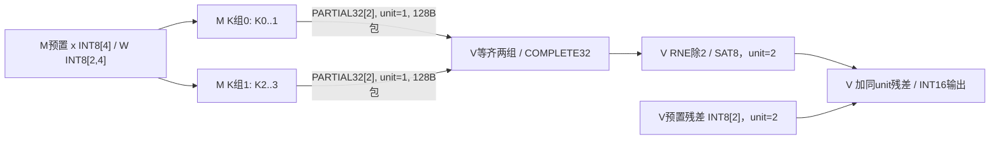
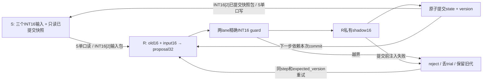

# Block v2 两个合成小图：输入、手算输出和离线重放

这是字段接续与协议反例的本地交付，状态 **offline/pending**，没有本批新 Issue/PR。固定来源 `88e9c4b2c3bb1b93b7155ba87ad11853e6c15512`；估算器基线 `b06d85a801a87c07f9745ccae6950dc7e4cbd0d2`。字段差距见 [对照表](../../../docs/BLOCK_V2_FIELD_MAPPING.md)，源文件原字节和 SHA 见 [manifest](sources/manifest.json)。本目录没有改写旧估算器/Block v1 快照，也不是 Issue #63 通用适配器。

以上为2026-10-24离线交付快照。2026-10-25用户已授权以`huangpingyang04-lgtm`发布独立Draft PR；[交接发布追加节](../../../docs/handoffs/2026-10-24-pending-block-v2-offline-prep.md)记录当前事实，run01/run02及来源manifest保留原始状态，不伪改为已绑定新commit。

已交付[Draft PR #78](https://github.com/rayggxia-workspace/LLMHardwareDesign/pull/78)，base为PR50的`task/48-int8-resource-estimator`，Refs #63但不关闭其通用适配器任务。本次发布前完整成功回执为[run04](evidence/run04-pr-preflight/validation.json)，原run03行尾检查失败记录保留；实现提交3b1fc28，后续HEAD由PR及发布回执绑定。

仅需 Python 3.10+ 标准库。从仓库根目录执行：

```powershell
python -B scripts/check_project.py
python -B -m unittest discover -s project/analysis/block_v2_offline -v
python -B -m unittest discover -s project/analysis/llm_resources -v
python -B project/analysis/block_v2_offline/replay.py project/analysis/block_v2_offline/fixtures/graph1_reduce_rq.input.json --expected project/analysis/block_v2_offline/fixtures/graph1_reduce_rq.expected.json
python -B project/analysis/block_v2_offline/replay.py project/analysis/block_v2_offline/fixtures/graph2_state_commit.input.json --expected project/analysis/block_v2_offline/fixtures/graph2_state_commit.expected.json
```

CLI先计算，再逐字段比较独立 expected，最后校验固定fixture SHA；成功返回0，合同/expected/篡改/容量错误返回2并写清错误路径。`--output <新文件>`拒绝覆盖，不能指向input/expected。测试/重放从不生成或重写fixture。输入字段规范见 [CONTRACT.md](CONTRACT.md)。Python API允许相同合同的其他合法数值用于边界测试；交付CLI特意只验收固定fixture字节。

## 统一通信和成本边界

以下全部是**本批合成配置**，没有作为已验收硬件参数：单跳，128bit链路每拍16B，64B header，payload向上64B对齐，单包总长≤2048B。因此单包最大payload1984B；4B或8B都形成128B包、占8个理想链路服务拍。`packet()`另测1984/1985分片边界，两个小图本身无分片。

unit/epoch/version、owner、step/group、范围、dtype/valid/payload长度等假设装入预留64B header。可以理解为16个32bit控制字的预算，实际二进制编码/CRC/时钟域/仲裁没有实现；本批不额外重复收取元数据payload。S2真实报告的服务假设含32B header/16B beat，不能套入本批64B header/64B payload对齐。旧估算器`beat_bytes=64`是payload对齐粒度，不能与128bit链路每拍16B混淆。

采用单在途、stop-and-wait策略，发送方等接收/端口操作完成后才发送下一条，credit至少能接纳一个完整128B包。每个使用的TX/RX各保留128B FIFO，独立于私有RAM。数据在RX→私有缓冲、计算、TX之间的复制/等待具有依赖，但本批**不计算其真实周期**。链路拍数只报告物理字节/16，不是端到端延迟；时钟和服务率明确为null。没有计算时间、能耗、面积或PPA通过结论。

所有初始数据视为运行前预置，**不计入runtime_traffic**。另给“若按同链路逐对象加载”的setup合成账；实际主机/外存路径未指定，不宣称这是不可避免的初始化流量。局部控制元数据由本地初始化，既有常量不另发控制包；中断、ACK/重传、协议CRC、网络编码和任意并发未覆盖。

## 图1：完整归约→单次RQ→残差消费者

输入 [graph1_reduce_rq.input.json](fixtures/graph1_reduce_rq.input.json)，独立手算 [expected](fixtures/graph1_reduce_rq.expected.json)。



两个M节点是**同一个M实例**的两个K组操作，不赠第二个M。W布局固定为`[output_channel][K]`，x沿K，部分和沿输出通道。两组均INT32、unit=1；完整归约后执行一次RNE/SAT8，后续残差加法在V内，输出INT16、unit=2。V只有两组齐全且单位一致才允许COMPLETE→RQ→消费者；缺组、重复组、错误范围/shape/dtype/unit均拒绝。图内没有可写持久状态，M拥有输入/部分和，V拥有完整和、转换和输出。

```text
x = [2, -1, 3, 4]
W = [[1, 2, -1, 0], [-2, 1, 1, 2]]
K组0: [2*1 + (-1)*2, 2*(-2) + (-1)*1] = [0, -5]
K组1: [3*(-1) + 4*0, 3*1 + 4*2]      = [-3, 11]
完整归约 = [0-3, -5+11]                = [-3, 6]
RNE(/2)后SAT8                         = [-2, 3]，unit=2
与残差[1,-2]相加                       = [-1, 1]，unit=2，INT16
```

负数tie必须取偶：−3/2→−2，−5/2→−2，−1/2→0。反例是对两组分别先RQ：[0,−2]+[−2,6]=**[−2,4]**，不等于合法[−2,3]。expected保留该反例；若把输入合同改成`rq_position=per_partial`，验证器直接拒绝，不把它当同函数。

运行期两个PARTIAL消息各`2×4=8B`逻辑payload、128B物理包、8拍，合计 **16B / 256B / 16拍**。V内归约、RQ、残差没有额外跨块消息。预置x4B、W8B、残差2B：驻留payload14B；如果分别加载，另列3包、384B、24拍，不混入运行期。

| 块/区域 | 字节 | 分配和生存期 |
| --- | ---: | --- |
| M x / W | 4 / 8 | 图开始到两组消费完 |
| M两组partial | 16 | 两个2×INT32槽，产生到V接收完成 |
| M控制元数据 | 24 | 6×32bit字：group、Kstart、Kstop、unit、valid_count、status，逐组复用 |
| V两组partial / complete | 16 / 8 | 两组接收至完整归约；complete至RQ |
| V RQ / 残差 / 输出 | 2 / 2 / 4 | RQ至加法；残差预置至消费者；输出至图结束 |
| V控制元数据 | 32 | 8×32bit：bitmap、组数、unit、epoch、version、flags、valid_len、reserved |
| M.TX / V.RX FIFO | 128 / 128 | 图内预留，不能借作RAM |

本批采用静态分区：所有scratch槽从图开始保留到结束，即使部分时刻无有效值也不复用。可复核的**峰值保留容量**为M **52B**、V **64B**，加两个FIFO为 **372B**；这是明确分配策略下的占用，不是最优容量或Python进程内存。fixture资源上限恰为52/64B；M=51B、V=63B或FIFO<128B都会拒绝。算术、复制/端口吞吐和广义混合unit ALIGN_REDUCE不在本图性能验证范围。

## 图2：三步递推、私有shadow和原子提交

输入 [graph2_state_commit.input.json](fixtures/graph2_state_commit.input.json)，独立手算 [expected](fixtures/graph2_state_commit.expected.json)。这是协议合成图，不是GDN/Mamba数学替代。



格式固定：state/input signed INT16[2]，unit=1，epoch=0；proposal signed INT32[2]，guard要求每lane都能**精确**写回INT16，不允许饱和替代。R是唯一写owner，S持有独立copy的只读已提交快照；初始version=0，成功一次才递增一次。每步先校验owner/step/expected_version/epoch/unit，再执行S读取/发送；这些元数据假定控制路径可预授权，无效元数据请求不会产生已计费数据访问。

```text
s0=[1,-1], u1=[2,1], u2=[-1,4], u3=[3,-2]
t1: [1+2,-1+1] = [3,0], version=1
t2: [3-1,0+4]  = [2,4], version=2
t3: [2+3,4-2]  = [5,2], version=3
```

每步S→R输入和R→S快照各4B payload。正常 **6消息 / 24B逻辑payload / 768B物理字节 / 48拍**。t2已创建shadow后注入失败：已提交态及S快照仍为[3,0]、v1，发布条数仍为1，失败trial没有输出包。重试同t2只成功提交一次；再次重发旧t2被拒绝。整条失败后重试轨迹有 **7消息 / 28B / 896B / 56拍**，多出的输入读/包收费。

S只有一个128bit 1RW bank。每次4B有效数据占一次有依赖的bank访问，读取其他输入与写快照不能共享同一个访问槽；下面`slot`是**串行bank访问索引**，中间插入消息/计算/guard/commit等待，不是连续的真实时钟时间戳：

| 轨迹 | 访问索引顺序 |
| --- | --- |
| 正常 | 0读u1 → 1写s1 → 2读u2 → 3写s2 → 4读u3 → 5写s3 |
| t2失败重试 | 0读u1 → 1写s1 → 2读u2(失败) → 3重读u2 → 4写s2 → 5读u3 → 6写s3 |

S接收端先暂存快照，再用单口写入独立snapshot区域；R的commit与下一步、快照发送顺序串行化。没有让S在同周期免费读写，也没有声称模拟真实双端口/网络争用。读输入不删除预置输入池，重试仍可重读。

| 块/区域 | 字节 | 生存期及控制义务 |
| --- | ---: | --- |
| R old INT16[2] | 4 | 初态/每次成功代始终有效；abort不改 |
| R proposal INT32[2] | 8 | add至guard，失败即无效；保留物理槽 |
| R shadow INT16[2] | 4 | 全lane guard通过至commit；失败不发布 |
| R输入缓冲 INT16[2] | 4 | S接收完成至本trial结束 |
| R控制元数据 | 32 | 8×32bit：owner、unit、epoch、version、position、trial_status、published_valid、reserved |
| S三个输入 | 12 | 预置到图结束；不因读过就借空间 |
| S已提交快照 / RX staging | 4 / 4 | 快照整图有效；staging接收至S单口写完成 |
| S控制元数据 | 24 | 6×32bit：owner、unit、epoch、version、snapshot_step、input_cursor |
| S.TX / R.RX / R.TX / S.RX FIFO | 4×128 | 每方向各一对，始终独立预留 |

同样采用静态保留，**R峰值52B、S峰值44B、FIFO512B，合计608B**。proposal、input、shadow和元数据都已经计入；不能只算old/shadow两个向量8B。R=8B或51B、S=43B构成容量不足反例。guard前/后各有独立槽，Python对象大小和JSON checkpoint文件不是该抽象硬件容量。

初态在R和S各有一份4B，setup另列2包/8B payload/256B物理/16拍；三个S输入另列3包/12B/384B/24拍。若全从外部按本假设逐对象加载，合计5包/20B/640B/40拍；实际初始加载路径未冻结，不纳入正常六条消息。

checkpoint保存state、snapshot、owner/unit/epoch/version/position、已提交输出及已计费访问记录；仅允许图内成功prefix，SHA是软件完整性检查。restore校验固定prefix合同，再从保存的字段建立独立copy，后两步从v1继续，不能重置s0/version。测试实际写入临时checkpoint文件再读取，证明三步结果/消息/访问序列与连续执行一致；重哈希后的错误owner/unit/epoch/version/state也被拒绝。本API不泛化到失败途中、任意模型、增量history或跨进程分布式认证。

## 实际验证与接续范围

[run01/validation.json](evidence/run01/validation.json)记录首轮实际执行：管理检查0；新32测试0；原估算器31测试0；两图各两次CLI结果字节一致；漏组及错误expected退出2；diff检查0。没有失败的业务测试被隐藏或放宽。最终文档/范围补齐后的验证见交接所链接的最终回执，首轮证据不覆盖其后新增的文档。

复核整个交付可运行以下命令，输出目录必须全新：

```powershell
python -B project/analysis/block_v2_offline/validate_delivery.py --output-dir project/analysis/block_v2_offline/evidence/<全新运行名>
```

runner按指定顺序执行检查并保存原stdout/stderr、退出码、测试数量、前后fixture/旧估算器SHA、源SHA和确定性结果；不会更新expected。31项旧回归是本次实际执行，不引用历史结果。本批手算expected以独立字面值保存，负数RNE额外使用标准库`Fraction`的round作独立oracle；测试不只是生产函数等于自身。

未覆盖：真实rescale算法和epoch变化、完整conv/history、真实模型算术/质量、混合scale宽ALIGN_REDUCE、任意调度/背压/死锁、真实RTL原子性、宽SFU/ROM/端口校准、冻结底座/金属层/过孔/RC/STA/PPA。六模板是逻辑模板，物理实例边界仍未冻结。恢复服务器后才需要由相应任务在新授权运行目录接入真实adapter及其已发布源码/张量/服务证据；本批没有SSH/SCP/Slurm、EDA、模型推理、权重/归档下载或GitHub写操作。
