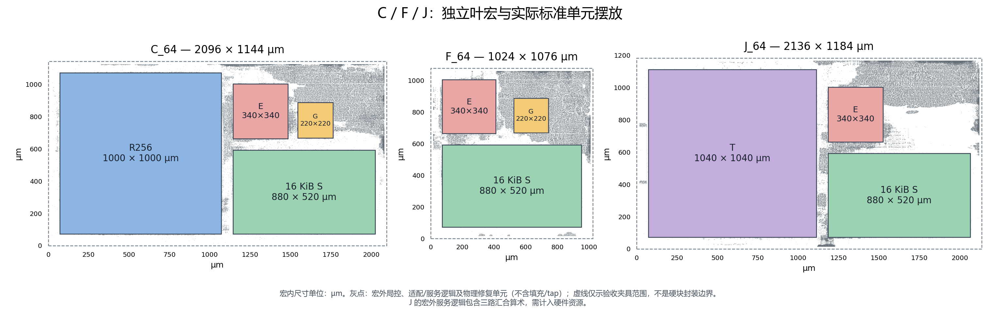

# C/F/J 的独立 64 bit 控制版本

保留原 `_128` 交付，使用 `controller64` 显式选择新版本；原 `controller` 路径不变。实际验收进度、作业号、负例和交付散列见 [Issue211 记录](../../../work/YUZE-LU/211/README.md)。未出最终回执的候选不计为通过。

## 最终验收

| 版本 | setup 裕量 / ps | hold 裕量 / ps | 完整原版 GDS DRC | 本地逐文件核验 |
| --- | --- | --- | --- | --- |
| C_64 | +134.228 | +14.133 | 0 | 316 |
| F_64 | +393.423 | +6.816 | 0 | 273 |
| J_64 | +116.616 | +40.791 | 0 | 548 |

三类均通过独立 TT 300 MHz、PG、电气、LEC、最终网表三初态和完整原版 GDS DRC；交付包及全部文件已本地核验。详见[验收索引](../../../work/YUZE-LU/211/control64-acceptance.json)。控制源也从旧冻结子集升级，因此这组数值不作为只改变指令位宽的单因素比较。



[图源绑定](../../../docs/experiments/assets/cfj-leaf-base/placement64-source.json)。虚线只示独立夹具范围。

## 固定合同

- 上游控制：PR180 `2a66b918df883853b6f276d40fd8490a8b5cdca0`，逐文件输入在 `control64-lock.json`。提供该提交的完整源码目录，通过 `CFJ_CONTROL64_SOURCE` 指定；每次生成都核对锁定文件的 Git blob 和 SHA-256。
- 物理局控由该提交的 `lc_min_controller.sv` 原样展开 include 后生成，原生 profile 和各组参数由 `group_top.py` 绑定；MC、LC、镜像编码工具在程序回归中取自同一上游。没有另写一套 64 bit 译码器。
- 新镜像为版本 2、64 bit 指令；PM 请求响应仍为 128 bit。控制器保留上游的旧镜像兼容能力。指令段压缩不代表描述符、整镜像或逻辑面积减半，指令数及表容量继续受 profile 检查。
- 当前取指按 PC 选择返回字的高／低半字，再展开到内部译码格式；不代表双发射，也不能据此假定 PM 请求次数或执行时间减半。
- C/F/J 的功能叶宏、16 KiB 私有 S 和服务适配器不因指令位宽改变。私有 S 用于数据；本独立夹具的程序 PM 在外部。没有接入新 `control_boot_top`、可综合 PM 或统一主机装载管理口。
- 此版本声明原生服务子集的程序覆盖，不声明完整 ISA、九实例组网或全模型覆盖。独立夹具的局控 ID 为 0；联合顶层需重新绑定实际实例身份并验收。

## 功能与物理入口

截至 #214 `f5fb8115`，P/U 的 `_64` 是在 #195 有界服务语义上移植 #180 `b54531b3` 的紧凑取指；本 C/F/J 版本则原样使用 `2a66b918` 局控。共同使用 v2 镜像不证明完整 ISA/profile/描述符合同相同。联合顶层前应明确允许的共同指令与服务子集，核对局控 ID、profile、描述符及完成事件，并用同一母控生成的程序做联合回归；现有各自物理资格不能代替这一步。

在分配的计算节点内执行，仿真建议 4 核、布局布线 10 核、完整审计 6 核。仍需提供既有的冻结控制包和叶宏视图，路径与 `physical.py`、`stage_regression.py` 一致。应使用完整本分支源码，包含 `project/experiments/block_v1/technology-2um-v1.json`；精简快照漏带此辅助输入曾导致上层检查失败。

```bash
export CFJ_CONTROL64_SOURCE=/path/to/pinned-pr180-checkout
# physical.sh 使用 cleanenv 容器，显式传入同一只读源目录。
export SINGULARITYENV_CFJ_CONTROL64_SOURCE="$CFJ_CONTROL64_SOURCE"

# SLURM_ARRAY_TASK_ID=0/2/4 分别为 C/F/J。
bash project/experiments/cfj_leaf_base/physical.sh \
  "$RUN" "$QUALIFIED_ROOT" "$SOURCE" finish late extended controller64 native-guard

# 可分别执行 C 往返、C-GE、F、J 及双向程序。每项跑三种初态。
bash project/experiments/cfj_leaf_base/run64.sh "$SOURCE" "$QUALIFIED_ROOT" "$OUT" rtl '' c -1
bash project/experiments/cfj_leaf_base/run64.sh "$SOURCE" "$QUALIFIED_ROOT" "$OUT_GE" rtl '' c 2
bash project/experiments/cfj_leaf_base/run64.sh "$SOURCE" "$QUALIFIED_ROOT" "$OUT_F" rtl '' f 1
bash project/experiments/cfj_leaf_base/run64.sh "$SOURCE" "$QUALIFIED_ROOT" "$OUT_J" rtl '' j 4
bash project/experiments/cfj_leaf_base/run64.sh "$SOURCE" "$QUALIFIED_ROOT" "$OUT_DUAL" duplex
```

`run64.sh` 复用冻结的上游 frontend 编译、镜像和测试场景；双向程序只执行该测试台已定义的正常、背压、复位场景。最终物理网表用同一入口的 `gate STITCHED KIND BENCH` 模式回放。紧凑取指专项沿用固定控制源的 `control_rtl_min_v0_1/run_compact.py`，检查半字地址、分支、旧镜像兼容、尾部填充和未知版本拒绝。

## 后端和最终门

原平台已有的禁用单元列表追加 OAI221_X4，须由 make 命令行传入，避免被平台配置覆盖；这针对 `_128` 实验中隔离可复现的原库几何问题。最终仍执行原版完整规则。

固定紧凑摆位的 `compact_native_edge_guard.tcl` 和 `_64` 的 `compact64_native_edge_guard.tcl` 只约束父层路由；不修改叶宏、pin、原生规则或 ISA。后者用于 C/J 的新接入冲突。它们不是通用顶层约束，移动宏后需重建。`resume_route.sh` 可从封存 CTS 加载这些约束并保持源快照散列；优化 hold/slew 裕量不改变最终 SDC 和 Liberty 判定限值。

J 的后续物理 ECO 由 `resume_j64_eco.sh` 从已修复的 post-global-route 数据库续接（初始为 physical04，后续明确绑定上一候选），真实输入阶段写入 `eco-origin.json`。`compact64_j_rx_hold_eco.tcl` 使用固定的 `rx-hold-targets.tsv`，为原提取结果低于 80 ps 的 301 个接收寄存器 D 端点各加四颗 BUF_X1；先接 PG 再设保护，重新合法化及路由，新增缓冲计入面积/功耗。该名单只适用这一固定夹具，不是通用顶层约束。优化后仍须通过同一最终门。

后续候选还包含两颗现有 T 输入驱动器的原库等价尺寸调整，以及 `compact64_j_post_grt_repair.tcl` 的电气/hold 修复。physical17 从 physical16 续接，对 T 的 128 位 write_data 与 10 位 write_index 共 138 个输入，将末级非反相缓冲提升至原库 BUF_X16（已有 X16/X32 保留），按 T 输入实际 M10 形状的中心，选择最近的宏外边缘通道放置末级，合法化后固定其位置；固定末级输出网，同时保留驱动输入可修复，再进行上游修复；新增驱动能力与面积计入冻结前实现，不能视为后制金属修复。实际端点/旧新 master 记录在 j-terminal-drivers.tsv。physical18 继续使用 physical17 的提取 RC，保留末级布局，仅将 T[38]/T[36] 末级调整至 BUF_X32，并重新合法化两颗单元；其余上游负载由同一电气/hold 修复流程处理。compact64_j_preserve_eco.tcl 还包含两处该夹具的父层接入禁布，不能无判断重复应用到其他底座。上一候选 SPEF 仅作为优化提示，并单独封存；最终独立读取新 SPEF。`native_precheck.sh` 先拒绝原 PG、时序或电气限值已失败的候选，通过后仍执行完整原版 DRC，不代表预检查本身具有最终资格。

合格包须同时绑定最终六文件、完整原版 GDS DRC 0、VDD/VSS、电气、TT 1.1 V / 25 °C / 300 MHz setup/hold、布线至合成参考 LEC、实际网表三初态程序及输入镜像。后制 base/high RC 是另列的研究模型，不是校准十二层工艺。`package64.py` 检查这些条件并封存实际执行源、失败记录、内部 SHA-256 和包级散列；不替换 `_128` 包。

## 实际 placement 图

`plot64.py` 从交付包里的 inventory 和最终 DEF 取宏位置及标准单元位置，排除填充/tap；虚线只表示独立夹具范围，不生成组合硬块边界。可传入已经验收并本地核验的一个或多个包，例如：

```bash
python -B project/experiments/cfj_leaf_base/plot64.py placement.png \
  accepted-c_64.tar.gz accepted-f_64.tar.gz accepted-j_64.tar.gz
```
