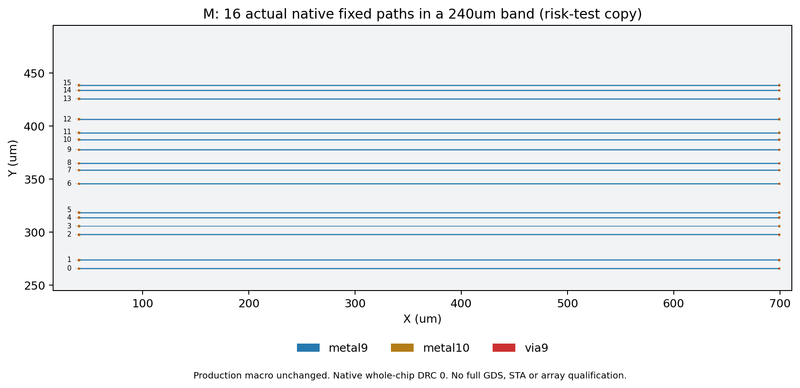
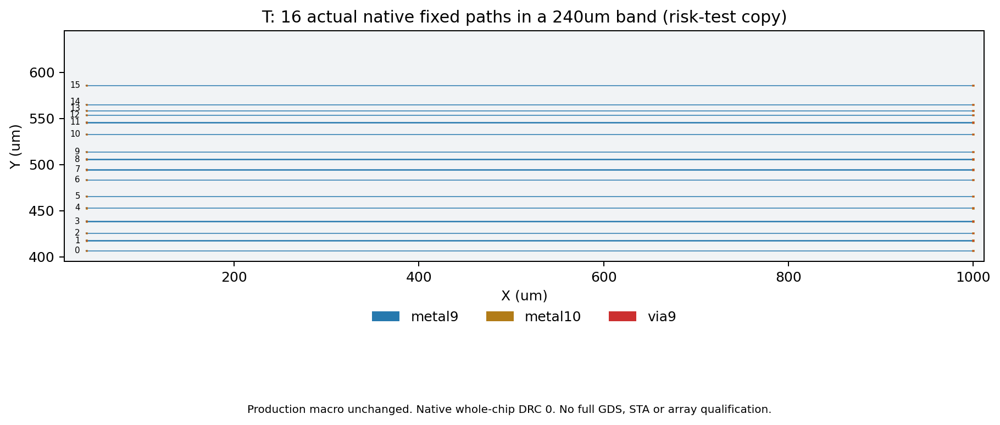

# 有限16位固定路径风险试验（run282）

Issue #121 / PR #122。M/T 各一个16CPU独立任务，在已接收原生最终ODB的可丢弃副本中实现16条路径，均通过真实全片原生DRC（0项）。原生产ODB SHA保持，未新增生产宏候选。

| 项目 | M | T |
| --- | --- | --- |
| 固定横向通道搜索带 | 中央240µm | 中央240µm |
| 实际连通位数 | 16 | 16 |
| 每条M9水平线长µm | 659.2 | 960 |
| M9总线长µm | 10547.2 | 15360 |
| 原生via9数量 | 32 | 32 |
| M10 2×2µm端部落点 | 32 | 32 |
| 原生DRC项数 | 0 | 0 |
| 去除via9负例 | 拒绝 | 拒绝 |

坐标来自实际轨道及全部原生占用（含PG/clock/pin/OBS），并由写出后的ODB迭代几何和独立DEF RECT解析核对；16条路径同时存在且逐网验证端到端连通。采用原生M9线宽0.8µm、via9孔0.8µm，不把新增层2µm线宽强加给原生布线。原80µm带只能找到7/8条的失败诊断仍保留；扩大单个搜索带后的具体路径成功不能证明任意位置或任意位序可用。

两图取自实际回读图形，16位编号、层、坐标和单位明确，PNG均已查看。plot-manifest.json绑定生成器与原始回执SHA。

本结果只接收声明的局部几何风险试验。`p3_qualified=true`不表示生产宏改版、完整GDS/STA或阵列接收；报告同时明确`production_macro_changed=false`、`full_leaf_qualified=false`。大ODB/DEF保留授权服务器，SHA见各任务报告，仓库保存15份原始小证据/12条输出绑定。

**首版生产宏不采用这些M9预连。** 仍固定M1–M10，并通过真实M10接点由后续M11/M12适配互联。若以后需要下层固定贯穿线，必须在另一版冻结前显式纳入宏并重做受影响的完整验收，不能把本试验的可用路径当作冻结后仍可修改的资源。不因早先80µm筛查失败把全部宏降到M8。
