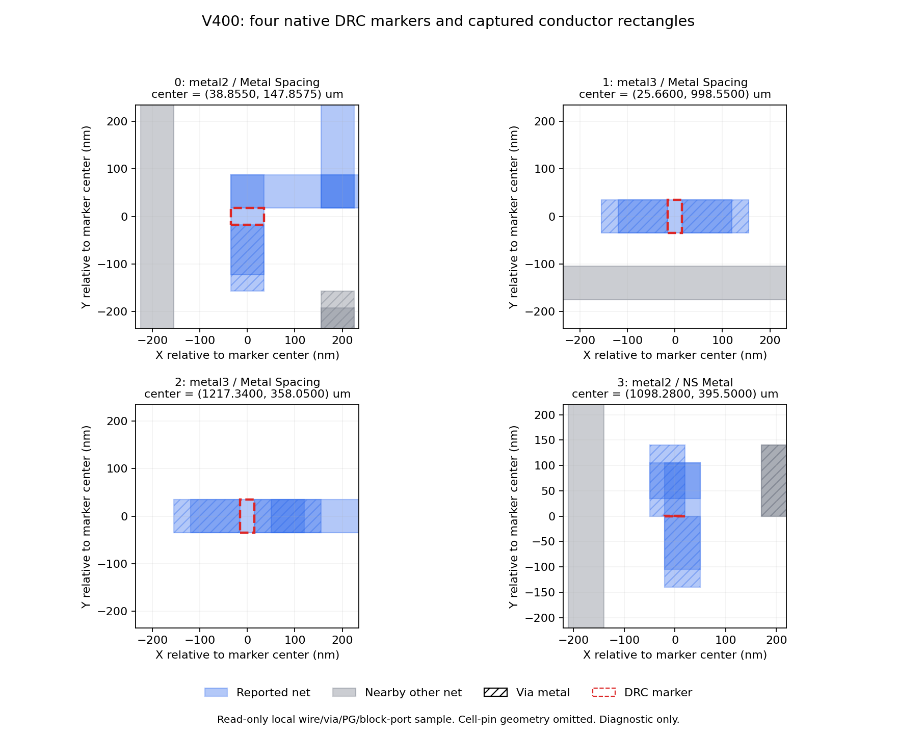

# 旧 V400 四处 DRC 标记的只读几何

Refs #121 / PR #122。415 在 R404/93555/node21 已有 allocation 的空闲 16–31 CPU 执行，正常 COMPLETED/0，原始 V400 route ODB 前后 SHA 不变。10 份原始文件、脚本/两个实际源 Git helper/ODB 回执绑定见 index.json。

扫描 508686 个网络、18002585 次矩形回调，在四个标记各扩展 0.2µm 的窗口找到 23 个 wire/via/PG/block-port 矩形。只选取首个 M2、首个 M3、一处时钟网和唯一 NS Metal 标记。未扫描单元 pin 几何，不代表完整版图导出或全体违规根因。

plot_markers.py 根据原始捕获数据生成 PNG/SVG，plot-index.json 记录输入/生成器/产物 SHA。已实际查看 PNG：四个面板、坐标、图例和诊断范围可读。蓝色是报告网络，灰色是邻网，斜线表示 via 金属，红色为原始 DRC 标记。

标记与现有矩形重叠只是继续检查编码/规则的依据，不能推断误报。416 进一步比较两种数据库形状读取方式；417 在副本上做有限编码对照，均单独留证。旧 V400 仍拒收，不向新 V410 转移结论。
