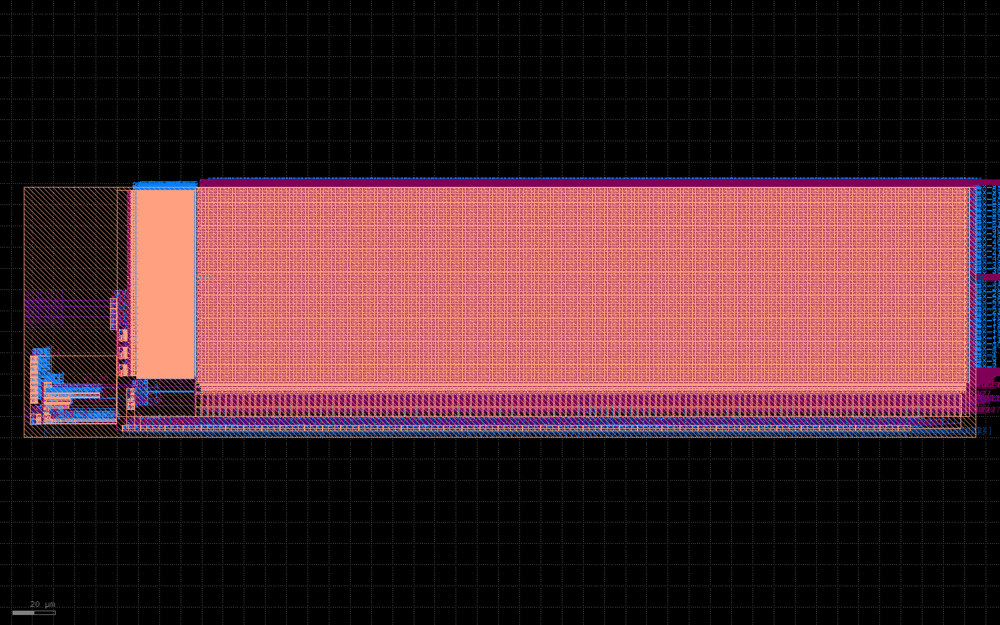

## 2026-11-02T12:39:03+08:00 Issue155继续：真实三点并行集成通过

95084真实原生三点并行集成已通过，三个点独立输入/输出对象SHA复核一致；95070/95077新实际银行完整未放宽DRC均0、晶体管LVS均匹配。95062/95065两个实际生产首个300MHz最大点通过并进入原生最小周期搜索；完整库和整个四银行S终验仍未完成，继续执行。新链95071→95073→95074→95075/95076、95078→95079→95080→95081/95082实际排队。原标准单元S不变、无自合并，Issue155 in_progress、PR158 Draft。证据：work/YUZE-LU/155/continuation-015。

## 2026-11-02 继续完整表征：初始DC及独立表格点并行

真实最大负载在DC初始化下通过独立读写/输出/半周期/延迟限制；旧UIC的fs级推进问题已定位。95062串行及95065六点动态队列的完整新生成实际运行中，保留全部原生门与源输入快照；不是库或整块S验收。新版95032几何完整DRC=0/LVS匹配；94836超时及其仅PENDING旧依赖退役证据保留。详见 continuation-013/README.md 和 continuation-014/README.md。继续完成全部S验收，未交最终六文件，不自行合并。

## 2026-11-02 纠正诊断输入绑定并继续执行

94990的通过回执不能证明真实银行时序：实际仿真trimmed.sp被重新生成，已追加否决审计。修复源e98291a6的95019双文件绑定诊断及828b3688的95028完整新生成已提交；原运行EDA保留。详见 continuation-012/README.md。全部整块S验收尚未完成，继续执行。

2026-11-02 接续：真实布局电路与netlist_only诊断的晶体管分指/结参数不同，旧300MHz诊断不转移资格；94836仍真实表征，单线程快照94983、直接实际电路检查94990运行。详见continuation-011；完整S仍未验收。

## 2026-11-01 23:49 CST：新银行同源接点检查与整块S新链

复用 task/155-s-sram 工作树。generate-009/94836仍在真实表征，actual-model-009/94839等成功前置；不使用49级旧库。新实际GDS已写出。bank-eco-003/94852被接点旧单元编号断言拒绝；失败保留。源码a22005be按真实65nm VIA2与M2/M3尺寸选择目标，不以旧编号代替身份，不改源GDS或检查规则。bank-eco-004/94855实际运行：几何序列化严格核验、GDS派生抽象及OpenROAD读回已过，晶体管LVS明确匹配，完整未修改ORFS DRC尚运行。

实际新链：94860/bank-views-005 afterok:94836:94839:94855 → 94861/physical-013（整个四银行S综合、布局布线、RCX/GDS）→ 94863/final-011（16CPU独立物理验收＋4CPU最终功能同节点并行）与94865/formal-009。前置汇合逐一核对视图SHA及模型/物理证据。94853/94854/94856/94857只在本人、本任务目录且PENDING核验后退役，因前置已明确失败；无正在运行EDA被取消。原标准单元S及其他宏未改。原始启动、失败、当前证明及终态见continuation-010；退役证据见remote-launches/retire-chain004.json。

当前没有完整S最终GDS或300MHz最终验收通过，未完成最终六文件/版图交付。实际内部wire PEX缺失与上游HL复制LH限制保留。继续需核对94855完整DRC及94836表征终态，失败据实定位；不得手改Liberty限值或以单银行代替整个S。Issue155保持in_progress、PR158 Draft，不自行合并。

# S SRAM 独立物理版本

## 新生产已启动（2026-11-01 23:05 CST）

94836/generate-009已实际RUNNING：从完整生成器重新构建唯一WPR2/25级物理候选及9点真实表征，实际源fe2b1ee8，16CPU分配/8线程KLU，复用只读工具运行覆盖；[提交回执](remote-launches/generate-009/submission.json)。94839/actual-model-009已真实提交afterok:94836，等待新版生成模型后执行三初态存储/完整供数回归。不是已生成的五视图、完整S或300MHz最终资格；先前49基线保留。

## 当前选型与下一步（2026-11-01T23:04:31.185676+08:00）

WPR2/25级在300MHz实际网格两极均通过全部原生检查和独立12项检查：[最小点](array-probe-004/min-receipt.json)0.2091fF/5ps、SEN=1.470278ns；[最大点](array-probe-004/max-receipt.json)6.6912fF/160ps、SEN=1.476083ns。距半周期分别196.389/190.584ps；这是网表点诊断，不是实际新GDS或完整库。完整原始日志与SHA保留。WPR2/31级扩大负载最大点也通过，SEN=1.610970ns；WPR4/31级仍超半周期，9级仍被原生感放检查拒绝，见[array-probe-003](array-probe-003/download-index.json)。

据此仅选WPR2/25级作为后续生产候选，保持256×128银行、四银行16KiB及全部外部接口不变；新生成必须采用实际9点load/slew网格，并重做匹配GDS/LEF/SPICE/Liberty/Verilog、完整DRC/LVS。generate-009启动脚本先核对两个实际原生/12项结果和负载域，拒绝未完成或失败的回执，复用经过SHA核对的只读工具覆盖而非旧版图/库。后续仍是完整S P&R/GDS，当前尚无完整S最终GDS。

原49级94706完整表征与既有S工程链保留；最小周期搜索最后刺激4.21875ns不代表接受该值，原生find_min_period_one_port返回已通过的上界4.375ns，随后实际表格按4.375ns执行。不能称300MHz通过，也不手改库或预算。

## 新实测与表征负载范围（2026-11-01T22:50:54.546159+08:00）

94803/array-probe-002已有明确结果：[WPR2/31级](array-probe-002/wpr2-stages31-receipt.json)在3.333ns、0.8364fF、40ps下全部原生检查及独立12项检查通过，SEN=1.608151ns，距半周期仅约58.5ps；这是网表点诊断，尚非真实候选GDS或完整库。WPR4/31级的10项数据检查也通过，但SEN=1.739179ns超半周期、原生检查不通过；WPR2/9级被原生检查明确报Sense amp enable timing error（[原始日志](array-probe-002/wpr2-stages9-launch.log)），不删该有效检查。

确认默认表征最大load=0.8364fF，而实际Nangate45 DFF_X1 D电容=1.14029fF（CK=.949653fF），尚未计布线，默认范围不能直接承担最终物理库。原生lib.py以tech dff_in_cap=.2091fF和rise_time=.005ns乘缩放数组，输出max_cap为最大实际表征load；新生产配置使用原生Cartesian load_scales=[1,8,32]/slew_scales=[1,8,32]，即0.2091/1.6728/6.6912fF与5/40/160ps。必须实际重跑这些点，不手改既有Liberty限值，不使用上游警告索引不准的use_specified_load_slew。

94807/array-probe-003在24CPU内3×8线程检查扩大范围的最大点，源aeecfdb4；94815/array-probe-004在16CPU内2×8线程检查WPR2/25级的实际网格最小/最大点，源f27c7632。25级为9级过早与31级接近半周期之间的单一实现筛选，不新增物理宏种类。两组均独立运行，无候选GDS/Liberty；根据逐项完成结果推进，不等无关慢项整批收尾。94706的49级原真实表征进入功耗测量，刺激采用4.21875ns；完整S基线依赖链保留，尚未P&R、无完整S最终GDS。

## 阵列诊断修正（2026-11-01T22:26:50.425275+08:00）

94794/array-probe-001三个配置构造了诊断电路，但刺激写入目录与模拟器运行目录不一致，原生delay_sen/数据测量未执行，后处理因空测量失败；[保留原始失败](array-probe-001/)。这是脚本执行失败，不是三个硬件配置失败。51cb1d17修正为原生OPENRAM_TMP刺激目录，并将独立感放检查的原始秒值明确转换为ns后比较；原生检查保持不变，未改任何正在运行的输入。

94803/array-probe-002已重新提交并运行，同一24CPU分配内3个独立配置、各8线程，实际源51cb1d17，仍无候选通过结论。完整S生产链及49级真实表征保持；最终仍要求完整布局布线/GDS。原生49级ECO完整DRC=0及LVS匹配已实收。

## 当前事实（2026-11-01T22:16:37.004471+08:00）

完整S P&R尚未开始，没有完整S最终GDS，任务继续。94760新版49级接点ECO已完成：完整未放宽ORFS DRC=0、晶体管LVS明确匹配；[完整原始报告与接收SHA索引](bank-eco-002/download-index.json)。94706真实表征继续（最小周期搜索），94712及94770→94771→94773/94774依赖链保留。

必须区分：原94745仅10项数据检查通过，实际原生感放使能检查未过，不能称300MHz通过；详见下面更正及原始日志。94794/array-probe-001已运行，24CPU内三个独立SPICE-only配置各8线程并行：WPR2/9级、WPR2/31级、WPR4/31级。每项保留全部原生检查并独立要求delay_sen<=半周期，不删/放宽有效检查；当前在构建诊断电路，尚无新通过结果。只筛选满足相同外部容量/接口/吞吐约束的内部阵列/控制，未改当前生产输入或其他宏任务。

## 300MHz重要更正（2026-11-01，22时段 CST）

原94745的passed仅指8项Q/Qbar及2项输出，不能作为完整原生表征通过。[追加原始日志审计](target300-probe-001/native-audit.json)发现delay_sen0测量失败；5ns原始49级日志的感放使能延迟约2.109ns，超过300MHz半周期1.667ns。实际新49级全表征已拒绝3.75ns并继续4.375ns搜索，现不能认定达成300MHz。搜索不放宽，完整S链暂保留工程基线。

上游check_valid_delays已经在最小周期比较前将负LH替代成正HL，因此不能把该拒绝归咎于漏处理负LH；先前关于该原因的解释不完整。最终库表仍有HL复制LH及内部wire PEX缺失的限制。原始10项结果不覆盖感放使能约束，不能删掉该有效检查。

[元件/有序端口规范化比较](canonical-circuit-001/receipt.json)证明原49级诊断与新真实生成器的trimmed.sp共79个子电路完全一致（仅注释、大小写、空白和声明/元件顺序差异，保留ENDS标签参与比较）；不是另一轮实际300MHz仿真或PEX证明。前两版比较器对上游replica_cell_1rw/.ends cell_1rw的相同命名过严，现将ENDS原文纳入两侧比较，而非忽略差异。

准备SPICE-only阵列/控制诊断：保持256×128银行及外部接口，对words_per_row=2/stages9或31、words_per_row=4/stages31执行全部原生delay checks并独立要求感放使能在半周期内；候选不生成GDS/Liberty，明确禁用布局DRC仅因netlist-only诊断，不能进入物理链。目的为减少宽字线负载与控制延迟冲突；只有完整检查通过才考虑替换选型并重做真实物理生成。当前49基线和其他任务不动，未宣称新候选通过。

## 当前执行链（2026-11-01，21:49 CST）

已按用户/作业名/工作目录/必须PENDING逐一核验，退役尚未运行的原LEF链94763/94764/94765/94767；[实际退役回执](remote-launches/obstruction-chain-retirement.json)，非因慢或静默，全部输入归档保留。94706真实完整表征、94712真实模型及94760新版宏完整DRC/LVS继续运行/等待。新生产链以归档a50960aee4ebf58c9495384637affd997aa73c41为源，严格绑定修正抽象：94770/bank-views-003 afterok:94706:94712:94760 → 94771/physical-011（完整S P&R/GDS）→ 94773/final-009（16CPU独立物理验收+4CPU功能回归同节点并行）及94774/formal-007并行；[实际提交回执](remote-launches/remaining-chain-003.json)。依赖未完成，完整S P&R尚未实际开始；无完整S最终GDS。

## 真实新版宏与后续链（2026-11-01，21:48 CST）

新版49级宏原生DRC已结束、原生LVS明确Netlists match，实际最终银行GDS/LEF/SPICE/LVS电路已产出，真实时序库正在表征（Liberty仍未完成）。94760/bank-eco-002正在与表征并行执行：四个接点修正的几何/序列化严格证明通过，修正GDS与实际新版LVS电路已匹配，完整未放宽ORFS DRC仍在运行。修正GDS SHA为6df1b08de915fa9b8c7c887564a6a3153ee33c2197878d8e5fe199f8c1b29828。完整S尚未开始布局布线，尚无完整S GDS。

新宏[几何诊断](pin-obstruction-probe-002/receipt.json)证实239/267个M3信号接点上方无实际M4，却被整片LEF M4 OBS覆盖。单独的修正版抽象从真实修正GDS导出348个M4阻挡矩形，证明所有真实M4都由阻挡或未改引脚覆盖、其他LEF文本逐字不变；[几何证明](lef-refinement-001/receipt.json)与[原生OpenROAD读回](lef-refinement-001/native-receipt.json)通过。修正抽象SHA为db8c5d9df6657829bb01ecc23a7b0f97faa063d32749381aa2f30cc55239cb23。这只是抽象一致性，实际接入及完整DRC仍待完整S验证，不称物理验收。

原已排队94763/94764/94765/94767使用原LEF；源代码现准备以严格绑定真实GDS、原LEF、几何证明和原生读回的修正抽象替换保守阻挡。应在确认这些作业均仍PENDING且属于本人本目录后，保存退役证据并以新目录提交完整依赖链，不修改其归档输入或重用旧结果。实际新作业号以新增提交回执为准。94706/94712/94760继续，不因静默或慢而取消。

## 当前状态（2026-11-01，21时段 CST）

**完整 S 尚未布局布线完成，尚无完整 S 最终 GDS；本任务继续以完整远程物理实现为交付。**

94745/target300-probe-001 已完成（7分34秒 Slurm、442.947秒求解）：49级 SPICE-only 候选在 3.333333333 ns、40 ps 转换时间、原 10 ps 步长下，8项 Q/Qbar 读写状态及2项输出检查全部通过。输入波形来自原生成器，先证明原5 ns 的138项 PWL及clock可重建；只改变周期及相应测量窗口，不改变电路、模型检查、原测量或容差。见[实际回执](target300-probe-001/receipt.json)、[原始日志](target300-probe-001/timing.lis)。它仍不是新版实物或完整时序库的验收。31级诊断94697在1小时限额超时，无读写结论；同一作业内49级结果已独立保存，不推进31级物理实现。

94706/generate-008 正在真实生成49级宏。新版实际GDS已写出（临时文件约14.9 MB），原生 OpenRAM DRC仍在执行，尚无最终银行五视图或完整库；94712真实模型回归继续等待 afterok:94706。不能把临时GDS当作已验收银行，更不能当作完整S。接点ECO/完整未放宽ORFS DRC/LVS、实际库、完整S综合/PG/CTS/布局布线/RCX/GDS及最终验收仍待执行。

S专用最终验收已增加原生 minimum_period/min_pulse_width 报告和四个实际 SRAM 时钟接点覆盖检查（代码准备，尚待实际新版库与最终ODB执行）。共享主线STA脚本未修改；缺少任一银行约束、未传播时钟或有违例均应失败。原生工具的get_pins/get_property及脉宽报告格式已通过真实标准单元小例确认，不能代替SRAM实际验收。

旧9级银行的[只读几何诊断](pin-obstruction-probe-001/receipt.json)发现267个M3信号接点中240个上方无真实M4，却被LEF整片M4 OBS覆盖。范围仅旧银行，不是新版接入或布线失败证据；目前未改LEF。若需修正抽象，必须证明真实GDS金属覆盖完整并完成实际布线/DRC。

非SRAM S、主线程及其他宏保持独立。Issue155 in_progress、PR158 Draft，登记/看板及审查状态见下文历史回执；不提前宣称任务完成或300MHz硬宏最终资格。

## 历史状态（2026-11-01T20:44:31+08:00）

**完整S尚未布局布线完成，没有完整S最终GDS。** 保留非SRAM S，当前仅推进一套新49级控制候选的真实物理实现，不改主线程/其他宏任务。

原9级银行接点修正后，完整未放宽ORFS Nangate45 DRC=0、晶体管LVS明确匹配，原始全量报告已实收并核对远程SHA，见[bank-eco-001](bank-eco-001/receipt.json)及[接收索引](bank-eco-001/download-index.json)。但原9级晶体管5ns写1/读1失败；真实探针显示写使能在字线建立前过早结束，不能因DRC/LVS或行为模型通过而使用该电路。

94697/delay-probe-002的49级SPICE-only候选保持原5ns输入和原测量，仅更换延迟链：8项Q/Qbar读写及2项输出检查全部通过，耗时706.827秒；[原始日志](delay-probe-002/stages49.lis)和[判定](delay-probe-002/stages49.json)。这还不是匹配新版GDS或完整时序库。31级继续作为诊断收尾，不推进第二套物理实现。

94706/generate-008已实际运行：从完整OpenRAM编译器重新生成49级电路/版图和真实ngspice库，TT/1.1V/25C，16CPU分配、8线程KLU配置。新隔离覆盖逐文件核对仅stimuli.py变化，修正cwd/读取本地线程初始化、选KLU、移除ng_nomodcheck以保留BSIM模型检查，未改刺激/原测量/容差；[实际启动与覆盖回执](remote-launches/generate-008/submission.json)。当前仍在构建新版物理数据，无完成结果。94712/actual-model-008真实afterok:94706，等待实际生成模型后做三初态存储/完整供数回归，不提前认定通过。

原94648及94670/94672/94673/94674旧9级链已按用户/目录/作业名核验后退役，见[回执](remote-launches/control9-retirement.json)。依据是已证实的写入失败及49级通过、新实际生成启动，非因沉默或耗时；10ns在途输入/日志保留，不称其完成或失败。后续必须绑定新实际五种视图、重做接点ECO/完整DRC/LVS，再执行完整S综合/PG/CTS/布局布线/RCX/GDS及最终STA/电气/引脚/功能/严格宏边界等价，不能复用旧银行来假装新版电路。

宏内部时序仍受KLayout wire PEX未实现、上游HL复制LH等限制；外部SPEF不能消除，不宣称300MHz硬宏最终资格。已发布8f49e99b与归档a875f103整树一致；仅独立分支正常快进，未force。Issue155 in_progress，PR158 Draft，审查人待指定；登记pending、看板unverified/同步pending，管理员待指定。

## 历史诊断：20:21 CST 控制诊断与并行候选

[write-controls-001](write-controls-001/timing.lis)的真实5ns探针：40.5ns输入已锁存到约1.1V；43ns字线约0.406V而写使能只剩约0.104V；44ns字线达到1.1V而写使能接近0。写1存储节点仍约3μV。提示控制窗口与字线建立错位，属于待检验的电路假设，不能仅归咎于外部周期。此目录receipt的passed仅指求解器执行，不是读写通过。

94697/delay-probe-002分配16CPU，同时运行31/49级控制延迟的两个SPICE诊断（各8线程KLU）。电路仅替换延迟链子电路，其余电路、输入与原测量保持；尚无候选对应的新GDS，不能接入完整S或冒称LVS匹配。94696/delay-probe-001因诊断脚本漏.ENDS立即报错，日志保留；b3d888cc补回并加入子电路配对守卫后提交94697。94697新增非侵入边沿探针存在DUT前缀错误，原功能测量不受影响；代码已修复，当前运行输入不改、不为此重复计算。

后续生成器已准备显式控制级数、TT/1.1V/25C角、8线程参数。新隔离运行时覆盖只修正ngspice cwd/本地初始化、选KLU，并移除上游ng_nomodcheck以保留BSIM模型检查；实际旧源的精确匹配/语法验证通过，尚未执行新物理生成。不得把诊断成功直接等同于实物、完整库或完整S成功。

以下按时间保留过程记录，历史排队状态以本节为准。

任务：[Issue #155](https://github.com/rayggxia-workspace/LLMHardwareDesign/issues/155)。负责人：YUZE-LU。

本次验收包含完整 S 的远程布局布线及最终物理结果，不能以本地接口仿真结束。
保留标准单元 S、原供数器和其他宏的现有结果与任务；四个256×128bit真实1RW SRAM替换16KiB有效载荷存储。

原始本地接口证据位于[143/s-sram-variant](../143/s-sram-variant/README.md)：严格lint及三初态存储/完整供数测试通过。原S接口源在本地基线`9a248b38`与PR144远端基线`d1f26884`逐路径比较无差异；本分支仅重放独立SRAM修改，不向远端发布未关联的主线本地提交。

## 远程执行记录

根目录：`/public/home/yuzelu/project-circuit/LLMHardwareDesign/issue-155`。
固定ORFS镜像SHA256：`49eae8b526c6eec806473b13db5d98f848424f38de9fa3430e8ce8e157144f3a`。
EDA仅在Slurm分配中执行；任务名为`yzl-sram-*`。单个SRAM银行生成一次、实例化四次；在真实视图产生前不启动依赖它的P&R。

| 目录 | 作业 | 实际结果 |
| --- | --- | --- |
| probe-002 | 94535 | COMPLETED0:0：Python3.10.12/KLayout0.30.12/Yosys0.68+post；无OpenRAM/ngspice；平台SRAM GDS列表为空 |
| generate-001 | 94536 | FAILED2:0：归档导出CRLF使bash拒绝pipefail；已新增s_sram目录LF属性 |
| generate-002 | 94537 | FAILED1:0：计算节点DNS不能解析软件源；改用离线包 |
| generate-003 | 94538 | FAILED1:0：跨平台下载未带Python3.10条件依赖exceptiongroup；已补齐并重新封存离线包 |
| generate-004 | 94540 | 工具准备阶段CANCELLED：在进入SRAM编译前补齐显式OPENRAM_TMP/TMPDIR目录约束；已安装Python依赖复用，未取消其他任务或已运行的SRAM编译 |
| generate-005 | 94543 | 独立c64/16CPU；离线依赖哈希与精确版本检查通过、ngspice45实际编译成功，真实SRAM编译已开始；最终结果待接收 |

离线包v2：`/public/home/yuzelu/opt/eda/issue155-offline-v2/offline.tar`，SHA256=`8cbdf1046ed3c101429de04790caba6184e92fe32d7b624020cd6dee2e63d886`。
OpenRAM1.2.48、numpy1.26.4、scipy1.13.1、scikit-learn1.5.2、coverage7.6.1及官方ngspice45源码，使用包内逐文件SHA256SUMS核验。
工具目录：`/public/home/yuzelu/opt/eda/issue155-sram`；不修改公共镜像或其他任务的工具。

## 当前验收边界

真实宏配置为FreePDK45、TT/1.1V/25℃、`analytical_delay=False`、显式ngspice/KLayout、保留临时日志。
准备阶段原始回执、日志与Slurm终态已实收至[remote-preparation](remote-preparation/receipt.json)，逐文件SHA256保留。尚无真实SRAM完整视图、宏DRC/LVS、完整S P&R或300MHz物理通过结论。工具安装、宏生成、完整宏物理验证分别记录，不能相互替代。

完整S物理入口为`project/experiments/s_sram/physical.py`，需在分配内提供真实`generation.json`且五种实际视图哈希一致。它排除仿真替身，检查四个真实银行实例，固定银行与M10内部接口，沿用300MHz边界/原生输入保护/电气修复预算，执行新综合、PG/布局/CTS/布线/RCX、完整GDS合图、完整GDS DRC和版图渲染。当前仅完成Python语法检查，尚未运行该流程，不代表物理通过。原生独立检查、最终功能和严格等价仍为单独验收项。

完成后需要接收真实宏V/Liberty/LEF/GDS/SPICE、完整S最终V/SDC/DEF/ODB/GDS/SPEF、版图图像、面积/时序/电气/DRC/连接证据、SHA256及最终功能/等价检查；若失败保留原始报告并说明具体障碍。

## 已提交的后继及中间几何

- 原94551/`physical-001`仅在PENDING状态取消，由94581/`physical-002`替代，源码`313be504`，仍`afterok:94543`。补上OpenSTA兼容的signed元数据处理、逐单元/逐引脚位重读证明及一位变坏的拒绝控制；未中断宏生成。
- 实际生成模型功能作业94555，`actual-model-001`，归档源码`2af5282d`，`afterok:94543`；使用生成器实际Verilog，保留默认3ns读延迟/1ns输出保持，并显式推进仿真时间。较慢时钟下检查协议与数据，不能作为300MHz通过证据；可与P&R并行。
- Git HTTPS push连续reset后，已通过本人GitHub API发布相同源码树`4e062cd8`，与归档源码`2af5282d`整树严格一致，见[publish-functional-tree.json](publish-functional-tree.json)。仅对齐本独立分支，未改主工作树。
- 检查点`checkpoint-002/intermediate.gds`位于本任务远程根，14,826,244B，SHA256=`8976d2910679b46cc4866f8a65fbc0ad934800426bef52550f8528f038542e2d`，140层次单元、0.0005μm数据库单位。读取前后源文件与快照SHA完全相同、GDS ENDLIB完整，KLayout可读并渲染。当前外包框`(-44.055,-9.85;405.47,108.225)`μm，为最终坐标平移/电源完成之前的中间布局，不作为最终宏边界或合格GDS。

读回元数据与图片哈希见[checkpoint.json](intermediate-bank/checkpoint.json)。真实几何已存在；当前仍在宏内布线，不能因此宣称宏DRC/LVS、表征或完整S P&R通过。

草稿：[PR #158](https://github.com/rayggxia-workspace/LLMHardwareDesign/pull/158)，base为PR144分支。侧会话调用应用附件挂载返回`thread not found`，在线PR可用；未改其他线程附件。最终审查仍待指定。

规则版本：rayggxia-project-collab1.0.0。项目登记复用已有pending证据；本地未配置config/board.json，看板事实unverified、同步pending，管理员及审查人待指定。PR158保持Draft，Issue保持in_progress，不标done。

## 2026-11-01 17:30 CST：原生接点候选和最终接收

94543默认周边逃逸布线继续运行。源码8292bbf7增加显式`--internal-pins`，同一256×128bit/1RW/四实例规格，仅关闭可选的信号周边逃逸；电源布线、DRC/LVS、真实ngspice表征全部保留。已查实际生成器route_layout调用顺序，该选项不关闭内部功能连线。能否接入仍由实际LEF/布线/DRC决定。

- 94582，`generate-006`：独立c64/16CPU，原生信号接点，复用逐版本核验的工具，实际配置单独保存。
- 94583，`physical-003`：源码8292bbf7，afterok:94582，生成成功后新做完整S P&R。
- 94584，`actual-model-002`：源码8292bbf7，afterok:94582，与P&R并行检查实际模型的协议/数据。
- 源码3b1b9585新增`inspect_final.py`及`run_actual.py --physical`。分别独立读取真实最终ODB/Lib/SPEF、精确300MHz边界并检查时序/电气/RC/PG/引脚/DRC，以及导出所有信号单元（含真实SRAM和保护负载）重跑完整S供数测试。仅完成Python语法检查，尚未运行。

当前无完整S最终GDS或通过结论。两种引脚策略最终仅收敛一种实现，原S和其他宏保持原状。

## 隔离的生成器性能处理

非阻塞调用栈采样确认94543位于supply_router→graph.remove_blocked_nodes，读取到140个电源接点中已有11个完成；94582同样进入图清理。没有进程等待外部工具、宏无GDS或内存不足的证据。

94592/`generate-007`（源码43a26058）在独立工具副本中仅替换graph.remove_blocked_nodes的列表删除循环：保持原来的逆序邻接处理，最后原位线性过滤列表，不改变搜索图/路径规则或原邻接方法。实际源方法对照1000组图，所有剩余节点/邻接顺序及列表对象身份一致；30000节点微基准原2.9396355748秒、线性0.00517403055秒，仅代表该循环。逐文件比较确认安装副本仅compiler/router/graph.py变更；原安装及两个原作业未改。完整包哈希清单及原始前置检查见[graph-overlay.json](remote-launches/generate-007/graph-overlay.json)。宏本身仍须实际布线/DRC/LVS/SPICE表征通过。

94593/`physical-004`与94594/`actual-model-003`依赖afterok:94592；94595/`final-003`依赖afterok:94593，仍为20CPU内16+4并行接收/最终功能。原默认引脚链的最终接收为94586，原生引脚链为94587；所有后继尚未运行，不作为通过。完整提交脚本、源码commit/归档SHA和原始诊断见[remote-launches](remote-launches/received.json)。

## SRAM边界形式检查的实际前置控制

`formal_banks.py`将四个实际银行的全部时钟/控制/地址/写数据提升为待比对输出，读数据为任意独立输入；并非凭银行名字或把未知读数据接零就宣称等价。最终ODB功能仍保留全部信号单元，形式视图仅有单独证明的无函数ANTENNA_X1投影。实际最终S证明94599/`formal-001`（源码d1ef7706，afterok:94593）尚未运行。

在真实Yosys/Kepler中已执行`formal-control-002`：四银行符号夹具、正例插入BUF、反例地址位反相/银行时钟接错/读响应换源，正例明确UNSAT/IDENTICAL且全部输入输出匹配，三个实际反例均明确检出差异。工具对差异也可返回0，因此接收器检查正面判词和完整边界计数。所有cut前后结构重读逐位一致。原`formal-control-001`正例为同一带BUF图的恒等对照，也通过；002增加直接地址与缓冲地址之间的真正正例。原始脚本/正负网表/工具日志/接收回执见[formal-boundary-control](formal-boundary-control/receipt.json)，这些只是检查器控制，不是最终S形式或物理合格。

## 2026-11-01 18:16 CST：真实银行布线与独立晶体管LVS

94592的银行布局布线实际完成，Routing耗时1314.4秒。已生成真实14,802,360B GDS，SHA256=4c92003044fc72e407b978ae26139e7b7d5b1c49e4e6adba172bb610d6893f4c；晶体管原理网表2,667,547B，SHA256=1f25c1f7fd6e231ff98c35c384120e721222b811279af27364aa5bd1e73fe4f3。当前是验证使用的routed视图，最终输出银行视图仍待产生并核对身份。

在同一分配的独立4CPU step并行执行unchanged FreePDK45 KLayout LVS，未传connect_supplies，显式CONGRATULATIONS/Netlists match且无ERROR，命令0:0、36.62秒；实际LVS数据库16,264,161B及提取晶体管网表3,276,686B留远程。小型原始回执、日志、脚本及规则文件已接收到[macro-lvs-001](macro-lvs-001/receipt.json)。这是该份routed银行的真实晶体管连接通过；DRC、时序表征、最终银行文件身份及完整S P&R仍未通过，不转移资格。

## 2026-11-01：银行原生DRC通过，时序表征调用修复

`generate-007`完整原生OpenRAM DRC已结束，XML实际items=0；随后编译器自带LVS明确Netlists match。失败发生在真实ngspice表征入口：上游stimuli.py无条件激活不存在的Conda目录，忽略use_conda=False，未产生timing.lis，因而不能视为库生成成功。原始DRC报告/日志和失败日志见[native-bank-drc](native-bank-drc/receipt.json)。原作业94592实际FAILED，其依赖94593/94594/94595/94599无可满足的成功前置，已清理这些本任务未运行的排队项。

以已布线并通过LVS的真实GDS/SPICE为输入，独立`views_from_routed.py`重建并核对表征电路，保留原生实际LEF/GDS，仅重做模型和真实ngspice库。隔离的simulator_overlay.py只让启动器遵从use_conda=False，不改变测量、器件或验证规则；原安装和运行中的基线不改。

OpenRAM库写入默认还会添加标称1.0V及其他角点；新入口显式use_specified_corners=[('TT',1.1,25)]，并记录有效配置。views-001/94625因此取消，替代views-002/94628；其依赖physical-005/94626也取消。views-002/94628与views-003/94636均因重建电路与实际GDS的LVS不匹配被真实拒绝，未生成可用库。额外核对发现原生最终输出GDS与已验证暂存GDS只有时间戳变化；views-003加入逐记录流比较，只归零BGNLIB/BGNSTR的24字节时间戳，其他全部字节须一致。实际两文件归一化SHA均cae9c593f708935096ae8c8d64ae9307aba07ccf86381dca1b97fa0cd3d9a937，141条时间记录；保留实际原始SHA，不转移到不同几何。完整S新链继续基于此输入建立，尚未完成。

额外完整ORFS Nangate45银行检查`macro-native-drc-001`原先作为94592的重叠step运行，父作业在表征失败后自动终止该step，因此不认定通过。独立4CPU Slurm作业94627/`macro-native-drc-002`使用未修改完整ORFS deck（FEOL/BEOL/OFFGRID/ANTENNA全开）重跑，不与父作业生命周期绑定。

时序证据限制：当前OpenRAM的KLayout PEX入口未实现；实际晶体管网表没有显式连线R/C。真实ngspice库属于原理图级表征，不是SRAM内部布线寄生后的时序证明。完整S仍须实际外部RC提取、精确300MHz时序/电气/PG/引脚、最终功能和严格银行边界形式检查；这不能替代内部PEX。保持未合格，不能将其描述为已完成300MHz硬宏验收。

### 表征电路身份的真实负例与修复候选

views-002与003重建采用netlist_only=True，实际晶体管LVS均明确Netlists don't match，禁止继续表征或物理流；失败原始回执/日志见[views-received.json](remote-launches/views-received.json)。单网表模式确实改变部分布局相关的控制单元构成，不能把新生成电路的时序表拿给旧版图用。

源码7cdd5fca的views-004/94648改为按原布局模式构建子模块电路，仅将顶层版图构建替换为对既有版图的复用；不产生替代GDS，原GDS/LEF仍是唯一物理输入，电路身份仍须与其实际LVS通过才可继续。此候选尚在构建，不能提前认定修复。旧002/003的未运行依赖94631/94632/94633/94635及94639/94640/94642/94644已清理，原因是前置明确失败，无可满足的成功依赖。原始作业与失败结果保留。
