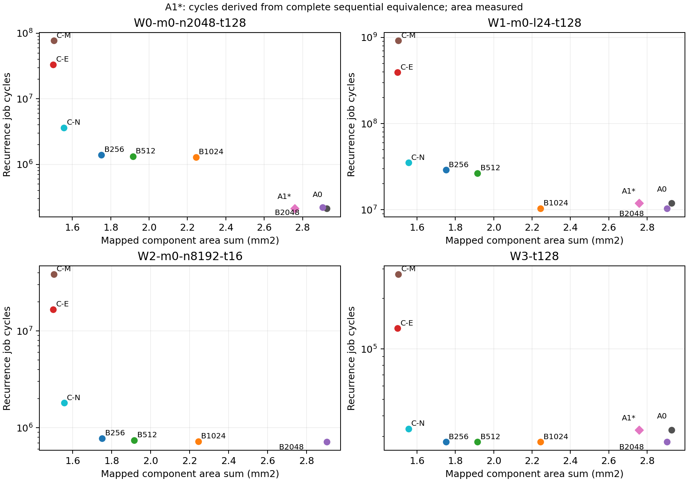
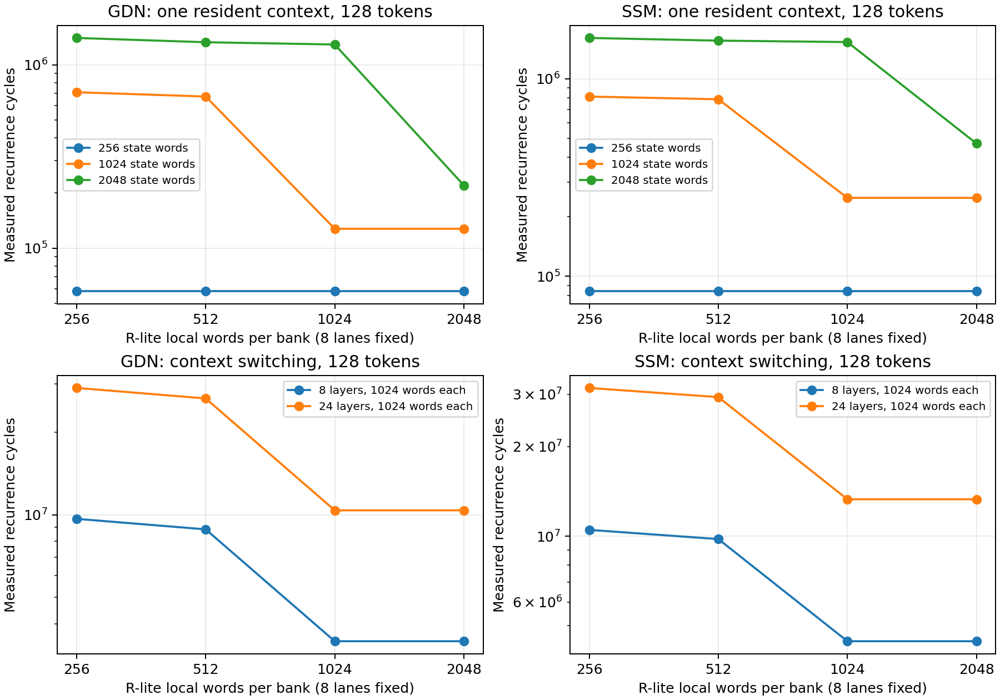
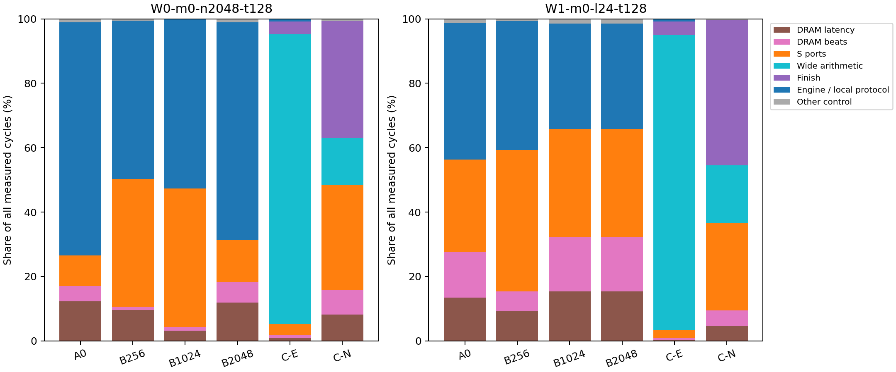
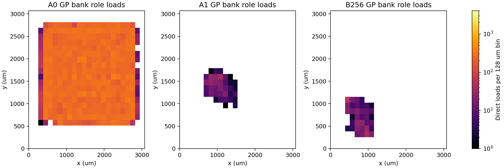

# R 架构探索：完整研究报告

更新：2026-11-01T22:44:56+08:00。Issue157 / PR160；研究分支与PR144生产及验收隔离。本任务作业快照：94708 RUNNING 01:50:54；94726 RUNNING 01:34:24。物理终态以[PHYSICAL_RESULTS.md](PHYSICAL_RESULTS.md)及EXECUTION_INDEX.json为准，运行中不计通过。

## 建议与适用条件

延迟优先且主要处理独立1024状态条带时，优先R-lite1024；单上下文2048状态连续递推时，优先保留2048并采用A1读取结构。面积优先、能够承担外部状态搬运和更高周期成本时，无R加显式宽整数扩展C-N也是有效候选。现有窄M/E直接分解并不经济，但这不等于所有无R架构都不可行。

这不是一个普适最优答案：没有统一真实时钟、完整芯片集成P&R和校准能量时，只能给有工作负载条件的架构选择，不能给最低焦耳或最终硅片吞吐的赢家。新候选均不继承原宏的物理资格。

## 原始92059负载到底是什么

实际直接负载是91686个MUX2_X1/S与373个其他标准单元输入pin，共92059个不同单元。active读取65536、shadow读取26123、共享/优化后读取396、明确写入目标控制3、共享读取/提交反相器1。主要来源明确是读取选择。

全部逐单元实例、类型、pin、坐标及分类分别保存于baseline-evidence/direct-loads.tsv.gz、bank-role-direct-categories.json.gz及[FANOUT_ROOT_CAUSE.md](FANOUT_ROOT_CAUSE.md)。直接输入pin不能与组合门后的可达负载相加。旧GP的578是按每个128µm bin至多256负载再分组的总数，实际地理bin376；不是578个不同空间bin。

key相关2056/4352负载来自生成的8bit动态读地址寄存器，而非key数值寄存器；其首次下游顺序端点为operand_b，同属寄存器数组动态读取/译码问题，但不是同一条网络。

|同容量方案|R面积µm²|cells|DFF|MUX|BUF|role直接负载|role pin-C fF|
|---|---|---|---|---|---|---|---|
|A0|1458349.256|709124|146402|169544|256|92059|176628.131|
|A1|1289693.818|689454|146402|48416|256|378|619.852|
|A2|1347009.1039999998|713897|146403|84838|256|18765|29995.239|

A1严格完整等价通过，role由92059降至378，但row/cmd_index/phase译码出现64551负载；A2保留64811最大负载且role回升18765。≥256负载非时钟集合pin-C合计：A0 755798.294fF、A1 760569.775fF、A2 625587.611fF。A1的role电容降低不等于总广播电容降低；A2也不能仅凭role较大被判定为所有电气维度均差。该集合包含数据网，线电容和切换活动尚未包含。全部非时钟信号net的pin-C则为A0 3002587.365、A1 2730520.880（−9.06%）、A2 2787523.150fF；A1仍有总体pin-C收益，不能被阈值集合的局部变化掩盖。

## 同一任务的系统代价

共同组件包括M、E、16KiB标准单元S、事务控制、控制成本原型及128bit router，面积和1.468659mm²。表中是实际映射组件和，包含R内部银行，不能再重复加状态bit面积；它不是完整集成芯片面积。

W0：单上下文2048状态×128token；W1：24层、各1024状态×128token；W2：8192状态×16token；W3：四抽头卷积×128token。均为GDN（W3除外）、固定整数输入、DDR latency40cycle/BW16B每cycle、cache策略。

|方案|组件面积和mm²|W0 cycle|W1 cycle|W2 cycle|W3 cycle|
|---|---|---|---|---|---|
|A0|2.927008|213442|11870208|不支持|32790|
|A1|2.758353|213442*|11870208*|不支持|32790*|
|A2|2.815668|213442*|11870208*|不支持|32790*|
|B256|1.751007|1399616|28990464|779344|27912|
|B512|1.915777|1326400|26545152|742992|27912|
|B1024|2.244541|1289024|10380288|724816|27912|
|B2048|2.903992|220224|10380288|715728|27912|
|C-M|1.502726|76994176|916866048|38451152|278664|
|C-E|1.499235|33351936|392429568|16652832|132744|
|C-N|1.555837|3622656|35180544|1803744|33416|

*A1/A2周期由完整时序等价继承A0，而非另跑联合仿真。cycle是包含状态载入、计算、搬运、提交/回滚的递推窗口；CSV另有cycles_including_setup包含一次性reset/context创建，逐token trace提供起止。W1的完整token包含全部24层，不能把每层token吞吐当完整token吞吐。

- R-lite1024对W1与2048容量同周期，组件面积和低22.71%；但W0比原2048 R慢约6.04倍。R-lite256的R本体虽然低80.64%，系统组件和只低40.18%，W0慢6.56倍。
- W0中R-lite256与1024均可将双版本状态留在R+S，不能把它们的全部周期损失归咎DRAM；反复R/S换页、端口和控制本身有代价。B256的保留S容量峰值15872B，余量仅512B。
- W1所有层的完整状态远超R，各候选的状态外存读写相同；更多本地容量没有自动使两个独立8输出条带合并计算。
- W2原R不支持；R-lite保留全局dot/error并最后一次提交，不是每块独立EXEC/COMMIT。容量由256增到2048的周期收益有限，流量主导程度上升。
- C-E优于C-M；C-N显式新增73074.190µm²、8路S32宽乘法后又明显加速。但W1仍需35180544cycle，是B1024的3.39倍，组件面积和低30.68%。瓶颈从数位乘法移到finish和S访问，详见[BOTTLENECK_ANALYSIS.md](BOTTLENECK_ANALYSIS.md)。C-N和finish预布局时序尚不满足300MHz，不能把该周期比较转换为同频芯片性能。

## 资源、通信和数值约束

S模型严格16KiB、4×128bit 1RW bank、单窄口和独占全部bank的共享512bit宽读，逐信号对照真实RTL。没有给每个bank虚构独立外部窄口。所有DRAM流量经一个128bit暂存packet及S口，原/新双版本、系数、中间值、写确认和失败回滚均计入；该策略没有DMA/计算重叠，也未测试直接DDR→R旁路。

BW16升到64没有收益，因片内128bit端口与单服务队列已限制吞吐。W1 B1024的共享宽读竞争令周期增加33.59%，不是无限端口模型。[BANDWIDTH_SENSITIVITY.md](BANDWIDTH_SENSITIVITY.md)、SYSTEMC_RESULTS.csv和PORT_PAYLOAD_RESULTS.csv保留各阶段、存储分类及有效载荷。端口有效载荷不等于含完整包头/握手/时钟的真实片上网络流量。

没有校准的每操作能量，只输出逐类乘法/归并/finish、存储读写和链路字节事件及[SYSTEM_COST_MODEL.md](SYSTEM_COST_MODEL.md)中的参数化能量式。默认ORFS toggle功耗不作工艺能量校准。

数值为与冻结R一致的逐阶段RNE、S32溢出检查及回绕；超过2048的独立整数扩展先完整归约再舍入。所有块完成且全部写确认、身份/epoch/position和数值检查成功后统一发布；失败保护旧状态。reset按原接口使上下文失效，并不承诺掉电保存未写回的dirty状态。

真实模型只增加冻结Qwen3.5维度的128×8单strip，输入仍合成。完整32头×128×128每层单版本2MiB、双版本4MiB，24层96MiB；并未声称运行完整真实模型。

## 验证与物理证据

A1/A2h各146137状态bit+132原输出bit，全部772个封闭SAT义务通过，覆盖没有遗漏；每个状态D和所有输出均比较，没有黑盒宽乘法、内部假设或忽略状态。对应回归与完整证明成功后才运行原Yosys/Liberty映射。完整证书归档及每分区日志SHA见PROOF_ARCHIVES.json；[FUNCTIONAL_VALIDATION.md](FUNCTIONAL_VALIDATION.md)列出全部回归。

最终RTL/SystemC记录2096，2056PASS、40个原R超容量明确不支持。S校准1009154信号检查；四个R-lite容量各28174656检查；M/E/native宽乘法和事务/控制/router分别有真实RTL测试及映射。串行架构模型、独立组件成本与全芯片实现的证据边界分别记录，不互相替代。

物理只选两个新候选B256与A1，A0为相同参数匹配控制。统一Nangate45 M1–M10、300MHz目标、相同floorplan和pin模板。A0/A1全局放置估计线长26958300→10071100µm（−62.64%），已有放置收益，但不是实际布线长度。[PHYSICAL_RESULTS.md](PHYSICAL_RESULTS.md)保存各流程终态、真实线长/金属层/根net pin-C与SPEF wire-C、setup/hold及电气违规。

已完成的B256详细布线总长9026143µm、router DRC0，但setup WNS−0.351331ns、hold WNS−0.0563912ns，不合格。相同大floorplan使B256利用率很低，结果不代表其最优紧凑布局。所有未完成候选、无完整提取时序/全芯片面积和校准能量的项目明确为未测。

## 文件与复现入口

[README.md](README.md)给出工具、容器/Liberty SHA、输入冻结、源归档和执行步骤；EXECUTION_INDEX.json绑定每个attempt的source commit、archive SHA和Slurm终态。BASELINE.json/EXTRA_INPUTS.json冻结Git源，FINAL_EVIDENCE.json逐文件索引，原始大ODB/mapped和完整整数corpus保留在独立远程目录。

本地重建：依次执行final_report.py、sensitivity_report.py、physical_report.py、architecture_figures.py、consolidated_report.py和check_final.py；脚本均在project/experiments/r_architecture。远程重跑新建attempt，解包相应source.tar、sha256sum --check FILES.sha256，再执行对应sbatch；不能混用旧map和新ODB。
