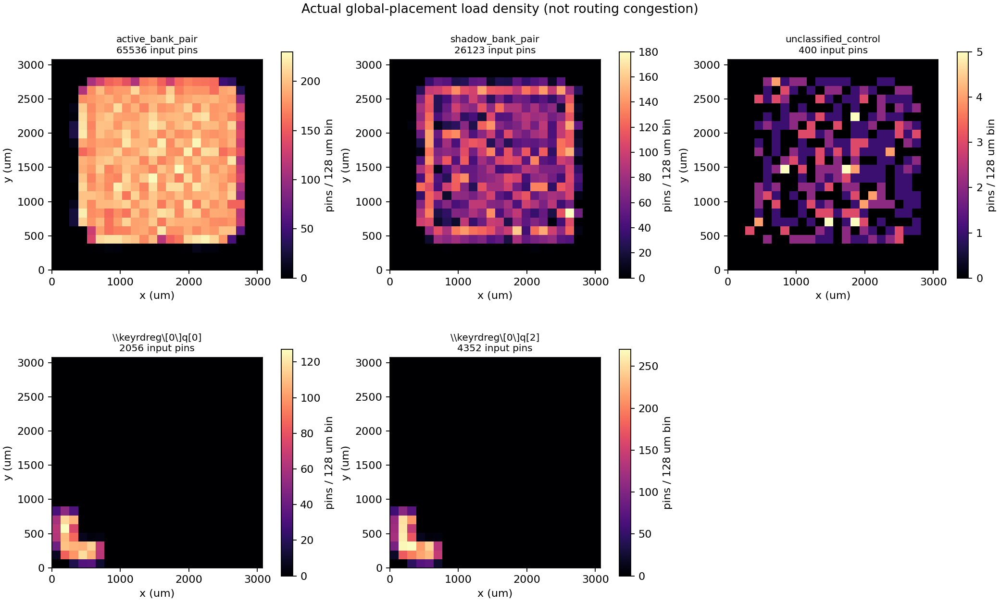

# R 高扇出只读溯源：run030 / run342

生成时间：2026-11-01T08:02:38.731008+00:00（CST 为 UTC+8）。本报告是独立分析，不修改仓库、PR #144、源 RTL、物理数据库、原验收流程或既有作业。本次没有创建或运行 B/C，也没有为新候选签发任何资格。

## 结论

1. **92,059 个直接负载的主因是读取选择，绝不是每个状态位都直接受 bank_role 写使能控制。** 其中 91,686 个为 MUX2_X1/S；另 373 个是组合逻辑输入。65,536 个 MUX 的 A/B 分别连接同地址同位 bank0/bank1，26,123 个顺序相反。
2. 对其余 400 个负载（27 MUX + 373 逻辑输入）逐个追踪至第一个时序边界：396 个只到读取操作数寄存器；3 个到 bank 写入 D；1 个反相器同时参与读取与 bank_role 自身提交更新。读取逻辑内部的 active/shadow 归属无法唯一分开的，保持共享类别。
3. 因此建议下一轮**先 B，C 后置**。B 的综合后收益尚未测量；不能因 RTL 把 MUX 交换了位置，就宣称降低了扇出或实际布线难度。
4. key 的 2,056/4,352 负载来自共享读地址相关寄存器及选择/译码网络。它们不是 key 数据位的乘法广播，也不是 bank_role 的子网；2,696 负载网是其中 bit2 的反相信号。共同背景是标准单元实现的大型动态寻址与选择网络，具体控制信号和空间分布不同。

## 1. 实际来源与边界

实际 RTL：

```text
/public/home/yuzelu/project-circuit/LLMHardwareDesign/issue-121/block-v1-20261029-342/src/project/rtl/block_library_v1/block_v1_r.sv
SHA256 4032c5edcbee9d38e1a51dd9f9c533e414d5263dd2440d7104a1688e73ca382d
producer commit 76f8db5758ecefdd72d45b0544ecb9a79ed6bced
```

Yosys 脚本及映射产物：

```text
/public/home/yuzelu/project-circuit/LLMHardwareDesign/issue-121/block-v1-20261029-342/tasks/revision300-map-r/map.ys
/public/home/yuzelu/project-circuit/LLMHardwareDesign/issue-121/block-v1-20261029-342/tasks/revision300-map-r/mapped.json
/public/home/yuzelu/project-circuit/LLMHardwareDesign/issue-121/block-v1-20261029-342/tasks/revision300-map-r/mapped.v
```

实际放置数据库：

```text
/public/home/yuzelu/project-circuit/llm_routing_analysis/worktrees/issue143-seven-block-v2-20261030/outputs/030/pnr/r/flow/results/nangate45/bv1_block_v1_r/base/3_3_place_gp.odb
SHA256 085829e28b10d9118ccc48d4de6de77e0ccf19592a5c7bf8929836a13b9ac6e6
```

run030 的 native-flow.json 明确引用 run342 的两份映射 SHA；run015 的映射复用记录与其一致。本地 sources.json 对下载输入逐项保存服务器原路径、实际大小、SHA 和下载前后源 SHA 检查。mapped.json 的统一 bit ID 是逻辑追踪依据；structural.v 为原始实例名称的物理输入表示，structural.ys 仅进行表示导出与重读。本次没有重新综合。

Yosys 0.68+post，记录中的 git sha1 为 UNKNOWN。OpenROAD 自报 unknown，不能补造版本号。实际固定容器：

```text
/public/home/yuzelu/opt/eda/containers/orfs-current-repacked.sif
SHA256 49eae8b526c6eec806473b13db5d98f848424f38de9fa3430e8ce8e157144f3a
Liberty SHA256 8d540a4d4cf6d09d27c87ad067857a9c0c2eeb023ab7a56e058cd3113db4e9b1
```

map.ys 实际顺序：read_liberty/read_verilog → hierarchy → proc/opt → synth -noabc → dfflibmap → abc（同一 Liberty）→ clean/check/flatten/check/stat → write_verilog/write_json。完整逐字脚本已保存，不替换参数。

放置配置来自 config.mk：3000×3000 µm die、CORE 20..2980、最终生效 PLACE_DENSITY=0.25、GPL_TIMING_DRIVEN=0、ENABLE_PLACE_REPAIR_TIMING=1、M1–M10。该文件有后续覆盖赋值，比较实验必须复制实际生效配置而不是只抄第一行密度0.45。这里只分析原快照，不把其他物理尝试或当前修复链混作同参数对照。

版本陷阱：另一工作树 issue-121 的 R 已含“先地址后银行”改写；它不等于本次 run030 使用的 4032c5ed 源。不能拿另一源的结果替代这里的新 B 实验。

## 2. bank_role 直接负载：实际单元完整统计

| 实际单元类型 | 负载输入脚数量 |
| --- | --- |
| MUX2_X1 | 91686 |
| AOI21_X1 | 136 |
| OAI21_X1 | 103 |
| AOI211_X1 | 54 |
| OAI211_X1 | 24 |
| OR2_X1 | 19 |
| NOR2_X1 | 13 |
| NAND2_X1 | 9 |
| AND2_X1 | 3 |
| OAI22_X1 | 3 |
| NOR4_X1 | 2 |
| XNOR2_X1 | 1 |
| OR4_X1 | 1 |
| NAND3_X1 | 1 |
| AOI221_X1 | 1 |
| AOI22_X1 | 1 |
| NOR3_X1 | 1 |
| INV_X1 | 1 |
| 合计 | 92059 |

根网共有 92,060 个 ITerm：1 个输出驱动 + 92,059 个输入；无外部 BTerm。每个直接负载都属于不同单元。实际 GP 驱动为 `$auto$ff.cc:337:slice$2874097/Q`、DFF_X2，位于 (377.7525, 541.767) µm；映射阶段同一实例是 DFF_X1，说明放置前已有尺寸调整，不能混用两个阶段的类型。

以上逐实例的名称、类型、引脚均与 mapped.json 对上，不仅比较总数。2056/4352/2696 三条网的驱动和全部直接类型/引脚统计也分别对上。完整列表在 direct-loads.tsv；细粒度逻辑归类在 bank-role-direct-categories.json 和 bank-role-control-details.json。

## 3. 功能归属、直接电容与空间分布

| 功能类别 | 直接负载数 | Liberty 输入脚电容之和 pF | 占用128µm网格数 |
| --- | --- | --- | --- |
| active 直接银行对选择 | 65536 | 125.825318912 | 375 |
| shadow 直接银行对选择 | 26123 | 50.154644866 | 360 |
| 优化后读取逻辑，active/shadow 不唯一 | 396 | 0.641716699 | 227 |
| 写入目标控制 | 3 | 0.004749931 | 1 |
| 共享读取与提交控制 | 1 | 0.001700230 | 1 |

合计输入脚电容 **176.628130638 pF**。使用实际同 SHA Liberty 的 scalar capacitance（原单位 ff）逐输入脚求和；不含线电容，也不是 STA 的有效电容。91,659 个明确银行对 MUX 的角色由 A/B 数据连接判定，不从名字推断。

三个直接写控制负载可明确定位：

```text
$abc$4429625$auto$blifparse.cc:397:parse_blif$4772076 AND2_X1/A1  → bank0 写入 D
$abc$4429625$auto$blifparse.cc:397:parse_blif$4772077 NAND2_X1/A1 → bank0 写入 D
$abc$4429625$auto$blifparse.cc:397:parse_blif$4772079 XNOR2_X1/A  → bank0/bank1 写入 D
```

它们最终通向两银行状态 D，不代表写网络只有三个单元。写使能和逐位保持/更新选择仍会展开；这里只说它们直接挂在 bank_role 根网上的负载很少。共享反相器 `$abc$4429625$auto$blifparse.cc:397:parse_blif$4429626` 到达 operand_a/operand_b/operand_state_base 及 bank_role 自身 D；不能把它强制记成纯读取或纯提交。

全部 bank_role 负载原点包围框约 x=367.393..2767.860、y=376.712..2781.595 µm，跨约2.4×2.4 mm。三项写控制仅位于 x=367.393..382.065、y=539.533..566.330 µm，靠近驱动；大面积分布来自读选择。

**578 的定义已复核：实际占用128µm网格是376个，578 是逐格 ceil(负载数/256) 的总和；单格最多365个负载。** 它是既有缓冲策略的分组数，不能说成578个独立物理区域或宏。



图为真实单元原点的输入脚密度，独立色标；不是连线图、布线拥塞或引脚坐标的精确线长。原点 bbox HPWL=4805.350 µm，仅为放置跨度指标。

## 4. 传递扇出：与根网电容分开

结构遍历从 bank_role 开始，经过所有组合单元输出，遇到 DFF 输入即停止；按信号 ID 和单元/输入脚去重，不穿越寄存器再循环：

| 指标 | 实测数量 |
| --- | --- |
| 直接输入脚 | 92059 |
| 间接到达输入脚（不含直接） | 761369 |
| 到达输入脚并集（含直接） | 853428 |
| 组合单元并集（含直接负载单元） | 398540 |
| 第一个时序边界的不同端点 | 131969 |

端点包含 bank0/bank1 各65,536个状态 D、operand_a/operand_b/operand_state_base 各256个寄存器、128个 rsp_data 寄存器及1个 bank_role 寄存器。共享/重汇合只计一次。

这些是**结构依赖的可达集合**，没有证明所有路径同周期都可激活。761,369 个间接输入脚不能加到根网负载或根电容上；中间有独立驱动。组合锥的单元类型明细在 mapped-analysis.json。完整锥的物理位置与逐中间网提取 RC 本次未导出，不从直接负载热图外推。

## 5. key 相关高扇出

| 实际 ODB 网名 | 直接负载 | 输入脚电容 pF | 占用网格 | 按256限制分组 |
| --- | --- | --- | --- | --- |
| `$\\key$rdreg\[0\]$q[0]` | 2056 | 3.411673 | 31 | 31 |
| `$\\key$rdreg\[0\]$q[2]` | 4352 | 7.025746 | 31 | 34 |
| `$abc$4429625$new_n296076` | 2696 | 4.381458 | 31 | 31 |

mapped.json 明确显示：`$\key$rdreg[0]$q` 为8位生成寄存器，其 D 的首层时序扇入是 row 与上下文/有效性/phase控制，不是 key/query 数据寄存器。bit0 的一个直接 MUX 真实选择 key[72][14]/key[73][14]；bit2 的一个直接 MUX 真实选择 query[146][15]/query[150][15]。这支持它们是共享读地址相关控制，而非名字所暗示的“某个key数值数据位”。样例完整实例和连接已列入 mapped-analysis.json，可重复核对。

2,696负载网 `$abc$4429625$new_n296076` 的驱动是 INV_X1，输入正是上述 q[2]；它是4,352负载那一位的反相支路。不要将两项合并成同一根网的7,048个直接负载或把该支路全部电容直接加到上游。

三条网的第一层时序下游均是 operand_b，没有 bank 写入 D。负载在 x≈64..715、y≈94..829 µm 内集中，明显不同于 bank_role 的全片展开。共同原因是大型寄存器存储的动态选择/译码被展开为标准单元逻辑；不是同一条控制网。B 是否将负担移到 row/读地址译码，必须在新综合网表和相同放置后测量，这组数据已经表明该风险值得检查。

## 6. 原始 A 的面积、单元和全局放置

| 指标 | A：实际历史基线 | B：读取重组 | C：B+写入局部化 |
| --- | --- | --- | --- |
| 综合面积 µm² | 1458349.256 | 未创建/未测 | 未创建/未测 |
| 总映射单元 | 709124 | 未测 | 未测 |
| DFF_X1 | 146402 | 未测 | 未测 |
| MUX2_X1 | 169544 | 未测 | 未测 |
| BUF_X1 | 256 | 未测 | 未测 |
| bank_role直接负载 | 92059 | 未测 | 未测 |
| 根网输入脚电容pF | 176.628130638 | 未测 | 未测 |
| GP总实例（含物理阶段变化） | 739007 | 未测 | 未测 |
| GP estimated wirelength（全设计，µm） | 26494300.0 | 未测 | 未测 |
| GP congestion metric（工具原字段） | 0.722739 | 未测 | 未测 |
| GP setup最差slack ns | -34422.2 | 未测 | 未测 |
| GP hold最差slack ns | 0.00448273 | 未测 | 未测 |
| 完整cap/slew/fanout违规计数 | 该GP摘要未提供，本次未新跑全项报告 | 未测 | 未测 |
| 逐拍严格RTL等价 | 本次未新跑；历史功能凭据不代替候选证明 | 未运行 | 未运行 |

综合其他主类数量：

| 单元家族 | 数量 |
| --- | --- |
| MUX | 169544 |
| DFF_X | 146402 |
| AOI | 132506 |
| NAND | 115711 |
| OAI | 81115 |
| NOR | 23934 |
| XNOR | 9684 |
| AND | 9392 |
| INV_X | 7771 |
| XOR | 7075 |
| OR | 5734 |
| BUF_X | 256 |

综合面积由同 SHA Liberty 各实际单元 area 重新求和得到，与 native-flow.json 的1458349.256完全一致；不是根据RTL MUX数量估计。A 的既有映射复用 receipt 记录三初态各379,979检查/178,456拍、240随机递推/100卷积用例通过；这是历史 RTL 功能凭据，**本次没有重跑 A，也没有将它变成 B/C 的功能或形式资格**。

该 GP 快照的真实最差 max 路径正是 bank_role 驱动 DFF_X2/Q →共享 INV→AOI/OAI组合→`$auto$ff.cc:337:slice$3983185/D`；mapped.json 将端点定位为 operand_b。报告根网 Cap=232347.91 fF，即232.34791 pF，含当时 placement 估算寄生口径，与前述176.628130638pF纯输入脚标量求和不同，不能把差值无条件称为提取线电容。

原始 report 的 setup slack 为−34422.19 ns，metrics 写成−34422.2ns；hold最差+0.00448273ns。负载/slew极端且网未缓冲，数值属于这一失败中间快照的STA报告，不能当作已修复最终R的工作频率或候选收益预测。该报告只给最差路径；**独立写入路径的最差数值尚缺定向 report_checks**，不能编造。

选中四条大网的 `getWire` 都为 NULL。因此缺少这一阶段这些网的实际布线金属层、实际 routed length、提取线电容。全设计 estimated wirelength=26,494,300µm也不能当作某条网的真实线长。

附带读取了同一030后续 routing iteration20 的既有拥塞快照：报告列出水平/垂直各10,000条标记，最大标记 excess tracks=17，Layer字段全为`-`。是否受报告条数上限截断未核验，不能把20,000当作全部拥塞总数；不能按金属层归因，更不能把后续已缓冲网络的拥塞当作这份 GP ODB 的结果。


## 7. 实际 ODB 直接扇出前20（排除电源/地/时钟）

| 实际网名 | 直接输入脚 | 驱动数 |
| --- | --- | --- |
| `bank_role` | 92059 | 1 |
| `$\\key$rdreg\[0\]$q[2]` | 4352 | 1 |
| `$abc$4429625$new_n296076` | 2696 | 1 |
| `$\\key$rdreg\[0\]$q[0]` | 2056 | 1 |
| `$abc$4429625$new_n295798` | 1924 | 1 |
| `$\\key$rdreg\[0\]$q[1]` | 1605 | 1 |
| `$\\key$rdreg\[0\]$q[3]` | 922 | 1 |
| `$abc$4429625$new_n298265` | 769 | 1 |
| `$abc$4429625$new_n409126` | 769 | 1 |
| `$abc$4429625$new_n409566` | 769 | 1 |
| `$abc$4429625$new_n409571` | 769 | 1 |
| `$abc$4429625$new_n409591` | 769 | 1 |
| `$abc$4429625$new_n409594` | 769 | 1 |
| `$abc$4429625$new_n409595` | 769 | 1 |
| `$abc$4429625$new_n409597` | 769 | 1 |
| `$abc$4429625$new_n409599` | 769 | 1 |
| `$abc$4429625$new_n409616` | 769 | 1 |
| `$abc$4429625$new_n409617` | 769 | 1 |
| `$abc$4429625$new_n409623` | 769 | 1 |
| `$abc$4429625$new_n409624` | 769 | 1 |

前20均实际枚举输入、输出和BTerm；不以ITerm数减一猜测驱动。所有网均1驱动、0外部端口。769负载的并列项按原数据库遍历顺序选取；不是唯一的前20排序名单。完整类型/引脚清单覆盖四条>2048大网，其他前20网本次仅计扇出，不伪称完成全部逻辑归因。

## 8. 是否启动候选：本次决定与后续最小实验

**决定：本轮保持只读溯源，不追加候选综合/P&R；证据支持下一轮先进行 A/B 逐拍等价与映射对照，C 暂缓。** 基线ODB/映射文件/原RTL/脚本/固定Liberty均已找到，不是文件缺失；未完成的是新的候选验证与对照测量。

A 必须冻结4032c5ed原源，保留原综合脚本/库/参数，不把本地另一分支已改写的R冒充A。B不能只改DEC_MUL一个读点，必须覆盖：

- DEC_MUL：active[row*8+l]，SSM下同时使用shadow[row*8+l]。
- PRED_MUL、READ_MUL：shadow[row*8+l]。
- UP_MUL的operand预取：operand_state_base<=shadow[row*8+i]。
- 命令11：active[cmd_index*4+i]，不同的动态四字地址和半行选择；不能遗漏IDLE命令读取。

可在互斥阶段复用选择地址；两银行各先选8×S32，再选active/shadow。仅组合改写，不加流水级、拍数或接口，不改状态容量/八路算术/位宽。512个输出选择位只是结构构想，**不是测得的新扇出**；ABC可能重新因式分解，仍须检查实际映射。

正式候选先完整原bench及模式/动态地址/重置/背压/读写/溢出失败回滚/提交原子性检查，再对原RTL做保持相同时钟和每拍接口的严格时序等价；有界测试、有限拍BMC或超时均不算严格证明通过。只有证明成功才做相同Yosys/Liberty映射。A/B/C的数值格式、初态/复位假设与不可观察存储状态关系必须明确，不通过修改命令延迟或屏蔽错误分支取巧。

映射后先比较全单元、面积、bank_role直接及传递集合、输入脚C、全前20，并重点补列row、product_row、cmd_index、读地址寄存器、各bank写使能的前后数值，再决定是否花资源进行相同放置/缓冲参数的物理对照。C只有在B后仍观察到写入/更新译码的大网或物理瓶颈时再做；当前根网上写选择已被综合压到3个直接负载，不支持将C当作首要修复。

完成候选证明后，如进行物理实验，各候选独立目录/固定源SHA/相同种子与参数，运行完整GP及相同电气修复；定向报告到operand、rsp_data、bank0/bank1写D的max/min路径，收集所有电气违规。若要宣称布线改善，需继续同条件全局/详细布线、实际线长、拥塞、RC与最终STA，而非只看根扇出降低。候选不能继承PR #144或原R的任何验收资格。

## 9. 复现与审计

原探针 proof 的92,059/578已用新的独立只读ODB枚举复核，前后SHA完全相同。新探针只在空闲debug node27上分配1CPU、set_thread_count=1，无已有作业step、取消、重启或文件修改。debug节点Slurm配置内存仅1MiB导致初次12GiB申请FAILED/未分配；随后mem=0使用该空闲节点，实际MemAvailable>518,000,000KiB。94524完成1:00；94527/94530为库字节传输诊断，各2秒；94533完成9秒。错误/终态日志保留。Tcl文本/base64方式的库传输SHA未通过，因此完全不用于电容结论；最终库通过独立二进制cat传输与服务器SHA逐字节核对。

在一个新的独立目录复制这些分析脚本后，可按下列步骤复现（需要原获授权SSH和固定容器；会新建独立只读探针作业，不应进入现有分配）：

```powershell
python collect.py
python copy_lib.py
python run_probe.py
python run_probe.py summary
python analyze.py
python physical.py
python congestion.py
python make_report.py
```

collect.py只是读取原文件；run_probe.py通过独立`srun -p debug --job-name=yzl-rtrace -c1 --mem=0 --time=00:10:00`，固定容器执行`openroad -no_init -exit /dev/stdin`，输入probe.tcl/summary-probe.tcl；不write_db、不resize、不修复或写源目录。若debug不空闲，应排队或停止此次新探针，不借用正在运行的EDA作业。已有原始证据在当前目录，可仅运行后三个本地分析脚本，无需重新碰服务器。

下一步缺少的最小测量为：在新隔离分析作业中按同一ODB/`2_floorplan.sdc`和Liberty加载、`estimate_parasitics -placement`，定向`report_checks`到读操作数/命令响应/两bank写D并输出完整`report_check_types`。这是原快照补测，仍不能替代新候选等价或最终RC。实际布线金属/线长需另一个同源且确已完成布线的ODB/SPEF，并单独绑定阶段，不能从NULL wire推测。

关键证据：sources.json、map.ys、original-r.sv、mapped.json/mapped.v、structural.ys/structural.v、odb-probe-2.log、odb-probe-summary.log、mapped-analysis.json、physical-analysis.json、direct-loads.tsv、3_global_place.rpt、3_3_place_gp.json、congestion-summary.json、两张PNG。sources.json保留大文件SHA；本报告所在目录与所有既有工作树/PR交付目录分离。
