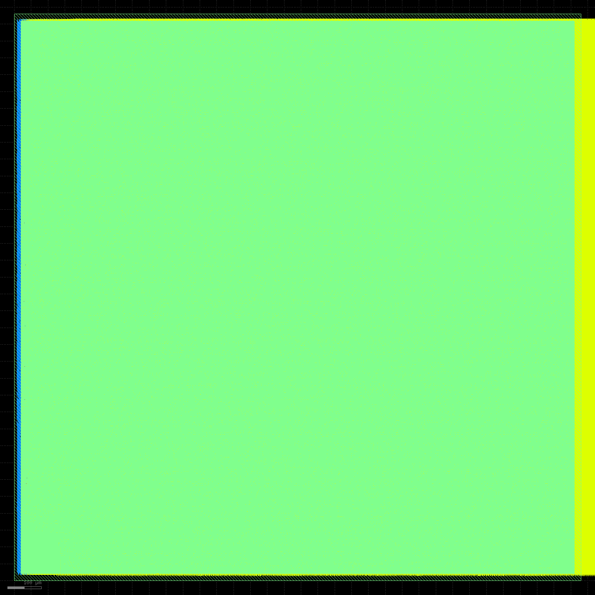

# Issue162 continuation checkpoint25

捕获：2026-11-03T05:40:16.262952+08:00；YUZE-LU；[Issue162](https://github.com/rayggxia-workspace/LLMHardwareDesign/issues/162) / [PR163](https://github.com/rayggxia-workspace/LLMHardwareDesign/pull/163)，继续in_progress / Draft，不合并。本次[源绑定索引](continuation-proof-25/index.json)保存124项远程记录/122项逐字节原文件及15项辅助/精确Git回执，复制内容全部再核验大小/SHA；活动日志仅代表捕获字节，大文件留获授权远程路径。本检查点不是停止或系统通过。

## 新S原生四门与六文件已实际通过

S1350的完整原始GDS deck正式通过，total_items=0，native报告亦空；包含天线与原生金属规则，无排除或豁免。完整deck实际耗时11814.020秒；末尾报告及23981字节lyrdb均保留。DRC receipt SHA `ddf149b05b29411e53ce35be45db7efbd16bcdf92dff442ed0954f812a923d01`，独立报告SHA `150ff0f1810750d6c5156dbee44571799018de3582fc820e56c94865fc2839c4`。物理、完整DRC、最终全部信号单元功能、全部状态边界严格形式四项现均实际通过，同一raw1350/sealed源精确合流，未继承1181失败版图资格。

300MHz原约束不变，setup/hold违例0，WNS +0.017822854/+0.005294543ns；电气/实际RC覆盖/供电连通/固定M10接点检查通过。实际最终单元三初态各124440检查、46581周期、523描述符、9545窄口请求、CPU内部RAM访问0。strict formal为UNSAT/IDENTICAL，266796输入和267406输出全部匹配、diff项全0，并精确绑定实际成功function回执。

`native_leaf_accepted=true`的真实原生交付及六文件已生成；S为1680×1680µm，活动面积1,191,739.584µm²。788个实际BUF_X32驱动归S M1–M10，无新增寄存器、周期或协议。S/T仍是标准单元存储。原生GDS实际PNG已逐字节校验并打开检查，整体版图边界与内容完整；图片不是概念示意。下列文件在交付步骤逐一哈希核验，本次原始交付报告记录获授权路径、大小与SHA，完整大文件不入Git。

| 原生最终文件 | 字节数 | SHA-256 |
|---|---:|---|
| 6_final.v | 119355486 | 41c5ccd9ffbc9411fb8b76377e63db7f042a9b3a5a941e2865178dfe0bc8fb19 |
| 6_final.sdc | 715 | d817b123b91904f7dd2f6f5a53937dd7dbe058474dcd7acdba5115a9d6e0da65 |
| 6_final.def | 650713201 | 2eb6abb15369c4ffc3ca84f912add9b7afb3ecb7eaff51e2dffd631692e22e40 |
| 6_final.odb | 937191779 | 2313e42e7f3a2f82d89d288e71cfb888ecf875d85ec3dc8af4c3bed220b74e7a |
| 6_final.spef | 809302356 | 8ef366b43a22243e6bc8232c320061eaf02e912b1e42e36e44293cfbfe1817c8 |
| 6_final.gds | 572632864 | ee06b4a30b94f8bb19d27602ea7c90fd6c8eb85e8260077d44835570dbb28c81 |

## 固定供电与实际组合继续

同一S的提前PG计算已通过完整native DRC和实际GDS native-plus-PG XOR，其原始完整GDS deck仍在运行。qualified03必须等其真正成功，再由source137核对候选与真正合格native的全部六文件字节/大小/SHA及四门后接收计算；随后新鲜PG物理、RC/300MHz、完整物理视图与最终PG交付仍须实际通过。原生版通过不能替代固定PG版本或系统通过。

composition03仍必须使用真正合格的新S固定PG叶，重新执行真实boundary-graph、全部最终单元三程序、原生STA/PG/电容前置；严格上层1380–1383/24后继发射器仍等待这些实际结果。未来四个16CPU候选在node2/node4动态补位，所有现有规格保持不可变。逐块和系统收集器只接收真实通过回执；新增本地收集监视器已运行，未制造合格包。依赖就绪后，精确旧失败物理S1182默认编译优先级脚本只按UID/完整命令/规格SHA核验后释放本任务冗余编译，尚未执行此停止；不影响其他任务或R。

规则只读快照的stdout前缀纠正见[drc-runtime-inspection-correction](drc-runtime-inspection-correction/README.md)：旧快照含环境启动提示，其哈希不能当纯deck哈希；实际验收始终调用容器原始deck，纯XML SHA `4e35cad6786f21c6e233fb606bea59bb44e1a12713008cf7367d65a1a3de2147`。原始与纠正快照均保留，未修改任何验收规则、活跃任务、冻结源或几何。

负责人YUZE-LU继续全部最终布局布线、实际M11/M12/全场景PG/low-base-high RC/300MHz及逐块/组合六文件、版图和源索引交付。八自有节点2/3/4/5/6/7/25/26；c96最多6×16、c64最多4×16独立任务动态补位，原内存保护sum(forecast)×1.2+16GiB不改，真实依赖等待不称满槽。R保留并由并行任务修改，其他五宏及旧S/失败基线保留，不动其他任务，不自行合并。

规则rayggxia-project-collab1.0.0；登记management-hub PR5 pending；缺board.json，看板unverified/同步pending；处理人及审查人待指定。源码仍为已发布冻结source137，commit2ee4eee17adcd666123c2267c2b5dafe862401d3，归档SHA0862a85421e6e969f63da7a4fd1505f80d73438f7978f666256dc3dce6178655；本次只更新原生通过证据、辅助收集器记录及文档，不改硬件。
