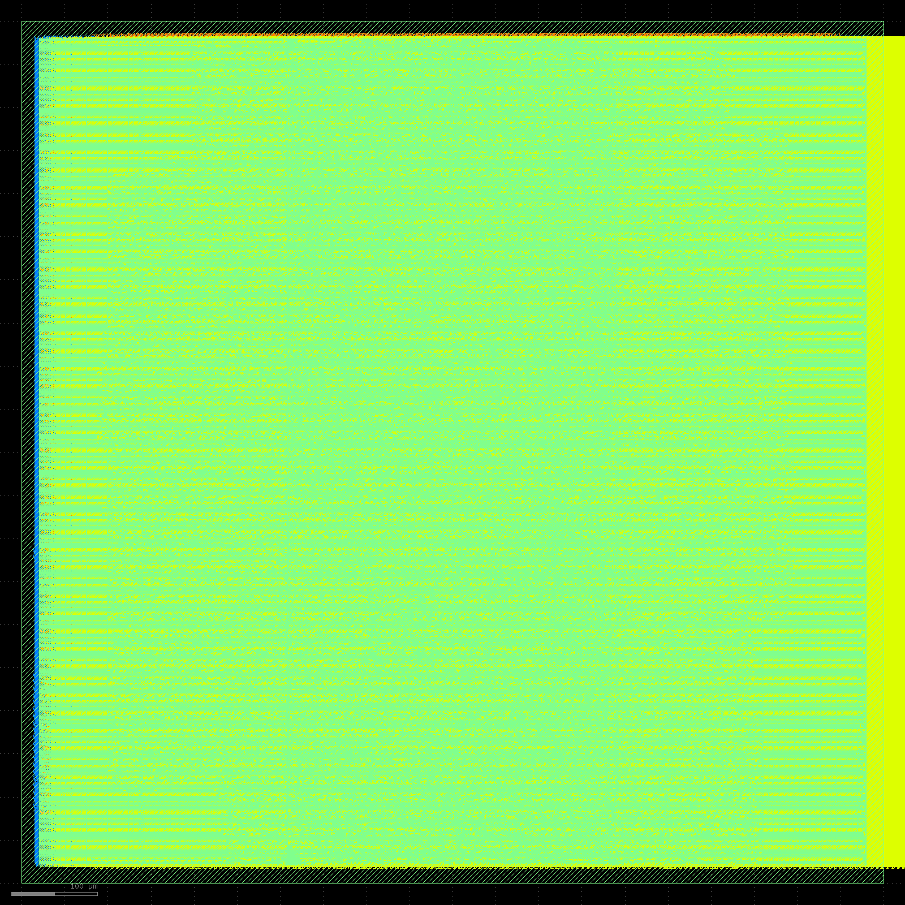

# R256局部状态宏：完整物理验收及本地实收

核验时间：2026-11-03T07:45:19.629349+08:00；Issue166 / PR167。此项为新局部状态R256独立宏资格，不修改main或PR160，不代表R1024或宏间系统通过。

## 实际规格

Nangate45、固定M1–M10，1000×1000µm；8lane计算；普通DFF标准单元存储。256表示每个状态版本有256个32bit元素，两版本总状态容量256×32×2/8=2048B（2KiB），不含流水/交接等额外寄存器。每个lane/tile16×32bit，选择/局部数据/汇合均寄存；外部128bit读回valid/ready，E0接受→E1选择→E2局部数据→E3汇合→E4外部入队。不是旧ISA的逐拍替换。

## 完整证据

| 项目 | 实际结果 |
| --- | --- |
| 原300MHz及IO约束 | 原SDC SHA完整一致 |
| 最终提取setup / hold | +10.2522ps / +1.91164ps |
| setup/hold/cap/slew计数 | 全部0 |
| 详细布线DRC | 0 |
| 完整未修改原GDS规则 | 0项 |
| 完整die原生规则 | 固定未修改上游checker，0项；6组新旧规则正反例通过 |
| PG/接点/实际端点/RC/围栏 | 全部通过，821个内部M10信号接点 |
| 最终物理网表严格LEC及故障对照 | 通过 |
| 精确最终单元网表 | 三初始化×63数值＋3协议，共192/192通过 |
| 映射结构/物理选择锥 | 完整审计通过，选择信号直接顺序端点最大32 |
| 全部物理验收门 | 251独立接收，16/16通过 |
| 最终资格接收 | 252全部9项聚合门通过 |
| 六文件/源绑定 | 14个实际冻结attempt源索引，完整成员SHA |
| 本地下载及验包 | 327062766B，816个文件全部SHA通过 |

标准单元面积298093µm²；die面积1000000µm²。这是单宏面积，不是系统面积。实际最终单元周期数据见[CASE_CYCLES.csv](evidence/final256-252/CASE_CYCLES.csv)，不能换算成未经测量的完整模型性能。

映射形式证明覆盖实际pre-ABC→实际ABC全状态/所有端口、DFF及对应最终物理网表LEC；信任Yosys单元降低步骤，不声称通用原始行为RTL顺序SAT已经完成。三初态真实最终功能、协议、溢出及跨块事务另外独立验证。

原容器ODB0.141无法被固定checker0.139读取，因此由原reader完整导出所有技术/单元LEF和完整DEF，逐字段往返核验后加载相同视图。DEF28456945字段、数值改写0；仅规范化无序GROUP成员的输出顺序，所有成员/重复项/属性完整保留比较。完整检查只改变内存GCELLGRID，非网格DEF字节/恢复后全部DEF/原ODB均不变，无标记或规则排除。固定工具为独立版本，不宣称原容器整片检查完成。259真实物理视图的坐标、分组成员、连接、技术间距四类篡改全部被接收器拒绝。

checker固定上游2eba27b2，binary SHA944848ca2b5181d570e21841fa9c54e53c062b4ebea74cd3955a6c5b30343ee0；构建源、全部依赖、规则正反例和标准视图绑定随包保存。

## 交付入口

- [本地完整包](D:/Data/电路实验/LLMHardwareDesign-worktrees/issue-166-r-local-state/.local/166/deliverables252/R-local-state-256-300MHz.tar.gz)，SHA5733b1c0c9ed45aba7d8fa9f3edfcd76bc04b8464f7aef3853edb3cc1d7cca55。
- [本地实收回执](evidence/final256-252/LOCAL_RECEPTION.json)、[最终资格](evidence/final256-252/QUALIFICATION.json)、[物理回执](evidence/final256-252/PHYSICAL_RECEIPT.json)。
- [六文件索引](evidence/final256-252/SIX_FILES.json)、[实际冻结源索引](evidence/final256-252/FROZEN_SOURCE_INDEX.json)。
- 服务器原包：/public/home/yuzelu/project-circuit/LLMHardwareDesign/issue-166-r-local-state/attempt252/R-local-state-256-300MHz.tar.gz。
- [实际GDS版图](evidence/final256-252/layout.png)。本地已查看；图像仅供观察，不能代替DRC。

R1024仍未完成完整物理验收，192/202原候选继续；260独立分离setup优化目标与hold插入保护条件，261–269串联完整验收/真实最终功能数组/包，原零门不变。本任务继续，不以R256通过结束。

协作：rayggxia-project-collab1.0.0；Issue166 in_progress、PR167 draft；登记PR5 pending，看板无board.json、unverified/同步pending，管理员/审查人待指定；未合并。
