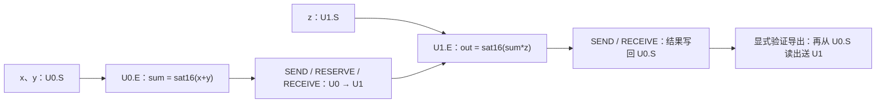

# 静态互斥修复与生成程序的母控／局控回放

2026-11-08 CST；[Issue #219](https://github.com/rayggxia-workspace/LLMHardwareDesign/issues/219) / [PR #220](https://github.com/rayggxia-workspace/LLMHardwareDesign/pull/220)。修改编译器、检查器及自己的仿真夹具，不修改硬件 RTL、其他工作树或其他作业。成果待独立审查。

## 1. 审查指出的漏洞成立，现已修复

原 `loop_dp.py` 和 `verify_loop_dp.py` 均遗漏了输入中的 `incompatible_nets`。此前“独立检查通过”的结论不覆盖带静态互斥约束的输入；这项保证撤回。两个任务错峰也不能使互斥金属同时合法。

搜索现在每次扩展都检查 **全部已选连接 ∪ 新候选连接 ∪ 已固定连接**；任务离开数据前沿后，静态连接历史仍保留。宽度 1 基线和宽搜索使用相同合法性门槛。独立检查器自行重建物理连接并集并拒绝冲突，不导入搜索的判断函数。非法互斥配置、未知端点、自冲突及互斥固定预连均失败。

| 回归 | 结果 |
| --- | --- |
| 先用 a；后选快但冲突的 b，或慢的 c | 宽度 1、8 均选 a+c，完成代价 3 |
| 删除合法 c | 返回 `no_plan_in_bounded_search`，不报告成功 |
| 外部伪造串行 a+b 计划 | 独立检查器拒绝；时间不重叠不能豁免 |
| 同一候选内冲突／早期任务已离开前沿／未被任务引用的固定连接 | 均受约束 |
| 150 个四节点 DAG，枚举全部顺序和绑定 | 宽度 4096 结果与独立枚举一致，含互斥和固定连接 |

最终 90 项测试通过；150 图比较包含在其中一项测试内。枚举参考不调用搜索或检查器。它支持当前小规模、全部 spill、资源只向后追加的模型，**不证明宽度 8 全局最优**。最小复现的机器可读结果见 [static-conflict.json](results/mutex-control-v1/tests/static-conflict.json)，完整测试见 [tests.log](results/mutex-control-v1/tests/tests.log)。

完整 Qwen2.5-3B 五组、九组、同束预算计划用修复后的搜索与独立检查器重跑通过，见 [summary](results/mutex-control-v1/plan/generated/summary.json)。原硬件清单没有声明互斥对，报告明确写 `checked_static_conflict_pairs: 0`；数字因此不变，**不能由此推断实际版图不存在冲突**。未改整数 IR，原三输入数值证据继续有效。九组 2.68% 模型代价收益仍伴随 10→18 束；同为 10 束仍无收益。

## 2. 小图已生成真正可执行的控制镜像

这次目标是检验编译器到现有控制器的接口，不用小图替代完整 3B benchmark。输入是自动生成的 native-domain ONNX 整数图、实际接口能力和明确的初始／算子／输出放置约束。使用八路 S16、指数 0、原生饱和 Add/Mul；普通 ONNX Add 不会被偷偷改为饱和语义。



同一份编译结果给出 S 地址、原生描述符、母控／两份局控程序及连接需求；使用锁定版本的项目官方汇编器和 #214 compact64 转换生成镜像，实际加载 `.mem` 后执行。母控用 `G_CALL/G_WAIT/G_END`，局控用 `L_EXEC/L_WAIT/L_END` 调用 `COMMAND/RESERVE/SEND/RECEIVE`。每个描述符均等待真实完成；无手工代发算术命令。

这是 **两个 U_64、固定放置、线性依赖的小图控制后端**：DP 只校验该约束下的资源和静态连接；程序按该依赖顺序生成，未声称可将任意整网 DP 的全部并行时刻翻译为程序。能力表限定当前编译器已验证的子集：两目标 ID 0/1，64 位 v2 指令、128 位 PM 总线、1024 个 128 位局部 S 字、每服务至多两输入；当前导出器上限 32 个 execution 描述符、256 条局控指令。不支持的记录／算子／容量／连接／程序超限显式拒绝。这些是所选配置和编译子集的限制，不是所有五类硬件的能力上限。

### 实际用了哪版控制和存储

| 部件 | 实际来源／范围 |
| --- | --- |
| 两组 U_64、紧凑 E、局部 S、局控及 compact fetch 转换 | #214 commit `46389f671761a5f5f7ca15d7cc98fd052c57d87e` 的冻结输入；最终 staging 的 `controlled.py/control_replay.py` 更新到 main `c4d7b960599b9d292f27eb4429d5f226a7156c95`，纳入 #221 独立 TX 保持槽及 U 三源入口修复；本图仍只验证两输入子集。复用 #195 验收参考，保持源码锁检查 |
| 当前独立母控 | main commit `c4d7b960599b9d292f27eb4429d5f226a7156c95` 的 `mother_control_64`；内核来自 #180 `81663a1e6586602d2a02748db1c488d2d0ba0233`，按其 `upstream-lock.json` 检查 |
| 当前母控程序存储 | 实际 `control_pm` 16 KiB SRAM RTL，替换兼容夹具的母控 `network_pm` |
| 局控程序存储 | 沿用 #214 验收夹具的 `network_pm` 响应模型，真实局控发起取指及描述符访问；未宣称局控 PM 的物理 SRAM 实现获新资格 |
| 局部数据 S | 实际 16 KiB 局部 SRAM RTL 和四 bank 模型，实际写响应驱动 ACK |

23 个最终冻结输入均与指定 GitHub commit 的 Git blob 和 SHA-256 对上，见 [来源核对](results/mutex-control-v2/control-origin-verification.json)。最终消费的 RTL/SVH/Python 哈希见 [RTL source manifest](results/mutex-control-v2/current-control/generated/rtl-source-sha256.json)。v1 保留 #214 兼容母控和更新 U 保持槽前的回放；v2 是当前独立母控＋#221 修复 U 的实际验收，不混称版本。

## 3. 数值、ACK、源释放、连接逐项对照

当前独立母控的 9 次回放全部通过：三种场景各做三初态。独立检查器从输入重算饱和整数图，逐笔检查实际目标地址／数值、请求早于存储提交、源释放与真实存储 ACK 同拍。RTL 监视器同时检查等待 ACK 时源 valid 和数据保持不变；中途复位前确有未获确认的实际写请求，复位后重新加载执行并检查无旧确认残留。

| 场景 | 三初态各自执行周期 | 跨组存储确认 | 源保持周期 | 母控运行期取指 |
| --- | ---: | ---: | ---: | ---: |
| 正常 | 352 | 3 | 9 | 4 |
| 局控取指／传输背压 | 491 | 3 | 46 | 4 |
| 未确认写途中复位，重新执行 | 486 | 3 | 41 | 4 |

周期从母控接受 start 到结果退休，排除前置配置；仅是此 RTL 夹具的观测值，不是物理频率或整网时延。实际母控 SRAM不注入 PM 背压，局控 PM 与传输保留背压。#214 兼容母控对应周期为 348／493／488，单独保存在 compatibility-control。

每次确认写入共 80 B：两次计算写回 32 B，加三次跨组写入 48 B。最后一次 16 B 是明确计账的验证导出，用真实 SEND 重读已落入 U0.S 的最终结果，而非只观察链路数据。

例如 [stalled-1-143.log](results/mutex-control-v2/current-control/protocol/stalled-1-143.log)：第一次跨组请求在周期 1541，实际提交 ACK 和源释放均在 1554；结果回写请求 1695，ACK 和源释放均在 1708；验证导出请求 1772，ACK 和源释放均在 1785。读取目标 SRAM 后的结果为 `[12,-3,-2,-5,400,-400,-800,800]`。

两方向的数据、地址、valid/ready、stored_ack/ack_ready 均列入 [connections.json](results/mutex-control-v2/current-control/generated/connections.json)，每方向 142 位逻辑需求；另登记固定 E↔S 通路和 MC/LC 控制分发／返回。双向静态链路若声明互斥，编译器拒绝生成。这里是仿真网络需求，未检查 M11/M12 几何、RC、电气或系统时序。

实际程序：[母控](results/mutex-control-v2/current-control/generated/mother.mem)、[局控 0](results/mutex-control-v2/current-control/generated/local0.mem)、[局控 1](results/mutex-control-v2/current-control/generated/local1.mem)。原 `.bin`／ONNX 留服务器，SHA 和绝对路径在 [最终控制 receipt](results/mutex-control-v2/receipt.json)。

## 4. 服务器回执与复现

| Slurm | 目录 | 终态 |
| --- | --- | --- |
| 100341 | algorithm-fix-103-review-regressions | COMPLETED 0:0；90 项测试、最小静态冲突探针 |
| 100338 | algorithm-fix-100-mutex-acceptance | COMPLETED 0:0；完整 3B 三类计划重验 |
| 100336 | algorithm-fix-98-control-acceptance | COMPLETED 0:0；#214 兼容母控 9 次回放 |
| 100339 | algorithm-fix-101-current-mother | COMPLETED 0:0；当前独立母控与真实程序 SRAM 9 次回放 |
| 100343 | algorithm-fix-105-current-mother-u | COMPLETED 0:0；当前母控＋#221 修复 U，最终 9 次回放 |

均为本人 yzl-*、c64、4 CPU、UNLIMITED，见 [v1 sacct](results/mutex-control-v1/slurm.psv) 和 [最终控制 sacct](results/mutex-control-v2/slurm.psv)。v1 的 66 份输出、379 项冻结源记录及 v2 的 24 份输出、109 项冻结源记录均校验通过，并标注哪些与相应当前源相同。历史兼容夹具与后来当前版本的差异保留，不伪报为同一源码。100340 首次新探针测试调用误用了不含 ortools 的依赖目录，失败日志完整保留，改为已有 CP 环境重提 100341 后通过；没有降低检查或改硬件。下载最新 U 源时一次超时导致100342仍冻结旧源，该次重复回放未用作最新 U 证据；两文件按 main Git blob 成功取回后，100343 才是最终版本。

复跑先用 `launch_fix.py` 创建新的 `algorithm-fix-*` 目录；不覆盖已有冻结目录：

```text
python work/YUZE-LU/219/launch_fix.py algorithm-fix-NEW test.sbatch /public/home/yuzelu/project-circuit/LLMHardwareDesign/issue-219-block-search/cp-environment-v2
python work/YUZE-LU/219/launch_fix.py algorithm-fix-NEW control-replay.sbatch /public/home/yuzelu/project-circuit/LLMHardwareDesign/issue-219-block-search/algorithm-fix-89-mixed-native current
```

`NEW` 替换为尚未使用的小写数字名称。控制回放需先按 [最终来源 index](results/mutex-control-v2/current-control/control-source-index.json) 将输入恢复至启动器的专用 `issue219-control-source` 缓存；每个文件按 commit 和 SHA 获取，启动器冻结并校验。服务器 staging 仍核对 #195 原参考源码及 #214／#221 接口转换锁，不修改只读参考。正式源在 `project/experiments/block_synthesis/`，不要直接在历史 attempt 中编辑。

## 5. 本轮完成与后续范围

静态互斥漏洞已修复并有独立拒绝证据；当前母控／两组实际 U_64 局控已执行自动生成程序，覆盖取指、数值、实际 S 提交、源释放与静态连接需求。完整 3B 的整数 IR 和全部 spill 计划继续保留各自资格。

尚未做的是任意整网计划的通用控制编码、九目标控制扩展、片上 tile/cache 复用与真实布线反馈。未宣称五类所有命令／全部 benchmark／整网控制 RTL／系统物理通过。本轮没有证据要求另造控制器或改变已验收宏。

规则 `rayggxia-project-collab 1.0.0`；负责人 YUZE-LU；PR 待独立审查，不自审、合并或关闭 Issue。登记 pending（management-hub PR5），仓库缺 board 配置，看板 unverified／同步 pending，待有权限的维护者处理。
