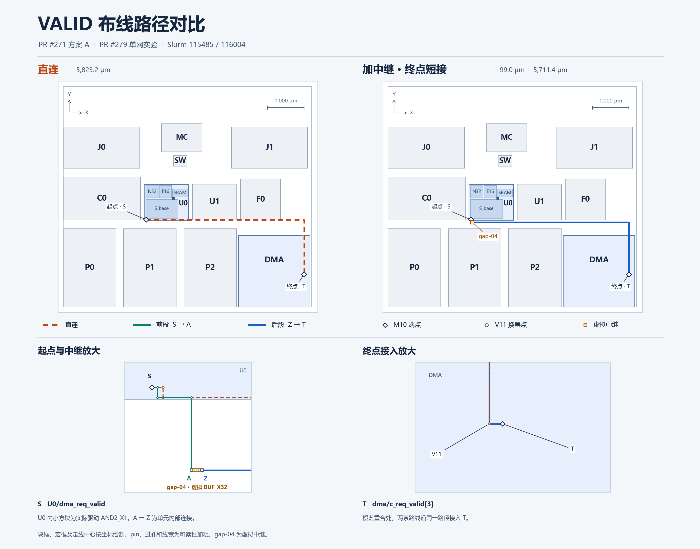

# PR #271 方案 A 的 U0→DMA 单线 VALID 对照

使用 [PR #271](https://github.com/rayggxia-workspace/LLMHardwareDesign/pull/271) 方案 A 的作业 112878 摆位与作业 114252 的 M10 端点。场景中只布 `net-b96c1ab2afde6d594ab09e28`，源为 `U0/dma_req_valid`，汇为 `dma/c_req_valid[3]`。场景保留 M10 接点目录以及原层宽、间距、网格和过孔规则。

## 布线路径对比

图按 #271 方案 A 的坐标绘制。左图为作业 **115485** 的直连，右图为作业 **116004** 的中继路径，沿用虚拟 `gap-04`（`BUF_X32`）。终点放大图中，两条路线在同一位置从 M12 经 V11 换到 M11，横走 2.4 µm 后接入 T（`dma/c_req_valid[3]`）。

## 终点短接复跑

作业 **116004** 保留 #271 方案 A 的摆位、端点、虚拟中继和前段路线，只修改加中继方案在 DMA 终点附近的接入。沿用作业 115485 的 RC 与 STA 模型，复现了直连和原中继路径的 STA 日志。三种走线均通过本实验的独立几何检查，两种中继走线均无电容和转换时间违规。

| 指标 | 直连 | 加中继，原走线 | 加中继，终点短接 |
| --- | ---: | ---: | ---: |
| M11/M12 路线长度 (µm) | 5823.2 | 5836.8 | 5810.4 |
| V11 数量 | 4 | 8 | 6 |
| 从时钟启动到 T 的到达时间 (ps) | 3460.007 | 423.255 | 422.069 |
| 相对 500 ps 接口预算的裕量 (ps) | −2960.007 | +76.744 | +77.931 |

终点短接减少 **26.4 µm** 和 **2 个 V11**。相比原中继路线，信号提前 **1.186 ps**，裕量增加 **1.186 ps**（差值按未舍入数据计算）。相比直连，信号提前 **3037.938 ps**。

| 传播区间 | 原走线长度 (µm) | 短接后长度 (µm) | 原走线延迟 (ps) | 短接后延迟 (ps) |
| --- | ---: | ---: | ---: | ---: |
| 直连 `U0/dma_req_valid → dma/c_req_valid[3]` | 5823.2 | — | 90.581 | — |
| 前段 `U0/dma_req_valid → gap-04/A` | 99.0 | 99.0 | 0.114 | 0.114 |
| 中继单元 `gap-04/A → gap-04/Z` | — | — | 92.049 | 91.595 |
| 后段 `gap-04/Z → dma/c_req_valid[3]` | 5737.8 | 5711.4 | 81.092 | 80.360 |

直连时 `AND2_X1` 的输出负载为 1369.226 fF，超出 60.577 fF 限值，转换时间为 3000.075 ps。原中继方案将源端负载降到 51.954 fF、转换时间降到 117.688 ps，相比直连提前 3036.752 ps。终点短接进一步减少后段负载，降低了后段走线和中继单元的延迟。

## 输入与模型

- 源汇坐标分别为 (2261.295, 2389.670) 和 (6588.095, 897.670) µm。gap-04 处于 P1 与 U0 的间隙，A/Z 中心分别为 (2293.295, 2322.670) 和 (2301.695, 2322.670) µm。
- 端点电气基于 U.Gather 的 DFF_X1 + AND2_X1 输出级、源端本地 AND2 负载，以及 DMA 映射网表中该输入的六个逻辑门输入电容。采用 Nangate45 TT、方案规定 300 MHz、DMA SDC 的 500 ps 输入延时预算。OpenSTA 使用简化单线网表和 M11/M12 的研究 RC（比例 1.5），未接入原底座的完整原生寄生、时钟和 DMA 内部 setup 路径。超载直连的延迟使用库表外推。中继 M10 接点及供电为虚拟，物理落位和下层接入待做。
- 对照先禁用中继布直连，通过本轮 OpenSTA 的电容违规生成与路线散列绑定的反馈。用 PR #259 的默认排序 `(max(d1, d2), d1+d2)` 从 10 个空隙位置取前 8 个候选试布，再用原修复入口比较。搜索的主跑使用 4 倍曼哈顿启发值和通过同一几何判定的长段候选。独立几何检查通过。原版各试了 500,000 与 2,400,000 节点预算，作业 115480 和 115487 均在直连阶段耗尽预算。仅加入长段候选的未加权作业 115484 也耗尽其 80,000 节点预算。

## 工件

作业 115485 在 14 秒内完成，退出码 `0:0`。服务器实验目录为 `/public/home/yuzelu/PingyangHuang/hpy-pr271-one-valid-qLgsHk`，成功试验的路线、SPEF 和 STA 日志在 `fast/`。

作业 116004 复跑用时 9 秒，退出码 `0:0`。服务器目录为 `/public/home/yuzelu/PingyangHuang/hpy-valid-shortcut-Wnlh2c`，其中 `buffered-shortcut.json` 为短接坐标，`buffered_shortcut/sta.log` 为新路线的 OpenSTA 输出。[复跑对比数据](shortcut-sta.json) 包含未舍入时序、几何检查和文件 SHA-256。

- [机器可读结果](summary.json)、[初筛顺序](candidate-order.json)、[直连违规反馈](feedback.json)。
- [直连 OpenSTA 日志](direct/sta.log)、[中继 OpenSTA 日志](buffered/sta.log)、[输入 SHA-256](inputs.sha256) 和 [输出 SHA-256](outputs.sha256)。
- [单线实验脚本](single_valid.py)、[A* 加速配置](weighted.py) 和 [Slurm 启动脚本](run.sh)。在新的复跑目录准备同散列的输入与 Liberty，解包路由器后执行 `sbatch -p c64 -c 2 --job-name=hpy-pr271-one-valid run.sh fast 18000`。路由器来源为 [PR #259](https://github.com/rayggxia-workspace/LLMHardwareDesign/pull/259) 的 `4ebd2a2fc845ccc6a1c17ed1751f208bb5791a8f`，归档 SHA-256 为 `0e9aab51971ef2410bceb2017da8dcb2cd2dcf0df9ca38c322b4e5db1f062a9a`。流程按 [PR #278](https://github.com/rayggxia-workspace/LLMHardwareDesign/pull/278) 执行。
